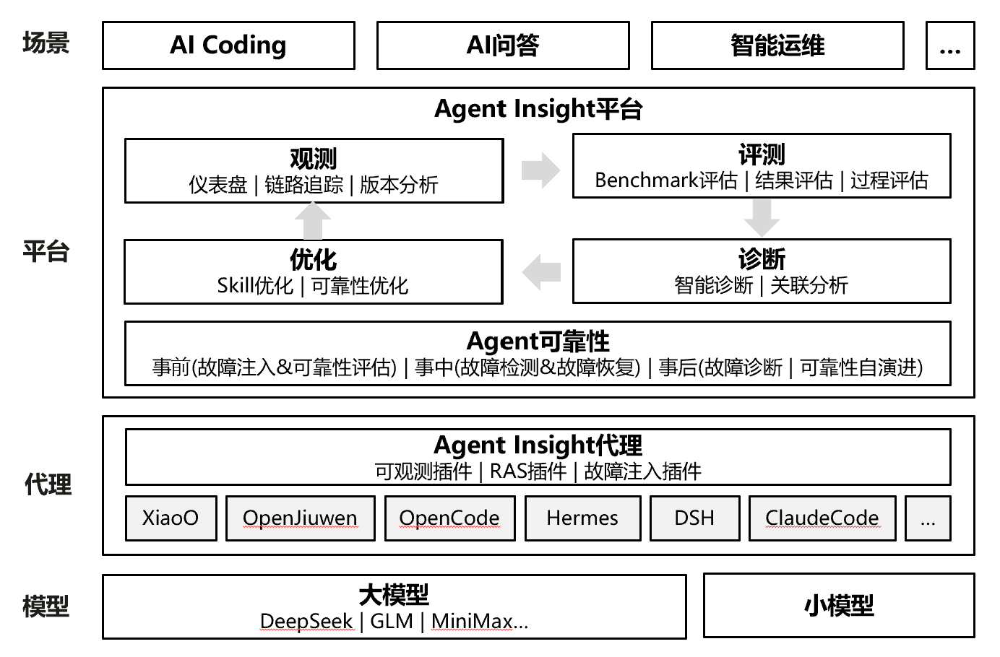

<p align="center">
  <picture>
    <source media="(prefers-color-scheme: dark)" srcset="public/brand/logo-horizontal-dark.svg" />
    
  </picture>
</p>

<p align="center">
  <strong>Observe, evaluate, diagnose, and improve Agent execution.</strong><br/>
  An open-source AgentOps platform for the Agent lifecycle.
</p>

<p align="center">
  <a href="LICENSE"></a>
  <a href="https://nodejs.org/"></a>
  <a href="https://gitcode.com/openJiuwen/agent-insight">Repository</a>
</p>

<p align="center">
  <a href="README.zh.md">简体中文</a> |
  <a href="README_en.md">English</a>
</p>

## Disclaimer

This product serves solely as a workflow orchestration tool and does not embed any AI model capabilities. When users integrate AI models for specific business scenarios, they shall bear full responsibility for compliance obligations under the EU AI Act and other relevant regulatory frameworks.

## Overview

Agent Insight is an open-source AgentOps platform that helps teams understand Agent execution, evaluate results, diagnose failures, and improve Skills using execution data. It brings observability, evaluation, diagnosis, optimization, and reliability workflows into a self-hosted application.

It integrates with multiple Agent platforms through native plugins, hooks, file collectors, or OTLP, depending on the platform. Steps that require model inference use model services configured by the user; Agent Insight does not include an AI model.

## Features

- **Execution tracing**: inspect Agent call trees, execution timelines, tool calls, and model interactions.
- **Evaluation**: run benchmark, result, trajectory, and reliability evaluations with built-in or custom evaluators.
- **Diagnosis**: investigate failures using execution evidence, deterministic checks, and user-configured model services.
- **Skill generation and optimization**: create Skills from user input or documents, manage versions, evaluate changes, and iterate on identified issues.
- **Reliability**: use Agent fault injection, anomaly detection, and recovery workflows to assess and improve behavior.
- **Multiple integrations**: connect supported Agent frameworks using their available collection mechanisms.
- **Self-hosted deployment**: deploy locally or on a server and control where execution data is stored.

## Architecture Overview

The platform has three main parts:

- **Agent integrations** collect execution data through native plugins, hooks, file collectors, or OTLP. Collection paths differ between platforms.
- **Application services** use Next.js, React, and TypeScript to provide the Web dashboard and APIs for tracing, evaluation, diagnosis, Skill generation, and optimization.
- **Data storage** uses Prisma and database adapters to manage execution records and task data. Local SQLite is the default; see the developer guide for other database configurations.

Model-dependent steps call user-configured external services. No AI model is embedded in the platform. See the [developer guide](docs/developer-guide/INDEX.md) for module and API details.

<p align="center">
  
</p>

## Supported Platforms

| Agent platform | Collection method |
|:---------------|:------------------|
| OpenCode | Native plugin |
| Claude Code | OTLP |
| Qwen Code | Hook collector |
| QwenPaw | Hook plugin |
| Hermes | Native plugin |
| Trae IDE | VS Code extension |
| JiuwenSwarm | OTLP |
| LangChain / LangGraph | OTLP |
| LlamaIndex | OTLP |
| OpenClaw | OTLP |
| Codex | Hook collector |
| Pi Agent | Hook collector |
| Qoder CN | Native plugin |
| DeepSeek Harness | Native plugin |
| xiaoO | Hook collector |
| CodeAgent | OTLP |
| AcTrail | OTLP |
| WorkBuddy | File collector |

## Quick Start

### 1. Install and start the server

For a local Node.js deployment, use Node.js 20.9 or later and an available port, normally `3000`. Check any additional runtime requirements reported by the dependencies for optional features.

**npm installation**

```bash
npx agent-insight install
```

The installer starts the platform and guides you through Agent integration. You can also manage the service with:

```bash
npx agent-insight start
npx agent-insight status
npx agent-insight logs
npx agent-insight stop --port 3000
```

**Installation from source**

```bash
git clone https://gitcode.com/openJiuwen/agent-insight.git
cd agent-insight
npm install

# Optional: build the Trae IDE collector extension.
(cd scripts/trae-collector && npm install && npm run build)

# Start the service from the repository root.
bash scripts/start.sh
```

For development, use `bash scripts/develop_start.sh`. Stop a source installation with `bash scripts/stop.sh`.

**Docker deployment**

```bash
docker pull karaggagent/agent-insight:latest
mkdir -p ~/.agent-insight/data
chmod -R 777 ~/.agent-insight

docker run -d \
  --name agent-insight \
  --restart unless-stopped \
  -p 3000:3000 \
  -v ~/.agent-insight:/data/agent-insight \
  karaggagent/agent-insight:latest
```

Use a fixed published image tag when you need a repeatable deployment. Keep the mounted data directory when upgrading. See the [deployment guide](docs/user-guide/quickstart.md) for offline images, mounting source code, and troubleshooting.

### 2. Open the dashboard and connect an Agent

Open `http://localhost:3000`. In the default standalone login mode, sign in with your email address; deployments configured for organization authentication use their configured login flow.

In **Installation Guide**, select your Agent platform and run the generated command on the machine or container where that Agent actually runs. A server running in Docker does not automatically configure an Agent on the host.

For OpenCode, the integration also installs the Agent RAS in-process plugin. You can install or update RAS separately with `npx agent-insight install-ras`.

### 3. Run a task and inspect its execution

Run a small task in the connected Agent, then open the execution list in Agent Insight and inspect the trace. The default source/npm data directory is `~/.agent-insight/data`, including `witty_insight.db`; the Docker mount above preserves the equivalent data outside the container.

## Guided Workflow: Generate, Evaluate, and Optimize

1. **Configure a model**: register the external model service needed by generation, evaluation, or optimization workflows.
2. **Generate a Skill**: use the Skill workspace to describe a task or supply a document. Inspect and save the generated content.
3. **Evaluate**: configure a dataset and evaluators, run the task, and inspect execution details and evaluation results.
4. **Optimize**: select an existing Skill and use the findings to create an improved version. Re-run the same task or dataset to compare behavior.

Start with the [built-in example walkthrough](docs/user-guide/example-walkthrough.md) for a concrete workflow. See the [Chinese README](README.zh.md) for the longer illustrated walkthrough.

## Documentation

| Path | Contents |
|:-----|:---------|
| [User guide](docs/user-guide/) | Installation, example walkthrough, concepts, and FAQ |
| [Developer guide](docs/developer-guide/INDEX.md) | Architecture, modules, APIs, and development conventions |
| [Agent RAS](docs/agent-ras/) | Reliability, anomaly detection, and recovery |
| [Agent fault injection](docs/agent-fault-injection/) | Fault injection and collection |
| [Reusable snippets](docs/snippets/) | SDK installation and environment setup |
| [Q&A](docs/qa.md) | Installation, integrations, evaluation, and troubleshooting |
| [Skill generation](docs/skill-generation-principle-and-pipeline.md) | Generation pipeline and capability boundaries |

## Contributing

Contributions through bug reports, documentation, tests, and code are welcome.

1. Open an [issue](https://gitcode.com/openJiuwen/agent-insight/issues) with the version, reproduction steps, and sanitized logs. Discuss larger feature changes before implementing them.
2. Before contributing code, sign the [openJiuwen CLA](https://clasign.osinfra.cn/sign/68ee0908765718ad08bab9ee) and read the [community contribution guide](https://gitcode.com/openJiuwen/community/blob/main/README.md) and this repository's [AGENTS.md](AGENTS.md).
3. Fork the repository, create a working branch, make the change, update the relevant documentation, and run `npm run test`. Submit a PR to `openJiuwen/agent-insight` describing the purpose and validation results.

## Open-source License

Agent Insight is licensed under [Apache-2.0](LICENSE). The original MIT copyright and permission notice is retained in [LICENSE-MIT-Historical](LICENSE-MIT-Historical) for historical code.

Independently licensed components retain their own terms. See [Third_Party_Open_Source_Software_Notice.txt](Third_Party_Open_Source_Software_Notice.txt) and the [license materials](licenses/INDEX.txt) for dependency versions, notices, license texts, and source references.
