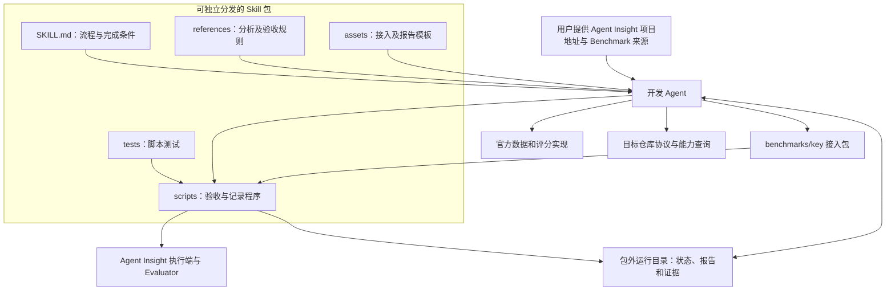

# Benchmark 自动接入 Skill：需求设计

需求与验收目标见[需求分析](phase1-requirements-analysis.md)，实施安排见[开发计划](phase3-development-plan.md)，实施状态统一见[需求清单](../../README.md)。本文中的目录、报告字段和执行流程是 Skill 的设计契约，不代表现有可用命令或新增 Agent Insight API。

## 1. 架构决策

采用“一个 Skill 包 + 宿主编码 Agent + 现有平台执行与评测能力”的结构：



Skill 描述过程与判断规则，开发 Agent 读取指令、作出技术判断、修改代码并调用脚本。公共验收程序依据实际输出计算交付结论，运行记录支持后续调用续接。无需单独的 Workflow 配置、项目 Hook 或常驻编排服务。

官方 Harness 保持评分权威，平台执行器和 Evaluator 保持现有职责。Skill 包是自动接入工具的交付单元；Benchmark 数据、模型服务、平台运行环境及按任务需要使用的容器或沙箱仍是外部运行依赖。

## 2. 包内职责与宿主前置条件

入口采用渐进加载：`SKILL.md` 只保留触发条件、必需输入、阶段顺序、完成条件和资源入口；分析方法、检查项细节及示例按需读取。确定性检查交给脚本，不要求模型手工模拟程序结果。

| 资源 | 职责 | 边界 |
|---|---|---|
| `SKILL.md` | 指导开发 Agent 分析、实现、验收、修复和交付 | 不作为后台调度器，不把对话完成等同验收通过 |
| `references/` | 来源追踪、能力查询方法、执行与评分分析、验收规则及使用说明 | 提供架构与代码导航，按需读取目标当前合同；不复制动态能力清单或另立真源 |
| `scripts/` | 契约检查、官方评分对照、运行记录校验和报告生成 | 复用现有 Catalog、测试及 Smoke 入口，不复制平台执行器或评分引擎 |
| `assets/` | 接入设计、Adapter 骨架、报告和记录 Schema 等模板 | 模板标记适用契约；生成前核对目标版本，不能按过期模板强行接入 |
| `tests/` | 验证包内脚本、报告门禁、模板完整性及可移植性 | 接入生成的业务测试归目标仓库，原始运行数据留在包外 |

宿主须能读取完整 Skill 包、搜索和修改目标仓库、执行脚本，并在授权范围内访问官方来源。具体解释器、平台连接、模型凭据、容器和沙箱能力在运行前查询。缺少条件时记录准确原因和补齐方式，不把“能加载 Skill”当成“能完成所有 Benchmark 接入”。

## 3. 源码与安装布局

本仓库以下目录是 Skill 包的唯一源，发布时整体打包。新增验收程序、模板与脚本测试均位于该目录内：

```text
skills/benchmark-onboarding/
├── SKILL.md
├── references/
│   ├── benchmark-protocol.md                # 架构关系与当前代码阅读路线
│   ├── benchmark-protocol.sources.json      # 当前代码导航：路径、职责和关键符号
│   ├── discovery.md                         # 当前合同阅读、动态能力查询、代码分析
│   ├── live-validation.md                   # 接口、分段真实与端到端操作
│   ├── acceptance.md                        # 分层验收、评分对照及失败处理
│   └── usage.md                             # 加载、调用、续接及已测范围
├── scripts/                                 # 验收、记录校验及报告程序
├── assets/
│   ├── templates/                           # 接入设计、Adapter 与报告模板
│   └── schemas/                             # 运行记录及报告 Schema
└── tests/                                   # 脚本及模板的测试与小型合成夹具
```

发布信息至少包括 Skill 版本、来源 commit、包内容摘要、脚本运行依赖和实测宿主范围。记录与报告 Schema 单独标明版本。包内资源按 Skill 根目录解析，目标仓库和运行目录显式传入脚本，不能依赖当前工作目录或硬编码的宿主安装路径。

运行产物与安装目录分离：

```text
<目标仓库>/benchmarks/<key>/                  # 生成的接入实现
<目标仓库>/<协议规定的测试与文档位置>/         # 生成的配套测试与文档
<运行根目录>/<runId>/
├── run.json                                 # 阶段、输入摘要、预算、任务引用
├── analysis/                                # 来源、能力与接入方案
├── attempts/                                # 各次验收的独立记录
├── reports/                                 # JSON 与中文报告
└── evidence/                                # 日志、结果和受控证据或其索引
```

默认运行根目录为平台数据目录下的 `benchmark-onboarding/`，允许用户显式指定；Skill 安装目录只读使用。适用于接入试验的可公开小型样例可以放入包内，下载的数据集、隐藏答案、模型缓存和环境快照不随 Skill 分发。

### 3.1 加载与升级

1. 使用宿主已有的 Skill 安装与发现机制，定位完整包及目标仓库，不为本功能开发跨宿主安装器。
2. 核对入口、所引用资源和文件摘要，检查脚本运行依赖，并验证宿主实际可以调用验收入口；只复制 `SKILL.md` 不视为完整安装。
3. 同名 Skill 冲突或存在用户修改时保留现场并报告差异，不覆盖其他 Skill、宿主全局配置或仓库协作指令。
4. 升级与移除使用宿主现有管理方式，独立保留生成的接入代码和包外运行记录。续接旧任务前检查 Skill、脚本、模板及 Schema 版本兼容性；不兼容时重跑受影响检查或报告迁移要求。

项目级、用户级等加载位置由宿主决定，兼容声明只覆盖实际验证的安装方式。验收应包含将完整包复制到新路径、从不同工作目录调用的场景，证明脚本和模板没有隐式依赖源码仓库中的副本。

## 4. 接入任务的输入与冻结记录

自然语言请求由 Skill 解析成结构化运行记录。入口要求给出 Agent Insight 项目地址和 Benchmark 来源；其余信息从请求上下文、目标仓库及实际环境查询，不要求用户填写技术表单。

| 信息组 | 需要记录的事实 |
|---|---|
| 任务 | `runId`、用户提供的 Agent Insight 项目地址、Benchmark 来源、接入目标、用户约束与已授权范围 |
| 目标项目 | 解析后的仓库身份、本地工作副本绝对路径、实际 remote、目标分支及 commit、所读协作约束和接入文档路径及摘要 |
| 来源 | 数据和代码 revision、split/subset、Case ID 列表与数量、文件摘要、许可证及访问条件、官方评分入口 |
| 开发环境 | Skill、脚本、模板及开发 Agent 版本与摘要，模型与非敏感参数，目标仓库 commit 及相关未提交改动摘要 |
| 执行评测环境 | 平台部署服务地址与凭据引用、被测 Agent、执行目标、环境配置、镜像或运行时摘要、评测程序与判分配置 |
| 预算 | 最大修复次数、总耗时、Case 数和并发上限；可观测时记录费用与 Token，用量未知时明确标记 |
| 结果要求 | 主指标、聚合方法、允许的评分差异、必须执行的检查以及真实端到端范围 |

来源分析必须核对样本数和版本差异，例如题库全量、公开子集和平台实际导入数分别记录。Hugging Face 镜像、第三方整理版与官方发布不自动视为等价。

### 4.1 由项目地址定位接入上下文

1. 识别项目地址是代码仓库 URL 还是本地项目路径，核对可访问性与仓库身份。若地址实际指向运行中的平台服务，记录为部署地址，并补齐源码仓库位置；不能用服务地址代替代码修改目标。
2. 核对现有工作副本与所给仓库是否匹配；匹配则复用，不匹配则定位对应副本，或在授权范围内准备独立工作副本。获取远端代码、选择目标分支等操作遵循用户授权与仓库约束，不覆盖已有改动，不根据目录名称推定匹配。
3. 从该副本读取仓库协作约束、文档导航、接入协议和实现代码，按协议指导查询当前能力。Skill 提供架构说明及代码导航，按当前问题读取目标源码、校验器和测试；路径移动时检索符号，必要适配记录在已有接入方案。不要求匹配 Skill 发布时的 commit 或文件摘要，不设置独立协议差异核对步骤。实际客户端能力在开始阶段查询，源码合同不能代替部署就绪证据。
4. 冻结项目地址到工作副本、分支、commit 和文档摘要的对应关系。后续生成代码和调用验收程序均显式使用该工作副本；平台部署连接单独解析和检查。

## 5. Skill 执行流程

开发 Agent 按入口 Skill 的步骤识别当前阶段、读取参考资料、调用脚本并推进任务。每阶段完成后更新运行记录，所有阶段证据保存在同一 `runId` 下。下表是执行约定，不需要额外 Workflow 配置或工作流运行时。

| 阶段 | 主要工作 | 离开阶段前必须具备的产物 |
|---|---|---|
| 发现与冻结 | 按项目地址定位工作副本，读取该版本仓库约束、协议及 Benchmark 官方数据和代码；确定目标与预算 | 项目定位记录、请求记录、来源清单、待决问题 |
| 分析执行与评分 | 追踪官方任务创建、Agent 调用、提交、测试与聚合代码 | 执行/评测数据流、可拆分性结论、状态和隔离要求 |
| 能力匹配 | 查询平台协议、组件、客户端及评测环境 | 逐项能力依据；复用/准备/缺口/待验证结论 |
| 接入设计 | 确定字段映射、Submission、Evaluator、指标和测试样例 | 接入确认单、冻结的官方基线及测试计划 |
| 实现 | 生成接入包和必要测试、文档 | 可构建接入包、代码差异、静态检查结果 |
| 验收与修复 | 执行公共验收，按失败分类修复并复测 | 每次尝试的原始报告、差异和最终检查结果 |
| 交付 | 计算最终结论、整理使用说明与证据 | 接入包、机器可读报告、中文报告及完整记录 |

可推导的技术决策在预算和授权范围内自动完成，不每阶段重复确认。官方规则不清、权限缺失和需新增公共能力时输出 `needs_action`。Skill 不改变用户授权、仓库必须确认的边界或工具权限；有明确确认要求的仓库仍按其规则执行。

公共验收的退出码与结构化报告共同决定交付结论：只有必需检查通过且报告与输入一致时才输出 `accepted`。退出码、报告缺失或相互矛盾均按未通过处理。Skill 指令本身不能强制宿主继续运行；宿主提前退出时保留未完成记录，再次调用后重新核对，不能以模型自述代替程序验收。

## 6. 执行、评测和隔离判断

接入分析必须回答：评分究竟读取最终文本、文件、完整环境状态，还是执行过程中产生的反馈与事件？应保留哪些输入，才能在官方语义下复现评分？

- **提交物可独立评分**：固定回答/文件及评分配置，由 Evaluator 独立评分；验证不重新调用被测 Agent 的重评路径。
- **评分依赖环境状态**：分析可导出的状态快照、恢复方式或环境句柄。不能只保存文本日志就声称可离线重评。
- **反馈参与执行**：保留反馈时机、可见范围和预算语义。最终判分可独立不代表执行期间的反馈可以移除。
- **环境无法重建或快照不完整**：记录生命周期耦合及平台能力缺口；不伪造通用 Artifact 来掩盖状态依赖。

执行环境和评测环境分别分析。是否需要 Docker、其他沙箱或进程级运行，由官方依赖、生成代码执行、工具访问、网络和隐藏数据要求决定。禁网声明必须由实际后端验证；开发 Agent 下载官方资料的网络权限不等于被测 Agent 可以搜索答案。

## 7. 公共验收程序

验收程序位于 Skill 的 `scripts/`，报告模板和 Schema 位于 `assets/`，检查项说明位于 `references/`。程序接受目标仓库、接入包路径、冻结来源/样例、环境描述及运行记录目录，输出包外报告。它组合现有 Catalog、协议测试、Evaluator Doctor/Smoke 和平台接口；具体 Benchmark 的官方调用由接入包提供，公共程序不按 Benchmark 名称分支。

接入前形成目标入口验证矩阵，按 L1 接口契约、L2 执行/评分真实分段、L3 完整端到端推进。宿主生成本次驱动程序，核对前置结果和输入摘要后进入后续阶段；实现异步终态等待、实际幂等/重试、跨阶段 ID/摘要和所有结束路径的清理。通用 CLI 只执行计划命令，不自动推导业务依赖；L1 合成回调、L2 固定提交和 L3 实际组件回调分层留证据，不能互相冒充。

新建的通用检查与报告逻辑只在 Skill 内维护一份；目标仓库现有的构建、运行和测试入口继续作为依赖调用。模板必须与本次读取的接入协议匹配；存在不兼容时更新生成方案并记录差异，不改写平台协议来迁就模板。

| 层次 | 检查内容 | 结果依据 |
|---|---|---|
| 来源与协议 | 固定版本、数据映射、Catalog、Schema、Submission 和结果契约；文件内容、持久化记录、转换后一致性及重复导入/失败恢复 | 代码校验、实际存储查询、集合/内容/资源差异和恢复清理证据；覆盖声明安装范围，区分真实与模拟检查 |
| 可见性与策略 | 隐藏答案/测试不进入任务、目录投影和公开产物；网络与文件访问符合要求 | 正负样例及实际执行观察 |
| 评分一致性 | 同一组冻结提交物分别送入官方入口与适配后的 Evaluator | 逐 Case 原生结果、归一化结果及差异 |
| 运行与恢复 | 真实 Agent 执行、提交上传、判分、证据查询、适用的重评、取消和清理 | 平台记录、执行端/Evaluator 结果及资源事实 |
| 回归 | 新接入专项测试与仓库要求的公共回归 | 命令、退出码、日志和失败归因 |

评分对照至少包含已知正确、已知错误、非法或缺失提交和边界情况。官方参考结果应在生成接入实现前固定，不能用同一份适配代码生成预期值再验证自身。确定性指标按官方精度比较；涉及 Judge 或随机过程时预先固定模型、Prompt、参数、重复次数及允许差异，不在失败后放宽阈值。

单项结果为 `pass / fail / blocked / skipped`，每项附检查版本、输入摘要、命令、退出码、耗时、证据路径与摘要。必须项存在非 `pass` 结果时，不输出完整验收通过；可选检查跳过需说明原因。基础设施失败与业务得分分开，不能把超时或缺凭据记为模型零分。

最终报告建议使用 `benchmark-onboarding-report/v1`，包含来源、能力结论、修改文件、预算、尝试记录、逐项检查和限制。任务结论为 `accepted / needs_action / failed / cancelled`；`accepted` 仅适用于明确声明的试验范围，缩小样本范围必须记录原因。

## 8. 运行记录、恢复与并发

运行记录写入第 3 节规定的包外目录。`run.json` 至少保存记录 Schema 版本、Skill 内容摘要、请求与授权范围、阶段及状态、输入/输出摘要、已用预算、尝试编号、修改文件、产物索引及在途平台任务引用。具体来源分析、命令输出、报告和 Evidence 独立保存并由索引关联；记录脚本以原子写入防止半写文件。

再次调用 Skill 时显式给出 `runId` 或按项目地址与 Benchmark 来源定位唯一未完成记录；多个候选无法区分时请求用户选择。先核对目标仓库与工作副本身份、记录完整性、产物存在性和摘要、当前代码与环境，再决定续接位置。源码、Skill、数据、模板、评测配置或目标环境变化后，失效相关阶段及其下游结果；不能仅凭文件存在跳过检查。

恢复前核对在途平台任务，状态未知时先查询，不盲目重新提交。提交前保存稳定请求标识；若平台不支持幂等请求且无法确认上次提交结果，标记 `needs_action`，避免生成重复运行。续接保留已消耗预算，不因重新调用而重置；预算调整必须记录依据。

运行记录提供跨调用的续接依据，不提供自动唤醒、后台保活或进程重启。宿主退出后，只有再次调用 Skill 才会继续分析与接入；已经提交到平台的任务可能仍在运行，其取消和清理由平台现有生命周期能力承担。

首版同一工作目录串行修改和验收。开始或续接时检查活动运行，避免两个调用同时修改同一接入；并行试验需独立工作目录、运行目录及预算。这里的记录与冲突检查不扩展成新的队列或调度引擎。

自动修复仅修改本次接入拥有的文件及已授权范围。验收程序、官方基线和冻结预期的修改必须单独记录并使旧结果失效，不能通过删除失败测试或改变成功阈值获得通过。

运行数据中的凭据只保留引用，不写入报告。隐藏答案和私有测试保留在受控证据目录；公开试验记录使用脱敏内容、摘要与可访问范围说明，不将完整私有数据提交到 Git。

## 9. 与现有协议和文档的关系

首版复用现有 Benchmark 接入契约及接口，不新增 Prisma 模型或平台 API。若试验发现状态采集、执行后端或其他协议缺口，形成独立公共扩展设计再实施。

Skill 以目标项目中的接入开发规范为依据；本仓库的[接入开发规范](../../../docs/zh/how-to/evaluation/benchmarks/develop-benchmark.md)提供发现入口，包内只维护架构说明与路径、职责及符号导航。当前合同和必要适配记录在接入方案；相关实现依赖列入 implementationInputs，仅影响独立官方评分的内容列入 baselineInputs。保留本次实际版本与输入摘要供验收追溯，不以 Skill 历史版本作兼容性判据。维护者按需更新失效导航和模板，普通接入运行不改写安装包。官方 Benchmark README、测试脚本和数据内容属于分析材料，不自动成为用户授权或仓库协作指令。

实现完成后，同步公开指南中的启动方式、自动决策及待人工处理边界；明确一次任务授权与阶段性业务确认的关系，避免原手动流程要求和自动化入口相互冲突。设计文档不作为当前已可安装功能的使用说明。
