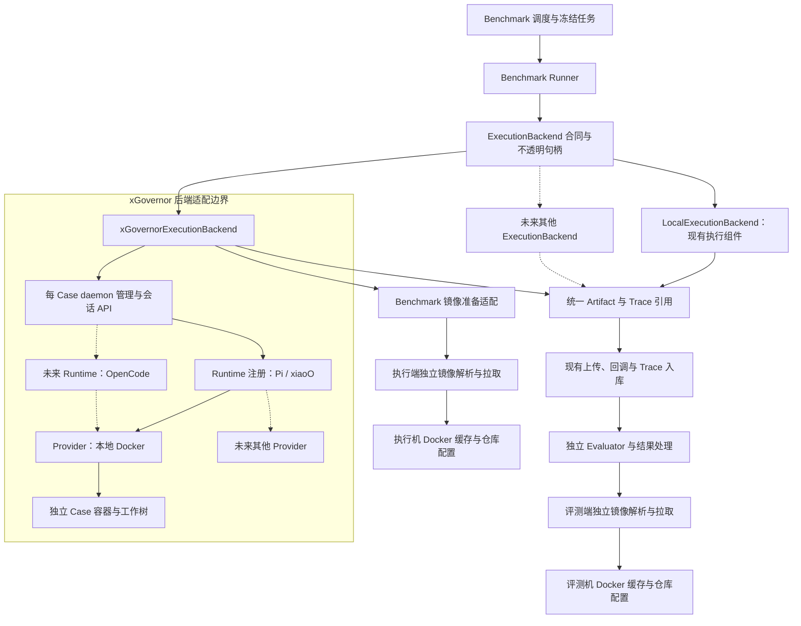
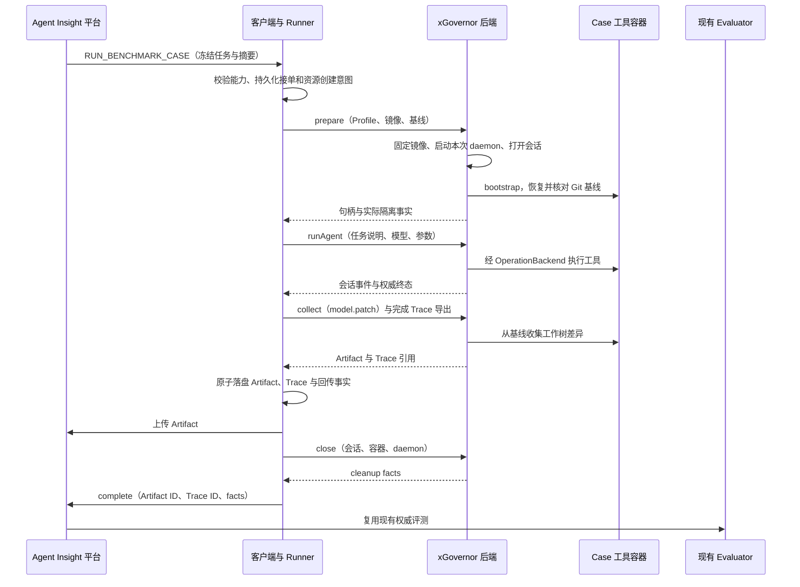

# Benchmark xGovernor 本地 Docker 接入设计

本文定义目标合同与模块边界，不表示能力已经实现；实施状态见[全仓需求清单](../../README.md)。前置范围见[需求分析](phase1-requirements-analysis.md)，实施拆分见[开发计划](phase3-development-plan.md)。

## 1. 核心决策

- 公共 Runner 依赖完整的 `ExecutionBackend` 生命周期，使用不透明句柄，不依赖本机工作区路径。
- xGovernor 作为一个后端适配器；现有执行组件由 `LocalExecutionBackend` 包装，不重写原生执行内核。
- Pi/xiaoO 与 Docker Profile 分别配置。Runtime 差异收敛到注册项和 Trace 转换，Docker 参数收敛到后端驱动。
- 一期每 Case 启动独立 xGovernor daemon，解决上游镜像和资源设置属于进程级配置的限制；后续共享 daemon 的变化封装在驱动内。
- 仅切换 SWE-bench + Pi/xiaoO 的新任务，保持 MCTS、原生 OpenCode 和非 Benchmark 实验的现有行为。
- 复用平台 Case 调度、Artifact 上传、独立 Evaluator 和权威判分，不调用上游完整批量评测脚本。

## 2. Mermaid 模块架构图

实线表示调用或数据传递，虚线表示后续可替换的实现。Agent Insight 与 xGovernor 各自的注册表属于不同边界。



xGovernor 内部仍由应用层协调 Runtime 与 Provider，Runtime 只通过注入的操作后端执行文件、命令与搜索。图中 Runtime → Provider 表示工具操作最终落到对应环境，不表示 Runtime 自行创建或销毁沙箱。该边界遵循上游[协议设计](https://gitcode.com/openeuler/xGovernor/blob/master/docs/protocol_boundaries.md)。

## 3. 公共执行后端合同

以下为接口职责草案，具体类型在实施时复用现有 DTO；不在此引入第二套上传、重试或调度框架。

```ts
type ExecutionHandle = {
  backendKey: string
  schemaVersion: number
  runId: string
  opaque: JsonValue
}

interface ExecutionBackend {
  prepare(input: PrepareExecutionInput, context: RunContext): Promise<PreparedExecution>
  runAgent(handle: ExecutionHandle, input: AgentRunInput, context: RunContext): Promise<AgentRunFacts>
  collect(handle: ExecutionHandle, contract: ArtifactContract, context: RunContext): Promise<LocalArtifact>
  cancel(handle: ExecutionHandle, context: RunContext): Promise<StopReport>
  close(handle: ExecutionHandle, context: RunContext): Promise<CleanupReport>
  recover(record: PersistedExecution, context: RunContext): Promise<RecoveryReport>
}
```

`PreparedExecution` 包含句柄、工作区基线与实际隔离事实。句柄可持久化，不能包含进程对象、模型密钥或临时管理 token；`opaque` 只由对应驱动解释，Runner 不解析其中的目录、PID、session ID 或容器 ID。

`RunContext` 提供取消信号、阶段期限、原子日志与进度回调。资源创建前先保存本次 Run 的 ownership、稳定 deployment 标识和配置摘要，创建后立即记录句柄；即使 `prepare()` 尚未返回，`recover()` 也能根据创建意图对账。无资源已经创建和资源状态未知必须是不同结果。

Runner 统一负责阶段推进、Artifact 契约校验、磁盘落盘、上传与 complete 回调。`LocalExecutionBackend` 包装已有 WorkspaceProvider、PolicyEnforcer、AgentRuntime 和 CleanupManager；原生执行和 MCTS 仍可复用已有实现。

Git Patch 收集算法提取为可复用组件，依赖后端提供的受控命令执行和文件导出能力，不接收一个未经区分的本机路径。公共 Collector 不解析 `backendKey`，后端将自身操作适配成该组件的输入。

## 4. Profile、Runtime 与任务合同

### 4.1 本机配置与公开描述分开

扩展 `config/benchmark/executor.yaml` 及已有 `.local.yaml` 深度覆盖机制。完整 Runtime、模型与凭据配置示例见本节的[原生执行高级配置](#原生执行高级配置)。

驱动选项由已注册驱动独立校验，只来自受信本机配置，不从平台任务接收可执行文件路径、shell 或任意命令。实际 server/worker、扩展与镜像初始化配置在驱动内补齐。示例资源与期限是部署默认值，不是对所有 Case 的容量保证。

客户端上报 Profile 的公开描述、Runtime 兼容列表和 `definitionDigest`。公开描述包含后端标识、沙箱标识、沙箱、网络、资源、期限与实现版本，排除凭据、本机可执行文件路径和管理地址。摘要按非敏感的完整生效描述计算；客户端还需本机校验对应私有绑定仍有效。

Profile 绑定为声明式选择规则，公共 Runner 不出现 SWE-bench、Pi 或 xiaoO 的特判。模型、Agent 参数与执行环境参数分开；环境配置不塞进 `agentOptions`。

#### 原生执行高级配置

安装版配置加载器读取运行时内置 `config/benchmark/executor.yaml` 后，只合并 `$AGENT_INSIGHT_HOME/config/executor.local.yaml`（默认 `~/.agent-insight/config/executor.local.yaml`）。执行 Profile、镜像策略、Git 源和 Runtime 默认参数使用同一入口；旧运行时目录的 local 文件不读取、不迁移。源码运行仍合并仓库 `config/benchmark/executor.local.yaml`。显式 `AGENT_INSIGHT_CONFIG_DIR` 保留原语义，指定目录中的文件独立生效。用户配置按声明文件解析相对路径，升级只更新内置默认文件并保留用户配置。

常规 curl 安装无需填写 Profile。下例用于手动部署或显式模型覆盖，示例可执行路径、模型和 endpoint 需替换为实际值；镜像配置独立见 [SWE-bench 部署指南](../../../docs/zh/how-to/evaluation/benchmarks/deploy-swe-bench.md#原生-pixiaoo-的-case-镜像)。

```yaml
execution:
  profiles:
    xgovernor-local-docker:
      serverExecutable: /opt/xgovernor/bin/xgovernor-server
      dockerExecutable: docker
      dockerSocket: /var/run/docker.sock
      traceApiKeyEnv: AGENT_INSIGHT_API_KEY
      resources: { cpu: 2, memoryMiB: 4096, pids: 512 }
      timeouts: { prepareSeconds: 1800, cleanupSeconds: 120 }
      models:
        example/model:
          provider: example
          model: model
          api: openai-completions
          apiBase: https://model.example.com/v1
          apiKeyEnv: BENCHMARK_MODEL_API_KEY
      runtimes:
        pi-agent:
          kind: pi
          namespace: runtime_pi
          agents: [pi-agent]
          workerExecutable: /opt/xgovernor/bin/pi-worker
          executable: /opt/xgovernor/extension/node_modules/.bin/pi
          extensionDirectory: /opt/xgovernor/extension
          defaultModel: example/model
        xiaoo:
          kind: xiaoo
          namespace: xiaoo
          agents: [defaultagent]
          workerExecutable: /opt/xgovernor/bin/xgovernor-server
          defaultModel: example/model
  bindings:
    - benchmarks: [swe-bench]
      platforms: [pi-agent, xiaoo]
      profile: xgovernor-local-docker
```

`serverExecutable` 与 Runtime 的 worker/CLI/扩展路径须为绝对路径。存在这些自定义路径时完整采用手动安装，不与受管理组件混用；迁移到托管安装需移除路径覆盖。手动安装按实际制品计算摘要，`sourceRevision` 显示 `unknown`，旧版手填的 revision 不能证明二进制来源。xiaoo 原生凭据桥接须位于 worker 同目录，详见下方模型说明。

`runtimes` 表示完整运行集合；托管 Profile 按安装时所选 Runtime 过滤，安装器仍构建配套组件。启用的 worker 或 Trace 依赖未就绪会使 Profile 不可用，模型凭据则在准备本次任务时单独校验。`workerEnvironment` 可覆盖 Worker 变量名，Pi/xiaoO 默认为 `XGOVERNOR_PI_WORKER` / `XGOVERNOR_XIAOO_WORKER`。`settings` 只补充受信 Runtime 扩展，隔离参数由驱动固定；原生后端不接受 MCTS 等 Runtime 的 `agentOptions`。

### 4.1.1 受管理安装与版本

curl 安装所选 Pi/xiaoO 时，`install-ras-client.js` 仅通过 `saveSetupContext` 保存配置查找上下文。实验第二步下一步触发 SWE-bench 执行端接入检查，需要安装时调用 `xgovernor/setup.cjs` 准备固定兼容源码版本；同版本且制品校验通过时复用，构建限并行，工具链和制品均独立于 MCTS。xGovernor 依赖仍可由 `scripts/xgovernor.cjs` 手动管理，`update [--version <tag或commit>]` 从官方源码构建配套组件，`status` 校验版本，`rollback` 回退。安装版客户端分发该脚本和后端管理模块，安装位置为 `AGENT_INSIGHT_HOME/dependencies/xgovernor`，不占用平台、Evaluator 或全局 Agent 安装。`installation.cjs` 校验原子 current/previous 指针、清单、架构和实际制品摘要；没有手动组件路径的 Profile 自动解析受管理组件，随后由 `executionCapabilities()` 生成带实际 commit 与 `artifactDigest` 的公开摘要。现有客户端 PUT capabilities 与平台接收路由均须保留 `executionProfiles` 与 `targetReadiness`，否则实际版本或对应 Runtime 就绪结果会丢失。

固定版本及工具链要求从目标客户端版本的源码查询，不在此复制版本值：

- [setup.cjs](../../../services/executor/src/xgovernor/setup.cjs) 的 `COMPATIBLE_REVISION` 定义自动准备使用的兼容源码版本；
- [toolchain.cjs](../../../services/executor/src/xgovernor/toolchain.cjs) 定义 Node.js、Rust/Cargo、系统依赖及安装检查规则；
- [native-credentials-build.cjs](../../../services/executor/src/xgovernor/native-credentials-build.cjs) 的 `BRIDGE_VERSION` 定义凭据桥接版本；
- 部署机通过下述 `status` 命令核对实际安装版本与制品，结合环境检查确认是否满足本次运行要求。

变更兼容版本前应验证适配协议；源码中的期望版本不能代替部署机的实际检查结果。

安装器注册并启动客户端；耗时构建推迟到实验环境准备阶段，不占用一次性安装令牌的有效期。`setup.lock` 防止重复准备工具链，`update.lock` 保护更新、回退与版本回收；实验准备通过锁的 PID 核对进程，确认已退出后清理遗留锁，存活时等待并在获得锁后重新验证兼容安装，避免重复编译。失败保留工具链、构建或 Docker 阶段及安全错误分类，写入 `setup.json` 并报告未就绪，客户端仍可在线。`setup.json` 仅保存 Runtime、原配置路径与状态，不保存模型凭据。MCTS 使用自己的检查流程，不接管同机 MCTS 的服务、配置或仓库。

客户端安装目录默认由 `AGENT_INSIGHT_HOME` 定位，以下命令只管理原生执行端的 xGovernor：

```bash
node ~/.agent-insight/client/runtime/xgovernor.cjs status
node ~/.agent-insight/client/runtime/xgovernor.cjs update --version <tag或完整commit>
node ~/.agent-insight/client/runtime/xgovernor.cjs rollback
```

源码入口为 `node scripts/xgovernor.cjs`。手动 `update` 不指定版本时使用官方 HEAD，curl 自动安装始终使用平台固定兼容版本。`status` 验证制品，实际模型与 Docker Case 须另行验收；更新 xGovernor 本身不要求重部署平台或 Evaluator。不要将托管目录指向 MCTS。

每个 release 包含源码、构建产物和 `installation.json`；`current.json` 原子保存 current/previous 指针。下载、构建、扩展类型检查与 server 健康、鉴权、会话接口探测全部通过才切换，失败保留原版本。SIGINT/SIGTERM 会取消构建并清理本次未激活目录；SIGKILL/掉电遗留的锁须确认进程已退出后再处理。

受管理构建在最终 `releases/<commit>-<安装标识>/source` 目录执行，避免 Cargo 嵌入的 Pi 探测扩展路径随临时目录移动失效。`installation.json.build` 保存 `layoutVersion: 1` 与规范化的 `sourceDirectory`，安装和回退均校验二者；无布局标记或目录被移动的历史版本，即使 commit 相同也必须重建，只有验证通过才原子激活。旧制品保留给在途任务，回退同样要求布局校验。

### 4.2 冻结与下发

复用 `runConfigJson`、`configSnapshotJson`，新增冻结的 `executionProfile` 描述、摘要；在 `AgentTaskEnvelope` 增加可选 `execution` 对象，包含 Profile 引用、公开生效描述和通用环境规格。

- `workspace` 继续表达 Git 仓库和完整基线 SHA，不再意味着必须在宿主机 clone。
- 通用环境规格表达 OCI 镜像引用、架构和容器工作目录；SWE-bench 实例 Adapter 根据公开 `instanceId`、已选目标架构和受控镜像策略生成，不能把私有 evaluation payload 复制进来。
- `task.policy.network` 对新 Profile 显式为 `deny`；其他执行目标继续使用自身策略，不全局修改 SWE-bench 的所有执行路径。
- 镜像在执行准备阶段解析为本机不可变 image ID，写入本次 lease 并记录实际解析结果；同一 Run 恢复和重传复用该结果。执行端核对目标架构，但不要求镜像具有 registry digest，也不强制评测端使用相同 digest、image ID 或架构。
- 任务摘要仍覆盖整个 task 及原有外层字段，新增执行配置随 task 参与摘要。

客户端在受理前校验 Profile 与摘要，启动前验证实际环境；配置漂移、架构不符或隔离不足必须失败，不选择“最接近”的环境。

### 4.3 协议兼容与能力门控

本轮保留 `agent-task/v1`，采用可选字段扩展并对新执行能力显式门控；同时更新 TypeScript、JSON Schema、平台/客户端校验，不能只增加一个 TypeScript 字段。

新增 `execution-backend/v1` 能力与 Profile 描述。平台只有在目标上报该能力且 Profile/Runtime 就绪时才生成带 `execution` 的任务；旧客户端不能接收新任务。旧信封仍可解析，但已冻结为 xGovernor 目标的任务不得剥离字段后走原生路径。

已完成历史记录继续读取原 facts。部署切换前应等待相关在途 Run 终结；升级后若发现旧版 Pi/xiaoO + SWE-bench 待运行任务，应明确标记需重新创建或显式迁移，不自动改变冻结配置。其他执行目标保留原路径。

`execution` 没有绑定到 `benchmark.yaml` 的全局必需能力，否则会误伤仍使用原生执行的 OpenCode 和 MCTS。目标匹配同时校验 Benchmark 能力、平台身份、Profile 兼容关系与后端能力。

### 4.4 Runtime 注册

| Agent Insight 平台 | xGovernor Runtime | 原生 Agent 身份 |
| --- | --- | --- |
| `pi-agent` | `pi` | `pi-agent` |
| `xiaoo` | `xiaoo` | 沿用现有 CLI Agent 与 Trace 展示身份映射 |
| `opencode`（后续） | 上游实际声明值 | 沿用现有 OpenCode Agent 身份 |

注册项负责 Runtime kind、ext 命名空间、支持的 Agent、参数和模型映射、Trace 转换。公共驱动通过注册表构造请求；不把原生 argv 参数直接透传为任意 xGovernor 配置。不支持的参数或 Agent profile 明确报错。

## 5. 一条 Case 的执行与回传



### 5.1 环境准备

1. 通过通用镜像准备入口分派到执行端自身的 SWE-bench 镜像适配器，记录实际来源、架构和本机 image ID。仅复用镜像缓存，不共享可写 Case 工作树。
2. 使用本次专用状态目录、随机凭据、稳定 deployment 标识与独立监听端口启动 daemon；server/worker 必须来自固定的兼容版本。满足上游双监听器与认证要求，客户端仅调用 loopback 管理面。
3. 打开 `runtime_kind=pi/xiaoo` 会话，将选定 Runtime 的 `backend_id` 设为 `docker`；驱动将容器目录 `/testbed`、`network_mode=none`、`bootstrap=true` 映射成上游 `provider_options`。
4. 使用镜像内源码并验证初始状态，不通过 reset/clean 改写官方安装调整；记录数据集版本及实际 Patch 基线，规则见[工作区、提交与诊断](#工作区提交与诊断)。同时检查实际网络、用户、资源和挂载边界。
5. 模型与工具初始化校验通过后才提交任务说明。网络关闭时直接使用镜像已有仓库，不能依赖在容器里临时联网 clone 来补足环境。

这些参数依据上游 [SWE-bench 运行与初始化合同](https://gitcode.com/openeuler/xGovernor/blob/master/docs/swebench_runner.md)。helper 所需 Python 与测试环境依赖是镜像兼容检查的一部分，不能只判断镜像存在。

执行与评测使用独立容器和各自的镜像适配；具体身份、来源和扩展合同见[镜像与 Runtime 扩展](#镜像与-runtime-扩展)。

### 5.2 Agent、模型与隔离范围

Agent 任务说明由实例 Adapter 生成，后端不从业务 Payload 重新拼 Prompt。

`model-resolver.cjs` 在执行端解析原有模型配置，Backend 将结果映射为 xGovernor 会话参数。环境就绪与模型认证独立，模型问题在 prepare 阶段报告；只有本次选中模型的凭据通过私有管道返回。

模型选择顺序为实验显式 model → Runtime 的 defaultModel → 唯一高级模型映射（仅配置一个时）→ 原生 Agent 默认模型；高级 `models` 映射仅覆盖当前选中的模型，不检查其他模型的凭据。配置路径与用户目录从安装上下文恢复，在独立登录 Shell 中解析登录环境；密钥不进入命令参数、Profile、能力上报或 lease，只注入本次 Case 的专用进程环境。Trace 认证沿用 `$AGENT_INSIGHT_HOME/.env`，显式环境变量优先，不使用设备凭据替代采集认证。

Pi 通过配套 SDK 的 ModelRuntime/ModelRegistry 读取原有 models.json/auth.json，并用纯内置目录（modelsPath: null、离线模式）结构化比对 compat 和 headers；无法保留的自定义差异只报告字段名。reasoning、input、contextWindow、maxTokens 映射到 llm.capabilities，输出上限不得超过上下文。Pi OAuth/订阅仍不支持，不静默降级。

xiaoo 的 max_tokens/context_window 映射到 capabilities，reasoning_effort 按原生别名规范为 off/high/max（支持 none/disabled/xhigh/maximum），每轮请求发送。解析值固定在本次句柄中，不受之后配置变化影响；两个 KV cache 开关不配置或为 false 可执行，true 时明确报契约不支持。TOML 与凭据解析由原生 Rust 桥接完成，不依赖 Python TOML 脚本。

受管理构建在 Cargo 编译前，仅将 `apps/runtime-xiaoo/src/model.rs` 中现有会话模型探测的超时从 10 秒调整为 60 秒；探测请求、执行阶段及页面 Agent 时限不变。`installation.json.build.modelPreflightTimeoutSeconds` 记录该值，缺少或不匹配时要求同一上游 revision 重建，防止复用旧的 10 秒二进制。补丁严格匹配现有探测调用，源码布局不兼容则中止安装并保留原版本；手动配置的 xGovernor 二进制需自行同步该修改。向导环境检查仍只读取配置和依赖，不新增真实模型探测。

xiaoo 凭据由安装时构建的 `insight-xiaoo-credentials` 解析：从 `cargo metadata --locked` 定位 xGovernor 实际锁定的 xiaoO 源码，直接编译其 `SecretProvider`，链接同一源码的 `vault` 与 `llm-client`，不在 JS 中复制解密算法。桥接读取原有 config.toml，默认采用 active_profile，实验显式模型优先匹配启用的 provider/model 配置；凭据引用采用显式 api_key_env 或原生 provider 默认值。按原生顺序读取同目录 llm_secrets.json 的 api_keys、tokens，再回退环境变量，使用原生白盒/SDF 实现；损坏库不会悄悄回退到另一 Key，也不修改原配置或凭据库。桥接用 stdin 接收配置路径和模型选择，fd3 返回本次模型与凭据，stdout/stderr 丢弃；不发送模型请求、不启动原生服务。桥接使用独立 Cargo manifest/lock，首次解析复用上游现有锁文件，不改动 xGovernor 原始 manifest/lock；components.xiaooCredentials 记录桥接版本及原生源码来源。新增制品进入安装清单和 artifactDigest，即使上游 commit 相同，缺失或版本不兼容也需重跑 curl 自动重建。修改桥接实现时应同步递增 BRIDGE_VERSION。手动安装需在 worker 同目录提供该二进制。

凭据诊断区分 `MODEL_CREDENTIAL_MISSING`、`MODEL_CREDENTIAL_STORE_UNREADABLE`、`MODEL_CREDENTIAL_ADAPTER_UNAVAILABLE`；配置错误仍用 `MODEL_CONFIGURATION_INVALID`。跨登录 Shell 的私有解析进程保留这些错误码，公开消息仅采用固定原因和合法的凭据引用名，不回传原始解析/解密异常。Case 详情和列表显示具体原因及处理方式，明确本地失败尚未发出模型请求。原生允许免 Key 而当前 xGovernor 会话协议要求非空凭据的模型，明确报适配限制，不注入虚构 Key。Pi 保留 SDK ModelRuntime/ModelRegistry 解析及 OAuth/订阅限制。MCTS 仍使用自身已配置的服务环境与 XGOVERNOR_LLM_KEY_ENV 引用，不接入这个凭据读取过程。

升级仅切换后续任务的版本指针，执行句柄固定本次 Runtime/模型凭据引用和组件路径，运行与 Trace 导出不依赖新的 current；旧版本目录保留供在途任务及恢复使用。任务受理前仍核对冻结摘要，不自动迁移旧实验。安装 smoke 只检查源码布局、扩展类型和 server 基础协议，实际模型、工具隔离、完整 Trace 仍需执行链路验证。安装步骤见[部署指南 7.3](../../../docs/zh/how-to/evaluation/benchmarks/deploy-services.md#73-原生-pixiaoo-的-swe-benchxgovernor-本地-docker)。

工具容器断网，模型连接由宿主机控制器发出。事实中分别记录控制器、工具容器、网络和资源边界，避免将工具容器限额描述为整个 Agent 的限额。

### 5.3 Patch、Trace 与终态

- Patch 收集复用 `git-patch/v1` 语义：核对 HEAD，包含新增/删除/二进制变更，排除保留产物路径，执行空值、大小和 SHA-256 校验。文件导出支持分块或流式处理，不让 exec 输出截断破坏已有 10 MiB 契约。
- Artifact 先落客户端受控 Run 目录再上传。后续上传失败可以重传同一文件，不能依赖仍存活的容器，也不能再次运行 Agent。
- 持久化 Run、runtime ID、turn ID、原生 Session ID 和平台 Trace ID 的精确映射；不通过时间邻近、Prompt 相同或 OTLP 哈希猜测会话。
- 复用 Trace transport/spool，单独实现单 Agent 转换。Pi/xiaoO 的完整 USER、LLM、工具参数、工具结果、用量与结束语义分别核对；SSE 摘要只用于进度，不能替代缺失的原生正文。
- Pi 适配本次唯一原生 JSONL；xiaoO 通过透明 worker 代理保存完整 state 快照，按 runtime_kind/schema_version 与 ChatMessage 格式校验后转换。新 Runtime 或格式变化可通过 execution-trace/v1 完整导出合同补齐，不能让公共 Runner 依赖 xGovernor SQLite 私有表。
- Trace 正文先持久化为可重传 spool，再关闭资源。是否可进入轨迹类评测继续遵循现有 Trace 入库规则；Patch 已上传、Agent 执行完成和 Trace 完整入库是不同事实。
- 收到权威终态才结束运行，模型错误、进程退出、`max_turns` 等软终态按注册的统一映射处理。错误时尽可能保留诊断 Trace；Artifact 和失败状态沿用既有协议，不改变“执行成功不等于评测通过”的含义。

## 6. 取消、重试、恢复与资源预算

### 6.1 持久化与幂等

沿用 `runId + requestDigest` 接单幂等。首次发送任务说明前保存 submit intent，获得 turn ID 后立即保存 receipt。请求结果未知时，不因 SSE 断流或 HTTP 超时重新提交任务说明；能对账则读取状态，不能确认则结束为执行状态未知并进入清理。

运行日志保存后端版本、Profile 摘要、资源 ownership、daemon 身份、会话/turn、镜像解析、阶段时间、Artifact 状态、Trace 引用及清理结果。临时 token 存在本机受限凭据文件中，日志仅保存受控引用。

### 6.2 取消与清理

取消贯穿镜像准备、daemon 启动、会话打开、Agent turn、收集与上传。打开会话前取消也必须清理已创建资源；活跃 turn 先 cancel，再确认停止并 close。

正常关闭先导出可用 Trace、关闭会话，再回收 daemon。daemon 已失联时，驱动通过本次日志与精确 ownership 核验遗留容器；仅清理自身资源，不按镜像名称、PID 数字或全局列表模糊删除。PID 必须核对启动身份，镜像缓存不随 Case 删除。

无法确认停止或清理时记录待重试事实，资源预算保持占用，Case/实验停止状态沿用现有取消流程表达。cleanup 不成功不能记为成功；执行结果和清理结果分别报告。

### 6.3 重启与回调

上传或 complete 待重传的 Run 仅重传已持久化数据。已接单但确定没有提交过 Agent 的记录可以按既有恢复规则处理；存在 submit intent 的记录只对账或清理，不自动重跑。

恢复要覆盖 `prepare()` 中途崩溃、daemon 启动但未返回 session、任务提交但 receipt 未落盘、Trace 未导出及资源回收不确定的窗口。平台重跑仍创建新的 Run，不复用旧容器。

### 6.4 时间与并发

准备期限包含拉镜像、bootstrap、模型初始化和基线检查；Agent 期限从实际提交任务说明时开始；收集/清理使用有界后处理期限。各阶段均有绝对 deadline 和失联检测，进度心跳不能无限延长绝对期限。

现有 progress 回调增加阶段开始时间、deadline 和环境准备说明，watchdog、控制指令 TTL 与取消宽限同步采用冻结期限。平台不能把 Git 准备的旧文案或固定 420 秒无进度规则当作所有容器准备任务的执行上限。

复用实验执行并发，并增加驱动本机资源准入。每 Case 独立 daemon/容器，调度名额与实际资源预算分别管理；等待清理的资源仍计入预算，不因上传结束提前腾空。

## 7. 能力上报与页面行为

Benchmark readiness 检查固定版本的 server/worker、对应 Runtime、Docker/socket/cgroup、模型配置解析、Trace 导出组件和 Profile。周期探测不调用付费模型、不拉取全部 Case 镜像；某个实例镜像的兼容性在准备阶段确认。

普通实验继续按原生 CLI/Collector 判断 readiness。现有平台能力不能用一个布尔值同时代表普通实验可执行和 xGovernor Benchmark 可执行，匹配与刷新路径需要识别 action/Profile 范围。

页面继续选择 Agent、模型与执行机，环境由客户端绑定规则选择。确认页和详情展示冻结 Profile、网络与资源，实际结果展示镜像、边界、阶段、Trace 和 cleanup；不暴露 daemon token、端口或本机内部路径。暂不提供面向用户的任意沙箱参数表单。

## 8. 后续扩展合同

### 8.1 OpenCode

前提是上游 OpenCode Runtime 提供兼容的会话、工具后端、事件、取消与轨迹导出。Insight 增加 Runtime 注册、Agent/模型/参数映射、必要的 Trace 转换和契约测试，再在 Profile 兼容列表及绑定规则中开放 `opencode`。

验收要求：公共 Runner、调度状态机、Docker 环境管理、Git Patch 算法、上传和 Evaluator 均无需增加 OpenCode 平台分支。原生 OpenCode 的现有路径在显式迁移前不改变。

### 8.2 更换沙箱

保留 xGovernor 时，变更 Profile 的 Provider 绑定，并在上游补齐所需 Provider/normalizer 适配；只有能力、环境规格和导出合同均兼容时才属于配置切换。新 Provider 不支持断网、资源限制或镜像环境时必须明确拒绝对应 Profile。

替换整个 xGovernor 时，实现另一个 `ExecutionBackend`，提供等价 Agent 运行与环境操作，而不只是 create/delete 裸容器。通过相同 prepare/run/collect/cancel/close/recover 契约测试，Benchmark Adapter、Runner 和评测流程不变。

一期不预建尚无消费者的 K8s、microVM 等驱动。使用独立测试后端验证公共 Runner 不解析 xGovernor 句柄，证明接口可替换。

## 9. API、持久化与指南

不新增 Prisma 表或 Agent Insight 路由。复用既有客户端能力、实验创建、任务下发、progress、Artifact、complete 和 Trace ingest，扩展各自 DTO、Schema 与 JSON 快照。实现如发现确需上游新导出接口，应单列上游合同及依赖，不把它描述为已有能力。

实现后同步 Benchmark 用户指南、部署指南、接入开发规范及实际受影响的 Trace 说明；只在导航或术语变化时修改开发者指南 INDEX。本次设计文档不把这些目标行为写入当前操作步骤。

## 10. 运行维护与实例适配

### 回收与恢复

`retention.cjs` 在客户端恢复后及每小时清理本地过期记录，每轮重读正整数 `retention.days`（默认 7）。`FileRunStore` 保存稳定的 `terminalAt`，重复写入终态不延长保留期；Runner 在完成回调成功后写入 `completionDeliveredAt`。删除前核对终态、cleanup、逐项 Artifact 上传、closed lease 与 Trace 字节 checkpoint，并避开活动任务和上传锁；缺少确认、损坏、符号链接及旧记录缺少终态时间时保留。

确认后的记录先移入客户端专属 `retention-trash/` 再删除，确认信息独立保存，中断后可继续；清理错误记录后下轮重试，不删除镜像或平台记录。Trace 上传器关闭自身按日期过期删除，统一遵循 Case 保留策略。版本回收等待执行空闲，使用 `update.lock`，按安装时间清理过期受管理版本，保护 current、previous 及未关闭/待恢复任务引用的版本。清理逻辑不进入任务信封或冻结 Profile，不改变调度与 Evaluator。

每个 Case 使用独立 daemon、状态目录、凭据及容器；两监听端口动态分配，端口冲突最多尝试 3 次。驱动核对实际镜像架构、image ID、无宿主挂载、非 root、capability、no-new-privileges 与资源限制。工具容器网络为 `none`，模型请求由宿主机发出；CPU/内存/PID 限额只约束工具容器。Pi 关闭个人资源发现，不自动携带全局 Skill。

Runner 为准备、Agent、收集与清理持久化期限，心跳不延长时限。取消与恢复按 PID 身份和 deployment ownership 清理，不执行全局 kill/prune；无法确认时保持 `cleanup_pending` 并占用预算。Patch/Trace 在关闭前落盘，上传失败只重传，不重新运行 Agent。真实链路验收应分别覆盖 Pi/xiaoO 单 Case、取消与重启恢复及平台评测结果。

### 工作区、提交与诊断

`XGovernorClient` 只回传固定安全原因和合法字段名，不透传原始响应、URL、headers 或凭据；读取响应和诊断均有界。模型预检、认证、配置、连接与服务错误分别分类，未知错误不凭 HTTP 状态猜测原因，历史记录不推断补写。错误码和消息映射以 `services/executor/src/xgovernor/client.cjs` 及模型解析模块为准。

`execution-workspace.cjs` 将 SWE-bench 的镜像工作区准备分派到执行端 `benchmarks/swe-bench.cjs`，其他 Benchmark 保留原有工作区准备策略。SWE-bench 不再 reset/clean 或校验 origin：官方镜像可移除 origin，并在数据集基线之后提交安装调整。执行端验证初始 HEAD、数据集 commit 存在且为 HEAD 祖先、初始状态干净，分别持久化 `datasetRevision` 和用于 Patch 的 `baseCommit`，不修改任务信封中的 `workspace.revision`。替换 Backend 时可注入自己的 `exec` 复用该工作区策略，不依赖 xGovernor 会话实现或 Evaluator。

`GitPatchCollector` 将修改暂存并相对持久化基线生成二进制完整 diff，禁用外部 diff/textconv，继续排除提交物自身、校验大小和路径。收集时不使用当前 HEAD 替换基线，因此 Agent commit、暂存及未暂存修改和新增/删除文件均可包含；缺少持久化基线时明确失败。`command-diagnostics.cjs` 将沙箱非零退出/超时映射为固定安全说明，写入 `diagnostic.json` 与 `runFacts.sandboxDiagnostic`；Runner 合并失败事实与已有运行事实，保留收集失败前的 Trace。诊断只存固定操作和原因、阶段、退出码及超时标记，不持久化原始命令或 stderr，随 Case 的保留策略清理。

### 镜像与 Runtime 扩展

SWE-bench 执行端在 `services/executor/src/benchmarks/swe-bench-images.cjs` 独立维护镜像命名、架构选择、SWR 映射、代理及官方回退；Evaluator 保留 `benchmarks/swe-bench/evaluator/` 的原有实现。两端不互相导入、不依赖共用镜像模块，也不使用另一端的实现生成测试预期，可分别演进。执行端通过 `execution-images.cjs` 分派到自身 Benchmark 镜像适配器，再注入本机 Docker 调用。xGovernor 后端只使用准备结果，不内置 SWE-bench 仓库规则；替换后端仍可调用同一入口。两端分别维护各自的 `benchmarks.swe-bench.images` 配置定义并读取 `executor` 与 `evaluator` 配置，不自动同步。当前默认均支持本地缓存 → SWR → 代理 → 官方仓库，内置 SWR Verified 镜像仅适用于官方 x86_64。执行端模块随现有 `services/executor/src` 的客户端 bundle/npm/standalone 分发，不向 Evaluator 增加执行端依赖。

带 OCI 执行环境的后端在执行前解析并持久化本机 image ID，通过 `runFacts.execution.imageId` 记录实际使用的镜像，`runFacts.execution.imageResolution` 记录来源及解析结果。平台不将其作为 EvaluationJob 的强制镜像约束；SWE-bench 评测与重评沿用私有评测配置中的镜像引用，以及 Evaluator 既有的 SWR、代理与官方镜像解析和回退策略。镜像预热不依赖执行端回传 registry digest。

完整 Trace 使用现有上传端点与 durable spool。Pi 从本次唯一原生 JSONL 导出；xiaoo 通过透明 Worker 代理持久化完整 state，要求 runtime_kind=xiaoo、schema_version=1 及匹配的 ChatMessage 结构。摘要 SSE 不替代完整消息，SSE 断连不重新提交 Agent；业务 Trace ID 为 `xgovernor:<runId>`，Runtime/turn 必须精确归属。

可选 `traceExporter` 支持其他 Runtime 或快照格式：

| 调用 | 契约 |
|---|---|
| `--describe` | 返回 schemaVersion=execution-trace/v1、full=true 和 runtimeKinds 列表 |
| `--export` | stdin 接收本次 runId/runtimeId/stateDirectory 及 `partial` 元数据；`partial=true` 返回当前可用的完整快照（可仅含根会话），`partial=false` 返回最终完整 canonical events；均须同版本、full=true、匹配 runId/runtimeId |
| 事件校验 | 唯一根会话为 `xgovernor:<runId>`；最终导出包含模型正文，运行中导出不提前声明会话完成；还须实现上游会话参数映射并验证 Trace 语义 |

后续接 OpenCode 时，在 xGovernor 支持的前提下新增受信 Runtime 注册、模型/参数映射及完整 Trace 转换，再增加目标 binding；公共 Runner、SWE-bench 业务任务与 Evaluator 无需增加 OpenCode 分支。连 xGovernor 一起替换时，实现同一六方法合同、配置/能力描述及独立 Trace/产物适配，注册新 `backendKey`。目前 YAML 配置解析与预探测实现针对 xGovernor；增加其他后端须补充对应配置和能力装配。通用合同不代表其他后端已经完成适配。配置见[原生执行高级配置](#原生执行高级配置)，Trace 导出合同见上表；部署操作见 [通用部署指南 7.3](../../../docs/zh/how-to/evaluation/benchmarks/deploy-services.md#73-原生-pixiaoo-的-swe-benchxgovernor-本地-docker)。

### 运行中的原生 Trace 快照

原生 Pi/xiaoO 沙箱在会话受理后绑定 `xgovernor:<runId>`，运行中串行读取本次原生消息快照并沿用 durable spool 上传；根事件标记 `status=running`、`agent.insight.trace.completed=false`。首条模型消息尚未出现时允许上传运行中的根会话；未完成工具调用允许出现在运行中快照中。最终导出必须仍满足完整模型、工具结果校验，先停止并等待运行中导出，再导出终态。相同 span 的终态根不会被迟到的运行中快照覆盖。客户端安装包需与服务端一起更新，新建运行生效。
