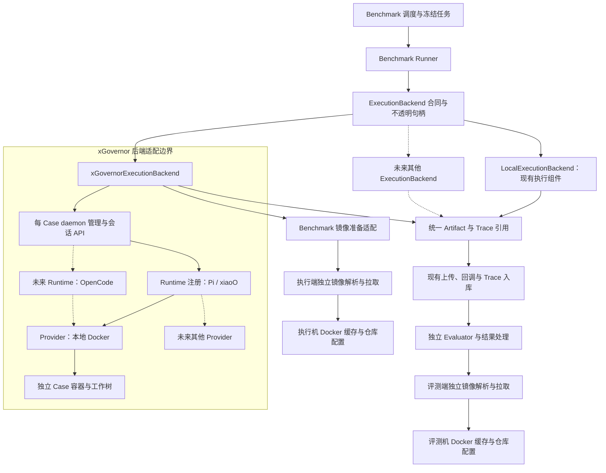
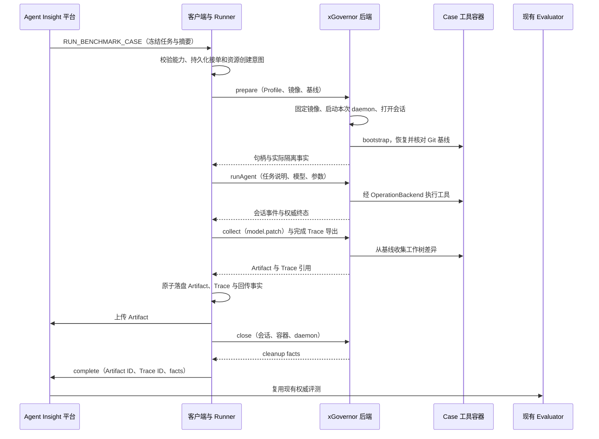

# Benchmark xGovernor 本地 Docker 接入设计

本文定义目标合同与模块边界，不表示能力已经实现；实施状态见[全仓需求清单](../../README.md)。前置范围见[需求分析](phase1-requirements-analysis.md)，实施拆分见[开发计划](phase3-development-plan.md)。

## 1. 核心决策

- 公共 Runner 依赖完整的 `ExecutionBackend` 生命周期，使用不透明句柄，不依赖本机工作区路径。
- xGovernor 作为一个后端适配器；现有执行组件由 `LocalExecutionBackend` 包装，不重写原生执行内核。
- Pi/xiaoO 与 Docker Profile 分别配置。Runtime 差异收敛到注册项和 Trace 转换，Docker 参数收敛到后端驱动。
- 一期每 Case 启动独立 xGovernor daemon，解决上游镜像和资源设置属于进程级配置的限制；后续共享 daemon 的变化封装在驱动内。
- 仅切换 SWE-bench + Pi/xiaoO 的新任务，保持 MCTS、原生 OpenCode 和非 Benchmark 实验的现有行为。
- 复用平台 Case 调度、Artifact 上传、独立 Evaluator 和权威判分，不调用上游完整批量评测脚本。

## 2. Mermaid 模块架构图

实线表示调用或数据传递，虚线表示后续可替换的实现。Agent Insight 与 xGovernor 各自的注册表属于不同边界。



xGovernor 内部仍由应用层协调 Runtime 与 Provider，Runtime 只通过注入的操作后端执行文件、命令与搜索。图中 Runtime → Provider 表示工具操作最终落到对应环境，不表示 Runtime 自行创建或销毁沙箱。该边界遵循上游[协议设计](https://gitcode.com/openeuler/xGovernor/blob/master/docs/protocol_boundaries.md)。

## 3. 公共执行后端合同

以下为接口职责草案，具体类型在实施时复用现有 DTO；不在此引入第二套上传、重试或调度框架。

```ts
type ExecutionHandle = {
  backendKey: string
  schemaVersion: number
  runId: string
  opaque: JsonValue
}

interface ExecutionBackend {
  prepare(input: PrepareExecutionInput, context: RunContext): Promise<PreparedExecution>
  runAgent(handle: ExecutionHandle, input: AgentRunInput, context: RunContext): Promise<AgentRunFacts>
  collect(handle: ExecutionHandle, contract: ArtifactContract, context: RunContext): Promise<LocalArtifact>
  cancel(handle: ExecutionHandle, context: RunContext): Promise<StopReport>
  close(handle: ExecutionHandle, context: RunContext): Promise<CleanupReport>
  recover(record: PersistedExecution, context: RunContext): Promise<RecoveryReport>
}
```

`PreparedExecution` 包含句柄、工作区基线与实际隔离事实。句柄可持久化，不能包含进程对象、模型密钥或临时管理 token；`opaque` 只由对应驱动解释，Runner 不解析其中的目录、PID、session ID 或容器 ID。

`RunContext` 提供取消信号、阶段期限、原子日志与进度回调。资源创建前先保存本次 Run 的 ownership、稳定 deployment 标识和配置摘要，创建后立即记录句柄；即使 `prepare()` 尚未返回，`recover()` 也能根据创建意图对账。无资源已经创建和资源状态未知必须是不同结果。

Runner 统一负责阶段推进、Artifact 契约校验、磁盘落盘、上传与 complete 回调。`LocalExecutionBackend` 包装已有 WorkspaceProvider、PolicyEnforcer、AgentRuntime 和 CleanupManager；原生执行和 MCTS 仍可复用已有实现。

Git Patch 收集算法提取为可复用组件，依赖后端提供的受控命令执行和文件导出能力，不接收一个未经区分的本机路径。公共 Collector 不解析 `backendKey`，后端将自身操作适配成该组件的输入。

## 4. Profile、Runtime 与任务合同

### 4.1 本机配置与公开描述分开

扩展 `config/benchmark/executor.yaml` 及已有 `.local.yaml` 深度覆盖机制。以下为 Profile 配置片段，完整 Runtime、模型与凭据配置见[部署指南](../../../docs/zh/how-to/evaluation/benchmarks/deploy-services.md#73-原生-pixiaoo-的-swe-benchxgovernor-本地-docker)：

```yaml
execution:
  profiles:
    xgovernor-local-docker:
      resources: { cpu: 2, memoryMiB: 4096, pids: 512 }
      timeouts: { prepareSeconds: 1800, cleanupSeconds: 120 }
  bindings:
    - benchmarks: [swe-bench]
      platforms: [pi-agent, xiaoo]
      profile: xgovernor-local-docker
```

驱动选项由已注册驱动独立校验，只来自受信本机配置，不从平台任务接收可执行文件路径、shell 或任意命令。实际 server/worker、扩展与镜像初始化配置在驱动内补齐。示例资源与期限是部署默认值，不是对所有 Case 的容量保证。

客户端上报 Profile 的公开描述、Runtime 兼容列表和 `definitionDigest`。公开描述包含后端标识、沙箱标识、沙箱、网络、资源、期限与实现版本，排除凭据、本机可执行文件路径和管理地址。摘要按非敏感的完整生效描述计算；客户端还需本机校验对应私有绑定仍有效。

Profile 绑定为声明式选择规则，公共 Runner 不出现 SWE-bench、Pi 或 xiaoO 的特判。模型、Agent 参数与执行环境参数分开；环境配置不塞进 `agentOptions`。

### 4.1.1 xGovernor 作为受管理依赖

`node scripts/xgovernor.cjs update` 首次安装、之后更新官方默认分支 HEAD；`--version <tag或commit>` 固定目标，另提供 `status`、`rollback`。管理工具随客户端 bundle/npm/standalone 分发，安装版入口为 `~/.agent-insight/client/runtime/xgovernor.cjs`。平台/客户端/Evaluator 原安装命令不变，只有执行机显式运行此命令。当前采用官方源码构建及上游 lockfile 安装，不依赖预编译发布包。

依赖位于 `AGENT_INSIGHT_HOME/dependencies/xgovernor`：`releases/<commit>-<安装标识>/source` 保留官方源码、server/Pi worker 和私有 Pi CLI/扩展；`installation.json` 记录真实 commit、组件版本、平台/架构、制品摘要及检查合同。安装与回退共用排他锁；下载、构建、扩展类型检查和临时 server 健康/鉴权/会话路由检查成功后，原子替换同时包含 current/previous 的 `current.json`，失败继续使用旧版。检查不调用模型或创建任务容器，不保证未知上游变化自动兼容。

未配置可执行文件和扩展路径的 Profile 从当前安装清单解析路径；显式配置任一路径时完整采用手动安装，不拼接两种来源。受管理 commit 自动填入公开 `sourceRevision`，实际制品摘要 `artifactDigest` 参与 `implementationDigest`/`definitionDigest`；手动安装仅认实际制品摘要，commit 来源为 `unknown`。不要求维护声明式 revision。

客户端每次能力探测读取原子版本指针，通过现有能力上报刷新平台，无需因依赖更新重启客户端。Run 受理时核对冻结摘要，准备后将本次组件路径、模型凭据引用和配置固化在私有执行句柄中；后续运行、Trace 导出和恢复不重读 current 路径。旧版本目录保留，以支持在途 Case 和回退；旧实验尚未受理的任务若与当前摘要不同，明确拒绝而非自动更换版本。

### 4.2 冻结与下发

复用 `runConfigJson`、`configSnapshotJson`，新增冻结的 `executionProfile` 描述、摘要；在 `AgentTaskEnvelope` 增加可选 `execution` 对象，包含 Profile 引用、公开生效描述和通用环境规格。

- `workspace` 继续表达 Git 仓库和完整基线 SHA，不再意味着必须在宿主机 clone。
- 通用环境规格表达 OCI 镜像引用、架构和容器工作目录；SWE-bench 实例 Adapter 根据公开 `instanceId`、已选目标架构和受控镜像策略生成，不能把私有 evaluation payload 复制进来。
- `task.policy.network` 对新 Profile 显式为 `deny`；其他执行目标继续使用自身策略，不全局修改 SWE-bench 的所有执行路径。
- 镜像在执行准备阶段解析为本机不可变 image ID，写入本次 lease 并记录实际解析结果；同一 Run 恢复和重传复用该结果。执行端核对目标架构，但不要求镜像具有 registry digest，也不强制评测端使用相同 digest、image ID 或架构。
- 任务摘要仍覆盖整个 task 及原有外层字段，新增执行配置随 task 参与摘要。

客户端在受理前校验 Profile 与摘要，启动前验证实际环境；配置漂移、架构不符或隔离不足必须失败，不选择“最接近”的环境。

### 4.3 协议兼容与能力门控

本轮保留 `agent-task/v1`，采用可选字段扩展并对新执行能力显式门控；同时更新 TypeScript、JSON Schema、平台/客户端校验，不能只增加一个 TypeScript 字段。

新增 `execution-backend/v1` 能力与 Profile 描述。平台只有在目标上报该能力且 Profile/Runtime 就绪时才生成带 `execution` 的任务；旧客户端不能接收新任务。旧信封仍可解析，但已冻结为 xGovernor 目标的任务不得剥离字段后走原生路径。

已完成历史记录继续读取原 facts。部署切换前应等待相关在途 Run 终结；升级后若发现旧版 Pi/xiaoO + SWE-bench 待运行任务，应明确标记需重新创建或显式迁移，不自动改变冻结配置。其他执行目标保留原路径。

`execution` 没有绑定到 `benchmark.yaml` 的全局必需能力，否则会误伤仍使用原生执行的 OpenCode 和 MCTS。目标匹配同时校验 Benchmark 能力、平台身份、Profile 兼容关系与后端能力。

### 4.4 Runtime 注册

| Agent Insight 平台 | xGovernor Runtime | 原生 Agent 身份 |
| --- | --- | --- |
| `pi-agent` | `pi` | `pi-agent` |
| `xiaoo` | `xiaoo` | 沿用现有 CLI Agent 与 Trace 展示身份映射 |
| `opencode`（后续） | 上游实际声明值 | 沿用现有 OpenCode Agent 身份 |

注册项负责 Runtime kind、ext 命名空间、支持的 Agent、参数和模型映射、Trace 转换。公共驱动通过注册表构造请求；不把原生 argv 参数直接透传为任意 xGovernor 配置。不支持的参数或 Agent profile 明确报错。

## 5. 一条 Case 的执行与回传



### 5.1 环境准备

1. 通过通用镜像准备入口分派到执行端自身的 SWE-bench 镜像适配器，记录实际来源、架构和本机 image ID。仅复用镜像缓存，不共享可写 Case 工作树。
2. 使用本次专用状态目录、随机凭据、稳定 deployment 标识与独立监听端口启动 daemon；server/worker 必须来自固定的兼容版本。满足上游双监听器与认证要求，客户端仅调用 loopback 管理面。
3. 打开 `runtime_kind=pi/xiaoo` 会话，将选定 Runtime 的 `backend_id` 设为 `docker`；驱动将容器目录 `/testbed`、`network_mode=none`、`bootstrap=true` 映射成上游 `provider_options`。
4. 在全新容器内恢复完整 `baseCommit`，核对 HEAD、仓库来源及干净工作树；检查实际网络、用户、资源和挂载边界。bootstrap 导致的辅助文件变化不能污染仓库基线。
5. 模型与工具初始化校验通过后才提交任务说明。网络关闭时直接使用镜像已有仓库，不能依赖在容器里临时联网 clone 来补足环境。

这些参数依据上游 [SWE-bench 运行与初始化合同](https://gitcode.com/openeuler/xGovernor/blob/master/docs/swebench_runner.md)。helper 所需 Python 与测试环境依赖是镜像兼容检查的一部分，不能只判断镜像存在。

执行与评测使用独立容器和两套独立维护的镜像实现。执行端实现在 `services/executor/src/benchmarks/swe-bench-images.cjs`，评测端保留 `benchmarks/swe-bench/evaluator/` 的原有实现，互不导入、不依赖共用镜像模块。当前两端均按以下规则准备镜像：先查本地官方别名缓存，缺失时依次尝试 SWR、配置代理和官方仓库，镜像站拉取成功后恢复官方别名。执行端在 `executor.local.yaml`、评测端在 `evaluator.local.yaml` 分别配置 `benchmarks.swe-bench.images`；两端配置不自动同步。SWR Verified 仓库仅用于官方 x86_64 Case，ARM64 不尝试这些仓库。执行端在本机固定 image ID，评测端保留原有镜像预热流程。评测端创建新容器、应用 model.patch 并运行官方测试；xGovernor bootstrap、用户/资源限制和评测控制设置仍各自负责。这一方案不保证两端基础镜像内容完全相同。

### 5.2 Agent、模型与隔离范围

Agent 任务说明继续由实例 Adapter 生成，后端不从 `benchmarkPayload` 重新拼 Prompt。客户端通过专门的本机 YAML 配置将模型 ID、endpoint、协议和凭据环境变量引用映射到 xGovernor 请求，不自动继承原生 CLI 的 OAuth 或密钥文件；平台快照、任务信封和日志不能保存密钥。无法映射的认证类型或模型必须失败，不能自动换模型。

工具容器断网，模型连接由宿主机控制器发出。事实中分别记录 `controllerBoundary=host`、`toolBoundary=container`、工具网络和实际资源限制，避免将容器 CPU/内存限额描述为整个 Agent 的限额。个人扩展和 Skill 发现以受控 Runtime Profile 为准，不默认继承用户 CLI 的全部全局资源。

### 5.3 Patch、Trace 与终态

- Patch 收集复用 `git-patch/v1` 语义：核对 HEAD，包含新增/删除/二进制变更，排除保留产物路径，执行空值、大小和 SHA-256 校验。文件导出支持分块或流式处理，不让 exec 输出截断破坏已有 10 MiB 契约。
- Artifact 先落客户端受控 Run 目录再上传。后续上传失败可以重传同一文件，不能依赖仍存活的容器，也不能再次运行 Agent。
- 持久化 Run、runtime ID、turn ID、原生 Session ID 和平台 Trace ID 的精确映射；不通过时间邻近、Prompt 相同或 OTLP 哈希猜测会话。
- 复用 Trace transport/spool，单独实现单 Agent 转换。Pi/xiaoO 的完整 USER、LLM、工具参数、工具结果、用量与结束语义分别核对；SSE 摘要只用于进度，不能替代缺失的原生正文。
- Pi 适配本次唯一原生 JSONL；xiaoO 通过透明 worker 代理保存完整 state 快照，按 runtime_kind/schema_version 与 ChatMessage 格式校验后转换。新 Runtime 或格式变化可通过 execution-trace/v1 完整导出合同补齐，不能让公共 Runner 依赖 xGovernor SQLite 私有表。
- Trace 正文先持久化为可重传 spool，再关闭资源。是否可进入轨迹类评测继续遵循现有 Trace 入库规则；Patch 已上传、Agent 执行完成和 Trace 完整入库是不同事实。
- 收到权威终态才结束运行，模型错误、进程退出、`max_turns` 等软终态按注册的统一映射处理。错误时尽可能保留诊断 Trace；Artifact 和失败状态沿用既有协议，不改变“执行成功不等于评测通过”的含义。

## 6. 取消、重试、恢复与资源预算

### 6.1 持久化与幂等

沿用 `runId + requestDigest` 接单幂等。首次发送任务说明前保存 submit intent，获得 turn ID 后立即保存 receipt。请求结果未知时，不因 SSE 断流或 HTTP 超时重新提交任务说明；能对账则读取状态，不能确认则结束为执行状态未知并进入清理。

运行日志保存后端版本、Profile 摘要、资源 ownership、daemon 身份、会话/turn、镜像解析、阶段时间、Artifact 状态、Trace 引用及清理结果。临时 token 存在本机受限凭据文件中，日志仅保存受控引用。

### 6.2 取消与清理

取消贯穿镜像准备、daemon 启动、会话打开、Agent turn、收集与上传。打开会话前取消也必须清理已创建资源；活跃 turn 先 cancel，再确认停止并 close。

正常关闭先导出可用 Trace、关闭会话，再回收 daemon。daemon 已失联时，驱动通过本次日志与精确 ownership 核验遗留容器；仅清理自身资源，不按镜像名称、PID 数字或全局列表模糊删除。PID 必须核对启动身份，镜像缓存不随 Case 删除。

无法确认停止或清理时记录待重试事实，资源预算保持占用，Case/实验停止状态沿用现有取消流程表达。cleanup 不成功不能记为成功；执行结果和清理结果分别报告。

### 6.3 重启与回调

上传或 complete 待重传的 Run 仅重传已持久化数据。已接单但确定没有提交过 Agent 的记录可以按既有恢复规则处理；存在 submit intent 的记录只对账或清理，不自动重跑。

恢复要覆盖 `prepare()` 中途崩溃、daemon 启动但未返回 session、任务提交但 receipt 未落盘、Trace 未导出及资源回收不确定的窗口。平台重跑仍创建新的 Run，不复用旧容器。

### 6.4 时间与并发

准备期限包含拉镜像、bootstrap、模型初始化和基线检查；Agent 期限从实际提交任务说明时开始；收集/清理使用有界后处理期限。各阶段均有绝对 deadline 和失联检测，进度心跳不能无限延长绝对期限。

现有 progress 回调增加阶段开始时间、deadline 和环境准备说明，watchdog、控制指令 TTL 与取消宽限同步采用冻结期限。平台不能把 Git 准备的旧文案或固定 420 秒无进度规则当作所有容器准备任务的执行上限。

复用实验执行并发，并增加驱动本机资源准入。每 Case 独立 daemon/容器，调度名额与实际资源预算分别管理；等待清理的资源仍计入预算，不因上传结束提前腾空。

## 7. 能力上报与页面行为

Benchmark readiness 检查固定版本的 server/worker、对应 Runtime、Docker/socket/cgroup、模型配置解析、Trace 导出组件和 Profile。周期探测不调用付费模型、不拉取全部 Case 镜像；某个实例镜像的兼容性在准备阶段确认。

普通实验继续按原生 CLI/Collector 判断 readiness。现有平台能力不能用一个布尔值同时代表普通实验可执行和 xGovernor Benchmark 可执行，匹配与刷新路径需要识别 action/Profile 范围。

页面继续选择 Agent、模型与执行机，环境由客户端绑定规则选择。确认页和详情展示冻结 Profile、网络与资源，实际结果展示镜像、边界、阶段、Trace 和 cleanup；不暴露 daemon token、端口或本机内部路径。暂不提供面向用户的任意沙箱参数表单。

## 8. 后续扩展合同

### 8.1 OpenCode

前提是上游 OpenCode Runtime 提供兼容的会话、工具后端、事件、取消与轨迹导出。Insight 增加 Runtime 注册、Agent/模型/参数映射、必要的 Trace 转换和契约测试，再在 Profile 兼容列表及绑定规则中开放 `opencode`。

验收要求：公共 Runner、调度状态机、Docker 环境管理、Git Patch 算法、上传和 Evaluator 均无需增加 OpenCode 平台分支。原生 OpenCode 的现有路径在显式迁移前不改变。

### 8.2 更换沙箱

保留 xGovernor 时，变更 Profile 的 Provider 绑定，并在上游补齐所需 Provider/normalizer 适配；只有能力、环境规格和导出合同均兼容时才属于配置切换。新 Provider 不支持断网、资源限制或镜像环境时必须明确拒绝对应 Profile。

替换整个 xGovernor 时，实现另一个 `ExecutionBackend`，提供等价 Agent 运行与环境操作，而不只是 create/delete 裸容器。通过相同 prepare/run/collect/cancel/close/recover 契约测试，Benchmark Adapter、Runner 和评测流程不变。

一期不预建尚无消费者的 K8s、microVM 等驱动。使用独立测试后端验证公共 Runner 不解析 xGovernor 句柄，证明接口可替换。

## 9. API、持久化与指南

不新增 Prisma 表或 Agent Insight 路由。复用既有客户端能力、实验创建、任务下发、progress、Artifact、complete 和 Trace ingest，扩展各自 DTO、Schema 与 JSON 快照。实现如发现确需上游新导出接口，应单列上游合同及依赖，不把它描述为已有能力。

实现后同步 Benchmark 用户指南、部署指南、接入开发规范及实际受影响的 Trace 说明；只在导航或术语变化时修改开发者指南 INDEX。本次设计文档不把这些目标行为写入当前操作步骤。
