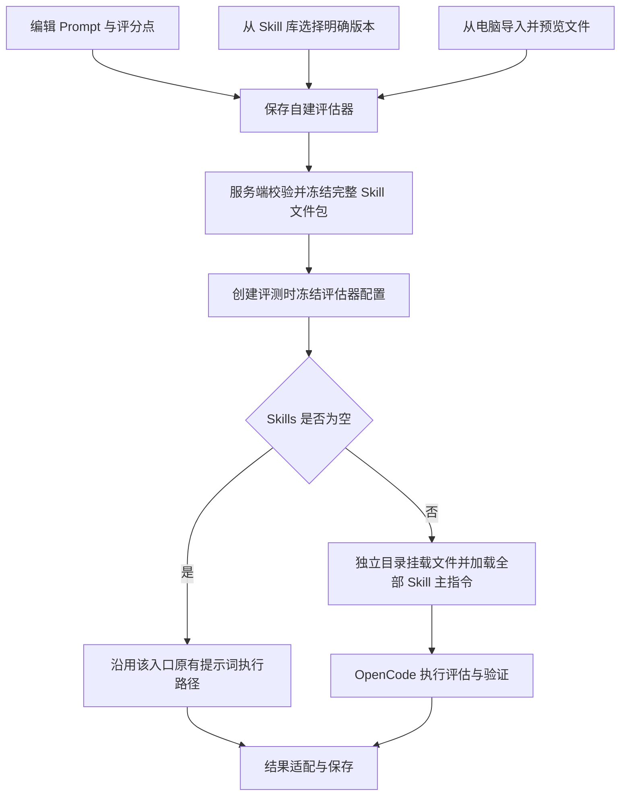

# 自建评估器 Prompt + Skills：需求设计

## 1. 总体决策

在现有自建 LLM 评估器上增加可选 `skills`，不增加 Prompt/Skill 二选一控件，不改变持久化 `evaluatorType: 'LLM'` 和 `custom-*` 标识。



添加支持「从 Skill 库选择」与「从电脑中导入文件夹」两种来源，可以混用。库版本用于选择和溯源；本地来源以导入快照摘要标识，不伪造库版本号。两者都冻结内容，保存后运行不再回源读取 Skill 库或用户电脑。本地导入不创建或更新 `Skill/SkillVersion`。

## 2. 页面交互

### 2.1 创建与编辑

沿用「基础信息 → 评估提示词/评分点 → 输出」布局，在提示词与输出之间新增「Skills（可选）」区域。

```text
Skills（可选）                                      + 添加 Skill
添加的 Skill 都会参与评估，不需要时请移除。

report-validator   Skill 库 · v2       3 个文件   查看文件   更换版本   移除
policy-checker     本地导入 · a1b2c3   2 个文件   查看文件   移除
```

- 空列表文案：「可添加 Skill，让评估器按其中的验证方法、脚本和参考资料进行评估。」
- 「添加 Skill」提供库选择、电脑导入入口。库选择复用 Skill 栏目的卡片式弹窗，支持搜索、分类、来源、分页及卡片内固定版本选择；已添加项禁用。电脑导入直接打开系统文件夹选择器，无二级菜单。
- 库来源：搜索可访问的 Skill → 选择具体版本 → 查看文件清单 → 添加到表单。版本必须显式确认；可预选有效版本，但保存的值是确定非负整数（兼容 v0），不保存 `latest` / `active`。
- 本地来源：选择根目录含 `SKILL.md` 的文件夹 → 上传并校验 → 预览文件树 → 添加到表单。说明「仅用于当前评估器，不自动加入 Skill 库」。用户选择文件夹后不立即创建库资产或修改评估器。
- 同一运行时 Skill 名称只能添加一次，即使来源不同或版本不同也不允许重复；更换版本替换原行。
- 库来源用「更换版本」；本地来源只保留「查看文件」「移除」，更新时移除后重新添加。表单变更保存成功后整体生效，取消编辑不改变原配置。本地修改无自动监听或同步。
- 「移除」只移除表单绑定；保存后生效，不删除库中 Skill 或历史快照。
- 不出现启停开关、执行权重或“仅部分 Skill 参与”的选项。
- 新增能力涉及的控件复用 `ui/*`、`.ai-*` 和共享令牌，不增加局部色板。

### 2.2 文件查看

查看文件使用独立只读弹窗，不显示添加或来源切换控件。使用只读文件树与内容区：文本文件可预览，二进制文件展示名称、类型与大小。预览被截断时明确标记；预览限制不影响运行文件完整性。

添加前查看所选库版本或已上传的本地临时文件；保存后统一查看已绑定快照，展示来源及库版本/本地导入摘要。源版本删除、原电脑离线或文件移动后，仍可查看已保存文件。前端不获得服务端绝对路径。

详情页原有历史 System/User Prompt 继续可编辑；创建页面继续使用现有单段评估提示词。第一期不借机重构所有编辑器。

### 2.3 列表与结果

- 评估器卡片保留原有「评分」灰框；新增「N 个 Skills」用紧凑文字单独展示，不再新增 Skills 灰框。
- 结果详情只显示分数、结论与判断依据，不展示 Skills 或工具执行区。
- 页头「查看执行链路」仍指向被评测 Agent；每项评估标题行仅在真实 Agent 会话成功落库且当前用户可访问时显示「查看评估链路」。普通 LLM 与无记录的历史结果不显示。
- Agent 会话结束、删除前读取真实消息并复用链路存储，保存原始工具调用及加载指令；成功后将 `evaluationTraceId` 写入 runtime 元数据。存储失败不影响已生成的评分，也不生成链接。
- 实验详情 API 批量校验元数据引用的 Execution 存在且归属于当前用户，再返回可展示的 `evaluationTraceId`；无须修改 Prisma schema 或新增路由。
- Skill 主指令已加载与实际工具执行分别以请求内容和真实工具事件表示，不生成虚假调用记录。

## 3. 配置契约与源资产解析

### 3.1 卡片增量字段

以下为拟新增类型，位于 `custom-evaluator-model.ts`：

```ts
type EvaluatorSkillSource =
  | { kind: 'library'; owner: string | null; version: number }
  | { kind: 'local'; originalFileName?: string };

interface EvaluatorSkillBinding {
  name: string;
  source: EvaluatorSkillSource;
  snapshotHash: string;
  fileCount: number;
  totalBytes: number;
}

interface LlmEvaluatorConfig {
  model: string;
  systemPrompt: string;
  userPrompt?: string;
  skills?: EvaluatorSkillBinding[];
}
```

- 对外用 Skill `name`，数据库 id 仅用于服务端定位目录。
- `source.kind` 明确区分来源，库版本字段只在 library 分支出现。本地来源不具有 Skill 库 id、归属用户或版本号。
- 库来源的 `source.owner` 是归属用户，`null` 表示历史共享资产，用于消除跨用户同名歧义；选择列表只返回按现有授权规则可访问的来源。
- 库来源按 `(name, source.owner)` 精确匹配，再执行现有 Skill 访问检查；禁止用 `find(...)[0]` 随机选择同名来源。API 查询参数 `sourceOwner` 对应此字段。
- 新库绑定请求提交 `{kind:'library', name, sourceOwner, version}`；新本地绑定提交 `{kind:'local', importToken}`。服务端解析为上述统一存储类型，临时凭证不写入持久配置。
- `name/snapshotHash/fileCount/totalBytes` 以服务端实际文件为准；库来源 name 同样需与所选资源核对，不能信任客户端声明的摘要或统计。本地 `originalFileName` 只用于来源展示，不包含电脑绝对路径，不作为存储路径。
- 已存在且未变化的绑定允许带原摘要，服务端确认其属于该用户已有评估器后复用快照；不能任意引用他人的摘要。
- 无 `skills` 的历史卡片按空列表解释。更新已有卡片时省略该字段表示保留原绑定，显式 `[]` 才表示移除全部，避免旧客户端误清空。
- `skills` 只对自建 LLM 类型有效，其他类型提交非空值返回配置错误。

Skill frontmatter 的 `name` 必须可被当前 OpenCode 版本加载；库来源还需与库中名称一致，本地来源以该字段确定运行时名称。缺少有效 name 或两种来源出现同名冲突都拒绝添加，提示修正源文件后重试；不在冻结时偷偷改写主指令。

### 3.2 本地导入与表单草稿

- 本地仅接受文件夹，通过系统选择器上传相对路径与字节；ZIP 需先解压，单个 `SKILL.md` 需放入文件夹。主文件必须包含有效 frontmatter。浏览器只传用户选定文件，不把本机绝对路径交给服务端读取。
- 每次导入一个 Skill。浏览器提交的所有相对路径必须位于同一个外层目录，文件名与路径末段一致，且该目录直接含 `SKILL.md`；存储时仅剥离这一层。缺少主文件或检测到多个独立 Skill 根目录时拒绝，不猜测、不拼成一个 Skill。
- 上传先写入用户隔离的临时区，完成名称、文件、路径与容量检查后返回不可猜测的 `importToken`、到期时间、名称和 manifest；文件查看基于同一用户临时凭证。临时区不是 Skill 库，也不是已保存评估器。
- 临时凭证建议有效 24 小时，只能由导入用户用于查看或提交本地绑定；它不能代替用户身份。到期时保存返回“导入已过期，请移除后重新添加”，不清空表单中的原绑定。
- 点击评估器「保存」时，再核对临时文件摘要并发布持久快照；校验全部绑定成功后才整体写入卡片。导入失败、保存失败或取消编辑都不修改原绑定，也不写 `Skill/SkillVersion`。
- 未保存临时文件按有效期清理，可复用服务内文件清理机制或在导入请求时清理过期目录，无需新增定时任务。已发布快照不能随临时文件一起删除。
- 不提供本地重新导入按钮；更新本地 Skill 时移除原项后重新添加。保存后电脑文件变化不会同步，旧实验继续引用旧摘要。

### 3.3 快照文件存储

复用应用数据目录，新增用户隔离、内容寻址的评估器 Skill 快照目录：

```text
<data>/evaluator-skills/<user-key>/<snapshotHash>/
  manifest.json
  files/
    SKILL.md
    scripts/validate.py
    references/rules.json
```

`user-key` 使用服务端稳定编码，不能直接拼接未经校验的用户输入。`snapshotHash` 由规范化相对路径、文件字节和可执行位计算；相同版本但内容不同会得到不同摘要。

快照生成规则：

1. 库来源的 `SKILL.md` 以 `SkillVersion.content` 为真源，不被磁盘同名文件覆盖；本地来源使用校验后的上传主文件字节，不创建库版本。
2. 库来源附属文件从版本目录读取，清单文件缺失即失败，历史无完整清单时扫描版本根目录。本地来源以用户上传的完整文件集生成 manifest。两者保留二进制字节；浏览器文件夹未提供权限位时使用普通文件权限，脚本由相应解释器运行，不伪称恢复了本机权限。
3. 路径统一为相对 POSIX 路径；拒绝绝对路径、盘符、反斜杠、`..`、空路径、符号链接、特殊设备文件及大小写归一后冲突。
4. 使用 `lstat/realpath` 等确保读取仍位于对应版本根目录或本地临时根目录；与平台配置文件、其他版本或用户的目录不能混用。本地导入校验全部路径并拒绝跨目录或名称不匹配的清单；累计实际文件数和字节，超限立即终止，不信任客户端声明值。
5. 临时目录写入所有文件和 manifest，核对摘要后原子发布，再更新 `itemsJson`；保存失败不产生半个可用绑定。
6. 同一绑定的源资产删除、升级或改写不修改已发布快照。库来源需更换版本并保存，本地来源需移除后重新添加并保存；新实验才使用新绑定。

第一期建议设置共享服务常量：每个评估器最多 8 个 Skill、每包最多 256 个文件/10 MiB、全部主指令合计不超过 64 KiB。超限在保存前明确拒绝，不截断后继续；这些是待实现时按实际模型上下文验证的容量建议，不新增用户配置项。

两种来源共用上述持久快照目录、摘要校验和执行挂载；导入临时区单独位于 `<data>/evaluator-skill-imports/<user-key>/<import-key>/`，不可用客户端 token 直接拼接路径。临时区和运行工作目录可清理，持久快照保留。移除绑定或删除库中源 Skill 不立即删除快照，避免破坏历史实验与复测；第一期不提供持久快照自动回收。备份/迁移需同时包含数据库与持久目录，临时上传不属于备份必需内容。源授权用于允许用户冻结副本，已冻结副本随评估器/实验保留，不设计源资产删除后的追溯撤销机制。

## 4. API 与持久化

### 4.1 复用现有接口

`GET/PUT /api/user-evaluators` 延续卡片数组协议，增量支持 `llmConfig.skills`。更新校验、快照生成、规范化存储及缓存失效通过共享服务完成；成功后返回规范化卡片，前端不得把保存前草稿当作最终快照。

读取 Skill 候选列表复用现有 `/api/skills` 的可访问范围；服务端负责来源消歧。所有新增读取仍执行与列表一致的用户解析和资源授权，不绕过到未经授权的旧版本 GET。

### 4.2 拟新增接口

| 接口 | 用途 |
|---|---|
| `GET /api/skills/by-name/:name/versions?sourceOwner=...` | 返回可访问来源的版本、主指令和文件 manifest 摘要，支持版本选择 |
| `GET /api/skills/by-name/:name/versions/:version/files/:path` | 添加前查看源文件，返回文本或二进制元数据 |
| `GET /api/user-evaluators/:evaluatorId/skills/:name/files?path=...` | 查看当前评估器已绑定快照；无 path 返回文件树，有 path 返回文件预览 |
| `POST /api/user-evaluators/skill-imports` | 仅接收本地 Skill 文件夹，校验后返回用户隔离的临时凭证与文件 manifest；不写 Skill 库 |
| `GET /api/user-evaluators/skill-imports/:importToken/files?path=...` | 保存前查看本地临时文件；无 path 返回文件树，有 path 返回预览 |

导入 POST 使用 `multipart/form-data`：`kind=folder`，提交 files 与一一对应的相对 paths。服务端拒绝其他 kind，核对数量、同一根目录、文件名匹配与总容量；multipart filename 可为路径末段或完全等于对应 paths 的相对路径，其他路径不匹配时拒绝。不接受客户端宣称的本机路径或任意服务端路径。两种来源的绑定可在同一次 PUT 中混用，任何一项失败都不更新评估器；成功响应不含 importToken。

源资产接口的 `sourceOwner` 必须明确提供，历史共享资产使用明确约定的空值表示 `null`，不可把参数缺失默认为任选来源。文件路径实际实现使用 catch-all 或编码后的查询参数，不直接拼接未校验路径。

快照读取接口先定位当前用户的评估器与绑定，再解析快照，不能仅凭 `snapshotHash` 读取任意文件。不暴露任意目录或任意文件读取参数。

错误应区分未找到、无权访问、版本不存在、源文件不完整、无有效主文件、多个 Skill 根目录、名称冲突、上传损坏、临时导入过期、容量超限和存储失败；不得把这些错误变成“成功但 Skills 为空”。

### 4.3 无需新增 Prisma 模型

- `CustomEvaluatorList.itemsJson` 保存规范化绑定。
- `Experiment.configSnapshotJson` 增量增加 `customEvaluatorSnapshots` 命名空间，内部带独立 `schemaVersion: 1`，不覆盖各入口已有顶层版本及其他冻结配置。
- `ExperimentEvalResult.evidenceJson` 保存评分依据与平台运行元数据。
- 轨迹评测在 `TrajectoryEvalResult.rawAnalysisJson` 中增量保存相同的配置快照及运行元数据，保留已有 `customEvaluations` 结果读法。

此方案不改 Prisma schema，不新增迁移；接口和存储契约仍按三阶段文档审阅。

## 5. 实验冻结与兼容

`customEvaluatorSnapshots` 按 evaluatorId 保存执行所需的 name/category、完整 llmConfig、pointsDef 和配置摘要。冻结在创建评测任务时完成，所有 Case 共用；不能在每一行启动时重新读取最新卡片。

覆盖普通实验、对比实验、Benchmark 追加自建评估器、`eval-traces` backing 实验、工作台及轨迹评测任务。冻结逻辑抽为共享服务，各入口在事务写入任务前调用，保留其已有前置条件检查。

- 重试同一行、追加 Case、监听新 Trace、重启恢复均读取同一任务快照。
- 复用同配置创建的新实验复制快照，不重解析源版本；需要最新评估器时通过普通新建流程选择。
- 后续编辑或删除评估器不影响已经冻结的任务。
- 历史无 `customEvaluatorSnapshots` 的实验保留原 Prompt 解析行为，但有效 Skills 固定为空，不能因卡片后来绑定 Skill 自动增加 Agent 能力。UI 提示需新建实验使用 Skills；不伪造历史冻结信息。
- 新建任务必须具有完整快照，不能在快照缺失时静默回退最新配置。坏 JSON 或摘要缺失是配置错误。
- 轨迹任务同样在创建时冻结；任务重试不能重新加载最新卡片。

冻结既覆盖库版本/本地导入摘要，也覆盖 Prompt 和评分点；否则相同 Skill 搭配不同评判标准仍会造成同一实验混用口径。实验配置不引用临时凭证或电脑路径，因此临时区清理、电脑离线或本地移除后重新添加均不影响旧实验。模型连接沿用当前平台评测模型配置，本期不承诺固定模型权重或完全确定性评分；记录实际运行模型用于审计。

## 6. OpenCode 执行

### 6.1 共享执行服务

拟新增 `custom-evaluator-runtime.ts`，输入为已冻结卡片、Case 上下文和取消信号，输出为评分原文与运行元数据。`run-experiment.ts` 和 `custom-llm-evaluator.ts` 调用同一服务，不复制两套 Skill 挂载逻辑。

- 空列表保持各入口现有 transport 和解析语义，不在本期强行统一历史结果。
- 非空列表强制 OpenCode；禁止经过默认直连 LLM，以及失败后的无 Skill 降级。
- 继续复用临时进程、后台并发槽、模型连接、取消与进程清理能力；不新增长期驻留服务。

### 6.2 工作目录与全部加载

每个 Case × evaluator × attempt 创建独立目录：

```text
<temporary-evaluator-workspace>/
  .git/
  .opencode/skills/<skill-name>/...
  inputs/case.json
  outputs/
```

挂载前校验冻结摘要；只复制本次绑定的 Skills。session 和 chat 的 directory 均绑定该目录，不能继续固定为 `/tmp`。复用已有 workspace 标记逻辑，避免 OpenCode 向上定位到其他项目根目录。

**全部参与采用确定性加载：**平台读取每个冻结 `SKILL.md`，按添加顺序作为独立的 Skill 指令段放入该次请求，同时提供该 Skill 的实际根目录。OpenCode 的项目级技能目录保留完整文件供引用和工具访问。不能只依赖自动发现或模型选择性调用 `skill` 工具来满足“全部加载”。

主指令保持原文，不做五个 Case 变量的模板替换；变量替换只适用于评估器 Prompt。Case 数据以既有变量和 `inputs/case.json` 提供，避免误替换 Skill 中的脚本模板。附属资料按需读取，脚本按适用条件执行。

### 6.3 提示词和输出

最终请求区分四类内容：

1. 用户评估 Prompt（System/User 历史格式兼容）。
2. 全部 Skill 主指令与根目录映射。
3. 平台评分点要求和现有输出契约，复用 `judge-assembly.ts`，保留用户评分点 label。
4. Case 数据与上下文文件位置。

平台输出契约用于结果接入；Skill 的建议输出不能覆盖它。Prompt 定义本次评判目标与标准，Skills 提供执行方法和证据。方法可以组合，但不能用某个 Skill 的默认标准暗中替换用户标准。存在无法消解的指令冲突、因而无法可靠判分时，本条评估失败并说明冲突，不以添加顺序作为未声明的评分优先级。

有 Skills 的新路径统一返回现有 `EvaluatorOutput`（verdict、summary、score、points、evidence）；全局实验直接归一化入库，轨迹入口适配到旧 score/reason/rawResponse，并保留完整输出与平台元数据。缺失可靠结果或解析失败按失败处理，不将工具报错本身转换成被评测 Agent 的 0 分。

本需求扩展执行能力，沿用自建评估器现有评分口径；不借此改造所有历史评分公式。新增示例 Prompt 应遵循开发者指南的离散判断/明确评分锚点建议。

### 6.4 运行事件、权限与清理

- 使用现有 `ChatHandlers.onTool/onStep` 收集真实事件；内部评估复用链路存储，显式跳过普通与内部自动评测，避免监听循环。
- 记录已加载主指令的名称、来源、库版本或本地摘要；工具执行独立记录 callId、工具名、状态和摘要。无法确定归属时不强行关联到某个 Skill。
- HOME/XDG 继续隔离，不导入宿主用户 Skills；工作目录仅包含本次快照。
- 现有权限基线含全局 read/bash 等允许，**工作目录与 HOME 隔离不等于操作系统安全沙箱**。第一期运行用户有权从库选择或主动上传的 Skill，不宣称能安全执行任意不可信脚本；本地导入只校验和保存文件，导入阶段不执行脚本。
- 沿用评测权限并显式允许实际需要的加载工具；保持 question/plan 工具禁用，不新增交互等待。依赖不足返回明确失败，不自动安装依赖。
- 单次执行遵守所属任务已有总超时、重试与取消策略，透传 AbortSignal；队列等待、模型执行与清理不能各自绕开行级上限。
- 结束时先停进程再清理临时目录；每次重试重新准备目录，持久快照保留。

## 7. 运行元数据

平台在模型输出之外生成 `customEvaluatorRuntime`，至少包含：配置摘要、实际模型、transport、已加载 Skill 的名称/来源/库版本（仅 library）/快照摘要、工具执行摘要、耗时和失败类型。模型不能通过返回同名字段伪造这些信息。

全局实验使用证据容器封装原始评分依据和运行元数据，展示层只渲染原有依据，Skills/工具信息通过有真实记录的评估链路查看；不要把运行元数据直接传给会丢弃未知字段的 `normalizeEvaluatorOutput`。轨迹入口使用同一序列化函数，写入 `rawAnalysisJson`。

工具事件摘要仍有界并标记截断；会话删除前另外读取真实消息，复用现有链路存储与查看页面，保存主指令和实际工具输入输出，不新增回放系统。保存前脱敏连接密钥，不把脚本 stdout 自动当作模型评分结果。历史结果无真实会话记录时不补造链路；保存失败不影响评分，也不提供入口。

## 8. 关键边界

| 情况 | 行为 |
|---|---|
| 没有添加 Skill | 沿用该入口原有提示词评测 |
| 部分绑定无效或快照损坏 | 整个自建评估器失败，其他评估器可继续 |
| OpenCode 不可用 | 有 Skills 时明确失败，不静默改为直连 |
| 源版本被删除/升级 | 已冻结绑定可运行；新增绑定必须重新校验源资产 |
| 原电脑离线、文件移动或改写 | 已保存的本地快照可运行，不自动同步本机文件 |
| 本地与库中 Skill 同名 | 拒绝重复绑定，可移除原项后显式添加新来源 |
| 文件夹缺少主文件、包含多个 Skill、路径无效或容量超限 | 导入失败，不写库、不更新原绑定，不留下可执行的半个快照 |
| 本地临时导入过期或用户取消编辑 | 提示移除后重新添加或丢弃草稿；原绑定与持久快照保持有效 |
| 所有 Skill 只需指令，无工具动作 | 允许评分，加载指令在评估链路中可查，不虚构工具调用 |
| 脚本验证结果为“不通过” | 作为评判证据；与脚本无法执行等基础设施错误区分 |
| 执行中用户修改或移除绑定 | 当前任务不变，新建任务使用保存后的配置 |
| 旧客户端更新评估器未传 skills | 保留已有绑定；显式空数组才移除 |
| 相同摘要跨用户出现 | 仍按用户隔离授权，不开放跨用户文件读取 |

## 9. 方案取舍

| 决策 | 收益 | 代价 |
|---|---|---|
| 库选择与本地导入共用快照 | 同时支持复用与评测专用文件，不强制先入库 | 增加上传暂存、校验与移除后重新添加流程 |
| 保存时冻结完整文件包 | 不受源文件变化、删除影响 | 需要额外磁盘及备份 |
| 全部主指令确定性入上下文 | 符合全部参与语义，可核验加载内容 | 主指令增加上下文成本，需容量门禁 |
| 有 Skills 才强制 OpenCode | 保留普通评测性能 | 两种执行路径需各自回归 |
| 利用现有 JSON 存储 | 无数据库迁移 | 必须版本化并校验 JSON 契约 |
| 先不做独立试运行和完整回放 | 控制本期界面与 API 范围 | 调试通过已有评测入口完成 |
