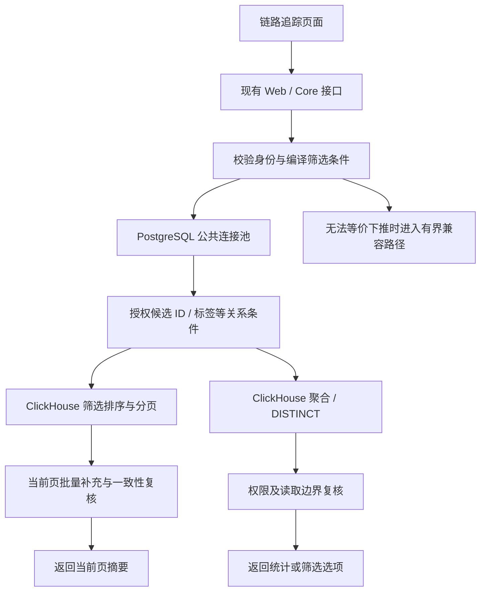

# Trace 加载优化：需求设计

## 1. 总体方案

将公共连接池、当前页摘要批量补充和数据库统计聚合分层实现。前端继续调用原接口；读请求不写入 Trace 业务数据，不新增数据模型或 API 路由。

图表示后端逻辑分支，不改变当前前端“记录成功后请求统计”的时序。统计和记录是不同请求，不承诺两次请求跨数据库共享同一快照；它们必须使用同样的筛选解释规则。

## 2. 公共连接池

### 2.1 所有权与接入位置

- 一个 Storage Core runtime 的 PostgreSQL control store 持有一个池，所有请求线程和该 runtime 的后台任务共同使用。
- 池属于服务进程，不属于用户名、浏览器或 API Token；不同 DSN/schema/store 不共享池，禁止跨进程继承使用已有连接。
- 在关系库连接提供层引入借用/归还，保留 `read_transaction()` 和 `transaction()` 调用边界。未启用池的显式 connection factory、迁移 CLI 和测试注入仍能保持原行为。
- 使用现有 psycopg2 驱动，连接池仅管理资源。优先复用其线程安全池能力；若现有简单池不能满足有界等待和空闲保留契约，则使用标准库锁/条件变量作薄资源管理层，不新增第三方依赖。
- PostgreSQL 为本轮启用范围。SQLite 保持原模式；openGauss 虽继承关系库适配器，也不得未经专项验证自动启用。ClickHouse HTTP 请求实现保持原样。

### 2.2 生命周期

| 事件 | 行为 |
|---|---|
| Core 初始化/就绪检查 | 创建池管理器，按需建立少量连接；检查配置及数据库可用性 |
| 用户登录 | 既有认证操作借用公共连接，完成后归还；不建立用户专属连接 |
| 登录期间读取 Trace | 每个原有事务独立借用连接，事务结束归还；物理连接保留以便后续复用 |
| 用户退出或凭证失效 | 保留现有退出/认证行为，不销毁公共池；后续请求仍须重新验证有效凭证 |
| 关闭浏览器/网络中断 | 无专属连接待回收；已开始的后端事务仍在 finally 中清理，不能假设浏览器取消等于 SQL 已取消 |
| 连接损坏或达到回收条件 | 空闲连接关闭；使用中的连接标记归还后淘汰，再按需补建 |
| Core 关闭 | 停止接收新工作，等待在途事务退出后关闭连接；不因某个用户退出关闭公共连接 |

当前 `src/lib/auth/auth-context.tsx` 的 Web 退出清理本地登录状态，没有调用 Core 的凭证撤销。Core 自己已有 `/v1/auth/logout`。本方案不把两者改成新的认证流程，也不承诺仅退出 Web 就撤销所有外部 API 凭证。

### 2.3 事务、清理与异常

1. 同一物理连接同时只租给一个事务。不同用户可以先后使用同一连接，但不能并发共用事务。
2. 读事务保留 `REPEATABLE READ READ ONLY`；写事务保留原隔离级别、锁和提交行为。连接长驻不意味着事务一直打开。
3. 成功后按原逻辑提交；异常、中断时回滚。关闭全部游标，确认事务空闲，重置连接会话参数，再归还。无法确认清理成功则物理关闭。
4. 不把上个请求的 schema、会话参数、游标或事务状态带给下个请求；权限结果不随连接缓存。
5. 归还清理异常不能掩盖原业务异常；业务提交已成功但清理失败时，只淘汰连接并记录事件，不能重放操作或伪报业务未提交。
6. 借用前检查连接状态，久置连接做有界健康探测。业务 SQL 开始前发现坏连接，可在借用预算内重新获取一次；业务开始后断连，终止当前调用并回收连接，不在驱动层重放事务。
7. 不增加 HTTP 全流程自动重试。保留现有 `TRACE_READ_CHANGED`/`TRACE_INDEXING` 重试契约；写事务和结果不确定的提交不得自动重试。

### 2.4 并发与嵌套调用

现有旧路径可能在外层事务未释放时开启内层事务，不能按线程固定返回同一连接，否则会合并原先独立的事务和快照。

- 普通首次借用可以有界等待；已持有该池连接的线程再借用时，先取空闲连接或在上限内新建。
- 若嵌套借用无可用容量，立即返回内部池耗尽错误，使外层 finally 释放资源，避免全部线程持有外层连接等待内层连接的死锁。
- 新批量读取方法显式传入当前事务对象，能在同一设计快照内完成的辅助查询不再隐式嵌套借用；不修改无关业务的事务组合。
- 池状态锁只用于计数和队列，建连、查询、探测、reset 不持有该锁；创建中的连接也计入上限。等待者有明确唤醒和关闭行为。
- 超容量为受控 503，不能无限建连。内部日志区分池耗尽、连接失败和查询失败，对外沿用现有错误结构。

### 2.5 拟定配置与容量

配置拟放入现有 Core 私有配置的可选 `control.connection_pool` 对象，旧配置可省略。这里是待实施契约，不修改用户当前配置。

| 配置 | 拟定默认值 | 说明 |
|---|---:|---|
| enabled | PostgreSQL runtime 为 true | false 回到原连接提供方式；其他后端默认不启用 |
| min_idle | 2 | 使用后保留的空闲基线，不要求登录时创建 |
| max_size | 16 | 单 runtime 总连接上限，含正在创建的连接 |
| acquire_timeout_seconds | 2 | 容量等待预算；嵌套耗尽不等待 |
| connect_timeout_seconds | 3 | 单次物理建连上限；借用总预算不得超过等待预算加一次建连预算 |
| idle_timeout_seconds | 300 | 超过基线的空闲连接回收阈值 |
| max_lifetime_seconds | 1800 | 到龄后在归还或空闲时回收，不中断活跃事务 |
| health_check_idle_seconds | 30 | 超过该空闲时间才主动探测，探测占用借用预算 |

数值为初始设计值，验证后方可定稿。必须校验范围和 `min_idle <= max_size`。多进程总容量按进程数乘以上限计算，给数据库管理连接、其他程序和独立 worker 留余量。活动 SQL 的原执行超时不因本次扩大。

服务关闭复用既有 worker 停止流程，增加活跃租约计数与有界排空；超出排空预算时关闭空闲连接并标记活动连接归还后关闭。不得直接调用会关闭使用中连接的池方法来中断写事务，也不得因等待连接池导致停服无限挂起。

## 3. 查询计划与当前页批量读取

### 3.1 共用筛选解释

内部增加列表查询计划，统一解析当前已有参数、字段白名单、排序、授权范围、子 Agent 范围和时间条件。计划同时服务 records、stats、相关 facets，并明确标记 `native`、`relational_filter` 或 `compatibility` 路径及原因。

SQL 字段和运算符使用受控映射，值参数化。不得把客户端提供的用户名当作授权依据；可见范围仍由实际 Token、workspace、资源授权及私有评测 Trace 排除规则决定。

字段分类：

| 类别 | 处理 |
|---|---|
| 摘要已有且能等价表达的时间、状态、框架、来源、Agent 等 | 由 ClickHouse 执行过滤、排序、分页或聚合 |
| 标签、用户归属、别名、人工修改等关系库字段 | 在授权范围内批量查询，生成条件 ID 集合或有效字段；禁止跨库直接 JOIN 假设 |
| 评估结果、Skill 关系、根 Span 属性覆盖、历史字段 | 证明最终值与 SQL 等价后下推，否则保留兼容路径 |

`contains` 等字符串语义、大小写、null、数组 any/all/none、时间边界、数值类型及同时间排序的 tie-breaker 均须与当前有效行为逐项比较。只要某个条件不支持，不得只执行剩余条件。

### 3.2 分页与补充

1. 在关系库读事务中批量取得可见候选 ID 和查询需要的权限/路由边界；候选 ID 可能覆盖全部可见 Trace，但不是全部展示摘要，更不是 Span 详情。
2. ClickHouse 使用最新有效摘要应用条件与排序，获取 `pageSize + 1` 个候选，计算 hasMore；只有当前页 `pageSize` 条进入展示组装。
3. 批量读取当前页完整摘要；按 workspace、trace bucket 和 Trace ID 定位，不能只按全局 Trace ID 查询。
4. 关系库按 ID 批量取得路由/owner、别名、annotations、标签关联、Trace head、删除屏障和结果选择所需行。标签的一对多结果在内存分组，避免 JOIN 扩大分页记录数。
5. 结果覆盖与执行元数据复用原有纯计算和字段覆盖规则；将其数据读取与计算分离，不能把 `_lookup_tx` 简单循环包在一个“批量”接口中就认定完成。
6. 为确实需要的当前页 Trace 批量取得根 Span 索引及所需属性。保留每 Trace 的根数量、制品字节及源版本边界；不能用全局 LIMIT 截断某条 Trace，也不遍历全部子 Span。制品读取未必能合并成一条数据库查询，必须单独计量。
7. 按页面顺序组装 DTO，批量复核权限指纹、路由身份、删除屏障、head 与结果选择版本，保持现有变更错误类别。

普通关系库集合查询采用每批最多 200 个 ID 的初始边界；实际还受 SQL 参数数和请求字节数限制。本页最多 100 条，不应发生每条 Trace 重复调用 route/summary/properties/tags 的退化。

兼容复杂筛选需要先判断所有候选的最终字段，再分页，不能“先拿 20 条再过滤”，否则会漏记录、页不足且总数错误。该路径仍有 O(N) 工作，但使用同一批量读取基础，保留现有数量和字节上限。

## 4. 数据库统计聚合

### 4.1 普通路径

统计使用同样的权限范围和筛选计划，不受当前页 LIMIT/OFFSET 限制。在 ClickHouse 最新有效 Trace 摘要集合上输出一行聚合结果：

| 返回字段 | 保持的计算口径 |
|---|---|
| total | 符合条件的 Trace 数；重复版本只计一次 |
| failedCount | 最终 trace_status 为 failed 的记录数，不以工具错误或 has_failures 替代 |
| avgLatencyMs | 非空有效 latency 之和 ÷ 全部符合条件的 Trace 数；空集合返回 0 |
| toolErrorRate | 总工具错误次数 ÷ 总工具调用次数 × 100，按现有 floor(x + 0.5) 规则保留一位小数；调用数为 0 返回 0 |

特别注意：现有平均延迟分母包括 latency 为空的记录，不能直接改为 SQL `AVG(nullable_latency)`。统计使用 `legacy_execution_metrics` 覆盖后的 latency/tool counts 等有效值，保留“字段存在但为 null”与“字段不存在”的区别。计数及 JSON 中数字/字符串的转换必须对照现有解析行为，避免无效值被 SQL 默认为 0 后悄悄通过。

数据库内部可能仍扫描全部匹配摘要；目标是不向 Python 返回全部展示记录，也不为简单计数读取全部 Span。后端只做必要的精度处理和响应编码，整数溢出、浮点误差及非有限值要与现有响应校验一致。

### 4.2 关系条件、复杂来源和回退

- 标签/用户条件优先在关系库得到授权范围内匹配 ID，随后在 ClickHouse 聚合。统计 JOIN 不允许因一条 Trace 有多个标签而重复计数。
- 对源字段覆盖、根元数据影响子 Agent 标识或筛选字段等情况，先检查来源/字段是否足以证明下推等价；不能假定原始摘要就是最终展示值。
- 能通过批量读取少量必要元数据准确得到匹配 ID 时，可先取得该集合再聚合；这种路径要记录辅助读取成本，不能宣称完全不读根 Span。
- 无法证明等价时整次 stats 请求走有界兼容路径，继续按现有有效记录计算，不返回部分统计冒充总数。列表与统计必须使用一致的有效字段语义。
- 不新增读时落库或后台摘要回填；若发现必须增加物化字段才能满足性能目标，提出设计补充供用户确认。
- 候选 ID 超出单请求大小时可按互斥 ID 分批聚合 count、failedCount、latencySum、toolCalls、toolErrors，完成全体边界复核后统一计算比率；不平均各批次均值或错误率。分页无法正确合并时走兼容路径，不截断 ID。

默认的 1,000 条测试数据必须验证实际走向、结果等价与耗时。若默认页仍需完整旧记录组装才能计算统计，就不能将“默认统计聚合”标为完成，需要收敛缺失字段的精确处理后再验收。

### 4.3 跨库一致性

不声称 PostgreSQL 与 ClickHouse 具有共同 ACID 快照。沿用当前“捕获读取边界 → 读取事实 → 再次校验”契约；批量化保留每条候选的必要 source/head/route/owner/annotation/结果选择信息。

不能只校验当前页的 20 条权限就返回 1,000 条的统计。统计需复核整个统计候选范围的权限与相关边界；并发新增/删除等场景按现有读取契约处理。发生源变化时按现有规则冲突/重试，不把多个版本的中间结果拼成一个统计值。该复核仍可能有 O(N) 数据，但使用批量轻量元数据，避免 O(N) 完整展示 DTO。

## 5. 筛选选项与前端契约

首屏还请求 tags、framework、sourceKind 和 `summary=agents`。在授权范围内：

- tags 直接读现有标签存储，避免先调用 `_records()` 再返回标签。
- framework/sourceKind 采用等价的 DISTINCT/GROUP BY 和现有排序、空值处理。
- Agent 选项保留当前范围及主/子 Agent 默认过滤，不能直接从全库 DISTINCT。
- 结果受历史覆盖影响时走相同兼容策略，记录回退原因。

不改动前端过滤项含义、请求参数和响应结构。保留记录与统计的现有加载/错误状态及 30 秒统计刷新规则。页码切换仍只向浏览器返回该页记录；详情每批 50 个结构 Span 的实现不纳入本次重写。

## 6. 诊断、上线与回滚

连接管理记录池活跃/空闲/创建中数量、借用等待、建连成功/失败、淘汰原因、清理失败及耗尽次数。查询侧记录所选路径、批次数、SQL 次数、根元数据读取次数、总耗时及兼容回退原因；不输出 Token、DSN 密码、Span 正文或 SQL 参数值。

拟定两个独立配置开关：`control.connection_pool.enabled` 和 Core 查询选项 `trace_list_optimization.enabled`。关闭后者恢复旧列表/统计/选项查询，仍可保留连接复用；关闭前者恢复旧建连方式。回滚需要按现有服务入口重启，不进行热切换、不重置数据库、不删数据。

本设计不涉及 schema 迁移，因此没有数据转换或回填。现有版本与数据可直接使用；配置缺省值、启动时配置转交、CLI 行为和 openGauss 隔离必须一起验证。

依据现有代码及官方 [Psycopg 连接池说明](https://www.psycopg.org/docs/pool.html)、[连接与事务说明](https://www.psycopg.org/docs/connection.html)制定连接生命周期约束；具体实现以仓库安装的驱动版本为准。
