# 核心表字段字典与首批建表契约

日期：2026-11-17。001保留 **21 张事务表 + 13 张 ClickHouse 表**，002新增10张IAM表，003新增2张项目目录/归属表，004新增2张可靠采集/实体版本表，005新增4张原接口元数据表，006新增2张诊断会话/消息表，007新增2张诊断报告运行/当前指针表，008新增2张Dataset兼容head/操作回执表，009新增1张Dataset生成任务表，010新增8张实验控制索引，011新增2张评测诊断绑定索引，012新增5张Benchmark控制表，013放宽空证据制品约束且不新增表，014新增1张派生Issue解决注解表，015新增统计发布、RAS当前回执及实验Trace来源索引3表，CH002新增统计摘要与RAS事实2表，016新增1张首次采集准备封存表，017新增3张采集Thread控制表，当前 **69 张事务表 + 15 张 ClickHouse 表，共84张物理核心表**。其中 schema_meta、workspaces、asset_release_seals、obs_payload_manifests 是为迁移、租户外键、发布封存和正文完整性补充的 4 张基础表；不把前稿 59 张逻辑表全部宣称为已实现。

本字典来自同目录实现的机器目录，描述字段和 DDL 契约。SQLite、PostgreSQL 15和openGauss 7已进行真实引擎约束、业务适配与统一授权合同测试；详细发行版与驱动见实施状态。ClickHouse 25.8.12.129 已通过 macOS ARM64 单实例的 13 表建表、万 Span 分页和正文链路验证；这不等于 Linux/HA 或千级混合压测；openGauss本批认证限定7.0.0 PG兼容模式及官方Linux ARM64原生SHA256驱动，不外推其他发行版。

## 表关系总览与阅读顺序

这84张表对应**69张事务控制表 + 15张ClickHouse事实表**。同一部署从SQLite/PG/openGauss选择一种事务后端，表数不乘三；ClickHouse单独承载分析事实。下图是功能分区，不将箭头当作数据库外键；各表字段已定义，也不代表所有领域业务/物化流程已经接管。

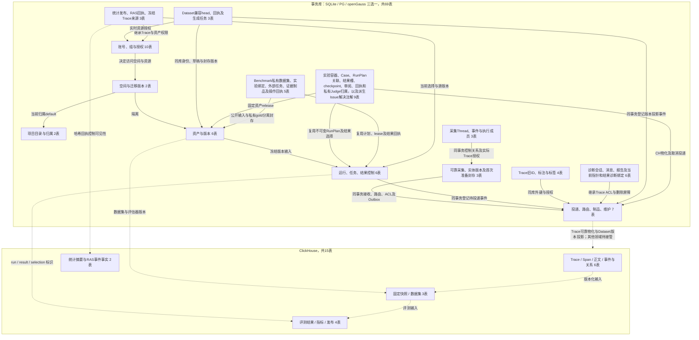

**三个关键区别：**

- 事务库的PK保证一行身份唯一，UK是额外唯一性约束，IDX用于特定查询；PK/UK本身也有索引，不写额外IDX不等于完全没有索引。
- ClickHouse下面列的是`ORDER BY`排序/替换身份键，由它形成稀疏主索引。它不提供事务库那样的唯一约束；同键旧版本可同时存在，读取最新态需`FINAL`或等价去重策略。001的13表都用`ReplacingMergeTree(version)`，按日期字段的`toYYYYMM(...)`月分区。
- 后续关系图中，**实线是已存在的数据库FK，方向为子表→被引用表；虚线是应用层逻辑关联**。跨库无外键；一个相同ID不会自动触发关联检查、级联删除或跨库JOIN。

### 事务库：每张表存什么、主键与索引

以下`W`均为完整字段`workspace_id`，不是省略租户隔离。业务表大多以`(W,实体ID)`为主键；账号、组、会话/凭据等IAM全局对象使用各自全局ID。`work_items`等表几组看似重复的复合UK是外键引用目标，让数据库能直接校验run/case/slot同源；它们也会增加写入维护成本。`UK`列出全部额外唯一约束；`IDX`列出当前DDL的全部显式二级索引及查询用途。列顺序与实际DDL一致，“查询用途”不代表已经跑过容量验收。

#### 空间与迁移版本（2张）

| 表 | 一行存什么 | PK | UK / 显式IDX及用途 |
|---|---|---|---|
| `schema_meta` | 已应用迁移版本、DDL校验和与应用时间；不是业务数据。 | `(version)` | 无额外UK/IDX；按PK查找 |
| `workspaces` | 数据隔离空间及启停状态；用户组和个人可各拥有空间。 | `(W)` | 无额外UK/IDX；按PK查找 |

#### 项目目录与归属（2张，003）

| 表 | 一行存什么 | PK | UK / 显式IDX及用途 |
|---|---|---|---|
| `projects` | 项目目录与状态；当前固定启用default，不承担成员授权。 | `(project_id)` | 无额外UK/IDX；按PK查找 |
| `project_workspaces` | 每个workspace唯一属于哪个项目；003将旧workspace原样归入default。 | `(W)` | IDX`(project_id,W)`：按项目查workspace归属 |

#### 账号、用户组与授权（10张）

| 表 | 一行存什么 | PK | UK / 显式IDX及用途 |
|---|---|---|---|
| `iam_principals` | 稳定账号主体、登录名、启停状态及认证版本；不存明文密码。 | `(principal_id)` | UK`(normalized_login_name)` |
| `iam_password_credentials` | 每账号一份加盐密码派生值、算法参数及改密版本。 | `(principal_id)` | 无额外UK/IDX；按PK查找 |
| `iam_api_credentials` | 采集/自动化Key摘要，固定账号、workspace、能力和有效期。 | `(credential_id)` | UK`(token_hash)`<br>IDX`(principal_id,W,revoked_at_ms)`：按用户/空间查询Key状态<br>IDX`(expires_at_ms)`：扫描过期Key |
| `iam_external_identities` | 外部登录provider/issuer/subject到账号的绑定。 | `(external_identity_id)` | UK`(provider,issuer,subject)`<br>IDX`(principal_id)`：查用户外部绑定 |
| `iam_sessions` | 登录会话摘要、主体认证版本、有效期与撤销时间。 | `(session_id)` | UK`(session_token_hash)`<br>IDX`(principal_id,revoked_at_ms)`：查用户会话状态<br>IDX`(expires_at_ms)`：扫描过期会话 |
| `iam_groups` | 用户组名称、状态、创建人和权限策略版本。 | `(group_id)` | UK`(group_key)`<br>IDX`(created_by)`：按创建人查组 |
| `iam_group_memberships` | 一个用户在一个组的角色、状态和CAS版本。 | `(group_id,principal_id)` | IDX`(principal_id,status,group_id)`：查用户所属有效组<br>IDX`(group_id,role,status)`：检查组Owner |
| `iam_workspace_bindings` | workspace属于哪个组或个人；两类所有权互斥。 | `(W)` | IDX`(owner_group_id)`：查组下空间<br>IDX`(owner_principal_id)`：查个人空间 |
| `iam_resource_access` | Trace/资产/运行/快照/制品的创建人及共享可见性。 | `(W,resource_kind,resource_id)` | IDX`(owner_principal_id,W,resource_kind)`：查本人资源<br>IDX`(W,visibility,resource_kind)`：查空间共享资源 |
| `iam_resource_grants` | 某资源明确共享给哪些用户；不授予编辑权。 | `(W,resource_kind,resource_id,grantee_principal_id)` | IDX`(grantee_principal_id,W,resource_kind)`：查分享给某用户的资源 |

#### 可版本化资产（6张）

| 表 | 一行存什么 | PK | UK / 显式IDX及用途 |
|---|---|---|---|
| `asset_identities` | Agent/Skill/Evaluator/Dataset/Benchmark的稳定身份、类型和名称。 | `(W,asset_id)` | UK`(W,kind,name)`<br>IDX`(W,kind,created_at_ms)`：按空间/资产类型列出新建资产 |
| `asset_releases` | 某资产一个不可变发布版本的内容hash与manifest引用。 | `(W,release_id)` | UK`(W,asset_id,version_label)`<br>UK`(W,asset_id,release_id)`<br>IDX`(W,asset_id,created_at_ms)`：按资产列出版本 |
| `asset_drafts` | 资产某分支的可编辑草稿，含基准release和编辑版本。 | `(W,draft_id)` | UK`(W,asset_id,branch_name)` |
| `asset_release_dependencies` | 某release依赖哪些精确release及依赖角色。 | `(W,release_id,role,dependency_release_id)` | IDX`(W,dependency_release_id)`：反查哪些版本依赖当前版本 |
| `asset_release_seals` | release已封存的凭证，冻结依赖数量和资产归属。 | `(W,release_id)` | UK`(W,asset_id,release_id)` |
| `asset_aliases` | 某资产latest/stable等别名当前指向哪个封存版本。 | `(W,asset_id,alias)` | 无额外UK/IDX；按PK查找 |

#### 运行、任务与结果控制（6张）

| 表 | 一行存什么 | PK | UK / 显式IDX及用途 |
|---|---|---|---|
| `runs` | 一次实验/评测运行的冻结计划、样本分母与运行状态。 | `(W,run_id)` | IDX`(W,status,created_at_ms)`：按状态查运行 |
| `run_inputs` | run每个输入槽采用哪个精确release及配置hash。 | `(W,run_id,slot)` | 无额外UK/IDX；按PK查找 |
| `work_items` | 待执行任务；冻结run/case/phase/evaluator_slot，保存调度状态。 | `(W,work_item_id)` | UK`(W,run_id,case_key,phase,evaluator_slot)`<br>UK`(W,run_id,work_item_id)`<br>UK`(W,run_id,work_item_id,case_key)`<br>UK`(W,run_id,work_item_id,case_key,evaluator_slot)`<br>IDX`(W,status,next_attempt_at_ms,priority)`：查可领取任务候选<br>IDX`(W,run_id,status)`：查运行内任务进度 |
| `work_attempts` | 任务每次尝试的worker、租约、fence、起止和错误。 | `(W,attempt_id)` | UK`(W,work_item_id,attempt_no)`<br>UK`(W,work_item_id,fence)`<br>UK`(W,work_item_id,attempt_id)`<br>IDX`(W,status,lease_until_ms)`：扫描到期租约<br>IDX`(W,work_item_id,attempt_no)`：查任务尝试历史 |
| `result_receipts` | 回调接收凭证：归属attempt/case/slot、幂等键、result_id与制品hash。 | `(W,receipt_id)` | UK`(W,attempt_id,receipt_key)`<br>UK`(W,result_id)`<br>UK`(W,run_id,result_id)`<br>UK`(W,run_id,case_key,evaluator_slot,result_id)`<br>IDX`(W,state,created_at_ms)`：查待索引回执 |
| `result_selections` | 每run/case/evaluator_slot当前选用哪个已接收结果。 | `(W,run_id,case_key,evaluator_slot)` | 无额外UK/IDX；按PK查找 |

#### 投递、路由、制品与维护（7张）

| 表 | 一行存什么 | PK | UK / 显式IDX及用途 |
|---|---|---|---|
| `outbox_events` | 与事务状态同提交的待投递事件、重试和租约。 | `(W,event_id)` | UK`(W,aggregate_id,aggregate_revision,event_type)`<br>IDX`(state,next_attempt_at_ms,created_at_ms)`：扫描待重试事件<br>IDX`(W,aggregate_id,aggregate_revision)`：按实体修订重放 |
| `inbox_receipts` | 消费者已处理的source/event及hash，用于幂等判定。 | `(W,source_id,event_id)` | 无额外UK/IDX；按PK查找 |
| `trace_locators` | 内部Trace ID、原生ID/来源/代次、日期路由及删除状态。 | `(W,trace_id)` | UK`(W,source_namespace,native_trace_id,incarnation)`<br>IDX`(W,trace_bucket,state)`：按空间/日期/状态查路由 |
| `snapshot_manifests` | 固定Trace输入快照的清单引用、hash、节点数和水位。 | `(W,snapshot_id)` | IDX`(W,state,created_at_ms)`：按状态列出快照 |
| `artifact_metadata` | 制品位置、namespace、hash、大小、类型及发布状态；不是文件正文。 | `(W,artifact_id)` | UK`(W,namespace,object_ref)`<br>IDX`(W,state,created_at_ms)`：按状态列出制品 |
| `deletion_requests` | 按资源/代次登记的删除请求、屏障版本和进度。 | `(W,deletion_id)` | UK`(W,resource_kind,resource_id,incarnation)`<br>IDX`(W,state,created_at_ms)`：扫描删除任务 |
| `migration_checkpoints` | 旧表迁移进度、源指纹、最后处理键及目标水位。 | `(W,migration_id,source_table)` | 无额外UK/IDX；按PK查找 |

#### 可靠采集与实体版本（2张，004）

| 表 | 一行存什么 | PK | UK / 显式IDX及用途 |
|---|---|---|---|
| `ingest_batches` | 一个主体在空间中已持久接收的OTLP包、冻结计划及索引状态。 | `(W,batch_id)` | UK`(W,principal_id,receipt_key)`；IDX`(W,principal_id,accepted_at_ms)`查本人回执；IDX`(state,accepted_at_ms)`查进度 |
| `obs_entity_heads` | Trace/Span当前内部版本、源版本和私有内容制品引用；不存正文。 | `(W,trace_id,entity_kind,entity_id)` | 无额外UK/IDX；按PK查实体，PK前缀可查同Trace的Span heads |

#### Dataset兼容、版本操作与生成（3张，008–009）

| 表 | 一行存什么 | PK | UK / 显式IDX及用途 |
|---|---|---|---|
| `dataset_compat_heads` | 原Dataset ID对应资产、当前草稿/封存版本、生命周期与CAS版本。 | `(W,dataset_id)` | UK`(W,asset_id)`、`(W,draft_id)`；IDX`(W,state,updated_at_ms,dataset_id)`：按空间和生命周期列出Dataset |
| `dataset_operation_receipts` | 实际actor一次操作的请求摘要与精确结果引用。 | `(W,actor_principal_id,operation_kind,operation_key)` | 无额外UK；IDX`(W,dataset_id,created_at_ms)`：按Dataset查回执 |
| `dataset_generation_jobs` | Trace生成请求的冻结配置/来源、阶段、租约、fence及结果。 | `(W,job_id)` | UK`(W,dataset_id)`、`(W,actor_principal_id,request_id)`、`(W,deletion_id)`；IDX`(W,actor_principal_id,status,created_at_ms)`：按actor和状态查任务 |

### ClickHouse：事实、排序键、分区与版本

下表`ORDER BY`为完整有序键。日期bucket不仅用于分区，也属于替换身份；实体的bucket应固定，不能因晚到更新而换bucket。当前DDL未另建显式跳数索引、Projection或物化视图，不把字段名出现在表中当作已有专项索引。

| 表 | 一行存什么 | ORDER BY | 月分区字段 | 替换版本 |
|---|---|---|---|---|
| `obs_trace_current` | 一个Trace的最新摘要：状态、时间、Span数、Token及维度。 | `(W,trace_bucket,trace_id)` | `trace_bucket` | `revision` |
| `obs_span_current` | 一个Span的最新结构/指标：父子关系、模型/工具、耗时、Token、正文revision。 | `(W,trace_bucket,trace_id,span_id)` | `trace_bucket` | `revision` |
| `obs_payload_chunks` | 该正文版本的某section第N块UTF-8正文及hash。 | `(W,trace_bucket,trace_id,span_id,payload_revision,section,chunk_no)` | `trace_bucket` | `retry_version` |
| `obs_payload_manifests` | 某Span某正文版本的section/块数/字节数/hash完整性清单。 | `(W,trace_bucket,trace_id,span_id,payload_revision)` | `trace_bucket` | `retry_version` |
| `obs_events` | Trace内的单个观测事件、来源序号与内容引用。 | `(W,trace_bucket,trace_id,event_id)` | `trace_bucket` | `retry_version` |
| `obs_entity_relations` | 协作、父子以外的实体关联事实及其修订。 | `(W,trace_bucket,relation_id)` | `trace_bucket` | `revision` |
| `snapshot_nodes` | 固定快照的单个节点，锁定Span和正文版本，避免受最新态改写影响。 | `(W,snapshot_bucket,snapshot_id,node_id)` | `snapshot_bucket` | `retry_version` |
| `dataset_sample_revisions` | 样本的不可变修订：case、公共/私有内容引用、字段Schema和来源快照。 | `(W,sample_bucket,dataset_id,sample_revision_id)` | `sample_bucket` | `retry_version` |
| `dataset_release_members` | 某数据集release按ordinal固定包含哪些样本修订。 | `(W,release_bucket,dataset_release_id,ordinal)` | `release_bucket` | `retry_version` |
| `eval_result_facts` | 一个评测结果的结论、摘要、证据、使用的Evaluator版本及输入快照。 | `(W,result_bucket,result_id)` | `result_bucket` | `retry_version` |
| `eval_metric_facts` | 某结果的某指标/维度值，含类型、单位、方法及证据引用。 | `(W,result_bucket,result_id,metric_definition_release_id,metric_key,dimension_key)` | `result_bucket` | `retry_version` |
| `eval_result_selection_current` | 事务库结果选择的分析侧最新投影；使用selection_revision。 | `(W,run_bucket,run_id,case_key,evaluator_slot)` | `run_bucket` | `selection_revision` |
| `eval_publication_members` | 一次分析发布批次冻结采用哪些结果/裁决及排除原因。 | `(W,publication_bucket,publication_id,ordinal)` | `publication_bucket` | `retry_version` |

### default项目与workspace：归属不授予权限

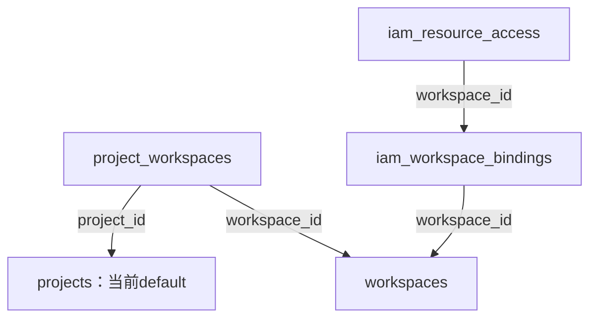

003只增加项目目录和workspace归属，不合并workspace、不改业务/Trace ID、不新增Owner/组员或ACL。当前所有workspace归属default，但用户仍按原workspace/资源权限读取，不能因为项目相同就看见其他组或其他人的数据。未来项目可以包含多个workspace，当前请求仅接受default；未指定时兼容为default，显式未知项目拒绝。

### 关联图一：账号凭据与组内资源权限

账号认证关系与组内授权分开看，避免将“已登录”误当成“能访问所有空间”。

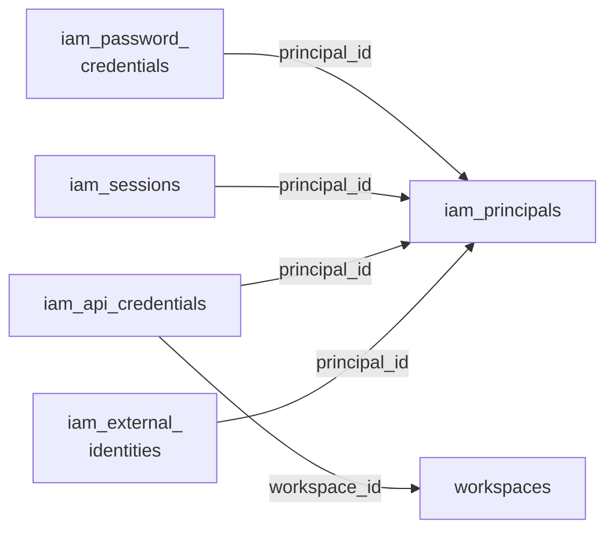

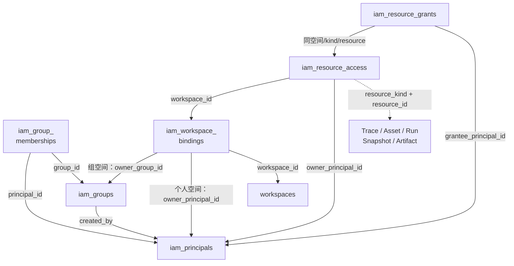

一个用户可在多个组，一个组可有多个workspace；workspace只能是组/个人所有权之一。组管理员读当前组全部资源，不通过“组员用户名列表”筛选历史Trace。成员退出后数据仍留原组；普通成员按资源归属/明确共享读取。ACL到业务资源是多态逻辑引用，数据库FK并不检查目标资源存在；业务写入与归属注册须由服务同事务处理。

### 关联图二：资产身份、草稿、发布、依赖与别名

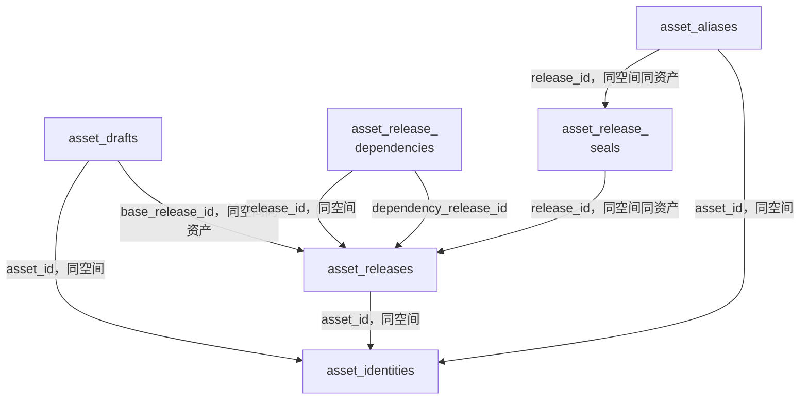

Agent、Skill、Evaluator、Dataset、Benchmark共用这6表，通过`asset_identities.kind`区分。身份不变、每次发布新增release；草稿可CAS编辑；依赖先写完再封存；`latest`等别名只能指向**同空间、同资产的封存版本**。例如Evaluator v1/v2不是两张表，而是一个资产身份下的两个release；Benchmark扩展的版本内容放manifest及精确依赖，后续业务协议仍需接入。

### 关联图三：运行、任务尝试、回执与结果选择

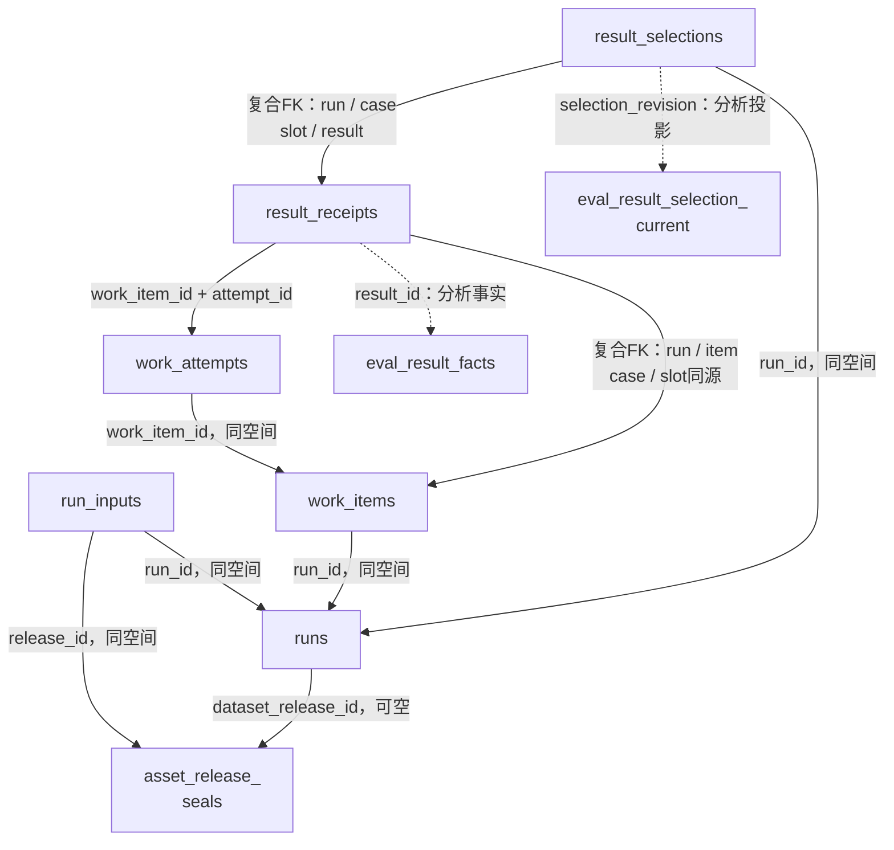

`run`是整批执行，`work_item`是一个case/phase/evaluator槽的任务，`attempt`是实际重试。回执不等于最终选中的结果，也不等于已进入CH或已发布。复合外键禁止把另一个run/case/槽的结果选进来；fence/租约校验进一步拒绝过期worker回调。`outbox_events`与回执事务一起写，评测事件投递与CH物化仍为后续链路；004仅接管观测OTLP事件，不因复用Outbox就宣称评测已自动同步。

### 关联图四：Trace、Span、正文与固定快照

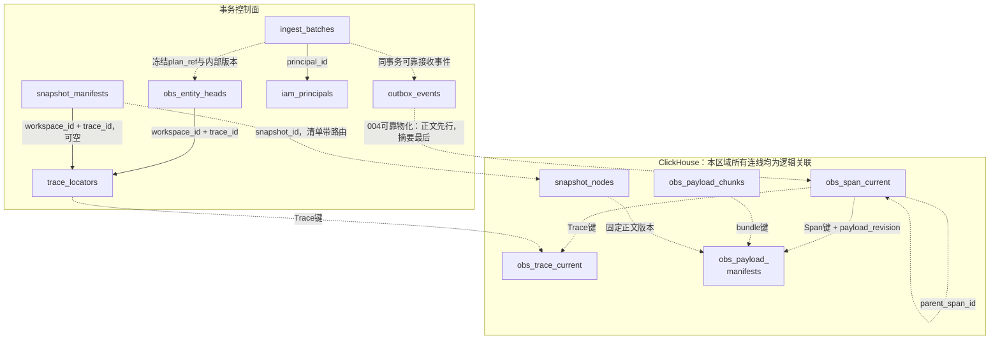

- 图中Trace键=`(workspace_id,trace_bucket,trace_id)`；Span键在其后增加`span_id`；bundle键继续增加`payload_revision`。块在bundle键后增加`section,chunk_no`。
- Trace摘要一行；每个Span的最新结构单独一行。单Span详情先查授权和事务路由，再精确读取`W + trace_bucket + trace_id + span_id`，不必取整个Trace JSON。
- 大正文从结构中拆出。Span用`payload_revision`指向bundle；清单和块有相同的`W + trace_bucket + trace_id + span_id + payload_revision`，块再带section/chunk_no。按需取某Span的input/output某页，不拼接不同revision。
- 正文`payload_revision`是内容hash；Span的`revision`是递增状态版本；正文重试的`retry_version`用于物理去重，三者含义不同。
- `obs_events`按Trace键关联事件；`parent_span_id`是同Trace内逻辑边，`obs_entity_relations`可表达其他实体关系，不能假定它的所有source/target都一定是Span。它们没有数据库FK；缺失父节点、乱序到达、跨实体类型必须由物化/读取协议处理。
- `snapshot_nodes`固定输入所需的节点内容和正文版本，不依赖`current`表永远保留旧版本。快照构建/发布业务仍待后续接管。

### 关联图五：多版本数据集、评测事实与发布口径

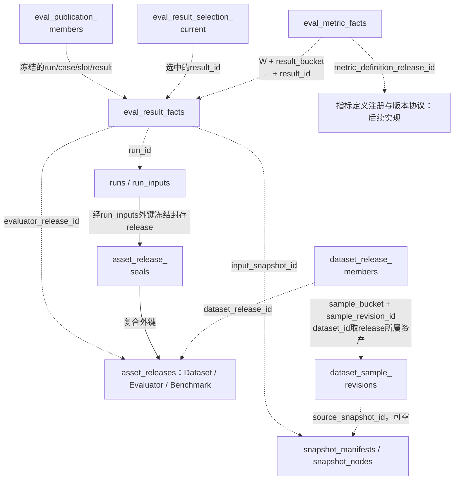

图中“指标定义注册与版本协议”是未来控制面能力，历史005阶段的52表内尚无独立指标定义注册表；当前009阶段的59表同样未增加该表；不把该字段假定为指向asset_releases的已落实外键。数据集release成员固定**样本修订ID**，不是“当前样本”。评测结果与指标拆开：结论一行，多个指标/维度各一行，新增指标通常不必为每项指标加固定列。`result_selections`是事务选择真源，CH的selection是查询投影；publication成员固定某次发布的口径，不能随“当前选择”变化而改写历史发布结果。publication/指标定义完整控制协议尚未全部落地，不把CH字段预留当作已有发布服务。

跨CH表读取还要知道目标的bucket；仅有`result_id`、`snapshot_id`或`release_id`通常不足以做精确分区读取。清单/发布事件需要携带路由，并校验workspace、内容hash、精确版本和可见性。此批表结构不提供跨库FK或全域ID到bucket的自动解析器，相关领域接管时须落实，不能靠全库扫描补上协议。

### 索引如何服务实际查询

| 操作 | 使用的键/索引 | 实际作用与当前边界 |
|---|---|---|
| 登录 | `iam_principals`的login唯一键；凭据/会话摘要唯一键 | 精确定位主体或令牌，状态/版本/到期仍需验证 |
| 查某组全部workspace | `iam_workspace_bindings(owner_group_id)` | 在事务库计算授权范围；CH不会自行推导组成员权限 |
| 查某资产历史版本 | `asset_releases(W,asset_id,created_at_ms)` | 不扫描其他资产；版本标签UK防止同资产标签重复 |
| 找可领取任务 | `work_items(W,status,next_attempt_at_ms,priority)` | 缩小候选；当前SQL完整排序还包含created_at_ms/work_item_id，不声称此索引覆盖全部排序 |
| 找过期租约 | `work_attempts(W,status,lease_until_ms)` | 找到期候选；fence/终态仍在事务中校验 |
| Outbox重试 | `outbox_events(state,next_attempt_at_ms,created_at_ms)` | 找待投递候选；索引不是消息已可靠交付的证据 |
| 取单个Span或正文块 | CH排序键前缀`W + bucket + trace + span` | 结合日期分区和稀疏索引缩小读取范围；不是事务库逐行B-tree查找 |
| 按时间/模型/状态分析 | CH月分区、`FINAL`后过滤和列式扫描 | 当前model/status/started_at没有额外专项索引；过滤可能仍扫描选定workspace和日期内较多数据，需真实负载再设计Projection/汇总 |

所有事务FK完整列名、ON DELETE规则、CHECK和各字段类型继续见下方逐表字典；图示省略了大部分业务表到`workspaces`的重复FK，不能据此省略workspace条件。

## 范围与未实现项

- 001首批事务表：`schema_meta`, `workspaces`, `asset_identities`, `asset_releases`, `asset_drafts`, `asset_release_dependencies`, `asset_release_seals`, `asset_aliases`, `runs`, `run_inputs`, `work_items`, `work_attempts`, `result_receipts`, `result_selections`, `outbox_events`, `inbox_receipts`, `trace_locators`, `snapshot_manifests`, `artifact_metadata`, `deletion_requests`, `migration_checkpoints`。
- 002追加事务表：`iam_principals`, `iam_password_credentials`, `iam_api_credentials`, `iam_external_identities`, `iam_sessions`, `iam_groups`, `iam_group_memberships`, `iam_workspace_bindings`, `iam_resource_access`, `iam_resource_grants`。
- 003追加事务表：`projects`, `project_workspaces`；004追加事务表：`ingest_batches`, `obs_entity_heads`。005追加事务表：`trace_legacy_ids`, `trace_annotations`, `trace_tags`, `trace_tag_links`。006追加`trace_diagnosis_sessions`、`trace_diagnosis_messages`；007追加`diagnostic_report_runs`、`diagnostic_report_heads`。上述为截至007的历史43张事务表。
- 008追加`dataset_compat_heads`、`dataset_operation_receipts`；009追加`dataset_generation_jobs`。当前001–009合计46张事务表，连同13张CH表共59张。
- 当前CH表：`obs_payload_manifests`, `obs_trace_current`, `obs_span_current`, `obs_payload_chunks`, `obs_events`, `obs_entity_relations`, `snapshot_nodes`, `dataset_sample_revisions`, `dataset_release_members`, `eval_result_facts`, `eval_metric_facts`, `eval_result_selection_current`, `eval_publication_members`。
- 仍待后续批次：账号恢复与外部身份业务入口、资产异步发布、插件与指标注册、run groups、人工裁决/评论、其他领域标签、资源引用/pin、客户端控制与配置、领域会话/计划、运维遥测与汇总代次等。现有服务/API 尚未全部切换到新表。

账号密码、用户组和组管理员的IAM基础库与统一授权门面已实现；显式core Web模式已接入密码登录与Trace路径，其他领域未全部接管；权限矩阵及历史归组规则见 [总体设计 §4.2](phase2-requirements-design.md#42-账号密码登录用户组与组管理员新增明确需求)。当前workspace外键保护引用归属，不能替代Web请求鉴权。

## 公共类型与约束

- TEXT：UTF-8，标识符最多 512 字符且无控制字符，port 负责精确验证；SQL 不自动生成 UUID。
- BIGINT：带符号 64 位。时间 `_ms` 为 UTC Unix 毫秒；revision/fence/etag 统一限定 1..2^63-1，不能用墙钟拼接进程序号；CH 使用 UInt64 但 CHECK 相同范围。SQLite BIGINT 物理映射 INTEGER。
- manifest-json/v1：ASCII 键、按键排序、UTF-8、不允许浮点；超过 JS 安全整数范围的整数及定点金额用十进制字符串。语义内容 hash 为规范字节 SHA-256；schema_meta.checksum 则是执行 SQL 文件原始字节的 SHA-256。
- JSON 字段用 TEXT 保留，port 验证结构和大小；不依赖三库不同 JSON 语法。hash 由 port 验证小写十六进制，SQL 校验长度。
- 业务实体间的租户外键含workspace_id；IAM主体/组和项目目录等全局对象使用对应全局键。无跨CH外键。SQL 默认 NO ACTION；发布版本不通过级联清理删除。nullable FK 仅表示显式无引用，不表示跨租户或全局共享。
- 不可变表 UPDATE/DELETE 被触发器拒绝。普通应用也不能绕过发布服务直接改依赖；依赖图无环、角色/类型相容、版本可见性由服务层验证。
- schema_meta 仅迁移器写；SQL 不预插固定 checksum。新目标初始化拒绝包含旧业务表的数据库；重开新库需精确校验版本和 checksum，不隐式升级。

## 事务表字段

### schema_meta

| 字段 | 逻辑类型 | 可空 | 默认 |
|---|---|---|---|
| `version` | INTEGER | 否 | 应用显式提供 |
| `name` | TEXT | 否 | 应用显式提供 |
| `checksum` | TEXT | 否 | 应用显式提供 |
| `applied_at_ms` | BIGINT | 否 | 应用显式提供 |

PK：`version`。
CHECK：`version > 0`。
CHECK：`applied_at_ms >= 0`。

### workspaces

| 字段 | 逻辑类型 | 可空 | 默认 |
|---|---|---|---|
| `workspace_id` | TEXT | 否 | 应用显式提供 |
| `name` | TEXT | 否 | 应用显式提供 |
| `state` | TEXT | 否 | active |
| `created_at_ms` | BIGINT | 否 | 应用显式提供 |
| `updated_at_ms` | BIGINT | 否 | 应用显式提供 |

PK：`workspace_id`。
CHECK：`state IN ('active','suspended','deleted')`。
CHECK：`created_at_ms >= 0`。
CHECK：`updated_at_ms >= 0`。

### asset_identities

| 字段 | 逻辑类型 | 可空 | 默认 |
|---|---|---|---|
| `workspace_id` | TEXT | 否 | 应用显式提供 |
| `asset_id` | TEXT | 否 | 应用显式提供 |
| `kind` | TEXT | 否 | 应用显式提供 |
| `name` | TEXT | 否 | 应用显式提供 |
| `visibility` | TEXT | 否 | private |
| `description` | TEXT | 否 | '' |
| `etag` | BIGINT | 否 | 1 |
| `created_at_ms` | BIGINT | 否 | 应用显式提供 |
| `updated_at_ms` | BIGINT | 否 | 应用显式提供 |

PK：`workspace_id, asset_id`。
UNIQUE：`workspace_id, kind, name`。
FK：`workspace_id` → `workspaces(workspace_id)`。
CHECK：`kind IN ('skill','agent','evaluator','dataset','benchmark')`。
CHECK：`visibility IN ('private','workspace','public')`。
CHECK：`etag > 0`。
CHECK：`length(name) > 0`。
CHECK：`etag <= 9223372036854775807`。
CHECK：`created_at_ms >= 0`。
CHECK：`updated_at_ms >= 0`。
INDEX `idx_asset_identities_1`：`workspace_id, kind, created_at_ms`。

### asset_releases

| 字段 | 逻辑类型 | 可空 | 默认 |
|---|---|---|---|
| `workspace_id` | TEXT | 否 | 应用显式提供 |
| `release_id` | TEXT | 否 | 应用显式提供 |
| `asset_id` | TEXT | 否 | 应用显式提供 |
| `version_label` | TEXT | 否 | 应用显式提供 |
| `content_hash` | TEXT | 否 | 应用显式提供 |
| `manifest_ref` | TEXT | 否 | 应用显式提供 |
| `schema_version` | INTEGER | 否 | 应用显式提供 |
| `publisher_id` | TEXT | 否 | 应用显式提供 |
| `created_at_ms` | BIGINT | 否 | 应用显式提供 |

PK：`workspace_id, release_id`。
UNIQUE：`workspace_id, asset_id, version_label`。
UNIQUE：`workspace_id, asset_id, release_id`。
FK：`workspace_id,asset_id` → `asset_identities(workspace_id,asset_id)`。
CHECK：`length(content_hash) = 64`。
CHECK：`schema_version > 0`。
CHECK：`length(version_label) > 0`。
CHECK：`created_at_ms >= 0`。
INDEX `idx_asset_releases_1`：`workspace_id, asset_id, created_at_ms`。
不可变：禁止原地 UPDATE/DELETE；修订新建 release/事实。

### asset_drafts

| 字段 | 逻辑类型 | 可空 | 默认 |
|---|---|---|---|
| `workspace_id` | TEXT | 否 | 应用显式提供 |
| `draft_id` | TEXT | 否 | 应用显式提供 |
| `asset_id` | TEXT | 否 | 应用显式提供 |
| `branch_name` | TEXT | 否 | 应用显式提供 |
| `base_release_id` | TEXT | 是 | 应用显式提供 |
| `manifest_json` | TEXT | 否 | 应用显式提供 |
| `edit_revision` | BIGINT | 否 | 1 |
| `created_at_ms` | BIGINT | 否 | 应用显式提供 |
| `updated_at_ms` | BIGINT | 否 | 应用显式提供 |

PK：`workspace_id, draft_id`。
UNIQUE：`workspace_id, asset_id, branch_name`。
FK：`workspace_id,asset_id` → `asset_identities(workspace_id,asset_id)`。
FK：`workspace_id,asset_id,base_release_id` → `asset_releases(workspace_id,asset_id,release_id)`。
CHECK：`edit_revision > 0`。
CHECK：`edit_revision <= 9223372036854775807`。
CHECK：`created_at_ms >= 0`。
CHECK：`updated_at_ms >= 0`。

### asset_release_dependencies

| 字段 | 逻辑类型 | 可空 | 默认 |
|---|---|---|---|
| `workspace_id` | TEXT | 否 | 应用显式提供 |
| `release_id` | TEXT | 否 | 应用显式提供 |
| `role` | TEXT | 否 | 应用显式提供 |
| `dependency_release_id` | TEXT | 否 | 应用显式提供 |
| `created_at_ms` | BIGINT | 否 | 应用显式提供 |

PK：`workspace_id, release_id, role, dependency_release_id`。
FK：`workspace_id,release_id` → `asset_releases(workspace_id,release_id)`。
FK：`workspace_id,dependency_release_id` → `asset_releases(workspace_id,release_id)`。
CHECK：`release_id <> dependency_release_id`。
CHECK：`created_at_ms >= 0`。
INDEX `idx_asset_release_dependencies_1`：`workspace_id, dependency_release_id`。
不可变：禁止原地 UPDATE/DELETE；修订新建 release/事实。

### asset_release_seals

| 字段 | 逻辑类型 | 可空 | 默认 |
|---|---|---|---|
| `workspace_id` | TEXT | 否 | 应用显式提供 |
| `release_id` | TEXT | 否 | 应用显式提供 |
| `asset_id` | TEXT | 否 | 应用显式提供 |
| `dependency_count` | BIGINT | 否 | 应用显式提供 |
| `created_at_ms` | BIGINT | 否 | 应用显式提供 |

PK：`workspace_id, release_id`。
UNIQUE：`workspace_id, asset_id, release_id`。
FK：`workspace_id,asset_id,release_id` → `asset_releases(workspace_id,asset_id,release_id)`。
CHECK：`dependency_count >= 0`。
CHECK：`created_at_ms >= 0`。
不可变：禁止原地 UPDATE/DELETE；修订新建 release/事实。

### asset_aliases

| 字段 | 逻辑类型 | 可空 | 默认 |
|---|---|---|---|
| `workspace_id` | TEXT | 否 | 应用显式提供 |
| `asset_id` | TEXT | 否 | 应用显式提供 |
| `alias` | TEXT | 否 | 应用显式提供 |
| `release_id` | TEXT | 否 | 应用显式提供 |
| `etag` | BIGINT | 否 | 1 |
| `created_at_ms` | BIGINT | 否 | 应用显式提供 |
| `updated_at_ms` | BIGINT | 否 | 应用显式提供 |

PK：`workspace_id, asset_id, alias`。
FK：`workspace_id,asset_id` → `asset_identities(workspace_id,asset_id)`。
FK：`workspace_id,asset_id,release_id` → `asset_release_seals(workspace_id,asset_id,release_id)`。
CHECK：`etag > 0`。
CHECK：`etag <= 9223372036854775807`。
CHECK：`created_at_ms >= 0`。
CHECK：`updated_at_ms >= 0`。

### runs

| 字段 | 逻辑类型 | 可空 | 默认 |
|---|---|---|---|
| `workspace_id` | TEXT | 否 | 应用显式提供 |
| `run_id` | TEXT | 否 | 应用显式提供 |
| `name` | TEXT | 否 | 应用显式提供 |
| `plan_hash` | TEXT | 否 | 应用显式提供 |
| `plan_manifest_ref` | TEXT | 否 | 应用显式提供 |
| `dataset_release_id` | TEXT | 是 | 应用显式提供 |
| `expected_case_count` | BIGINT | 否 | 应用显式提供 |
| `status` | TEXT | 否 | draft |
| `etag` | BIGINT | 否 | 1 |
| `created_at_ms` | BIGINT | 否 | 应用显式提供 |
| `updated_at_ms` | BIGINT | 否 | 应用显式提供 |

PK：`workspace_id, run_id`。
FK：`workspace_id` → `workspaces(workspace_id)`。
FK：`workspace_id,dataset_release_id` → `asset_release_seals(workspace_id,release_id)`。
CHECK：`length(plan_hash) = 64`。
CHECK：`expected_case_count >= 0`。
CHECK：`etag > 0`。
CHECK：`status IN ('draft','queued','running','done','partial','failed','cancelled')`。
CHECK：`etag <= 9223372036854775807`。
CHECK：`created_at_ms >= 0`。
CHECK：`updated_at_ms >= 0`。
INDEX `idx_runs_1`：`workspace_id, status, created_at_ms`。

### run_inputs

| 字段 | 逻辑类型 | 可空 | 默认 |
|---|---|---|---|
| `workspace_id` | TEXT | 否 | 应用显式提供 |
| `run_id` | TEXT | 否 | 应用显式提供 |
| `slot` | TEXT | 否 | 应用显式提供 |
| `release_id` | TEXT | 否 | 应用显式提供 |
| `config_hash` | TEXT | 否 | 应用显式提供 |
| `created_at_ms` | BIGINT | 否 | 应用显式提供 |

PK：`workspace_id, run_id, slot`。
FK：`workspace_id,run_id` → `runs(workspace_id,run_id)`。
FK：`workspace_id,release_id` → `asset_release_seals(workspace_id,release_id)`。
CHECK：`length(config_hash) = 64`。
CHECK：`created_at_ms >= 0`。
不可变：禁止原地 UPDATE/DELETE；修订新建 release/事实。

### work_items

| 字段 | 逻辑类型 | 可空 | 默认 |
|---|---|---|---|
| `workspace_id` | TEXT | 否 | 应用显式提供 |
| `work_item_id` | TEXT | 否 | 应用显式提供 |
| `run_id` | TEXT | 否 | 应用显式提供 |
| `case_key` | TEXT | 否 | 应用显式提供 |
| `phase` | TEXT | 否 | 应用显式提供 |
| `evaluator_slot` | TEXT | 否 | default |
| `status` | TEXT | 否 | queued |
| `priority` | INTEGER | 否 | 0 |
| `etag` | BIGINT | 否 | 1 |
| `next_attempt_at_ms` | BIGINT | 否 | 0 |
| `cancel_requested` | INTEGER | 否 | 0 |
| `created_at_ms` | BIGINT | 否 | 应用显式提供 |
| `updated_at_ms` | BIGINT | 否 | 应用显式提供 |

PK：`workspace_id, work_item_id`。
UNIQUE：`workspace_id, run_id, case_key, phase, evaluator_slot`。
UNIQUE：`workspace_id, run_id, work_item_id`。
UNIQUE：`workspace_id, run_id, work_item_id, case_key`。
UNIQUE：`workspace_id, run_id, work_item_id, case_key, evaluator_slot`。
FK：`workspace_id,run_id` → `runs(workspace_id,run_id)`。
CHECK：`etag > 0`。
CHECK：`cancel_requested IN (0,1)`。
CHECK：`phase IN ('execute','evaluate','snapshot','publish','migrate')`。
CHECK：`status IN ('queued','running','done','failed','cancelled')`。
CHECK：`etag <= 9223372036854775807`。
CHECK：`next_attempt_at_ms >= 0`。
CHECK：`created_at_ms >= 0`。
CHECK：`updated_at_ms >= 0`。
INDEX `idx_work_items_1`：`workspace_id, status, next_attempt_at_ms, priority`。
INDEX `idx_work_items_2`：`workspace_id, run_id, status`。

### work_attempts

| 字段 | 逻辑类型 | 可空 | 默认 |
|---|---|---|---|
| `workspace_id` | TEXT | 否 | 应用显式提供 |
| `attempt_id` | TEXT | 否 | 应用显式提供 |
| `work_item_id` | TEXT | 否 | 应用显式提供 |
| `attempt_no` | BIGINT | 否 | 应用显式提供 |
| `fence` | BIGINT | 否 | 应用显式提供 |
| `worker_id` | TEXT | 否 | 应用显式提供 |
| `status` | TEXT | 否 | 应用显式提供 |
| `lease_until_ms` | BIGINT | 否 | 应用显式提供 |
| `started_at_ms` | BIGINT | 否 | 应用显式提供 |
| `finished_at_ms` | BIGINT | 是 | 应用显式提供 |
| `error_code` | TEXT | 是 | 应用显式提供 |

PK：`workspace_id, attempt_id`。
UNIQUE：`workspace_id, work_item_id, attempt_no`。
UNIQUE：`workspace_id, work_item_id, fence`。
UNIQUE：`workspace_id, work_item_id, attempt_id`。
FK：`workspace_id,work_item_id` → `work_items(workspace_id,work_item_id)`。
CHECK：`attempt_no > 0`。
CHECK：`fence > 0`。
CHECK：`status IN ('running','done','failed','cancelled','expired')`。
CHECK：`lease_until_ms >= started_at_ms`。
CHECK：`fence <= 9223372036854775807`。
CHECK：`lease_until_ms >= 0`。
CHECK：`started_at_ms >= 0`。
CHECK：`finished_at_ms >= 0`。
INDEX `idx_work_attempts_1`：`workspace_id, status, lease_until_ms`。
INDEX `idx_work_attempts_2`：`workspace_id, work_item_id, attempt_no`。

### result_receipts

| 字段 | 逻辑类型 | 可空 | 默认 |
|---|---|---|---|
| `workspace_id` | TEXT | 否 | 应用显式提供 |
| `run_id` | TEXT | 否 | 应用显式提供 |
| `work_item_id` | TEXT | 否 | 应用显式提供 |
| `case_key` | TEXT | 否 | 应用显式提供 |
| `evaluator_slot` | TEXT | 否 | default |
| `receipt_id` | TEXT | 否 | 应用显式提供 |
| `attempt_id` | TEXT | 否 | 应用显式提供 |
| `receipt_key` | TEXT | 否 | 应用显式提供 |
| `result_id` | TEXT | 否 | 应用显式提供 |
| `content_hash` | TEXT | 否 | 应用显式提供 |
| `artifact_ref` | TEXT | 否 | 应用显式提供 |
| `state` | TEXT | 否 | accepted |
| `created_at_ms` | BIGINT | 否 | 应用显式提供 |

PK：`workspace_id, receipt_id`。
UNIQUE：`workspace_id, attempt_id, receipt_key`。
UNIQUE：`workspace_id, result_id`。
UNIQUE：`workspace_id, run_id, result_id`。
UNIQUE：`workspace_id, run_id, case_key, evaluator_slot, result_id`。
FK：`workspace_id,work_item_id,attempt_id` → `work_attempts(workspace_id,work_item_id,attempt_id)`。
FK：`workspace_id,run_id,work_item_id,case_key,evaluator_slot` → `work_items(workspace_id,run_id,work_item_id,case_key,evaluator_slot)`。
CHECK：`length(content_hash) = 64`。
CHECK：`state IN ('accepted','indexed','published','quarantined')`。
CHECK：`created_at_ms >= 0`。
INDEX `idx_result_receipts_1`：`workspace_id, state, created_at_ms`。

### result_selections

| 字段 | 逻辑类型 | 可空 | 默认 |
|---|---|---|---|
| `workspace_id` | TEXT | 否 | 应用显式提供 |
| `run_id` | TEXT | 否 | 应用显式提供 |
| `case_key` | TEXT | 否 | 应用显式提供 |
| `evaluator_slot` | TEXT | 否 | 应用显式提供 |
| `result_id` | TEXT | 否 | 应用显式提供 |
| `selection_revision` | BIGINT | 否 | 应用显式提供 |
| `updated_at_ms` | BIGINT | 否 | 应用显式提供 |

PK：`workspace_id, run_id, case_key, evaluator_slot`。
FK：`workspace_id,run_id` → `runs(workspace_id,run_id)`。
FK：`workspace_id,run_id,case_key,evaluator_slot,result_id` → `result_receipts(workspace_id,run_id,case_key,evaluator_slot,result_id)`。
CHECK：`selection_revision > 0`。
CHECK：`selection_revision <= 9223372036854775807`。
CHECK：`updated_at_ms >= 0`。

### outbox_events

| 字段 | 逻辑类型 | 可空 | 默认 |
|---|---|---|---|
| `workspace_id` | TEXT | 否 | 应用显式提供 |
| `event_id` | TEXT | 否 | 应用显式提供 |
| `aggregate_id` | TEXT | 否 | 应用显式提供 |
| `aggregate_revision` | BIGINT | 否 | 应用显式提供 |
| `event_type` | TEXT | 否 | 应用显式提供 |
| `payload_json` | TEXT | 否 | 应用显式提供 |
| `state` | TEXT | 否 | pending |
| `attempts` | INTEGER | 否 | 0 |
| `next_attempt_at_ms` | BIGINT | 否 | 0 |
| `lease_owner` | TEXT | 是 | 应用显式提供 |
| `lease_until_ms` | BIGINT | 是 | 应用显式提供 |
| `created_at_ms` | BIGINT | 否 | 应用显式提供 |
| `updated_at_ms` | BIGINT | 否 | 应用显式提供 |

PK：`workspace_id, event_id`。
UNIQUE：`workspace_id, aggregate_id, aggregate_revision, event_type`。
FK：`workspace_id` → `workspaces(workspace_id)`。
CHECK：`aggregate_revision > 0`。
CHECK：`attempts >= 0`。
CHECK：`state IN ('pending','dispatching','sent','dead')`。
CHECK：`next_attempt_at_ms >= 0`。
CHECK：`lease_until_ms >= 0`。
CHECK：`created_at_ms >= 0`。
CHECK：`updated_at_ms >= 0`。
INDEX `idx_outbox_events_1`：`state, next_attempt_at_ms, created_at_ms`。
INDEX `idx_outbox_events_2`：`workspace_id, aggregate_id, aggregate_revision`。

### inbox_receipts

| 字段 | 逻辑类型 | 可空 | 默认 |
|---|---|---|---|
| `workspace_id` | TEXT | 否 | 应用显式提供 |
| `source_id` | TEXT | 否 | 应用显式提供 |
| `event_id` | TEXT | 否 | 应用显式提供 |
| `content_hash` | TEXT | 否 | 应用显式提供 |
| `processed_at_ms` | BIGINT | 否 | 应用显式提供 |

PK：`workspace_id, source_id, event_id`。
FK：`workspace_id` → `workspaces(workspace_id)`。
CHECK：`length(content_hash) = 64`。
CHECK：`processed_at_ms >= 0`。
不可变：禁止原地 UPDATE/DELETE；修订新建 release/事实。

### trace_locators

| 字段 | 逻辑类型 | 可空 | 默认 |
|---|---|---|---|
| `workspace_id` | TEXT | 否 | 应用显式提供 |
| `trace_id` | TEXT | 否 | 应用显式提供 |
| `source_namespace` | TEXT | 否 | 应用显式提供 |
| `native_trace_id` | TEXT | 否 | 应用显式提供 |
| `trace_bucket` | TEXT | 否 | 应用显式提供 |
| `route_epoch` | BIGINT | 否 | 1 |
| `incarnation` | BIGINT | 否 | 1 |
| `state` | TEXT | 否 | active |
| `created_at_ms` | BIGINT | 否 | 应用显式提供 |
| `updated_at_ms` | BIGINT | 否 | 应用显式提供 |

PK：`workspace_id, trace_id`。
UNIQUE：`workspace_id, source_namespace, native_trace_id, incarnation`。
FK：`workspace_id` → `workspaces(workspace_id)`。
CHECK：`route_epoch > 0`。
CHECK：`incarnation > 0`。
CHECK：`state IN ('active','deleting','deleted')`。
CHECK：`route_epoch <= 9223372036854775807`。
CHECK：`incarnation <= 9223372036854775807`。
CHECK：`created_at_ms >= 0`。
CHECK：`updated_at_ms >= 0`。
INDEX `idx_trace_locators_1`：`workspace_id, trace_bucket, state`。

### snapshot_manifests

| 字段 | 逻辑类型 | 可空 | 默认 |
|---|---|---|---|
| `workspace_id` | TEXT | 否 | 应用显式提供 |
| `snapshot_id` | TEXT | 否 | 应用显式提供 |
| `trace_id` | TEXT | 是 | 应用显式提供 |
| `manifest_ref` | TEXT | 否 | 应用显式提供 |
| `content_hash` | TEXT | 否 | 应用显式提供 |
| `node_count` | BIGINT | 否 | 应用显式提供 |
| `log_watermark` | TEXT | 否 | 应用显式提供 |
| `state` | TEXT | 否 | staging |
| `created_at_ms` | BIGINT | 否 | 应用显式提供 |
| `published_at_ms` | BIGINT | 是 | 应用显式提供 |

PK：`workspace_id, snapshot_id`。
FK：`workspace_id` → `workspaces(workspace_id)`。
FK：`workspace_id,trace_id` → `trace_locators(workspace_id,trace_id)`。
CHECK：`node_count >= 0`。
CHECK：`length(content_hash) = 64`。
CHECK：`state IN ('staging','published','failed')`。
CHECK：`created_at_ms >= 0`。
CHECK：`published_at_ms >= 0`。
INDEX `idx_snapshot_manifests_1`：`workspace_id, state, created_at_ms`。

### artifact_metadata

| 字段 | 逻辑类型 | 可空 | 默认 |
|---|---|---|---|
| `workspace_id` | TEXT | 否 | 应用显式提供 |
| `artifact_id` | TEXT | 否 | 应用显式提供 |
| `namespace` | TEXT | 否 | 应用显式提供 |
| `object_ref` | TEXT | 否 | 应用显式提供 |
| `content_hash` | TEXT | 否 | 应用显式提供 |
| `size_bytes` | BIGINT | 否 | 应用显式提供 |
| `media_type` | TEXT | 否 | 应用显式提供 |
| `state` | TEXT | 否 | staging |
| `created_at_ms` | BIGINT | 否 | 应用显式提供 |
| `published_at_ms` | BIGINT | 是 | 应用显式提供 |

PK：`workspace_id, artifact_id`。
UNIQUE：`workspace_id, namespace, object_ref`。
FK：`workspace_id` → `workspaces(workspace_id)`。
CHECK：`length(content_hash) = 64`。
CHECK：`size_bytes >= 0`。
CHECK：`state IN ('staging','published','deleted')`。
CHECK：`created_at_ms >= 0`。
CHECK：`published_at_ms >= 0`。
INDEX `idx_artifact_metadata_1`：`workspace_id, state, created_at_ms`。

### deletion_requests

| 字段 | 逻辑类型 | 可空 | 默认 |
|---|---|---|---|
| `workspace_id` | TEXT | 否 | 应用显式提供 |
| `deletion_id` | TEXT | 否 | 应用显式提供 |
| `resource_kind` | TEXT | 否 | 应用显式提供 |
| `resource_id` | TEXT | 否 | 应用显式提供 |
| `incarnation` | BIGINT | 否 | 应用显式提供 |
| `barrier_revision` | BIGINT | 否 | 应用显式提供 |
| `state` | TEXT | 否 | requested |
| `requested_by` | TEXT | 否 | 应用显式提供 |
| `created_at_ms` | BIGINT | 否 | 应用显式提供 |
| `updated_at_ms` | BIGINT | 否 | 应用显式提供 |

PK：`workspace_id, deletion_id`。
UNIQUE：`workspace_id, resource_kind, resource_id, incarnation`。
FK：`workspace_id` → `workspaces(workspace_id)`。
CHECK：`incarnation > 0`。
CHECK：`barrier_revision > 0`。
CHECK：`state IN ('requested','blocked','propagating','purged','failed')`。
CHECK：`incarnation <= 9223372036854775807`。
CHECK：`barrier_revision <= 9223372036854775807`。
CHECK：`created_at_ms >= 0`。
CHECK：`updated_at_ms >= 0`。
INDEX `idx_deletion_requests_1`：`workspace_id, state, created_at_ms`。

### migration_checkpoints

| 字段 | 逻辑类型 | 可空 | 默认 |
|---|---|---|---|
| `workspace_id` | TEXT | 否 | 应用显式提供 |
| `migration_id` | TEXT | 否 | 应用显式提供 |
| `source_fingerprint` | TEXT | 否 | 应用显式提供 |
| `source_table` | TEXT | 否 | 应用显式提供 |
| `last_key` | TEXT | 否 | 应用显式提供 |
| `rows_processed` | BIGINT | 否 | 0 |
| `target_watermark` | TEXT | 否 | 应用显式提供 |
| `state` | TEXT | 否 | planned |
| `etag` | BIGINT | 否 | 1 |
| `created_at_ms` | BIGINT | 否 | 应用显式提供 |
| `updated_at_ms` | BIGINT | 否 | 应用显式提供 |

PK：`workspace_id, migration_id, source_table`。
FK：`workspace_id` → `workspaces(workspace_id)`。
CHECK：`length(source_fingerprint) = 64`。
CHECK：`rows_processed >= 0`。
CHECK：`etag > 0`。
CHECK：`state IN ('planned','running','verified','failed')`。
CHECK：`etag <= 9223372036854775807`。
CHECK：`created_at_ms >= 0`。
CHECK：`updated_at_ms >= 0`。

## ClickHouse 字段与物理键

生产环境的复制与分片由部署模板定义；这里是本地可执行的 ReplacingMergeTree 基线，不是 HA 配置。所有表具有 workspace 非空检查。排序键不是 SQL UNIQUE；不可变事实重试要求内容一致，读取正确性使用 FINAL/完整行 argMax，而非期待后台已合并。

### obs_trace_current

| 字段 | CH 类型 | 可空 | 默认 |
|---|---|---|---|
| `workspace_id` | String | 否 | 显式提供 |
| `trace_bucket` | Date | 否 | 显式提供 |
| `trace_id` | String | 否 | 显式提供 |
| `source_namespace` | LowCardinality(String) | 否 | '' |
| `native_trace_id` | String | 否 | '' |
| `root_trace_id` | String | 否 | '' |
| `agent_name` | String | 否 | '' |
| `framework` | LowCardinality(String) | 否 | '' |
| `started_at_ms` | Nullable(UInt64) | 是 | NULL |
| `ended_at_ms` | Nullable(UInt64) | 是 | NULL |
| `last_activity_at_ms` | Nullable(UInt64) | 是 | NULL |
| `execution_status` | LowCardinality(String) | 否 | '' |
| `span_count` | UInt64 | 否 | 0 |
| `llm_call_count` | UInt64 | 否 | 0 |
| `tool_call_count` | UInt64 | 否 | 0 |
| `input_tokens` | Nullable(UInt64) | 是 | NULL |
| `output_tokens` | Nullable(UInt64) | 是 | NULL |
| `cost_decimal` | String | 否 | '' |
| `currency` | LowCardinality(String) | 否 | '' |
| `price_rule_version` | String | 否 | '' |
| `attributes_json` | String | 否 | '{}' |
| `schema_version` | UInt16 | 否 | 1 |
| `revision` | UInt64 | 否 | 显式提供 |
| `is_deleted` | UInt8 | 否 | 0 |

ENGINE：`ReplacingMergeTree(revision)`。
PARTITION：`toYYYYMM(trace_bucket)`。
ORDER BY：`workspace_id, trace_bucket, trace_id`。
CHECK：`is_deleted IN (0,1)`。
CHECK：`schema_version > 0`。
CHECK：`revision > 0 AND revision <= 9223372036854775807`。
CHECK：`length(workspace_id) > 0`。

### obs_span_current

| 字段 | CH 类型 | 可空 | 默认 |
|---|---|---|---|
| `workspace_id` | String | 否 | 显式提供 |
| `trace_bucket` | Date | 否 | 显式提供 |
| `trace_id` | String | 否 | 显式提供 |
| `span_id` | String | 否 | 显式提供 |
| `parent_span_id` | String | 否 | '' |
| `source_namespace` | LowCardinality(String) | 否 | '' |
| `native_span_id` | String | 否 | '' |
| `kind` | LowCardinality(String) | 否 | '' |
| `name` | String | 否 | '' |
| `started_at_ms` | Nullable(UInt64) | 是 | NULL |
| `ended_at_ms` | Nullable(UInt64) | 是 | NULL |
| `duration_us` | Nullable(UInt64) | 是 | NULL |
| `model` | LowCardinality(String) | 否 | '' |
| `tool_name` | LowCardinality(String) | 否 | '' |
| `execution_status` | LowCardinality(String) | 否 | '' |
| `error_type` | LowCardinality(String) | 否 | '' |
| `input_tokens` | Nullable(UInt64) | 是 | NULL |
| `output_tokens` | Nullable(UInt64) | 是 | NULL |
| `payload_revision` | String | 否 | '' |
| `attributes_json` | String | 否 | '{}' |
| `schema_version` | UInt16 | 否 | 1 |
| `revision` | UInt64 | 否 | 显式提供 |
| `is_deleted` | UInt8 | 否 | 0 |

ENGINE：`ReplacingMergeTree(revision)`。
PARTITION：`toYYYYMM(trace_bucket)`。
ORDER BY：`workspace_id, trace_bucket, trace_id, span_id`。
CHECK：`is_deleted IN (0,1)`。
CHECK：`schema_version > 0`。
CHECK：`revision > 0 AND revision <= 9223372036854775807`。
CHECK：`length(workspace_id) > 0`。

### obs_payload_chunks

| 字段 | CH 类型 | 可空 | 默认 |
|---|---|---|---|
| `workspace_id` | String | 否 | 显式提供 |
| `trace_bucket` | Date | 否 | 显式提供 |
| `trace_id` | String | 否 | 显式提供 |
| `span_id` | String | 否 | 显式提供 |
| `payload_revision` | String | 否 | 显式提供 |
| `section` | LowCardinality(String) | 否 | 显式提供 |
| `chunk_no` | UInt32 | 否 | 显式提供 |
| `chunk_count` | UInt32 | 否 | 显式提供 |
| `uncompressed_bytes` | UInt32 | 否 | 显式提供 |
| `content_hash` | String | 否 | 显式提供 |
| `body` | String | 否 | 显式提供 |
| `retry_version` | UInt64 | 否 | 1 |

ENGINE：`ReplacingMergeTree(retry_version)`。
PARTITION：`toYYYYMM(trace_bucket)`。
ORDER BY：`workspace_id, trace_bucket, trace_id, span_id, payload_revision, section, chunk_no`。
CHECK：`chunk_count > 0`。
CHECK：`chunk_no < chunk_count`。
CHECK：`uncompressed_bytes <= 262144`。
CHECK：`length(content_hash) = 64`。
CHECK：`length(body) = uncompressed_bytes`。
CHECK：`retry_version > 0 AND retry_version <= 9223372036854775807`。
CHECK：`length(workspace_id) > 0`。

### obs_events

| 字段 | CH 类型 | 可空 | 默认 |
|---|---|---|---|
| `workspace_id` | String | 否 | 显式提供 |
| `trace_bucket` | Date | 否 | 显式提供 |
| `trace_id` | String | 否 | 显式提供 |
| `event_id` | String | 否 | 显式提供 |
| `source_namespace` | LowCardinality(String) | 否 | '' |
| `event_type` | LowCardinality(String) | 否 | 显式提供 |
| `occurred_at_ms` | Nullable(UInt64) | 是 | NULL |
| `source_sequence` | String | 否 | '' |
| `payload_ref` | String | 否 | '' |
| `content_hash` | String | 否 | 显式提供 |
| `schema_version` | UInt16 | 否 | 1 |
| `retry_version` | UInt64 | 否 | 1 |

ENGINE：`ReplacingMergeTree(retry_version)`。
PARTITION：`toYYYYMM(trace_bucket)`。
ORDER BY：`workspace_id, trace_bucket, trace_id, event_id`。
CHECK：`length(content_hash) = 64`。
CHECK：`schema_version > 0`。
CHECK：`retry_version > 0 AND retry_version <= 9223372036854775807`。
CHECK：`length(workspace_id) > 0`。

### obs_entity_relations

| 字段 | CH 类型 | 可空 | 默认 |
|---|---|---|---|
| `workspace_id` | String | 否 | 显式提供 |
| `trace_bucket` | Date | 否 | 显式提供 |
| `trace_id` | String | 否 | 显式提供 |
| `relation_id` | String | 否 | 显式提供 |
| `relation_kind` | LowCardinality(String) | 否 | 显式提供 |
| `source_entity_id` | String | 否 | 显式提供 |
| `target_entity_id` | String | 否 | 显式提供 |
| `attributes_json` | String | 否 | '{}' |
| `revision` | UInt64 | 否 | 显式提供 |
| `is_deleted` | UInt8 | 否 | 0 |

ENGINE：`ReplacingMergeTree(revision)`。
PARTITION：`toYYYYMM(trace_bucket)`。
ORDER BY：`workspace_id, trace_bucket, relation_id`。
CHECK：`is_deleted IN (0,1)`。
CHECK：`revision > 0 AND revision <= 9223372036854775807`。
CHECK：`length(workspace_id) > 0`。

### snapshot_nodes

| 字段 | CH 类型 | 可空 | 默认 |
|---|---|---|---|
| `workspace_id` | String | 否 | 显式提供 |
| `snapshot_bucket` | Date | 否 | 显式提供 |
| `snapshot_id` | String | 否 | 显式提供 |
| `node_id` | String | 否 | 显式提供 |
| `trace_id` | String | 否 | 显式提供 |
| `span_id` | String | 否 | 显式提供 |
| `parent_node_id` | String | 否 | '' |
| `payload_revision` | String | 否 | '' |
| `node_json` | String | 否 | 显式提供 |
| `content_hash` | String | 否 | 显式提供 |
| `ordinal` | UInt64 | 否 | 显式提供 |
| `retry_version` | UInt64 | 否 | 1 |

ENGINE：`ReplacingMergeTree(retry_version)`。
PARTITION：`toYYYYMM(snapshot_bucket)`。
ORDER BY：`workspace_id, snapshot_bucket, snapshot_id, node_id`。
CHECK：`length(content_hash) = 64`。
CHECK：`retry_version > 0 AND retry_version <= 9223372036854775807`。
CHECK：`length(workspace_id) > 0`。

### dataset_sample_revisions

| 字段 | CH 类型 | 可空 | 默认 |
|---|---|---|---|
| `workspace_id` | String | 否 | 显式提供 |
| `sample_bucket` | Date | 否 | 显式提供 |
| `dataset_id` | String | 否 | 显式提供 |
| `sample_revision_id` | String | 否 | 显式提供 |
| `case_key` | String | 否 | 显式提供 |
| `public_payload_ref` | String | 否 | 显式提供 |
| `private_payload_ref` | String | 否 | '' |
| `field_schema_release_id` | String | 否 | 显式提供 |
| `content_hash` | String | 否 | 显式提供 |
| `source_snapshot_id` | String | 否 | '' |
| `attributes_json` | String | 否 | '{}' |
| `retry_version` | UInt64 | 否 | 1 |

ENGINE：`ReplacingMergeTree(retry_version)`。
PARTITION：`toYYYYMM(sample_bucket)`。
ORDER BY：`workspace_id, sample_bucket, dataset_id, sample_revision_id`。
CHECK：`length(content_hash) = 64`。
CHECK：`retry_version > 0 AND retry_version <= 9223372036854775807`。
CHECK：`length(workspace_id) > 0`。

### dataset_release_members

| 字段 | CH 类型 | 可空 | 默认 |
|---|---|---|---|
| `workspace_id` | String | 否 | 显式提供 |
| `release_bucket` | Date | 否 | 显式提供 |
| `dataset_release_id` | String | 否 | 显式提供 |
| `ordinal` | UInt64 | 否 | 显式提供 |
| `case_key` | String | 否 | 显式提供 |
| `sample_revision_id` | String | 否 | 显式提供 |
| `sample_bucket` | Date | 否 | 显式提供 |
| `content_hash` | String | 否 | 显式提供 |
| `retry_version` | UInt64 | 否 | 1 |

ENGINE：`ReplacingMergeTree(retry_version)`。
PARTITION：`toYYYYMM(release_bucket)`。
ORDER BY：`workspace_id, release_bucket, dataset_release_id, ordinal`。
CHECK：`length(content_hash) = 64`。
CHECK：`retry_version > 0 AND retry_version <= 9223372036854775807`。
CHECK：`length(workspace_id) > 0`。

### eval_result_facts

| 字段 | CH 类型 | 可空 | 默认 |
|---|---|---|---|
| `workspace_id` | String | 否 | 显式提供 |
| `result_bucket` | Date | 否 | 显式提供 |
| `result_id` | String | 否 | 显式提供 |
| `run_id` | String | 否 | 显式提供 |
| `case_key` | String | 否 | 显式提供 |
| `attempt_id` | String | 否 | 显式提供 |
| `evaluator_release_id` | String | 否 | 显式提供 |
| `input_snapshot_id` | String | 否 | 显式提供 |
| `verdict` | LowCardinality(String) | 否 | 显式提供 |
| `summary` | String | 否 | '' |
| `evidence_ref` | String | 否 | '' |
| `content_hash` | String | 否 | 显式提供 |
| `created_at_ms` | UInt64 | 否 | 显式提供 |
| `schema_version` | UInt16 | 否 | 1 |
| `retry_version` | UInt64 | 否 | 1 |

ENGINE：`ReplacingMergeTree(retry_version)`。
PARTITION：`toYYYYMM(result_bucket)`。
ORDER BY：`workspace_id, result_bucket, result_id`。
CHECK：`length(content_hash) = 64`。
CHECK：`verdict IN ('pass','warn','fail','inconclusive','not_applicable','error')`。
CHECK：`schema_version > 0`。
CHECK：`retry_version > 0 AND retry_version <= 9223372036854775807`。
CHECK：`length(workspace_id) > 0`。

### eval_metric_facts

| 字段 | CH 类型 | 可空 | 默认 |
|---|---|---|---|
| `workspace_id` | String | 否 | 显式提供 |
| `result_bucket` | Date | 否 | 显式提供 |
| `result_id` | String | 否 | 显式提供 |
| `metric_definition_release_id` | String | 否 | 显式提供 |
| `metric_key` | String | 否 | 显式提供 |
| `dimension_key` | String | 否 | '' |
| `value_type` | LowCardinality(String) | 否 | 显式提供 |
| `value_int` | Nullable(Int64) | 是 | NULL |
| `value_float` | Nullable(Float64) | 是 | NULL |
| `value_decimal` | String | 否 | '' |
| `value_text` | String | 否 | '' |
| `unit` | LowCardinality(String) | 否 | '' |
| `method` | String | 否 | '' |
| `evidence_ref` | String | 否 | '' |
| `content_hash` | String | 否 | 显式提供 |
| `retry_version` | UInt64 | 否 | 1 |

ENGINE：`ReplacingMergeTree(retry_version)`。
PARTITION：`toYYYYMM(result_bucket)`。
ORDER BY：`workspace_id, result_bucket, result_id, metric_definition_release_id, metric_key, dimension_key`。
CHECK：`length(content_hash) = 64`。
CHECK：`value_type IN ('integer','float','decimal','boolean','category','missing')`。
CHECK：`retry_version > 0 AND retry_version <= 9223372036854775807`。
CHECK：`length(workspace_id) > 0`。

### eval_result_selection_current

| 字段 | CH 类型 | 可空 | 默认 |
|---|---|---|---|
| `workspace_id` | String | 否 | 显式提供 |
| `run_bucket` | Date | 否 | 显式提供 |
| `run_id` | String | 否 | 显式提供 |
| `case_key` | String | 否 | 显式提供 |
| `evaluator_slot` | String | 否 | 显式提供 |
| `result_id` | String | 否 | 显式提供 |
| `review_decision_id` | String | 否 | '' |
| `selection_revision` | UInt64 | 否 | 显式提供 |
| `is_deleted` | UInt8 | 否 | 0 |

ENGINE：`ReplacingMergeTree(selection_revision)`。
PARTITION：`toYYYYMM(run_bucket)`。
ORDER BY：`workspace_id, run_bucket, run_id, case_key, evaluator_slot`。
CHECK：`is_deleted IN (0,1)`。
CHECK：`selection_revision > 0 AND selection_revision <= 9223372036854775807`。
CHECK：`length(workspace_id) > 0`。

### eval_publication_members

| 字段 | CH 类型 | 可空 | 默认 |
|---|---|---|---|
| `workspace_id` | String | 否 | 显式提供 |
| `publication_bucket` | Date | 否 | 显式提供 |
| `publication_id` | String | 否 | 显式提供 |
| `ordinal` | UInt64 | 否 | 显式提供 |
| `run_id` | String | 否 | 显式提供 |
| `case_key` | String | 否 | 显式提供 |
| `evaluator_slot` | String | 否 | 显式提供 |
| `result_id` | String | 否 | '' |
| `review_decision_id` | String | 否 | '' |
| `excluded_reason` | String | 否 | '' |
| `content_hash` | String | 否 | 显式提供 |
| `retry_version` | UInt64 | 否 | 1 |

ENGINE：`ReplacingMergeTree(retry_version)`。
PARTITION：`toYYYYMM(publication_bucket)`。
ORDER BY：`workspace_id, publication_bucket, publication_id, ordinal`。
CHECK：`length(content_hash) = 64`。
CHECK：`retry_version > 0 AND retry_version <= 9223372036854775807`。
CHECK：`length(workspace_id) > 0`。

### obs_payload_manifests

| 字段 | CH 类型 | 可空 | 默认 |
|---|---|---|---|
| `workspace_id` | String | 否 | 显式提供 |
| `trace_bucket` | Date | 否 | 显式提供 |
| `trace_id` | String | 否 | 显式提供 |
| `span_id` | String | 否 | 显式提供 |
| `payload_revision` | String | 否 | 显式提供 |
| `manifest_json` | String | 否 | 显式提供 |
| `retry_version` | UInt64 | 否 | 1 |

ENGINE：`ReplacingMergeTree(retry_version)`。
PARTITION：`toYYYYMM(trace_bucket)`。
ORDER BY：`workspace_id, trace_bucket, trace_id, span_id, payload_revision`。
CHECK：`retry_version > 0 AND retry_version <= 9223372036854775807`。
CHECK：`length(workspace_id) > 0`。
CHECK：`length(payload_revision) = 64`。
CHECK：`length(manifest_json) > 0`。

`payload_revision` 为全部 section 的 canonical bundle manifest 的 SHA-256，所有 section（如 input/output/tool_result）共享同一个 Span 正文版本。manifest_json 保存规范化清单，包含每个 section 的块数、字节数、块摘要和根摘要；先写齐、校验所有 section 的块，最后写此 manifest，再令 Span 引用该 revision。重试只能写相同内容，不能在同 revision 上替换某一 section。

读取时先取这个完整 bundle manifest，只从清单内读取对应 section/chunk 并核对完整性；不能以当前能查到的块数猜测正文已完整。SQL 只检查 manifest 非空、修订格式及整数范围，JSON 与 SHA-256 精确一致性由 canonical writer/reader 验证。

## 发布、并发和跨库一致性规则

1. **同资产别名**：alias 同时引用 workspace、asset、已封存 release 的复合键；草稿 base_release 也必须属于同一资产。禁止绑定另一个资产或租户的合法 release。
2. **发布封存**：一个事务插入 release、依赖边、seal，再更新 alias/outbox。seal.dependency_count 必须等于边数；seal 后拒绝追加/修改/删除依赖。PG/openGauss 触发器先锁 release 行串行化依赖插入和 seal，SQLite 短写事务串行化。同名同版本不可覆盖。
3. **冻结输入**：run_inputs 引用实际存在的固定 release，仅引用已封存 release，且在 runs.status=draft 时可 INSERT，随后不可 UPDATE/DELETE。非 draft 不能退回 draft，计划 hash/ref、Dataset release、分母和运行身份冻结。运行前固定计划；若需要更换输入，新建 run，不通过改 hash 欺骗旧实验。
4. **任务领取**：work_items 的 etag 是 CAS，evaluator_slot 冻结在 work item，唯一性为 run/case/phase/slot，因此同一 Case 可运行多个评估器；work_attempts 的 attempt_no 和 fence 在 item 内唯一，续租/完成必须匹配当前有效 attempt 与 fence。仅唯一键不能代替并发领取服务。
5. **结果归属**：result_receipts 的 workspace/run/item/attempt 复合引用保证回执属于自己的运行；result_selections 的 workspace/run/case/evaluator_slot/result_id 复合引用禁止在本租户内偷换其他 run、Case 或评估器槽的结果。evaluator_slot 默认 default，由任务冻结输入解释，不能在回调中随意改派。
6. **事务与 CH**：控制状态、结果回执与 outbox 同一 OLTP 事务提交；CH 写入和复制不参与此事务。状态区分 accepted/indexed/published，重复投递按稳定身份处理；失败不推进消费 checkpoint。
7. **Trace 身份**：内部 trace_id 删除后永不重用，locator 不硬删，deleted 不可恢复 active，bucket/source/native/incarnation 不可原地修改。相同原生 ID 重新出现须明确分配新内部 Trace ID 和新的 incarnation；不能复活旧数据。
8. **快照水位**：log_watermark 保存 JSON 向量 `{authority_epoch,topic,partitions:[{partition,offset}],sinks:...}`，不是假设全局单序号。snapshot_nodes 保存稳定成员与精确 payload_revision；RMT current 合并后不能按旧 revision 恢复历史。
9. **正文**：同 payload_revision 的块不可变；UTF-8 字节数与 hash 校验，块不超过 256KiB；所有块完整后才使 Span 引用该版本。CH 校验 length(body)=uncompressed_bytes，但 SHA-256/根 hash 由写入服务验证。obs_payload_manifests 将所有 section 固定在一个 bundle revision，发布 manifest 是正文写入链路的最后一步。
10. **分数与指标**：metric 的完整身份包含 metric_definition_release_id、key 与 dimension，避免不同指标版本冲突。只按有效 result selection 聚合，不能直接累计不同 Trace/Span 快照；未知不填零。
11. **备份与迁移**：源数据库只读预检/快照；目标全新隔离目录。回填保留身份映射和标准化版本，失败检查点可恢复，切换后新写入必须纳入反向迁移。旧库留存，不允许以重新建空库代替迁移。

## SQL 与机器目录

- [001事务机器目录](../../../services/storage/schema/core-catalog.json)
- [002 IAM目录](../../../services/storage/schema/iam-catalog.json)
- [003项目目录](../../../services/storage/schema/project-catalog.json)
- [004采集目录](../../../services/storage/schema/ingest-catalog.json)
- [008 Dataset资产目录](../../../services/storage/schema/dataset-catalog.json)
- [009 Dataset生成目录](../../../services/storage/schema/dataset-generation-catalog.json)
- [CH 机器目录](../../../services/storage/schema/clickhouse-catalog.json)
- [SQLite DDL](../../../services/storage/schema/sqlite/001_core.sql)
- [PostgreSQL DDL](../../../services/storage/schema/postgresql/001_core.sql)
- [openGauss DDL](../../../services/storage/schema/opengauss/001_core.sql)
- [ClickHouse DDL](../../../services/storage/schema/clickhouse/001_core.sql)

表计数不包含由部署层生成的 Distributed/Replicated 代理、索引、触发器和物化视图。当前001–009的59张物理核心表与前稿59张逻辑表不是逐项等同清单；首轮基础和后续增量均不表示全部业务已迁移。

## 约束验证入口

- `python3 -m unittest discover -s services/storage/tests -p test_schema.py -v`：SQLite 真实引擎测试；未配置 PostgreSQL 容器时对应项明确 skip。
- `STORAGE_TEST_PG_CONTAINER=<专用 postgres:15-alpine 容器名> python3 -m unittest discover -s services/storage/tests -p test_schema.py -v`：通过容器内 psql 在随机临时 Schema 的事务内应用完整 PG DDL、验证关键约束，最后 ROLLBACK，不修改公共 Schema 或现有运行库。
- PG 实测仅证明该版本 DDL 和测试覆盖的约束；openGauss 不能由此推断通过。

## IAM / 用户组增量核心表（002_iam）

历史计数（日期：2026-11-12）：本节在首批 21 张事务表 + 13 张 CH 表上增加 **10 张 IAM 事务表**，截至002时核心物理表为 **31 张事务表 + 13 张 CH 表 = 44 张**；003项目预留后为33张事务表+13张CH表=46张；截至004可靠采集时为35张事务表+13张CH表=48张；005后为39张事务表+13张CH表=52张；不是把完整产品的后续领域表全部实现。`001_core.sql` 字节和校验和保持不变，本节仅使用追加迁移 `002_iam.sql`。

IAM 主体是全局稳定 principal，组成员在 group 中授权，workspace 通过不可变 binding 属于一个 group 或一个 personal principal；资源 ACL 使用 workspace/kind/id 三元身份。不是给原 user 字符串增加一个 group 字段。

### IAM 公共字段与规则

- `_ms` 是 UTC Unix 毫秒，均非负；版本、etag、policy_revision、binding_revision 为 1..2^63-1 的整数。SQLite 附加 typeof(...)=integer 检查，不能靠动态类型把文本存进版本列。
- password_hash、token_hash、session_token_hash 均为小写 64 位十六进制；SQL 校验格式，不存原始 API Token/Session Token。密码本轮使用 PBKDF2-SHA256 的 32 字节 hex；scheme 与 parameters_json 固定实际算法参数，参数由密码服务校验，不在 SQL 存明文密码。
- normalized_login_name 由身份服务规范化后写入，数据库唯一约束保证规范值不重复；Unicode casefold/规范化不能依赖不同数据库的 lower() 一致。外部身份唯一性为 provider+issuer+subject，subject 不擅自转小写。
- API 凭据固定 workspace 和 auth_version；Session 固定 principal auth_version。有效认证还须读取当前主体状态/版本、有效期与撤销状态；表中保存旧版本用于撤销追溯不等于旧凭据仍可使用。capabilities_json 是上限，不能越过当前组成员和资源权限。
- expires_at_ms 必填且不早于 issued_at_ms；revoked_at_ms 可空，非空时不早于签发。所有 JSON 的 Schema、大小及允许能力由服务层校验，跨后端用 TEXT，不假称 SQL 已校验 JSON 全部语义。
- 所有 FK 默认 NO ACTION，物理删除不会级联抹掉凭据或授权历史；通常禁用/撤销。IAM 身份或授权信息不写入 ClickHouse 作为权限判断权威。

### iam_principals

| 字段 | 逻辑类型 | 可空 | 默认 |
|---|---|---|---|
| `principal_id` | TEXT | 否 | 应用显式提供 |
| `normalized_login_name` | TEXT | 否 | 应用显式提供 |
| `display_name` | TEXT | 否 | 应用显式提供 |
| `status` | TEXT | 否 | active |
| `auth_version` | BIGINT | 否 | 1 |
| `created_at_ms` | BIGINT | 否 | 应用显式提供 |
| `updated_at_ms` | BIGINT | 否 | 应用显式提供 |

PK：`principal_id`。
UNIQUE：`normalized_login_name`。
CHECK：`status IN ('active','disabled')`。
CHECK：`length(normalized_login_name) > 0`。
CHECK：`normalized_login_name = trim(normalized_login_name)`。
CHECK：`auth_version > 0 AND auth_version <= 9223372036854775807`。
CHECK：`created_at_ms >= 0`。
CHECK：`updated_at_ms >= 0`。

### iam_password_credentials

| 字段 | 逻辑类型 | 可空 | 默认 |
|---|---|---|---|
| `principal_id` | TEXT | 否 | 应用显式提供 |
| `password_hash` | TEXT | 否 | 应用显式提供 |
| `scheme` | TEXT | 否 | 应用显式提供 |
| `parameters_json` | TEXT | 否 | 应用显式提供 |
| `credential_version` | BIGINT | 否 | 1 |
| `changed_at_ms` | BIGINT | 否 | 应用显式提供 |

PK：`principal_id`。
FK：`principal_id` → `iam_principals(principal_id)`。
CHECK：`length(scheme) > 0`。
CHECK：`length(parameters_json) > 0`。
CHECK：`credential_version > 0 AND credential_version <= 9223372036854775807`。
CHECK：`changed_at_ms >= 0`。
HASH CHECK：`password_hash` 必须是小写 64 位 hex。SQLite 使用 length + NOT GLOB 非 hex 字符；PG/openGauss 使用正则 `^[0-9a-f]{64}$`。

### iam_api_credentials

| 字段 | 逻辑类型 | 可空 | 默认 |
|---|---|---|---|
| `credential_id` | TEXT | 否 | 应用显式提供 |
| `principal_id` | TEXT | 否 | 应用显式提供 |
| `workspace_id` | TEXT | 否 | 应用显式提供 |
| `token_hash` | TEXT | 否 | 应用显式提供 |
| `capabilities_json` | TEXT | 否 | 应用显式提供 |
| `auth_version` | BIGINT | 否 | 应用显式提供 |
| `issued_at_ms` | BIGINT | 否 | 应用显式提供 |
| `expires_at_ms` | BIGINT | 否 | 应用显式提供 |
| `revoked_at_ms` | BIGINT | 是 | 应用显式提供 |

PK：`credential_id`。
UNIQUE：`token_hash`。
FK：`principal_id` → `iam_principals(principal_id)`。
FK：`workspace_id` → `workspaces(workspace_id)`。
CHECK：`expires_at_ms >= issued_at_ms`。
CHECK：`revoked_at_ms IS NULL OR revoked_at_ms >= issued_at_ms`。
CHECK：`auth_version > 0 AND auth_version <= 9223372036854775807`。
CHECK：`issued_at_ms >= 0`。
CHECK：`expires_at_ms >= 0`。
CHECK：`revoked_at_ms >= 0`。
HASH CHECK：`token_hash` 必须是小写 64 位 hex。SQLite 使用 length + NOT GLOB 非 hex 字符；PG/openGauss 使用正则 `^[0-9a-f]{64}$`。
INDEX `idx_iam_api_credentials_principal_scope`：`principal_id,workspace_id,revoked_at_ms`。
INDEX `idx_iam_api_credentials_expiry`：`expires_at_ms`。

### iam_external_identities

| 字段 | 逻辑类型 | 可空 | 默认 |
|---|---|---|---|
| `external_identity_id` | TEXT | 否 | 应用显式提供 |
| `principal_id` | TEXT | 否 | 应用显式提供 |
| `provider` | TEXT | 否 | 应用显式提供 |
| `issuer` | TEXT | 否 | 应用显式提供 |
| `subject` | TEXT | 否 | 应用显式提供 |
| `created_at_ms` | BIGINT | 否 | 应用显式提供 |

PK：`external_identity_id`。
UNIQUE：`provider, issuer, subject`。
FK：`principal_id` → `iam_principals(principal_id)`。
CHECK：`length(provider) > 0`。
CHECK：`length(issuer) > 0`。
CHECK：`length(subject) > 0`。
CHECK：`created_at_ms >= 0`。
INDEX `idx_iam_external_identities_principal`：`principal_id`。

### iam_sessions

| 字段 | 逻辑类型 | 可空 | 默认 |
|---|---|---|---|
| `session_id` | TEXT | 否 | 应用显式提供 |
| `principal_id` | TEXT | 否 | 应用显式提供 |
| `session_token_hash` | TEXT | 否 | 应用显式提供 |
| `auth_version` | BIGINT | 否 | 应用显式提供 |
| `issued_at_ms` | BIGINT | 否 | 应用显式提供 |
| `expires_at_ms` | BIGINT | 否 | 应用显式提供 |
| `revoked_at_ms` | BIGINT | 是 | 应用显式提供 |

PK：`session_id`。
UNIQUE：`session_token_hash`。
FK：`principal_id` → `iam_principals(principal_id)`。
CHECK：`expires_at_ms >= issued_at_ms`。
CHECK：`revoked_at_ms IS NULL OR revoked_at_ms >= issued_at_ms`。
CHECK：`auth_version > 0 AND auth_version <= 9223372036854775807`。
CHECK：`issued_at_ms >= 0`。
CHECK：`expires_at_ms >= 0`。
CHECK：`revoked_at_ms >= 0`。
HASH CHECK：`session_token_hash` 必须是小写 64 位 hex。SQLite 使用 length + NOT GLOB 非 hex 字符；PG/openGauss 使用正则 `^[0-9a-f]{64}$`。
INDEX `idx_iam_sessions_principal`：`principal_id,revoked_at_ms`。
INDEX `idx_iam_sessions_expiry`：`expires_at_ms`。

### iam_groups

| 字段 | 逻辑类型 | 可空 | 默认 |
|---|---|---|---|
| `group_id` | TEXT | 否 | 应用显式提供 |
| `group_key` | TEXT | 否 | 应用显式提供 |
| `name` | TEXT | 否 | 应用显式提供 |
| `status` | TEXT | 否 | active |
| `created_by` | TEXT | 否 | 应用显式提供 |
| `policy_revision` | BIGINT | 否 | 1 |
| `created_at_ms` | BIGINT | 否 | 应用显式提供 |
| `updated_at_ms` | BIGINT | 否 | 应用显式提供 |

PK：`group_id`。
UNIQUE：`group_key`。
FK：`created_by` → `iam_principals(principal_id)`。
CHECK：`status IN ('active','disabled')`。
CHECK：`length(group_key) > 0`。
CHECK：`policy_revision > 0 AND policy_revision <= 9223372036854775807`。
CHECK：`created_at_ms >= 0`。
CHECK：`updated_at_ms >= 0`。
INDEX `idx_iam_groups_created_by`：`created_by`。

### iam_group_memberships

| 字段 | 逻辑类型 | 可空 | 默认 |
|---|---|---|---|
| `group_id` | TEXT | 否 | 应用显式提供 |
| `principal_id` | TEXT | 否 | 应用显式提供 |
| `role` | TEXT | 否 | 应用显式提供 |
| `status` | TEXT | 否 | active |
| `etag` | BIGINT | 否 | 1 |
| `created_at_ms` | BIGINT | 否 | 应用显式提供 |
| `updated_at_ms` | BIGINT | 否 | 应用显式提供 |

PK：`group_id, principal_id`。
FK：`group_id` → `iam_groups(group_id)`。
FK：`principal_id` → `iam_principals(principal_id)`。
CHECK：`role IN ('owner','admin','member','viewer')`。
CHECK：`status IN ('active','disabled')`。
CHECK：`etag > 0 AND etag <= 9223372036854775807`。
CHECK：`created_at_ms >= 0`。
CHECK：`updated_at_ms >= 0`。
INDEX `idx_iam_group_memberships_principal`：`principal_id,status,group_id`。
INDEX `idx_iam_group_memberships_owners`：`group_id,role,status`。

### iam_workspace_bindings

| 字段 | 逻辑类型 | 可空 | 默认 |
|---|---|---|---|
| `workspace_id` | TEXT | 否 | 应用显式提供 |
| `owner_type` | TEXT | 否 | 应用显式提供 |
| `owner_group_id` | TEXT | 是 | 应用显式提供 |
| `owner_principal_id` | TEXT | 是 | 应用显式提供 |
| `binding_revision` | BIGINT | 否 | 1 |
| `created_at_ms` | BIGINT | 否 | 应用显式提供 |
| `updated_at_ms` | BIGINT | 否 | 应用显式提供 |

PK：`workspace_id`。
FK：`workspace_id` → `workspaces(workspace_id)`。
FK：`owner_group_id` → `iam_groups(group_id)`。
FK：`owner_principal_id` → `iam_principals(principal_id)`。
CHECK：`(owner_type = 'group' AND owner_group_id IS NOT NULL AND owner_principal_id IS NULL) OR (owner_type = 'personal' AND owner_principal_id IS NOT NULL AND owner_group_id IS NULL)`。
CHECK：`binding_revision > 0 AND binding_revision <= 9223372036854775807`。
CHECK：`created_at_ms >= 0`。
CHECK：`updated_at_ms >= 0`。
INDEX `idx_iam_workspace_bindings_group`：`owner_group_id`。
INDEX `idx_iam_workspace_bindings_principal`：`owner_principal_id`。

### iam_resource_access

| 字段 | 逻辑类型 | 可空 | 默认 |
|---|---|---|---|
| `workspace_id` | TEXT | 否 | 应用显式提供 |
| `resource_kind` | TEXT | 否 | 应用显式提供 |
| `resource_id` | TEXT | 否 | 应用显式提供 |
| `owner_principal_id` | TEXT | 否 | 应用显式提供 |
| `visibility` | TEXT | 否 | private |
| `etag` | BIGINT | 否 | 1 |
| `created_at_ms` | BIGINT | 否 | 应用显式提供 |
| `updated_at_ms` | BIGINT | 否 | 应用显式提供 |

PK：`workspace_id, resource_kind, resource_id`。
FK：`workspace_id` → `iam_workspace_bindings(workspace_id)`。
FK：`owner_principal_id` → `iam_principals(principal_id)`。
CHECK：`resource_kind IN ('trace','asset','run','snapshot','artifact')`。
CHECK：`visibility IN ('private','group')`。
CHECK：`length(resource_id) > 0`。
CHECK：`etag > 0 AND etag <= 9223372036854775807`。
CHECK：`created_at_ms >= 0`。
CHECK：`updated_at_ms >= 0`。
INDEX `idx_iam_resource_access_owner`：`owner_principal_id,workspace_id,resource_kind`。
INDEX `idx_iam_resource_access_visibility`：`workspace_id,visibility,resource_kind`。

### iam_resource_grants

| 字段 | 逻辑类型 | 可空 | 默认 |
|---|---|---|---|
| `workspace_id` | TEXT | 否 | 应用显式提供 |
| `resource_kind` | TEXT | 否 | 应用显式提供 |
| `resource_id` | TEXT | 否 | 应用显式提供 |
| `grantee_principal_id` | TEXT | 否 | 应用显式提供 |
| `created_at_ms` | BIGINT | 否 | 应用显式提供 |

PK：`workspace_id, resource_kind, resource_id, grantee_principal_id`。
FK：`workspace_id,resource_kind,resource_id` → `iam_resource_access(workspace_id,resource_kind,resource_id)`。
FK：`grantee_principal_id` → `iam_principals(principal_id)`。
CHECK：`created_at_ms >= 0`。
INDEX `idx_iam_resource_grants_principal`：`grantee_principal_id,workspace_id,resource_kind`。

### IAM 最后 Owner 与并发规则

1. 有效 Owner = principal.status=active 且 membership.status=active 且 role=owner。活动组中的最后一个有效 Owner 不能被降级、禁用、删成员，也不能通过禁用/删除 principal 间接移除。
2. 初始 INSERT 活动组时允许暂时没有 Owner，便于同一短事务内 bootstrap 组和首位成员；服务不得在 bootstrap 未完成时发布可用组。已禁用组可以移除成员，但重新激活必须至少有一个有效 Owner。
3. Membership 的 group_id/principal_id 不可原地更换；换组或换人是删除/新增，并执行相同的 Owner 与权限校验。
4. Membership INSERT/UPDATE/DELETE 及 principal 状态变化由数据库触发器自动增加相关 group.policy_revision。普通代码不再次盲目递增同一政策版本；etag 用于单成员 CAS，policy_revision 用于整个组权限版本失效。
5. PG/openGauss 触发器先 UPDATE 组行增加 policy_revision，形成组级写锁，再检查有效 Owner；principal 涉及多个组时按 group_id 排序更新，减少死锁。并发 READ COMMITTED 操作依次检查最新状态；REPEATABLE READ 下冲突更新应触发序列化失败而不是基于旧快照双双删除 Owner。适配器需要有限重试，不能把失败当完成。SQLite 通过短写事务串行化。
6. 组状态、主体状态、成员角色、成员状态和 token/session 版本都要在认证/授权路径重新验证；不能把曾经获取的 AuthContext 当永久有效授权。资源授权须读取当前 ACL/etag，修改 grant 或 visibility 后不能仅依赖旧的组 policy_revision 缓存放行。

### IAM Workspace 与资源一致性

- iam_workspace_bindings 的 group/personal 所有权必须满足 XOR；owner_type、owner_group_id、owner_principal_id、workspace_id 不可 UPDATE，也不允许 DELETE 后重建绕过。本批不支持所有权转移；未来需要显式迁移协议。binding_revision 用于 CAS 和缓存失效，不允许跳过源/目标权限验证。
- iam_resource_access 的 workspace 必须已绑定；种类限制为 trace/asset/run/snapshot/artifact。resource_id 是业务引用，不对 CH Trace 创建跨库外键；受控业务操作先在 OLTP 写入或检查 ACL，再通过 Outbox/物化链路处理事实。
- iam_resource_grants 复合 FK 必须命中同一 workspace/kind/id 的已注册资源，grantee 必须是存在的 principal；SQL FK 不等于调用者有权授予权限。是否允许组外分享、Owner/Admin 对 private 资源的管理规则、能力边界由授权服务统一执行，不因知道资源 ID 自动获得访问权。
- API 凭据的 workspace FK 仅证明 workspace 存在；发行和使用还必须检查对应 binding 及当前有效主体/组权限。禁用成员后不会因历史 token 或 grant 自动保留访问。
- 用户组不直接写 CH 的 WHERE user 字符串；查询服务从当前授权上下文计算 workspace 和资源过滤范围，正文、快照、Artifact 必须经过相同校验。

### IAM SQL 与验证入口

- [IAM 机器目录](../../../services/storage/schema/iam-catalog.json)
- [SQLite 002](../../../services/storage/schema/sqlite/002_iam.sql)
- [PostgreSQL 002](../../../services/storage/schema/postgresql/002_iam.sql)
- [openGauss 002](../../../services/storage/schema/opengauss/002_iam.sql)
- `python3 -m unittest discover -s services/storage/tests -p test_iam_schema.py -v`：SQLite 真实引擎与 001 校验和回归。
- `STORAGE_TEST_PG_CONTAINER=<专用 PG 容器> python3 -m unittest discover -s services/storage/tests -p test_iam_schema.py -v`：可选真实 PG 合同测试，使用隔离 Schema 与 ROLLBACK；不修改默认生产库。
- openGauss SQL 单独维护；没有目标发行版本实机结果就不标记认证。并发 Owner 操作、撤销缓存失效和真实 PG 运行时测试由对应验证层报告，静态目录与 SQLite 测试不代替它们。

## 003 default项目字段与一致性

项目是未来产品协作边界，workspace保留为既有数据隔离/路由键。本批目录只预留default，不等同于项目管理/邀请/Owner功能。完整项目范围见[总体设计§4.3](phase2-requirements-design.md#43-项目预留当前统一归属-default)。

### projects

| 字段 | 逻辑类型 | 可空 | 默认 |
|---|---|---|---|
| `project_id` | TEXT | 否 | 应用显式提供 |
| `name` | TEXT | 否 | 应用显式提供 |
| `status` | TEXT | 否 | active |
| `created_at_ms` | BIGINT | 否 | 应用显式提供 |
| `updated_at_ms` | BIGINT | 否 | 应用显式提供 |

PK：`(project_id)`。

CHECK：`length(project_id) BETWEEN 1 AND 512`。

CHECK：`project_id = trim(project_id)`。

CHECK：`length(trim(name)) > 0`。

CHECK：`length(name) <= 512`。

CHECK：`status IN ('active','disabled')`。

CHECK：`created_at_ms >= 0`。

CHECK：`updated_at_ms >= 0`。

### project_workspaces

| 字段 | 逻辑类型 | 可空 | 默认 |
|---|---|---|---|
| `workspace_id` | TEXT | 否 | 应用显式提供 |
| `project_id` | TEXT | 否 | 应用显式提供 |
| `created_at_ms` | BIGINT | 否 | 应用显式提供 |

PK：`(workspace_id)`。

FK：`(workspace_id)` → `workspaces(workspace_id)`，ON DELETE NO ACTION。

FK：`(project_id)` → `projects(project_id)`，ON DELETE NO ACTION。

CHECK：`length(project_id) BETWEEN 1 AND 512`。

CHECK：`project_id = trim(project_id)`。

CHECK：`created_at_ms >= 0`。

索引：`idx_project_workspaces_project(project_id,workspace_id)`。

- default项目种子为`('default','default','active',0,0)`；状态可停用，ID不可变，default不可删除。新增项目ID须规范且不含控制字符；SQLite时间字段还校验整数类型。
- project_workspaces禁止UPDATE/DELETE；workspace_id完整继承001父表约束，不新增trim/长度/控制字符约束，旧ID逐字保留。当前解析/采集端口仍沿用原identifier契约，历史异常ID的业务接管需独立审计，不在归属迁移中静默标准化。
- 003以原workspace创建时间回填映射，新workspace与映射同事务提交。存在同default归属不扩大IAM读取范围；绑定缺失或项目停用时拒绝访问。
- IAM及授权门面的当前实现要求已应用003，旧001/002核心端口保持兼容且不会初始化时隐式升级。SQL文件见`services/storage/schema/{sqlite,postgresql,opengauss}/003_projects.sql`，机器目录为`services/storage/schema/project-catalog.json`。


## 004 可靠采集与实体版本字段

004为追加迁移，不改001–003字节。三事务后端字段、PK/UK/FK和逻辑约束一致；SQLite的BIGINT逻辑字段落INTEGER并逐列校验`typeof(...)=integer`（nullable字段允许NULL），PG/openGauss使用BIGINT。完整机器定义见[ingest catalog](../../../services/storage/schema/ingest-catalog.json)，SQL见`services/storage/schema/{sqlite,postgresql,opengauss}/004_observations.sql`。

### ingest_batches

| 字段 | 逻辑类型 | 可空 | 默认 | 含义 |
|---|---|---|---|---|
| `workspace_id` | TEXT | 否 | 显式提供 | 授权空间，FK到workspaces |
| `batch_id` | TEXT | 否 | 显式提供 | 服务生成UUID；非空 |
| `principal_id` | TEXT | 否 | 显式提供 | 接收时已验证主体，FK到iam_principals |
| `receipt_key` | TEXT | 否 | 显式提供 | 1..512字符；未提供时用包hash |
| `packet_hash` | TEXT | 否 | 显式提供 | 稳定JSON包SHA256，小写64位十六进制 |
| `packet_ref` | TEXT | 否 | 显式提供 | 非空私有fsync制品引用 |
| `state` | TEXT | 否 | `accepted` | accepted / prepared / indexed / failed |
| `plan_ref` | TEXT | 是 | NULL | 冻结物化计划的私有引用；非NULL则非空 |
| `trace_ids_json` | TEXT | 否 | 显式提供 | 非空JSON文本；应用验证为稳定内部Trace ID数组 |
| `accepted_at_ms` | BIGINT | 否 | 显式提供 | 非负可靠接收时间 |
| `indexed_at_ms` | BIGINT | 是 | NULL | 不小于accepted_at_ms，包含时钟回退保护 |
| `error_code` | TEXT | 是 | NULL | 有限服务错误码，不存异常正文或凭据 |

PK：`(workspace_id,batch_id)`。UK：`(workspace_id,principal_id,receipt_key)`。FK：`workspace_id → workspaces(workspace_id)`；`principal_id → iam_principals(principal_id)`，均ON DELETE NO ACTION。

显式索引：`idx_ingest_batches_actor(workspace_id,principal_id,accepted_at_ms)`；`idx_ingest_batches_state(state,accepted_at_ms)`。实际投递队列继续使用001的`outbox_events`索引，不靠扫描本表调度。

SQL CHECK包含上述长度/哈希/状态/时间检查；`prepared`必须有plan_ref；`indexed`必须同时有plan_ref及indexed_at_ms。JSON数组语义、调用者授权和制品内容完整性由应用验证，不把TEXT字段误称数据库JSON Schema约束。

UPDATE触发器冻结workspace/batch/principal/receipt、包hash/ref、Trace集合及接收时间；plan_ref一经非NULL不能替换或清空。prepared不能回到accepted；indexed/failed为终态，其state、indexed_at_ms、error_code不可改写。DELETE拒绝，未来保留期清理需独立协议。

### obs_entity_heads

| 字段 | 逻辑类型 | 可空 | 默认 | 含义 |
|---|---|---|---|---|
| `workspace_id` | TEXT | 否 | 显式提供 | 与Trace相同空间 |
| `trace_id` | TEXT | 否 | 显式提供 | 稳定内部Trace ID |
| `entity_kind` | TEXT | 否 | 显式提供 | `trace` / `span` |
| `entity_id` | TEXT | 否 | 显式提供 | 非空；trace种类必须等于trace_id |
| `revision` | BIGINT | 否 | 显式提供 | 内部分配版本，1..2^63-1 |
| `source_revision` | BIGINT | 否 | 显式提供 | Span来源版本，1..2^63-1；Trace汇总保留为1 |
| `content_hash` | TEXT | 否 | 显式提供 | 规范源快照/汇总内容SHA256，小写64位十六进制 |
| `artifact_ref` | TEXT | 否 | 显式提供 | 非空私有内容制品引用 |
| `created_at_ms` | BIGINT | 否 | 显式提供 | 非负创建时间 |
| `updated_at_ms` | BIGINT | 否 | 显式提供 | 不小于创建时间，且更新时不得回退 |

PK：`(workspace_id,trace_id,entity_kind,entity_id)`。复合FK：`(workspace_id,trace_id) → trace_locators(workspace_id,trace_id)`，ON DELETE NO ACTION。无额外UK或显式二级索引。

SQL CHECK验证种类、非空ID/引用、hash格式、版本有符号范围及时间。触发器冻结身份/created_at_ms，每次UPDATE内部revision必须恰加1，source_revision不回退；Span更新的source_revision必须严格增加。Trace汇总的内部revision独立增加，source_revision保持1。DELETE拒绝，防止遗忘已分配的版本而重用。

### 接收、版本与跨库一致性

1. `ObservationIngest.accept`先认证当前IAM写能力及default项目，并验证整个完成Span包：4MiB、4096 Span；共享resource属性展开后的结构/正文总预算64MiB。结构行attributes_json有界，完整资源/Span属性、原始Span、输入/输出在正文section。未完成Span不在本批输入协议内。
2. 原始包使用`{encoding:'otlp-json/v1',json:稳定JSON文本}`制品；head/计划用`observation-json/v1`文本封装，避免manifest规范对浮点/大整数的限制。引用文件名hash校验制品封装；head.content_hash校验源/汇总快照内容，两者不要求相同。文件私有且fsync后，才在一个事务内登记locator、私有ACL、batch与Outbox；确认accepted只证明可靠接收，未证明CH已indexed。
3. 默认source_namespace=`otlp`；service.name仅用于显示。同一workspace/来源/native trace ID的跨service Span属于一个内部Trace，parentSpanId保留。显式resource属性`agent_insight.source_namespace`可隔离来源。当前UUID5映射使用incarnation=1，已退役映射拒绝复活；未来复用原生ID必须走显式新代次协议。
4. Bucket首次接收固定，必须落在CH Date可表示范围。Span源版本来自`agent_insight.revision`，默认1；旧版本忽略，同版本同内容幂等，同版本不同内容永久失败并隔离。内部版本由heads原子分配，不从时间戳或进程计数器推导。
5. Outbox事件`observability.otlp.accepted.v1`只存batch引用，不存凭据。全局最早未完成事件强序领取；活动租约或退避中的早期事件阻止后续越过。attempts为fence，owner/租约决定完成权；准备事务提交heads及唯一plan_ref后才访问CH，慢准备在仍持写锁时续租。重试使用相同计划、行版本及正文hash。
6. Worker每128 Span批量写正文，HTTP单请求≤4MiB。所有chunks写成功后发布manifests，再写Span，最后写Trace摘要；每批续租并重核路由。摘要按新旧Span差量更新计数/Token，不叠加累计快照；任一缺失Token使总值NULL，同时保存已知和与缺失数。修订边界时间时从当前heads重核范围。全部sink成功且fence仍有效才同事务标indexed/sent；部分写入靠相同版本重放收敛。
7. 成员/账号撤销会拒绝新接收和读取，已接收数据仍按冻结归属由可信worker物化；Trace进入删除状态则阻止后续批次物化。此为单队列/控制写锁正确性基线，不等于分片Durable Event Log、HA或1000采集端吞吐验收。

## 005 原接口 Trace 元数据

005只追加下列4表，001–004字节不变。三种事务后端逻辑类型/约束一致；SQLite的BIGINT使用INTEGER并校验整数存储类型。正文、Span及分析事实继续在CH，跨库不声明外键。机器契约为`metadata-catalog.json`，精确SQL以各后端`005_trace_metadata.sql`为准。

### trace_legacy_ids

稳定保存旧task/execution ID到内部Trace的映射。UPDATE、DELETE触发器拒绝，保留已退役ID避免误复活。

| 字段 | 逻辑类型 | 可空 | 默认 |
|---|---|---|---|
| `workspace_id` | TEXT | 否 | 显式提供 |
| `alias_kind` | TEXT | 否 | 显式提供 |
| `alias_id` | TEXT | 否 | 显式提供 |
| `trace_id` | TEXT | 否 | 显式提供 |
| `created_at_ms` | BIGINT | 否 | 显式提供 |

PK：`(workspace_id,alias_kind,alias_id)`。

CHECK：`alias_kind IN ('task','execution')`；`length(alias_id)>0`；`created_at_ms>=0`。

FK：`(workspace_id,trace_id) → trace_locators(workspace_id,trace_id)`，ON DELETE NO ACTION。

IDX：`idx_trace_legacy_ids_trace(workspace_id,trace_id,alias_kind,created_at_ms,alias_id)`。


### trace_annotations

保存用户修改的label/query/final_result和反馈，不改采集原文。extra_json.override_fields区分未覆盖与显式NULL；revision用于CAS。

| 字段 | 逻辑类型 | 可空 | 默认 |
|---|---|---|---|
| `workspace_id` | TEXT | 否 | 显式提供 |
| `trace_id` | TEXT | 否 | 显式提供 |
| `label` | TEXT | 是 | NULL |
| `query_override` | TEXT | 是 | NULL |
| `final_result_override` | TEXT | 是 | NULL |
| `feedback_json` | TEXT | 是 | NULL |
| `extra_json` | TEXT | 否 | `{}` |
| `revision` | BIGINT | 否 | `1` |
| `created_at_ms` | BIGINT | 否 | 显式提供 |
| `updated_at_ms` | BIGINT | 否 | 显式提供 |

PK：`(workspace_id,trace_id)`。

CHECK：`length(extra_json)>0`；`feedback_json IS NULL OR length(feedback_json)>0`；`revision BETWEEN 1 AND 9223372036854775807`；`created_at_ms>=0`；`updated_at_ms>=created_at_ms`。

FK：`(workspace_id,trace_id) → trace_locators(workspace_id,trace_id)`，ON DELETE NO ACTION。

无额外显式二级索引。

### trace_tags

用户拥有的版本/业务标签，颜色由应用验证为小写#RRGGBB；组管理员可管理授权组内资源。

| 字段 | 逻辑类型 | 可空 | 默认 |
|---|---|---|---|
| `workspace_id` | TEXT | 否 | 显式提供 |
| `tag_id` | TEXT | 否 | 显式提供 |
| `owner_principal_id` | TEXT | 否 | 显式提供 |
| `kind` | TEXT | 否 | 显式提供 |
| `name` | TEXT | 否 | 显式提供 |
| `description` | TEXT | 是 | NULL |
| `color` | TEXT | 否 | `#6366f1` |
| `revision` | BIGINT | 否 | `1` |
| `created_at_ms` | BIGINT | 否 | 显式提供 |
| `updated_at_ms` | BIGINT | 否 | 显式提供 |

PK：`(workspace_id,tag_id)`。 UK：`(workspace_id,owner_principal_id,kind,name)`。

CHECK：`length(tag_id)>0`；`kind IN ('version','business')`；`length(name) BETWEEN 1 AND 80`；`name=trim(name)`；`description IS NULL OR length(description)<=300`；`length(color)=7`；`substr(color,1,1)='#'`；`revision BETWEEN 1 AND 9223372036854775807`；`created_at_ms>=0`；`updated_at_ms>=created_at_ms`。

FK：`(workspace_id) → workspaces(workspace_id)`，ON DELETE NO ACTION。

FK：`(owner_principal_id) → iam_principals(principal_id)`，ON DELETE NO ACTION。

IDX：`idx_trace_tags_kind(workspace_id,kind,created_at_ms)`。


### trace_tag_links

Trace与标签多对多关联，重复添加不改原created_by/created_at；标签使用数只统计当前可读的active Trace。

| 字段 | 逻辑类型 | 可空 | 默认 |
|---|---|---|---|
| `workspace_id` | TEXT | 否 | 显式提供 |
| `trace_id` | TEXT | 否 | 显式提供 |
| `tag_id` | TEXT | 否 | 显式提供 |
| `created_by` | TEXT | 否 | 显式提供 |
| `created_at_ms` | BIGINT | 否 | 显式提供 |

PK：`(workspace_id,trace_id,tag_id)`。

CHECK：`created_at_ms>=0`。

FK：`(workspace_id,trace_id) → trace_locators(workspace_id,trace_id)`，ON DELETE NO ACTION。

FK：`(workspace_id,tag_id) → trace_tags(workspace_id,tag_id)`，ON DELETE NO ACTION。

FK：`(created_by) → iam_principals(principal_id)`，ON DELETE NO ACTION。

IDX：`idx_trace_tag_links_tag(workspace_id,tag_id,trace_id)`。


### 版本、身份与跨库一致性

- 旧别名由可信导入/配置显式登记；原生OTLP新Trace在accept事务内登记native Trace ID为task/execution别名，限schema>=5及namespace=otlp。碰撞则locator、ACL、别名、batch及Outbox整包回滚。已有004路由不自动猜旧ID；需单独清点回填。第一条别名保持公开ID，内部ID仍能解析既有书签。
- label/query/feedback在事务库提交后立即由兼容读覆盖CH摘要；不以异步CH覆盖解释用户编辑。final_result还关联原自动评测，尚未完成该交接时明确冲突，不虚报评测已触发。
- 删除先将locator改为deleting、增加route_epoch并登记deletion_requests；列表、统计、详情、正文均受当前授权和删除屏障约束。物理CH清理后续按维护协议完成，不能先删映射。
- 根资源/标签删除要求独立delete能力（write-only凭据不能删除）；成员只可删除自己的资源。标签写入与Trace/标签归属在同一控制事务检查；标签链接不跨workspace。初次标注revision=1，expected_revision=0只允许新建；重复同值更新不增加版本。
- 原前端、登录及导航不改变。服务端通过验证过的旧Key与0600显式映射获取当前IAM范围；payload.user和查询user不能授予身份。未映射、撤权或core故障必须失败，禁止悄悄读取旧Trace库。


## 006–007 诊断会话、消息与报告

历史范围：截至007为43张事务表+13张CH表=56张；008/009后的当前计数见文首。006、007仅追加四张事务表，001–005保持原字节。会话/消息按Trace授权；报告每次运行冻结完整证据，payload/progress保存在私有hash制品；诊断Agent自身Trace仍写既有ClickHouse Span/正文表，不创建巨型Trace JSON事务列。以下逻辑类型、CHECK、PK/UK/FK及索引来自`diagnosis-catalog.json`和`report-catalog.json`，SQLite的BIGINT映射INTEGER并检查存储类型，PG/openGauss为BIGINT。

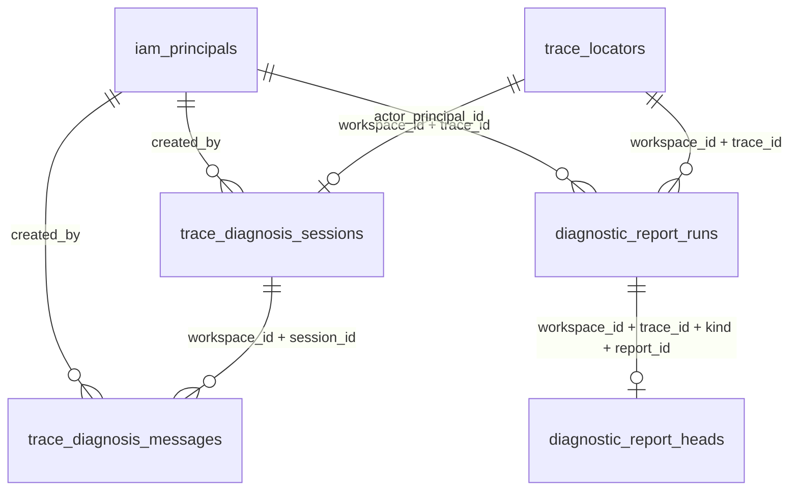

### trace_diagnosis_sessions

一条Trace一份聊天账本，绑定合法上游会话、CAS revision及当前轮租约/fence。

| 字段 | 逻辑类型 | 可空 | 默认 |
|---|---|---|---|
| `workspace_id` | TEXT | 否 | 显式提供 |
| `session_id` | TEXT | 否 | 显式提供 |
| `trace_id` | TEXT | 否 | 显式提供 |
| `created_by` | TEXT | 否 | 显式提供 |
| `opencode_session_id` | TEXT | 是 | NULL |
| `revision` | BIGINT | 否 | 1 |
| `next_sequence` | BIGINT | 否 | 1 |
| `turn_fence` | BIGINT | 否 | 1 |
| `active_request_key` | TEXT | 是 | NULL |
| `lease_owner` | TEXT | 是 | NULL |
| `lease_expires_at_ms` | BIGINT | 是 | NULL |
| `created_at_ms` | BIGINT | 否 | 显式提供 |
| `updated_at_ms` | BIGINT | 否 | 显式提供 |

PK：`(workspace_id,session_id)`。 UK：`(workspace_id,trace_id)`。

CHECK：`length(session_id) BETWEEN 1 AND 512`；`revision BETWEEN 1 AND 9223372036854775807`；`next_sequence BETWEEN 1 AND 9223372036854775807`；`turn_fence BETWEEN 1 AND 9223372036854775807`；`created_at_ms>=0`；`updated_at_ms>=created_at_ms`；`lease_expires_at_ms IS NULL OR lease_expires_at_ms>=0`；`opencode_session_id IS NULL OR length(opencode_session_id) BETWEEN 1 AND 512`；`active_request_key IS NULL OR length(active_request_key) BETWEEN 1 AND 512`；`lease_owner IS NULL OR length(lease_owner) BETWEEN 1 AND 512`；`(active_request_key IS NULL AND lease_owner IS NULL AND lease_expires_at_ms IS NULL) OR (active_request_key IS NOT NULL AND lease_owner IS NOT NULL AND lease_expires_at_ms IS NOT NULL)`。

FK：`(workspace_id,trace_id) → trace_locators(workspace_id,trace_id)`，NO ACTION。

FK：`(created_by) → iam_principals(principal_id)`，NO ACTION。

IDX：`idx_diagnosis_sessions_updated(workspace_id,updated_at_ms,session_id)`。

IDX：`idx_diagnosis_sessions_lease(lease_expires_at_ms,workspace_id,session_id)`。

### trace_diagnosis_messages

每轮原子预分配user/assistant两个序号，保存完整正文与内容hash；终态不可覆盖。

| 字段 | 逻辑类型 | 可空 | 默认 |
|---|---|---|---|
| `workspace_id` | TEXT | 否 | 显式提供 |
| `session_id` | TEXT | 否 | 显式提供 |
| `message_id` | TEXT | 否 | 显式提供 |
| `seq` | BIGINT | 否 | 显式提供 |
| `request_key` | TEXT | 否 | 显式提供 |
| `request_hash` | TEXT | 否 | 显式提供 |
| `role` | TEXT | 否 | 显式提供 |
| `state` | TEXT | 否 | 显式提供 |
| `content` | TEXT | 否 | '' |
| `content_hash` | TEXT | 否 | 显式提供 |
| `evidence_hash` | TEXT | 是 | NULL |
| `opencode_session_id` | TEXT | 是 | NULL |
| `created_by` | TEXT | 否 | 显式提供 |
| `turn_fence` | BIGINT | 否 | 显式提供 |
| `revision` | BIGINT | 否 | 1 |
| `error_code` | TEXT | 是 | NULL |
| `created_at_ms` | BIGINT | 否 | 显式提供 |
| `updated_at_ms` | BIGINT | 否 | 显式提供 |

PK：`(workspace_id,message_id)`。 UK：`(workspace_id,session_id,seq)`；`(workspace_id,session_id,request_key,role)`。

CHECK：`length(message_id) BETWEEN 1 AND 512`；`length(request_key) BETWEEN 1 AND 512`；`seq BETWEEN 1 AND 9223372036854775807`；`revision BETWEEN 1 AND 9223372036854775807`；`turn_fence BETWEEN 1 AND 9223372036854775807`；`(role='user' AND state='accepted' AND length(content)>0) OR (role='assistant' AND state IN ('streaming','done','failed','interrupted'))`；`created_at_ms>=0`；`updated_at_ms>=created_at_ms`；`opencode_session_id IS NULL OR length(opencode_session_id) BETWEEN 1 AND 512`；`error_code IS NULL OR (length(error_code) BETWEEN 1 AND 128 AND state IN ('failed','interrupted'))`；`request_hash: lowercase64hex`；`content_hash: lowercase64hex`；`evidence_hash: NULL or lowercase64hex`。

FK：`(workspace_id,session_id) → trace_diagnosis_sessions(workspace_id,session_id)`，NO ACTION。

FK：`(created_by) → iam_principals(principal_id)`，NO ACTION。

IDX：`idx_diagnosis_messages_upstream(workspace_id,session_id,opencode_session_id,seq)`。

IDX：`idx_diagnosis_messages_workspace_upstream(workspace_id,opencode_session_id,session_id)`。

### diagnostic_report_runs

每次AgentDebug/SkillsAnalysis报告的不可变取证来源、运行状态、租约、内容制品引用与进度。

| 字段 | 逻辑类型 | 可空 | 默认 |
|---|---|---|---|
| `workspace_id` | TEXT | 否 | 显式提供 |
| `report_id` | TEXT | 否 | 显式提供 |
| `trace_id` | TEXT | 否 | 显式提供 |
| `kind` | TEXT | 否 | 显式提供 |
| `actor_principal_id` | TEXT | 否 | 显式提供 |
| `request_key` | TEXT | 是 | NULL |
| `execution_id` | TEXT | 否 | 显式提供 |
| `interactions_hash` | TEXT | 否 | 显式提供 |
| `generator` | TEXT | 否 | 显式提供 |
| `scope_fingerprint` | TEXT | 否 | 显式提供 |
| `evidence_hash` | TEXT | 否 | 显式提供 |
| `evidence_ref` | TEXT | 否 | 显式提供 |
| `lease_secret_hash` | TEXT | 否 | 显式提供 |
| `status` | TEXT | 否 | running |
| `payload_hash` | TEXT | 是 | NULL |
| `payload_ref` | TEXT | 是 | NULL |
| `progress_hash` | TEXT | 是 | NULL |
| `progress_ref` | TEXT | 是 | NULL |
| `error_message` | TEXT | 是 | NULL |
| `lease_until_ms` | BIGINT | 是 | NULL |
| `revision` | BIGINT | 否 | 1 |
| `created_at_ms` | BIGINT | 否 | 显式提供 |
| `updated_at_ms` | BIGINT | 否 | 显式提供 |

PK：`(workspace_id,report_id)`。 UK：`(workspace_id,trace_id,kind,report_id)`；`(workspace_id,actor_principal_id,kind,request_key)`。

CHECK：`kind IN ('agent-debug','skills-analysis')`；`status IN ('running','done','failed','skipped')`；`length(report_id)>0`；`length(execution_id)>0`；`length(generator) BETWEEN 1 AND 300`；`request_key IS NULL OR length(request_key) BETWEEN 1 AND 512`；`length(interactions_hash)=64`；`length(evidence_hash)=64`；`length(lease_secret_hash)=64`；`length(scope_fingerprint)>0`；`length(evidence_ref)>0`；`(payload_hash IS NULL AND payload_ref IS NULL) OR (payload_hash IS NOT NULL AND payload_ref IS NOT NULL AND length(payload_hash)=64 AND length(payload_ref)>0)`；`(progress_hash IS NULL AND progress_ref IS NULL) OR (progress_hash IS NOT NULL AND progress_ref IS NOT NULL AND length(progress_hash)=64 AND length(progress_ref)>0)`；`status NOT IN ('done','skipped') OR payload_ref IS NOT NULL`；`error_message IS NULL OR length(error_message)<=2000`；`revision BETWEEN 1 AND 9223372036854775807`；`created_at_ms>=0`；`updated_at_ms>=created_at_ms`；`lease_until_ms IS NULL OR lease_until_ms>=created_at_ms`；`status<>'running' OR lease_until_ms IS NOT NULL`。

FK：`(workspace_id,trace_id) → trace_locators(workspace_id,trace_id)`，NO ACTION。

FK：`(actor_principal_id) → iam_principals(principal_id)`，NO ACTION。

IDX：`idx_diagnostic_report_runs_trace(workspace_id,trace_id,kind,created_at_ms)`。

不可变规则：all content hashes are lowercase hexadecimal；frozen run identity and evidence immutable；terminal run immutable；revision increments exactly once；updated_at_ms never decreases；run history cannot be deleted。

### diagnostic_report_heads

每条Trace每种报告当前选择的运行；force重跑或删除只调整指针，旧任务不能发布到新head。

| 字段 | 逻辑类型 | 可空 | 默认 |
|---|---|---|---|
| `workspace_id` | TEXT | 否 | 显式提供 |
| `trace_id` | TEXT | 否 | 显式提供 |
| `kind` | TEXT | 否 | 显式提供 |
| `report_id` | TEXT | 否 | 显式提供 |

PK：`(workspace_id,trace_id,kind)`。

FK：`(workspace_id,trace_id,kind,report_id) → diagnostic_report_runs(workspace_id,trace_id,kind,report_id)`，NO ACTION。

### 轮次与跨存储提交规则

- 控制库事务预留连续seq、生成稳定消息ID、认领lease/fence；checkpoint累计全文，完全相同正文可用原revision幂等重投，终态不可改写。续租不推进助手正文revision。HTTP revision/fence/seq使用十进制字符串，避免JS大整数损失。
- Next仍运行原Agent与SSE；text必须排在相应checkpoint提交后，done必须排在完整Agent Trace全部batch indexed和聊天终态事务后。finish由core验证receipt实际batch、actor、task、parent Trace、诊断session和request_key；不能用本人其他批次或任意provider ID冒充。
- 所有begin/renew/checkpoint/finish复核实时Trace ACL与删除屏障；原user/executionBrief不参与身份和模型配置选择。相同上游只允许其实际actor续聊；组管理员可以查看成员历史，并以null新建自己的上游，暂不共享跨用户OpenCode运行目录或模型凭据。
- 报告以完整TraceEvidence冻结输入，head+revision+私有leaseToken栅栏发布；强制重跑/删除后旧job更新冲突，进度不影子写旧Prisma。精确重试、预算和故障恢复合同见phase6 §10/§11。
- 旧Prisma诊断会话/消息/报告未自动导入；默认业务库不升级，不推导旧payload.user归属。显式历史映射/隔离导入、评测DiagnosisRun下游仍按各自领域推进，四表本身不代表全产品重构完成。


## 008–009 Dataset版本资产、操作回执与生成任务

本节按冻结的[008机器目录](../../../services/storage/schema/dataset-catalog.json)、[009机器目录](../../../services/storage/schema/dataset-generation-catalog.json)及三库DDL描述。008新增2表，009新增1表；**当前001–009合计46张事务表+13张CH表=59张**。历史计数：截至007为43+13=56；截至008为45+13=58。当前物理表数与前稿逻辑表数不是逐项等同清单，也不表示旧业务数据已自动迁入。

### 三库字段类型与约束口径

- 下表逐字段列出SQLite、PostgreSQL、openGauss的实际物理类型。TEXT为UTF-8文本；数字列在SQLite为INTEGER，在PG/openGauss为带符号64位BIGINT。日期为UTC Unix毫秒；DDL不自动生成ID或时间。
- “—”表示没有DDL DEFAULT，写入须提供非NULL字段；nullable列省略时为NULL。008的state/revision/lifecycle_revision/read_only和009的attempt_count是本节仅有的显式默认值。
- SQLite为全部17个整数列另加typeof检查；nullable整数允许NULL，非NULL时必须为integer。009部分NOT NULL列采用`列 IS NULL OR typeof(列)='integer'`，与NOT NULL联合后仍禁止NULL。
- 下文CHECK清单逐项来自PG/openGauss共同DDL；SQLite使用GLOB代替008的小写hex正则，并叠加上述类型检查。009的摘要字段主要检查长度及空值配对，不能将领域层SHA-256、标识符格式、阶段映射、授权或租约校验表述为已有SQL CHECK。
- 三表共9组FK，显式或默认ON DELETE NO ACTION，无级联删除。正文、来源索引、gold保存在私有hash制品中，TEXT ref不是到artifact_metadata的数据库FK。

### 008–009关系图

实线为子表指向被引用表的实际FK；虚线为领域/异步关联。workspace、asset和release的复合列不得省略。IAM owner/共享权限为多态逻辑关联，不由created_by或body.user授予。

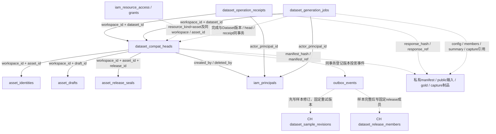

### dataset_compat_heads

| 字段 | SQLite | PostgreSQL | openGauss | 可空 | DDL默认 | 含义与约束 |
|---|---|---|---|---|---|---|
| `workspace_id` | TEXT | TEXT | TEXT | 否 | — | 租户边界，复合FK保持同空间。 |
| `dataset_id` | TEXT | TEXT | TEXT | 否 | — | 原Dataset DTO公开ID；与内部asset_id分开保存。 |
| `asset_id` | TEXT | TEXT | TEXT | 否 | — | 稳定dataset资产ID；内部名称使用稳定key，允许DTO显示名称重复。 |
| `draft_id` | TEXT | TEXT | TEXT | 否 | — | 当前草稿；插入触发器额外校验属于同一asset。 |
| `release_id` | TEXT | TEXT | TEXT | 否 | — | 当前内部封存版本；复合FK保证属于本asset。 |
| `manifest_hash` | TEXT | TEXT | TEXT | 否 | — | 当前私有成员manifest制品摘要；SQL保证小写64hex。 |
| `manifest_ref` | TEXT | TEXT | TEXT | 否 | — | 非空私有manifest引用，不作为公开下载地址。 |
| `state` | TEXT | TEXT | TEXT | 否 | 'active' | active或deleted；tombstone保留原ID和历史版本。 |
| `revision` | INTEGER | BIGINT | BIGINT | 否 | 1 | head CAS版本；每次更新恰好+1。 |
| `lifecycle_revision` | INTEGER | BIGINT | BIGINT | 否 | 1 | 删除/恢复屏障；state改变恰好+1，state未变保持原值。 |
| `read_only` | INTEGER | BIGINT | BIGINT | 否 | 0 | 0/1；DDL禁止1降到0，领域层执行builtin/benchmark写保护。 |
| `generation_source` | TEXT | TEXT | TEXT | 是 | — | 生成来源标记，可NULL；是否允许普通编辑由领域层判断。 |
| `generation_status` | TEXT | TEXT | TEXT | 是 | — | 生成展示状态，可NULL；没有SQL枚举CHECK，由生成协议维护。 |
| `created_by` | TEXT | TEXT | TEXT | 否 | — | 首次创建的真实principal；不可变审计字段，授权仍以实时IAM owner为准。 |
| `deleted_by` | TEXT | TEXT | TEXT | 是 | — | deleted时必填、active时必须NULL；实际删除principal。 |
| `deleted_at_ms` | INTEGER | BIGINT | BIGINT | 是 | — | deleted时必填非负毫秒，active时必须NULL。 |
| `created_at_ms` | INTEGER | BIGINT | BIGINT | 否 | — | 首次创建UTC Unix毫秒；非负、不可变。 |
| `updated_at_ms` | INTEGER | BIGINT | BIGINT | 否 | — | head更新UTC Unix毫秒；不早于created，更新触发器禁止回退。 |

PK：`(workspace_id,dataset_id)`。

UK：`(workspace_id,draft_id)`；`(workspace_id,asset_id)`。

FK（全部NO ACTION）：

- `(deleted_by) → iam_principals(principal_id)`。
- `(created_by) → iam_principals(principal_id)`。
- `(workspace_id,asset_id,release_id) → asset_release_seals(workspace_id,asset_id,release_id)`。
- `(workspace_id,draft_id) → asset_drafts(workspace_id,draft_id)`。
- `(workspace_id,asset_id) → asset_identities(workspace_id,asset_id)`。

显式IDX：`idx_dataset_heads_state(workspace_id,state,updated_at_ms,dataset_id)`。PK/UK另形成对应唯一索引。

共同SQL CHECK（SQLite的008 hex检查以GLOB等价表达）：

- `state IN ('active','deleted')`。
- `revision BETWEEN 1 AND 9223372036854775807`。
- `lifecycle_revision BETWEEN 1 AND 9223372036854775807`。
- `read_only IN (0,1)`。
- `length(manifest_hash)=64 AND manifest_hash !~ '[^0-9a-f]'`。
- `length(dataset_id)>0 AND length(manifest_ref)>0`。
- `created_at_ms>=0 AND updated_at_ms>=created_at_ms`。
- `(state='active' AND deleted_by IS NULL AND deleted_at_ms IS NULL) OR (state='deleted' AND deleted_by IS NOT NULL AND deleted_at_ms IS NOT NULL AND deleted_at_ms>=0)`。

触发器：插入时校验asset.kind为dataset且draft属于同一asset；更新禁止改workspace_id、dataset_id、asset_id、draft_id、created_by、created_at_ms，revision恰好+1，updated_at_ms不回退，read_only不能从1变0。state改变时lifecycle_revision恰好+1，state未变时保持原值。禁止DELETE；软删除/恢复保留历史release与run输入引用。

### dataset_operation_receipts

| 字段 | SQLite | PostgreSQL | openGauss | 可空 | DDL默认 | 含义与约束 |
|---|---|---|---|---|---|---|
| `workspace_id` | TEXT | TEXT | TEXT | 否 | — | 租户边界；通过复合FK绑定同空间Dataset。 |
| `actor_principal_id` | TEXT | TEXT | TEXT | 否 | — | 实际操作主体；不取body.user。 |
| `operation_kind` | TEXT | TEXT | TEXT | 否 | — | 非空操作种类，与actor及operation_key共同确定幂等身份。 |
| `operation_key` | TEXT | TEXT | TEXT | 否 | — | 非空稳定操作键；网络重试不重新生成。 |
| `request_hash` | TEXT | TEXT | TEXT | 否 | — | 原稳定操作请求SHA-256，小写64hex；不同请求复用同键冲突。 |
| `dataset_id` | TEXT | TEXT | TEXT | 否 | — | 该操作关联的原Dataset ID。 |
| `response_hash` | TEXT | TEXT | TEXT | 否 | — | 精确结果依赖的私有manifest/制品摘要，小写64hex；配合response_meta_json重建原响应。 |
| `response_ref` | TEXT | TEXT | TEXT | 否 | — | 非空私有制品引用；不返回真实路径给公开DTO。 |
| `response_meta_json` | TEXT | TEXT | TEXT | 否 | — | 非空私有响应元数据JSON文本，含当次revision/lifecycle及操作结果；结构和预算由内核验证。 |
| `created_at_ms` | INTEGER | BIGINT | BIGINT | 否 | — | 回执提交UTC Unix毫秒，非负。 |

PK：`(workspace_id,actor_principal_id,operation_kind,operation_key)`。

UK：无额外唯一约束。

FK（全部NO ACTION）：

- `(actor_principal_id) → iam_principals(principal_id)`。
- `(workspace_id,dataset_id) → dataset_compat_heads(workspace_id,dataset_id)`。

显式IDX：`idx_dataset_receipts_dataset(workspace_id,dataset_id,created_at_ms)`。PK/UK另形成对应唯一索引。

共同SQL CHECK（SQLite的008 hex检查以GLOB等价表达）：

- `length(request_hash)=64 AND request_hash !~ '[^0-9a-f]'`。
- `length(response_hash)=64 AND response_hash !~ '[^0-9a-f]'`。
- `length(operation_kind)>0 AND length(operation_key)>0 AND length(response_ref)>0 AND length(response_meta_json)>0`。
- `created_at_ms>=0`。

触发器禁止UPDATE和DELETE，操作身份、request_hash、响应引用及元数据提交后不可改写。幂等返回在CAS之前，但不绕过实时授权：含正文的save/restore/no-op回执需要read；删除回执检查delete，不额外要求write。全重复回流可只登记原head/root的回执，不增加业务版本或更新时间。

### dataset_generation_jobs

| 字段 | SQLite | PostgreSQL | openGauss | 可空 | DDL默认 | 含义与约束 |
|---|---|---|---|---|---|---|
| `workspace_id` | TEXT | TEXT | TEXT | 否 | — | 租户边界；通过Dataset复合FK约束同空间。 |
| `job_id` | TEXT | TEXT | TEXT | 否 | — | 稳定任务ID，不可变。 |
| `dataset_id` | TEXT | TEXT | TEXT | 否 | — | 关联Dataset公开ID；一个Dataset最多一条生成任务账本。 |
| `actor_principal_id` | TEXT | TEXT | TEXT | 否 | — | 实际发起principal；恢复、读取来源、发布需同actor的实时凭据。 |
| `request_id` | TEXT | TEXT | TEXT | 否 | — | 生成请求ID；与workspace/actor组成唯一幂等键，UUIDv7格式和期限由领域层验证。 |
| `request_hash` | TEXT | TEXT | TEXT | 否 | — | 冻结请求摘要；SQL仅校验长度64，SHA-256内容由内核计算/验证。 |
| `config_hash` | TEXT | TEXT | TEXT | 否 | — | 冻结配置制品摘要；SQL仅校验长度64。 |
| `config_ref` | TEXT | TEXT | TEXT | 否 | — | 冻结配置私有引用，SQL要求非空，更新不可替换。 |
| `members_hash` | TEXT | TEXT | TEXT | 否 | — | 冻结来源成员清单摘要；SQL仅校验长度64。 |
| `members_ref` | TEXT | TEXT | TEXT | 否 | — | 冻结来源成员清单私有引用，SQL要求非空，更新不可替换。 |
| `status` | TEXT | TEXT | TEXT | 否 | — | queued/running/succeeded/failed/deleted；与lease、结果和删除ID交叉约束。 |
| `stage` | TEXT | TEXT | TEXT | 否 | — | 原阶段字符串；没有SQL枚举CHECK，领域层校验与stage_index的配对。 |
| `stage_index` | INTEGER | BIGINT | BIGINT | 否 | — | 0..6；领域阶段read/dedup/stratify/sample/convert/save/complete，queued/failed由任务状态处理。 |
| `generated_count` | INTEGER | BIGINT | BIGINT | 否 | — | 已提交生成Case数，非负；完成时按实际cases更新。 |
| `attempt_count` | INTEGER | BIGINT | BIGINT | 否 | 0 | 恢复/接管尝试计数，非负；不是墙钟或fence。 |
| `epoch` | INTEGER | BIGINT | BIGINT | 否 | — | 持久worker fence；SQL允许0且禁止回退，认领后领域层要求有效正数epoch。 |
| `revision` | INTEGER | BIGINT | BIGINT | 否 | — | 任务CAS版本，至少1；更新必须恰好+1。 |
| `dataset_revision` | INTEGER | BIGINT | BIGINT | 否 | — | 当前绑定的Dataset head CAS版本，至少1；原子发布时随head推进。 |
| `dataset_lifecycle_revision` | INTEGER | BIGINT | BIGINT | 否 | — | 创建任务时锁定的Dataset生命周期，至少1且不可变；恢复Dataset不复活旧worker。 |
| `lease_owner` | TEXT | TEXT | TEXT | 是 | — | running必填，其余status必须NULL；与lease_until_ms成对。 |
| `lease_until_ms` | INTEGER | BIGINT | BIGINT | 是 | — | 租约截止UTC Unix毫秒；非NULL时非负，是否过期及当前owner由领域层检查。 |
| `summary_hash` | TEXT | TEXT | TEXT | 是 | — | 可空summary制品摘要；非NULL时长度64，与summary_ref成对。 |
| `summary_ref` | TEXT | TEXT | TEXT | 是 | — | 可空私有summary引用；与summary_hash同时空或非空。 |
| `capture_hash` | TEXT | TEXT | TEXT | 是 | — | 可空已捕获来源索引摘要；非NULL时长度64，与capture_ref成对。 |
| `capture_ref` | TEXT | TEXT | TEXT | 是 | — | 可空capture索引私有引用；与capture_hash成对，可随受信捕获推进。 |
| `result_hash` | TEXT | TEXT | TEXT | 是 | — | 成功/失败终态必填长度64的结果摘要，供精确重试；其他状态可NULL。 |
| `error_code` | TEXT | TEXT | TEXT | 是 | — | 可空失败代码；具体值由领域层校验，SQL无枚举CHECK。 |
| `error_message` | TEXT | TEXT | TEXT | 是 | — | 可空失败说明；预算/脱敏由领域层执行，SQL无长度CHECK。 |
| `deletion_id` | TEXT | TEXT | TEXT | 是 | — | deleted必填，其他status必须NULL；非NULL值在workspace内唯一。 |
| `created_at_ms` | INTEGER | BIGINT | BIGINT | 否 | — | 创建UTC Unix毫秒；非负、不可变。 |
| `updated_at_ms` | INTEGER | BIGINT | BIGINT | 否 | — | 更新UTC Unix毫秒；SQL要求不早于created，领域写入使用单调时钟高水位。 |

PK：`(workspace_id,job_id)`。

UK：`(workspace_id,dataset_id)`；`(workspace_id,actor_principal_id,request_id)`；`(workspace_id,deletion_id)`。
deletion_id可NULL，多个NULL不冲突；只有非NULL删除ID在同workspace内唯一。

FK（全部NO ACTION）：

- `(workspace_id,dataset_id) → dataset_compat_heads(workspace_id,dataset_id)`。
- `(actor_principal_id) → iam_principals(principal_id)`。

显式IDX：`idx_dataset_generation_actor(workspace_id,actor_principal_id,status,created_at_ms)`。PK/UK另形成对应唯一索引。

共同SQL CHECK（SQLite的008 hex检查以GLOB等价表达）：

- `status IN ('queued','running','succeeded','failed','deleted')`。
- `stage_index BETWEEN 0 AND 6`。
- `generated_count>=0`。
- `attempt_count>=0`。
- `epoch>=0`。
- `revision>=1`。
- `dataset_revision>=1`。
- `dataset_lifecycle_revision>=1`。
- `created_at_ms>=0`。
- `updated_at_ms>=created_at_ms`。
- `length(request_hash)=64 AND length(config_hash)=64 AND length(members_hash)=64`。
- `(lease_owner IS NULL AND lease_until_ms IS NULL) OR (lease_owner IS NOT NULL AND lease_until_ms IS NOT NULL)`。
- `(summary_hash IS NULL AND summary_ref IS NULL) OR (summary_hash IS NOT NULL AND summary_ref IS NOT NULL AND length(summary_hash)=64)`。
- `(capture_hash IS NULL AND capture_ref IS NULL) OR (capture_hash IS NOT NULL AND capture_ref IS NOT NULL AND length(capture_hash)=64)`。
- `(status='running' AND lease_owner IS NOT NULL AND lease_until_ms IS NOT NULL) OR (status<>'running' AND lease_owner IS NULL AND lease_until_ms IS NULL)`。
- `(status='deleted')=(deletion_id IS NOT NULL)`。
- `status NOT IN ('succeeded','failed') OR (result_hash IS NOT NULL AND length(result_hash)=64)`。
- `lease_until_ms IS NULL OR lease_until_ms>=0`。
- `length(config_ref)>0 AND length(members_ref)>0`。

更新触发器固定workspace_id、job_id、dataset_id、actor_principal_id、request_id、request_hash、config_hash、config_ref、members_hash、members_ref、created_at_ms及dataset_lifecycle_revision；revision每次恰好+1，epoch不回退。succeeded/failed/deleted不能回queued或running、不能在成功失败间切换；允许保留原status或转deleted。DELETE被禁止。

DDL没有将整条终态行设为不可变，也未检查stage与stage_index映射、epoch是否属于当前worker、租约是否过期或updated_at_ms相对旧行不回退；这些由领域方法执行。完成/失败按result_hash精确重试，发布核对job epoch/lease、Dataset revision/lifecycle及来源实时权限，再与Dataset版本、head和操作回执同事务提交。只持久化任务身份和租约owner，不保存明文bearer/token。

### Dataset版本与跨库存储边界

- Dataset公开ID通过head映射到内部asset；显示名保留原DTO，避免asset_identities的`(workspace_id,kind,name)`唯一约束阻止同名Dataset。普通保存形成私有不可变release/seal/latest；内部freeze不新增公开publish权限要求。
- Case按public执行输入、private authoring/gold、items预览、reference制品保存，草稿只保留有界成员manifest引用。小数与Unicode JSON键经UTF-8 JSON文本envelope保真；通用artifact下载不开放dataset私有namespace，ref字段不是下载令牌。
- 回执绑定真实workspace/actor/kind/key及原请求摘要，响应丢失后返回原结果仍校验当前权限和生命周期。派生根因缓存不创建新业务版本；不可变release不跟随当前head变化。
- 新增/改变Case来源在准备时冻结Trace身份/heads摘要并在提交事务复核实时授权和删除屏障；来源未变的同Case复制保留原provenance，不把用户可编辑Case宣称为原Trace逐字副本。
- 生成config/members固定，capture保存已冻结来源的私有索引；接管推进epoch，失效worker不能发布。删除/恢复推进Dataset lifecycle；恢复登记新lifecycle的投影任务，不使旧event或旧job fence重新有效。
- Dataset权威读取是控制库head/sealed release及私有不可变制品。Outbox与版本同事务提交；CH样本/成员异步投影按固定内容重放，全部sink成功且lease仍有效才标indexed。跨库无FK，控制事务提交或CH表存在不等于投影完整。
- 三库SQL：[SQLite 008](../../../services/storage/schema/sqlite/008_dataset_assets.sql)、[PG 008](../../../services/storage/schema/postgresql/008_dataset_assets.sql)、[openGauss 008](../../../services/storage/schema/opengauss/008_dataset_assets.sql)、[SQLite 009](../../../services/storage/schema/sqlite/009_dataset_generation.sql)、[PG 009](../../../services/storage/schema/postgresql/009_dataset_generation.sql)、[openGauss 009](../../../services/storage/schema/opengauss/009_dataset_generation.sql)。本节只描述冻结schema，不自动迁移旧库，不代替HTTP/UI或容量验收。


## 010–011 实验、评测结果与诊断绑定

010追加8表103字段；011追加2表20字段。没有新增CH物理表；结果事实进入既有 `eval_result_facts`、`eval_metric_facts`，选择与发布复用001协议。001–009前缀保持原字节；010/011仅显式迁移后可用。以下由两份机器目录列出完整字段和约束；三库逐列约束以同版本SQL为准，不能只按列名手工补表。

- `experiment_heads` 是可编辑业务容器，不等于一次执行。每次启动/重试/监听追加通过 `experiment_runs` 关联独立001 `runs`；`plan_hash/plan_manifest_ref` 是不可变输入与配置。
- `experiment_cases` 保存稳定外部Case身份、生命周期及内容hash/ref；`experiment_result_slots` 保存外部Result ID与当前工作/选择。机器分数、过程和扩展只在不可变结果制品/receipt及CH事实中保存，人工评分和评论另追加审计注解，不能覆写机器结果。
- `experiment_attempt_checkpoints` 按租约fence与checkpoint revision CAS记录命令、FI和Trace交接；真实执行机来自封存execution_request，不能把服务端租约worker当作客户端。未确认旧进程退出时不得重发Agent。
- `diagnosis_runs` 绑定选中的机器receipt、人工评审、精确RunPlan与Trace来源；运行/租约/报告仍用001，不建立第二份可变报告真相。`expected_input_hash`包含语义source fingerprint；无关Case、只读reconcile和CH发布确认不使当前诊断误失效。
- 两张 `*_judge_traces` 在Agent Trace路由创建的同一事务写入，阻止评分/诊断参考答案通过自身Trace旁路泄露。仅原actor可读；即使业务实验元数据被组管理员读取，Trace列表、单点、下载和汇总都继续排除他人的私有Judge正文。

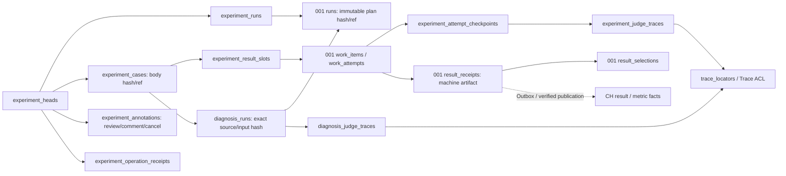

字段类型：`TEXT`在三库均为TEXT；目录中的`BIGINT`在SQLite实现为带逐列 `typeof(...)=integer` 的INTEGER，在PG/openGauss为BIGINT。可空与默认值逐列列出；PK/FK不允许跨workspace。hash固定64字符，ref保存私有内容寻址位置而非公开URL。正文与扩展JSON在领域层做UTF-8/展开预算及hash验证，不依赖数据库JSON方言。所有revision/fence外部以十进制字符串传递；时间为非负毫秒，revision/fence为正整数且加法检查2^63−1溢出。

机器目录：`services/storage/schema/experiment-catalog.json`。DDL：`services/storage/schema/{sqlite,postgresql,opengauss}/010_experiments.sql`。

### experiment_heads

实验业务容器与当前生命周期。

| 字段 | 逻辑类型 | 允许NULL | 默认值 |
|---|---|---|---|
| `workspace_id` | TEXT | 否 | 无 |
| `experiment_id` | TEXT | 否 | 无 |
| `name` | TEXT | 否 | 无 |
| `type` | TEXT | 否 | 无 |
| `scope` | TEXT | 否 | 无 |
| `skill_name` | TEXT | 否 | 无 |
| `agent_name` | TEXT | 否 | 无 |
| `status` | TEXT | 否 | 无 |
| `watch_mode` | BIGINT | 否 | `0` |
| `watch_enabled_at_ms` | BIGINT | 是 | 无 |
| `metadata_hash` | TEXT | 否 | 无 |
| `metadata_ref` | TEXT | 否 | 无 |
| `revision` | BIGINT | 否 | `1` |
| `lifecycle_revision` | BIGINT | 否 | `1` |
| `state` | TEXT | 否 | 无 |
| `current_run_id` | TEXT | 是 | 无 |
| `created_by` | TEXT | 否 | 无 |
| `deleted_at_ms` | BIGINT | 是 | 无 |
| `created_at_ms` | BIGINT | 否 | 无 |
| `updated_at_ms` | BIGINT | 否 | 无 |

主键：`["workspace_id","experiment_id"]`。

外键：`[["workspace_id","workspaces",["workspace_id"]],["created_by","iam_principals",["principal_id"]],[["workspace_id","experiment_id","current_run_id"],"experiment_runs",["workspace_id","experiment_id","run_id"]]]`。

索引：`[["workspace_id","state","scope","updated_at_ms","experiment_id"],["workspace_id","watch_mode","agent_name"]]`。

不可变身份列：`["workspace_id","experiment_id","created_by","created_at_ms"]`。

CHECK约束：

- `state IN ('active','deleted')`
- `status IN ('draft','queued','running','done','partial','failed','cancelled')`
- `type IN ('single','llm','framework','skill')`
- `watch_mode IN (0,1)`
- `(state='active' AND deleted_at_ms IS NULL) OR (state='deleted' AND deleted_at_ms IS NOT NULL)`
- `length(name)>0`
- `length(experiment_id)>0`
- `watch_mode >= 0 AND watch_mode <= 9223372036854775807`
- `watch_enabled_at_ms >= 0 AND watch_enabled_at_ms <= 9223372036854775807`
- `length(metadata_hash)=64`
- `length(metadata_ref)>0`
- `revision >= 1 AND revision <= 9223372036854775807`
- `lifecycle_revision >= 1 AND lifecycle_revision <= 9223372036854775807`
- `deleted_at_ms >= 0 AND deleted_at_ms <= 9223372036854775807`
- `created_at_ms >= 0 AND created_at_ms <= 9223372036854775807`
- `updated_at_ms >= 0 AND updated_at_ms <= 9223372036854775807`

可变字段受单调revision/CAS触发器及领域事务保护，不能绕过生命周期/版本屏障。

### experiment_runs

实验与不可变RunPlan的归属。

| 字段 | 逻辑类型 | 允许NULL | 默认值 |
|---|---|---|---|
| `workspace_id` | TEXT | 否 | 无 |
| `experiment_id` | TEXT | 否 | 无 |
| `run_id` | TEXT | 否 | 无 |
| `generation` | BIGINT | 否 | 无 |
| `lifecycle_revision` | BIGINT | 否 | 无 |
| `created_by` | TEXT | 否 | 无 |
| `created_at_ms` | BIGINT | 否 | 无 |

主键：`["workspace_id","run_id"]`。

唯一约束：`[["workspace_id","experiment_id","run_id"],["workspace_id","experiment_id","generation"]]`。

外键：`[[["workspace_id","experiment_id"],"experiment_heads",["workspace_id","experiment_id"]],[["workspace_id","run_id"],"runs",["workspace_id","run_id"]],["created_by","iam_principals",["principal_id"]]]`。

索引：`[["workspace_id","experiment_id","created_at_ms"]]`。

CHECK约束：

- `length(experiment_id)>0`
- `generation >= 1 AND generation <= 9223372036854775807`
- `lifecycle_revision >= 1 AND lifecycle_revision <= 9223372036854775807`
- `created_at_ms >= 0 AND created_at_ms <= 9223372036854775807`

全行只追加；直接UPDATE/DELETE也由触发器拒绝。

### experiment_cases

稳定Case、正文引用与删除屏障。

| 字段 | 逻辑类型 | 允许NULL | 默认值 |
|---|---|---|---|
| `workspace_id` | TEXT | 否 | 无 |
| `experiment_id` | TEXT | 否 | 无 |
| `case_id` | TEXT | 否 | 无 |
| `ordinal` | BIGINT | 否 | 无 |
| `state` | TEXT | 否 | 无 |
| `revision` | BIGINT | 否 | `1` |
| `lifecycle_revision` | BIGINT | 否 | `1` |
| `payload_hash` | TEXT | 否 | 无 |
| `payload_ref` | TEXT | 否 | 无 |
| `trace_id` | TEXT | 是 | 无 |
| `deleted_at_ms` | BIGINT | 是 | 无 |
| `created_at_ms` | BIGINT | 否 | 无 |
| `updated_at_ms` | BIGINT | 否 | 无 |
| `binding_hash` | TEXT | 是 | 无 |

主键：`["workspace_id","case_id"]`。

唯一约束：`[["workspace_id","experiment_id","case_id"]]`。

外键：`[[["workspace_id","experiment_id"],"experiment_heads",["workspace_id","experiment_id"]],[["workspace_id","trace_id"],"trace_locators",["workspace_id","trace_id"]]]`。

索引：`[["workspace_id","experiment_id","state","ordinal"]]`。

部分索引：`[{"name":"idx_experiment_case_active_binding","columns":["workspace_id","experiment_id","binding_hash"],"unique":true,"where":"state='active'"}]`。

不可变身份列：`["workspace_id","experiment_id","case_id","created_at_ms"]`。

CHECK约束：

- `state IN ('active','deleted')`
- `(state='active' AND deleted_at_ms IS NULL) OR (state='deleted' AND deleted_at_ms IS NOT NULL)`
- `binding_hash IS NULL OR length(binding_hash)=64`
- `length(experiment_id)>0`
- `length(case_id)>0`
- `ordinal >= 0 AND ordinal <= 9223372036854775807`
- `revision >= 1 AND revision <= 9223372036854775807`
- `lifecycle_revision >= 1 AND lifecycle_revision <= 9223372036854775807`
- `length(payload_hash)=64`
- `length(payload_ref)>0`
- `deleted_at_ms >= 0 AND deleted_at_ms <= 9223372036854775807`
- `created_at_ms >= 0 AND created_at_ms <= 9223372036854775807`
- `updated_at_ms >= 0 AND updated_at_ms <= 9223372036854775807`
- `length(binding_hash)=64`

可变字段受单调revision/CAS触发器及领域事务保护，不能绕过生命周期/版本屏障。

### experiment_result_slots

稳定评测槽与当前选择。

| 字段 | 逻辑类型 | 允许NULL | 默认值 |
|---|---|---|---|
| `workspace_id` | TEXT | 否 | 无 |
| `experiment_id` | TEXT | 否 | 无 |
| `case_id` | TEXT | 否 | 无 |
| `result_id` | TEXT | 否 | 无 |
| `evaluator_id` | TEXT | 否 | 无 |
| `run_id` | TEXT | 是 | 无 |
| `work_item_id` | TEXT | 是 | 无 |
| `selected_result_id` | TEXT | 是 | 无 |
| `review_id` | TEXT | 是 | 无 |
| `status` | TEXT | 否 | 无 |
| `revision` | BIGINT | 否 | `1` |
| `evaluation_version` | BIGINT | 否 | `0` |
| `created_at_ms` | BIGINT | 否 | 无 |
| `updated_at_ms` | BIGINT | 否 | 无 |

主键：`["workspace_id","result_id"]`。

唯一约束：`[["workspace_id","case_id","evaluator_id"],["workspace_id","experiment_id","result_id"],["workspace_id","experiment_id","case_id","result_id"]]`。

外键：`[[["workspace_id","experiment_id","case_id"],"experiment_cases",["workspace_id","experiment_id","case_id"]],[["workspace_id","experiment_id","run_id"],"experiment_runs",["workspace_id","experiment_id","run_id"]],[["workspace_id","run_id","work_item_id","case_id","evaluator_id"],"work_items",["workspace_id","run_id","work_item_id","case_key","evaluator_slot"]],[["workspace_id","run_id","case_id","evaluator_id","selected_result_id"],"result_receipts",["workspace_id","run_id","case_key","evaluator_slot","result_id"]],[["workspace_id","experiment_id","case_id","result_id","review_id"],"experiment_annotations",["workspace_id","experiment_id","case_id","result_id","annotation_id"]]]`。

索引：`[["workspace_id","experiment_id","status"]]`。

不可变身份列：`["workspace_id","experiment_id","case_id","result_id","evaluator_id","created_at_ms"]`。

CHECK约束：

- `status IN ('pending','running','done','failed','cancelled','skipped')`
- `(run_id IS NULL AND work_item_id IS NULL AND selected_result_id IS NULL) OR (run_id IS NOT NULL AND work_item_id IS NOT NULL)`
- `length(experiment_id)>0`
- `length(case_id)>0`
- `length(result_id)>0`
- `length(evaluator_id)>0`
- `revision >= 1 AND revision <= 9223372036854775807`
- `evaluation_version >= 0 AND evaluation_version <= 9223372036854775807`
- `created_at_ms >= 0 AND created_at_ms <= 9223372036854775807`
- `updated_at_ms >= 0 AND updated_at_ms <= 9223372036854775807`

可变字段受单调revision/CAS触发器及领域事务保护，不能绕过生命周期/版本屏障。

### experiment_attempt_checkpoints

执行/评分attempt的租约和持久交接。

| 字段 | 逻辑类型 | 允许NULL | 默认值 |
|---|---|---|---|
| `workspace_id` | TEXT | 否 | 无 |
| `experiment_id` | TEXT | 否 | 无 |
| `case_id` | TEXT | 否 | 无 |
| `run_id` | TEXT | 否 | 无 |
| `work_item_id` | TEXT | 否 | 无 |
| `attempt_id` | TEXT | 否 | 无 |
| `fence` | BIGINT | 否 | 无 |
| `lease_owner` | TEXT | 否 | 无 |
| `actor_principal_id` | TEXT | 否 | 无 |
| `lifecycle_revision` | BIGINT | 否 | 无 |
| `case_lifecycle_revision` | BIGINT | 否 | 无 |
| `revision` | BIGINT | 否 | `1` |
| `payload_hash` | TEXT | 否 | 无 |
| `payload_ref` | TEXT | 否 | 无 |
| `stage` | TEXT | 否 | 无 |
| `command_id` | TEXT | 是 | 无 |
| `trace_id` | TEXT | 是 | 无 |
| `created_at_ms` | BIGINT | 否 | 无 |
| `updated_at_ms` | BIGINT | 否 | 无 |

主键：`["workspace_id","attempt_id"]`。

唯一约束：`[["workspace_id","experiment_id","run_id","attempt_id","actor_principal_id"]]`。

外键：`[[["workspace_id","experiment_id","case_id"],"experiment_cases",["workspace_id","experiment_id","case_id"]],[["workspace_id","experiment_id","run_id"],"experiment_runs",["workspace_id","experiment_id","run_id"]],[["workspace_id","work_item_id","attempt_id"],"work_attempts",["workspace_id","work_item_id","attempt_id"]],[["workspace_id","run_id","work_item_id","case_id"],"work_items",["workspace_id","run_id","work_item_id","case_key"]],[["workspace_id","trace_id"],"trace_locators",["workspace_id","trace_id"]],["actor_principal_id","iam_principals",["principal_id"]]]`。

索引：`[["workspace_id","experiment_id","case_id","created_at_ms"],["workspace_id","command_id"]]`。

不可变身份列：`["workspace_id","experiment_id","case_id","run_id","work_item_id","attempt_id","fence","lease_owner","actor_principal_id","lifecycle_revision","case_lifecycle_revision","created_at_ms"]`。

CHECK约束：

- `length(experiment_id)>0`
- `length(case_id)>0`
- `fence >= 1 AND fence <= 9223372036854775807`
- `length(lease_owner)>0`
- `lifecycle_revision >= 1 AND lifecycle_revision <= 9223372036854775807`
- `case_lifecycle_revision >= 1 AND case_lifecycle_revision <= 9223372036854775807`
- `revision >= 1 AND revision <= 9223372036854775807`
- `length(payload_hash)=64`
- `length(payload_ref)>0`
- `length(stage)>0`
- `created_at_ms >= 0 AND created_at_ms <= 9223372036854775807`
- `updated_at_ms >= 0 AND updated_at_ms <= 9223372036854775807`

可变字段受单调revision/CAS触发器及领域事务保护，不能绕过生命周期/版本屏障。

### experiment_annotations

人工review、评论与取消审计。

| 字段 | 逻辑类型 | 允许NULL | 默认值 |
|---|---|---|---|
| `workspace_id` | TEXT | 否 | 无 |
| `experiment_id` | TEXT | 否 | 无 |
| `annotation_id` | TEXT | 否 | 无 |
| `kind` | TEXT | 否 | 无 |
| `case_id` | TEXT | 是 | 无 |
| `result_id` | TEXT | 是 | 无 |
| `machine_result_id` | TEXT | 是 | 无 |
| `subject_id` | TEXT | 是 | 无 |
| `actor_principal_id` | TEXT | 否 | 无 |
| `payload_hash` | TEXT | 否 | 无 |
| `payload_ref` | TEXT | 否 | 无 |
| `created_at_ms` | BIGINT | 否 | 无 |
| `lookup_key` | TEXT | 是 | 无 |

主键：`["workspace_id","annotation_id"]`。

唯一约束：`[["workspace_id","experiment_id","annotation_id"],["workspace_id","experiment_id","case_id","result_id","annotation_id"]]`。

外键：`[[["workspace_id","experiment_id"],"experiment_heads",["workspace_id","experiment_id"]],[["workspace_id","experiment_id","case_id"],"experiment_cases",["workspace_id","experiment_id","case_id"]],[["workspace_id","experiment_id","case_id","result_id"],"experiment_result_slots",["workspace_id","experiment_id","case_id","result_id"]],[["workspace_id","machine_result_id"],"result_receipts",["workspace_id","result_id"]],["actor_principal_id","iam_principals",["principal_id"]]]`。

索引：`[["workspace_id","experiment_id","created_at_ms","annotation_id"],["workspace_id","result_id","created_at_ms"],["workspace_id","kind","lookup_key","created_at_ms","annotation_id"]]`。

CHECK约束：

- `kind IN ('review','comment','comment_remove','cancellation','cancellation_update','derived-evaluation','derived-issue')`
- `result_id IS NULL OR case_id IS NOT NULL`
- `kind<>'review' OR (result_id IS NOT NULL AND machine_result_id IS NOT NULL)`
- `kind<>'comment_remove' OR subject_id IS NOT NULL`
- `length(experiment_id)>0`
- `length(case_id)>0`
- `length(result_id)>0`
- `length(payload_hash)=64`
- `length(payload_ref)>0`
- `created_at_ms >= 0 AND created_at_ms <= 9223372036854775807`

全行只追加；直接UPDATE/DELETE也由触发器拒绝。

### experiment_operation_receipts

精确请求幂等结果。

| 字段 | 逻辑类型 | 允许NULL | 默认值 |
|---|---|---|---|
| `workspace_id` | TEXT | 否 | 无 |
| `actor_principal_id` | TEXT | 否 | 无 |
| `operation_kind` | TEXT | 否 | 无 |
| `operation_key` | TEXT | 否 | 无 |
| `request_hash` | TEXT | 否 | 无 |
| `experiment_id` | TEXT | 否 | 无 |
| `response_hash` | TEXT | 否 | 无 |
| `response_ref` | TEXT | 否 | 无 |
| `created_at_ms` | BIGINT | 否 | 无 |

主键：`["workspace_id","actor_principal_id","operation_kind","operation_key"]`。

外键：`[["actor_principal_id","iam_principals",["principal_id"]],[["workspace_id","experiment_id"],"experiment_heads",["workspace_id","experiment_id"]]]`。

索引：`[["workspace_id","experiment_id","created_at_ms"]]`。

CHECK约束：

- `length(operation_kind)>0`
- `length(operation_key)>0`
- `length(request_hash)=64`
- `length(experiment_id)>0`
- `length(response_hash)=64`
- `length(response_ref)>0`
- `created_at_ms >= 0 AND created_at_ms <= 9223372036854775807`

全行只追加；直接UPDATE/DELETE也由触发器拒绝。

### experiment_judge_traces

私有评估器自身Trace归属。

| 字段 | 逻辑类型 | 允许NULL | 默认值 |
|---|---|---|---|
| `workspace_id` | TEXT | 否 | 无 |
| `trace_id` | TEXT | 否 | 无 |
| `experiment_id` | TEXT | 否 | 无 |
| `run_id` | TEXT | 否 | 无 |
| `attempt_id` | TEXT | 否 | 无 |
| `owner_principal_id` | TEXT | 否 | 无 |
| `created_at_ms` | BIGINT | 否 | 无 |

主键：`["workspace_id","trace_id"]`。

外键：`[[["workspace_id","trace_id"],"trace_locators",["workspace_id","trace_id"]],[["workspace_id","experiment_id","run_id"],"experiment_runs",["workspace_id","experiment_id","run_id"]],[["workspace_id","experiment_id","run_id","attempt_id","owner_principal_id"],"experiment_attempt_checkpoints",["workspace_id","experiment_id","run_id","attempt_id","actor_principal_id"]],[["workspace_id","attempt_id"],"work_attempts",["workspace_id","attempt_id"]],["owner_principal_id","iam_principals",["principal_id"]]]`。

索引：`[["workspace_id","experiment_id","run_id","attempt_id"]]`。

CHECK约束：

- `length(experiment_id)>0`
- `created_at_ms >= 0 AND created_at_ms <= 9223372036854775807`

全行只追加；直接UPDATE/DELETE也由触发器拒绝。

机器目录：`services/storage/schema/diagnosis-run-catalog.json`。DDL：`services/storage/schema/{sqlite,postgresql,opengauss}/011_diagnosis_runs.sql`。

### diagnosis_runs

评测/Trace报告诊断的不可变来源绑定。

| 字段 | 逻辑类型 | 允许NULL | 默认值 |
|---|---|---|---|
| `workspace_id` | TEXT | 否 | 无 |
| `diagnosis_id` | TEXT | 否 | 无 |
| `actor_principal_id` | TEXT | 否 | 无 |
| `request_key` | TEXT | 否 | 无 |
| `source_kind` | TEXT | 否 | 无 |
| `experiment_id` | TEXT | 是 | 无 |
| `case_id` | TEXT | 是 | 无 |
| `trace_id` | TEXT | 否 | 无 |
| `source_fingerprint` | TEXT | 否 | 无 |
| `input_hash` | TEXT | 否 | 无 |
| `generator` | TEXT | 否 | 无 |
| `snapshot_hash` | TEXT | 否 | 无 |
| `snapshot_ref` | TEXT | 否 | 无 |
| `created_at_ms` | BIGINT | 否 | 无 |

主键：`["workspace_id","diagnosis_id"]`。

唯一约束：`[["workspace_id","actor_principal_id","request_key"],["workspace_id","diagnosis_id","actor_principal_id"]]`。

外键：`[{"columns":["workspace_id","diagnosis_id"],"references":{"table":"runs","columns":["workspace_id","run_id"]}},{"columns":["actor_principal_id"],"references":{"table":"iam_principals","columns":["principal_id"]}},{"columns":["workspace_id","experiment_id"],"references":{"table":"experiment_heads","columns":["workspace_id","experiment_id"]}},{"columns":["workspace_id","case_id"],"references":{"table":"experiment_cases","columns":["workspace_id","case_id"]}},{"columns":["workspace_id","trace_id"],"references":{"table":"trace_locators","columns":["workspace_id","trace_id"]}}]`。

索引：`[{"name":"idx_diagnosis_runs_source","columns":["workspace_id","experiment_id","case_id","created_at_ms"]},{"name":"idx_diagnosis_runs_actor","columns":["workspace_id","actor_principal_id","created_at_ms"]}]`。

CHECK约束：

- `source_kind IN ('experiment','trace-report')`
- `(source_kind='experiment' AND experiment_id IS NOT NULL AND case_id IS NOT NULL) OR (source_kind='trace-report' AND experiment_id IS NULL AND case_id IS NULL)`
- `length(request_key) BETWEEN 1 AND 512`
- `length(generator) BETWEEN 1 AND 300`
- `length(snapshot_ref)>0`
- `created_at_ms>=0`
- `length(source_fingerprint)=64`
- `length(input_hash)=64`
- `length(snapshot_hash)=64`

其他不变式：Append only immutable actor-bound identity; mutable state remains in core001。

### diagnosis_judge_traces

私有诊断Agent自身Trace归属。

| 字段 | 逻辑类型 | 允许NULL | 默认值 |
|---|---|---|---|
| `workspace_id` | TEXT | 否 | 无 |
| `diagnosis_id` | TEXT | 否 | 无 |
| `attempt_id` | TEXT | 否 | 无 |
| `trace_id` | TEXT | 否 | 无 |
| `owner_principal_id` | TEXT | 否 | 无 |
| `created_at_ms` | BIGINT | 否 | 无 |

主键：`["workspace_id","trace_id"]`。

外键：`[{"columns":["workspace_id","diagnosis_id","owner_principal_id"],"references":{"table":"diagnosis_runs","columns":["workspace_id","diagnosis_id","actor_principal_id"]}},{"columns":["workspace_id","attempt_id"],"references":{"table":"work_attempts","columns":["workspace_id","attempt_id"]}},{"columns":["workspace_id","trace_id"],"references":{"table":"trace_locators","columns":["workspace_id","trace_id"]}}]`。

索引：`[{"name":"idx_diagnosis_judge_traces_run","columns":["workspace_id","diagnosis_id","attempt_id"]}]`。

CHECK约束：

- `created_at_ms>=0`

其他不变式：Append only immutable actor-bound identity; mutable state remains in core001。


### 版本、跨库一致性与保留规则

1. 输入Dataset/Skill/Evaluator在运行前封存，RunPlan按真实release/hash引用；worker只能执行封存输入。模型仅冻结无凭据的连接指纹和选定配置ID，实际凭据在受信actor运行时解析；配置失效明确失败，不自动使用最新配置。私有控制器以真实principal/workspace、目的和精确请求体hash签名，公开请求中的自称attested无效。
2. 原子性边界是一个事务库领域操作：创建容器/Case/组、冻结计划/输入与工作项、接受结果/选择/Outbox、人工review及其操作回执。HTTP不传任意SQL，不用逐次RPC冒充Prisma事务。对比两侧Case通过显式batch同事务提交。
3. CH写入可重投，accepted不等于indexed/published。物化失败保留Outbox与原机器制品；发布屏障核对输入、选择和生命周期后才生效。cancel/delete即刻推进OLTP屏障，旧worker即使晚回也不能重新选择结果；不能以CH最终一致性延迟绕过权限/删除。
4. 取消目标从封存命令/FI身份恢复，确认停止必须读取对应真实客户端/运行的回执；未确认状态对用户仍是pending。跨模式/换客户端重试先按旧目标清理。操作回执在权限实时校验后提供原请求精确重试，不重新冻结最新资产或重新执行Agent。
5. 010/011迁移本身只追加表，不把旧库自动搬空或让新旧双写。旧Experiment/Case/Trajectory/Evaluation/Diagnosis等语义迁移须显式导出、映射身份与来源、冻结历史定义、核验历史选择和计数，再在独立目标apply；尚无全量迁移证明时不切换生产库。原始备份、导出和旧库只读保留，含缺失来源/版本的旧行须进入差异报告，不能伪造release或最新分数补齐。


## Benchmark 核心表（012/013）

012机器目录：`services/storage/schema/benchmark-catalog.json`。013仅将`benchmark_artifacts.size_bytes`下界由1放宽到0，保留原012校验和、全部历史数据、索引和不可变/保留触发器。最终约束以013为准。

### benchmark_dataset_heads

| 字段 | 逻辑类型 | 允许NULL | 默认值 |
|---|---|---|---|
| `workspace_id` | TEXT | 否 | 无 |
| `dataset_id` | TEXT | 否 | 无 |
| `public_dataset_id` | TEXT | 否 | 无 |
| `public_asset_id` | TEXT | 否 | 无 |
| `public_release_id` | TEXT | 否 | 无 |
| `private_asset_id` | TEXT | 否 | 无 |
| `private_release_id` | TEXT | 否 | 无 |
| `adapter_key` | TEXT | 否 | 无 |
| `content_hash` | TEXT | 否 | 无 |
| `state` | TEXT | 否 | 无 |
| `revision` | BIGINT | 否 | 无 |
| `lifecycle_revision` | BIGINT | 否 | 无 |
| `created_by` | TEXT | 否 | 无 |
| `created_at_ms` | BIGINT | 否 | 无 |
| `updated_at_ms` | BIGINT | 否 | 无 |

主键：`["workspace_id","dataset_id"]`。

唯一约束：`[["workspace_id","public_dataset_id"],["workspace_id","private_asset_id"]]`。

外键：`[{"columns":["workspace_id","public_dataset_id"],"references":{"table":"dataset_compat_heads","columns":["workspace_id","dataset_id"]}},{"columns":["workspace_id","public_asset_id","public_release_id"],"references":{"table":"asset_release_seals","columns":["workspace_id","asset_id","release_id"]}},{"columns":["workspace_id","private_asset_id","private_release_id"],"references":{"table":"asset_release_seals","columns":["workspace_id","asset_id","release_id"]}},{"columns":["created_by"],"references":{"table":"iam_principals","columns":["principal_id"]}}]`。

索引：`[["workspace_id","adapter_key","state","updated_at_ms"]]`。

CHECK约束：`["state IN ('active','deleted')","length(adapter_key)>0","public_asset_id<>private_asset_id","length(content_hash)=64","revision>=1 AND revision<=9223372036854775807","lifecycle_revision>=1 AND lifecycle_revision<=9223372036854775807","created_at_ms>=0 AND created_at_ms<=9223372036854775807","updated_at_ms>=0 AND updated_at_ms<=9223372036854775807","updated_at_ms>=created_at_ms"]`。

### benchmark_experiment_bindings

| 字段 | 逻辑类型 | 允许NULL | 默认值 |
|---|---|---|---|
| `workspace_id` | TEXT | 否 | 无 |
| `experiment_id` | TEXT | 否 | 无 |
| `dataset_id` | TEXT | 否 | 无 |
| `public_release_id` | TEXT | 否 | 无 |
| `private_release_id` | TEXT | 否 | 无 |
| `binding_hash` | TEXT | 否 | 无 |
| `binding_ref` | TEXT | 否 | 无 |
| `actor_principal_id` | TEXT | 否 | 无 |
| `created_at_ms` | BIGINT | 否 | 无 |

主键：`["workspace_id","experiment_id"]`。

唯一约束：`[]`。

外键：`[{"columns":["workspace_id","experiment_id"],"references":{"table":"experiment_heads","columns":["workspace_id","experiment_id"]}},{"columns":["workspace_id","dataset_id"],"references":{"table":"benchmark_dataset_heads","columns":["workspace_id","dataset_id"]}},{"columns":["workspace_id","public_release_id"],"references":{"table":"asset_release_seals","columns":["workspace_id","release_id"]}},{"columns":["workspace_id","private_release_id"],"references":{"table":"asset_release_seals","columns":["workspace_id","release_id"]}},{"columns":["actor_principal_id"],"references":{"table":"iam_principals","columns":["principal_id"]}}]`。

索引：`[["workspace_id","dataset_id","experiment_id"]]`。

CHECK约束：`["length(binding_hash)=64","length(binding_ref)>0","created_at_ms>=0 AND created_at_ms<=9223372036854775807"]`。

### benchmark_jobs

| 字段 | 逻辑类型 | 允许NULL | 默认值 |
|---|---|---|---|
| `workspace_id` | TEXT | 否 | 无 |
| `job_id` | TEXT | 否 | 无 |
| `experiment_id` | TEXT | 否 | 无 |
| `case_id` | TEXT | 否 | 无 |
| `run_id` | TEXT | 否 | 无 |
| `work_item_id` | TEXT | 否 | 无 |
| `kind` | TEXT | 否 | 无 |
| `parent_job_id` | TEXT | 是 | 无 |
| `adapter_key` | TEXT | 否 | 无 |
| `evaluator_key` | TEXT | 是 | 无 |
| `attempt_no` | BIGINT | 否 | 无 |
| `retry_of_job_id` | TEXT | 是 | 无 |
| `origin_credential_id` | TEXT | 否 | 无 |
| `origin_credential_kind` | TEXT | 否 | 无 |
| `actor_principal_id` | TEXT | 否 | 无 |
| `protocol_state` | TEXT | 否 | 无 |
| `revision` | BIGINT | 否 | 无 |
| `request_hash` | TEXT | 是 | 无 |
| `request_ref` | TEXT | 是 | 无 |
| `progress_hash` | TEXT | 是 | 无 |
| `progress_ref` | TEXT | 是 | 无 |
| `completion_hash` | TEXT | 是 | 无 |
| `completion_ref` | TEXT | 是 | 无 |
| `callback_epoch` | BIGINT | 否 | 无 |
| `callback_token_hash` | TEXT | 是 | 无 |
| `callback_expires_ms` | BIGINT | 是 | 无 |
| `callback_attempt_id` | TEXT | 是 | 无 |
| `callback_fence` | BIGINT | 是 | 无 |
| `created_at_ms` | BIGINT | 否 | 无 |
| `updated_at_ms` | BIGINT | 否 | 无 |

主键：`["workspace_id","job_id"]`。

唯一约束：`[["workspace_id","experiment_id","case_id","job_id"],["workspace_id","parent_job_id","attempt_no"]]`。

外键：`[{"columns":["workspace_id","experiment_id"],"references":{"table":"benchmark_experiment_bindings","columns":["workspace_id","experiment_id"]}},{"columns":["workspace_id","experiment_id","case_id"],"references":{"table":"experiment_cases","columns":["workspace_id","experiment_id","case_id"]}},{"columns":["workspace_id","experiment_id","run_id"],"references":{"table":"experiment_runs","columns":["workspace_id","experiment_id","run_id"]}},{"columns":["workspace_id","run_id","work_item_id","case_id"],"references":{"table":"work_items","columns":["workspace_id","run_id","work_item_id","case_key"]}},{"columns":["workspace_id","work_item_id","callback_attempt_id"],"references":{"table":"work_attempts","columns":["workspace_id","work_item_id","attempt_id"]}},{"columns":["workspace_id","experiment_id","case_id","parent_job_id"],"references":{"table":"benchmark_jobs","columns":["workspace_id","experiment_id","case_id","job_id"]}},{"columns":["workspace_id","experiment_id","case_id","retry_of_job_id"],"references":{"table":"benchmark_jobs","columns":["workspace_id","experiment_id","case_id","job_id"]}},{"columns":["actor_principal_id"],"references":{"table":"iam_principals","columns":["principal_id"]}}]`。

索引：`[["workspace_id","experiment_id","case_id","kind","created_at_ms"],["workspace_id","protocol_state","updated_at_ms"],["workspace_id","origin_credential_id"]]`。

CHECK约束：`["kind IN ('execute','evaluate')","origin_credential_kind IN ('api','session')","protocol_state IN ('pending','preparing','dispatching','dispatch_unknown','running_agent','collecting','uploading','cleaning','submitted','queued','running_evaluator','normalizing','normalization_failed','completed','failed','cancelled','blocked','execution_failed','dispatch_failed','evaluation_failed','submission_invalid')","(kind='execute' AND parent_job_id IS NULL) OR (kind='evaluate' AND parent_job_id IS NOT NULL)","(callback_token_hash IS NULL AND callback_expires_ms IS NULL AND callback_attempt_id IS NULL AND callback_fence IS NULL) OR (callback_token_hash IS NOT NULL AND callback_expires_ms IS NOT NULL AND callback_attempt_id IS NOT NULL AND callback_fence IS NOT NULL)","parent_job_id IS NULL OR parent_job_id<>job_id","retry_of_job_id IS NULL OR retry_of_job_id<>job_id","attempt_no>=1 AND attempt_no<=9223372036854775807","revision>=1 AND revision<=9223372036854775807","length(request_hash)=64","length(request_ref)>0","length(progress_hash)=64","length(progress_ref)>0","length(completion_hash)=64","length(completion_ref)>0","callback_epoch>=0 AND callback_epoch<=9223372036854775807","length(callback_token_hash)=64","callback_expires_ms>=0 AND callback_expires_ms<=9223372036854775807","callback_fence>=1 AND callback_fence<=9223372036854775807","created_at_ms>=0 AND created_at_ms<=9223372036854775807","updated_at_ms>=0 AND updated_at_ms<=9223372036854775807","updated_at_ms>=created_at_ms","(request_hash IS NULL)=(request_ref IS NULL)","(progress_hash IS NULL)=(progress_ref IS NULL)","(completion_hash IS NULL)=(completion_ref IS NULL)"]`。

### benchmark_artifacts

| 字段 | 逻辑类型 | 允许NULL | 默认值 |
|---|---|---|---|
| `workspace_id` | TEXT | 否 | 无 |
| `job_id` | TEXT | 否 | 无 |
| `artifact_id` | TEXT | 否 | 无 |
| `name` | TEXT | 否 | 无 |
| `kind` | TEXT | 否 | 无 |
| `media_type` | TEXT | 否 | 无 |
| `content_hash` | TEXT | 否 | 无 |
| `size_bytes` | BIGINT | 否 | 无 |
| `storage_hash` | TEXT | 否 | 无 |
| `storage_ref` | TEXT | 否 | 无 |
| `contract_hash` | TEXT | 否 | 无 |
| `created_at_ms` | BIGINT | 否 | 无 |

主键：`["workspace_id","artifact_id"]`。

唯一约束：`[["workspace_id","job_id","name"]]`。

外键：`[{"columns":["workspace_id","job_id"],"references":{"table":"benchmark_jobs","columns":["workspace_id","job_id"]}}]`。

索引：`[["workspace_id","job_id","created_at_ms"],["workspace_id","content_hash"]]`。

CHECK约束：`["length(name) BETWEEN 1 AND 512","size_bytes BETWEEN 0 AND 67108864","length(media_type) BETWEEN 1 AND 256","length(content_hash)=64","size_bytes>=0 AND size_bytes<=9223372036854775807","length(storage_hash)=64","length(storage_ref)>0","length(contract_hash)=64","created_at_ms>=0 AND created_at_ms<=9223372036854775807"]`。

013生效后的大小约束为`0 <= size_bytes <= 67108864`，允许原评估器协议的空stdout/stderr证据；其余不可变规则保持。

### benchmark_operation_receipts

| 字段 | 逻辑类型 | 允许NULL | 默认值 |
|---|---|---|---|
| `workspace_id` | TEXT | 否 | 无 |
| `actor_principal_id` | TEXT | 否 | 无 |
| `operation_kind` | TEXT | 否 | 无 |
| `operation_key` | TEXT | 否 | 无 |
| `request_hash` | TEXT | 否 | 无 |
| `experiment_id` | TEXT | 是 | 无 |
| `dataset_id` | TEXT | 是 | 无 |
| `job_id` | TEXT | 是 | 无 |
| `response_hash` | TEXT | 否 | 无 |
| `response_ref` | TEXT | 否 | 无 |
| `created_at_ms` | BIGINT | 否 | 无 |

主键：`["workspace_id","actor_principal_id","operation_kind","operation_key"]`。

唯一约束：`[]`。

外键：`[{"columns":["workspace_id"],"references":{"table":"workspaces","columns":["workspace_id"]}},{"columns":["actor_principal_id"],"references":{"table":"iam_principals","columns":["principal_id"]}},{"columns":["workspace_id","experiment_id"],"references":{"table":"experiment_heads","columns":["workspace_id","experiment_id"]}},{"columns":["workspace_id","dataset_id"],"references":{"table":"benchmark_dataset_heads","columns":["workspace_id","dataset_id"]}},{"columns":["workspace_id","job_id"],"references":{"table":"benchmark_jobs","columns":["workspace_id","job_id"]}}]`。

索引：`[["workspace_id","experiment_id","created_at_ms"],["workspace_id","job_id","created_at_ms"]]`。

CHECK约束：`["length(operation_kind) BETWEEN 1 AND 128","length(operation_key) BETWEEN 1 AND 512","(CASE WHEN experiment_id IS NOT NULL THEN 1 ELSE 0 END)+(CASE WHEN dataset_id IS NOT NULL THEN 1 ELSE 0 END)+(CASE WHEN job_id IS NOT NULL THEN 1 ELSE 0 END)=1","length(request_hash)=64","length(response_hash)=64","length(response_ref)>0","created_at_ms>=0 AND created_at_ms<=9223372036854775807"]`。


## 派生 Issue 解决注解（014）

只追加人工解决状态，保留原机器Issue与receipt，不回写旧动态SkillIssue。静态Issue继续使用原控制域；两域按可重复领域操作衔接，不宣称跨库事务。

### experiment_derived_issue_annotations

| 字段 | 逻辑类型 | 允许NULL | 默认值 |
|---|---|---|---|
| `workspace_id` | TEXT | 否 | 无 |
| `annotation_id` | TEXT | 否 | 无 |
| `experiment_id` | TEXT | 否 | 无 |
| `issue_id` | TEXT | 否 | 无 |
| `machine_result_id` | TEXT | 否 | 无 |
| `owner_principal_id` | TEXT | 否 | 无 |
| `actor_principal_id` | TEXT | 否 | 无 |
| `resolved_run_id` | TEXT | 否 | 无 |
| `resolved_at_ms` | BIGINT | 否 | 无 |
| `operation_kind` | TEXT | 否 | 无 |
| `operation_key` | TEXT | 否 | 无 |
| `request_hash` | TEXT | 否 | 无 |
| `issue_payload_hash` | TEXT | 否 | 无 |
| `machine_content_hash` | TEXT | 否 | 无 |
| `selection_revision` | BIGINT | 否 | 无 |

主键：`["workspace_id","annotation_id"]`。

唯一约束：`[["workspace_id","issue_id"],["workspace_id","actor_principal_id","operation_key","issue_id"]]`。

外键：`[[["workspace_id","experiment_id","issue_id"],"experiment_annotations",["workspace_id","experiment_id","annotation_id"]],[["workspace_id","machine_result_id"],"result_receipts",["workspace_id","result_id"]],["owner_principal_id","iam_principals",["principal_id"]],["actor_principal_id","iam_principals",["principal_id"]],[["workspace_id","actor_principal_id","operation_kind","operation_key"],"experiment_operation_receipts",["workspace_id","actor_principal_id","operation_kind","operation_key"]]]`。

索引：`[["workspace_id","issue_id","resolved_at_ms","annotation_id"]]`。

CHECK约束：`["operation_kind='derived_issue_resolve'","length(annotation_id)>0","length(resolved_run_id) BETWEEN 1 AND 512","length(operation_key)>0","resolved_at_ms>=0 AND resolved_at_ms<=9223372036854775807","selection_revision>0 AND selection_revision<=9223372036854775807","length(request_hash)=64","length(issue_payload_hash)=64","length(machine_content_hash)=64"]`。

不可变列：`true`。


### 014解决上下文的公开null兼容

014 DDL、物理非空`resolved_run_id`与校验和保留。无threadId的手工解决，以真实操作receipt稳定引用填物理列（`resolution-operation:`与workspace/actor/key的hash）；它不是RunPlan或优化已执行的证明。公开投影只在workspace/actor/kind/key/request_hash、issue成员和首issue所属实验均与已校验receipt匹配时恢复`resolvedRunId:null`。既有非null关联原样；缺失/损坏回执明确失败。跨实验同批不误要求每个Issue的实验都等于receipt首实验。没有新增核心表。


## 015 / CH002：统一授权统计投影

事务适配统一 SQLite、PostgreSQL、openGauss 的事务、参数和迁移；业务层按 Trace/评测/诊断/统计能力调用。分析事实由 ClickHouse 专用适配负责，不把两类数据库伪装成相同 CRUD。旧配置域的 Prisma 仍保留，不能把已接入消费者表述为全仓消除了数据库差异。

统计摘要是源版本派生物。发布时先写不可变 CH 行，再以当前 IAM、路由/owner/别名/注解/Trace head 边界登记事务回执；只有已接受的精确哈希可读。相同边界不同摘要拒绝，孤立 CH 写入不可见。RAS 保存真实归一化事件；当前回执逐版本更新，历史事实保留，查询 owner 必须与授权 Trace owner 一致。实验来源索引记录冻结路由/快照及计划哈希，旧计划仅由有控制器证明的后台显式回填，统计请求不读完整 RunPlan。

### trace_analytics_publications

主键：`workspace_id, trace_id, boundary, parser_version`。索引：`workspace_id, created_at_ms, trace_id`。

| 字段 | 逻辑类型 | 可空 | 默认值 |
|---|---|---|---|
| `workspace_id` | TEXT | 否 | — |
| `trace_id` | TEXT | 否 | — |
| `boundary` | TEXT | 否 | — |
| `parser_version` | BIGINT | 否 | — |
| `projection_hash` | TEXT | 否 | — |
| `snapshot_hash` | TEXT | 否 | — |
| `created_by` | TEXT | 否 | — |
| `created_at_ms` | BIGINT | 否 | — |

外键、唯一约束、范围检查及版本触发器以机器目录 `services/storage/schema/analytics-catalog.json` 和三种后端的 `015_trace_analytics.sql` 为准。

### ras_event_receipts

主键：`workspace_id, owner_principal_id, task_id, event_key`。索引：`workspace_id, owner_principal_id, task_id, occurred_at_ms, event_id`。

| 字段 | 逻辑类型 | 可空 | 默认值 |
|---|---|---|---|
| `workspace_id` | TEXT | 否 | — |
| `owner_principal_id` | TEXT | 否 | — |
| `task_id` | TEXT | 否 | — |
| `event_key` | TEXT | 否 | — |
| `event_id` | TEXT | 否 | — |
| `content_hash` | TEXT | 否 | — |
| `revision` | BIGINT | 否 | — |
| `occurred_at_ms` | BIGINT | 否 | — |
| `created_at_ms` | BIGINT | 否 | — |

外键、唯一约束、范围检查及版本触发器以机器目录 `services/storage/schema/analytics-catalog.json` 和三种后端的 `015_trace_analytics.sql` 为准。

### experiment_trace_sources

主键：`workspace_id, run_id, case_id`。索引：`workspace_id, trace_id, run_id, case_id`。

| 字段 | 逻辑类型 | 可空 | 默认值 |
|---|---|---|---|
| `workspace_id` | TEXT | 否 | — |
| `run_id` | TEXT | 否 | — |
| `case_id` | TEXT | 否 | — |
| `trace_id` | TEXT | 否 | — |
| `incarnation` | BIGINT | 否 | — |
| `route_epoch` | BIGINT | 否 | — |
| `execution_id` | TEXT | 否 | — |
| `snapshot_hash` | TEXT | 否 | — |
| `plan_hash` | TEXT | 否 | — |
| `created_at_ms` | BIGINT | 否 | — |

外键、唯一约束、范围检查及版本触发器以机器目录 `services/storage/schema/analytics-catalog.json` 和三种后端的 `015_trace_analytics.sql` 为准。

### ClickHouse 002：完整建表定义

历史 001 不改写；新增两表需显式调用 `ClickHouseStore.initialize_analytics_schema()`。它不创建/替换旧表，也不负责生产切换。

```sql
CREATE TABLE obs_trace_analytics (
  workspace_id String,
  trace_bucket Date,
  trace_id String,
  boundary String,
  parser_version UInt16,
  projection_hash String,
  projection_json String,
  retry_version UInt64 DEFAULT 1,
  CONSTRAINT check_1 CHECK length(boundary)=64,
  CONSTRAINT check_2 CHECK length(projection_hash)=64,
  CONSTRAINT check_3 CHECK parser_version=1,
  CONSTRAINT check_4 CHECK length(projection_json)<=2097152,
  CONSTRAINT check_5 CHECK retry_version>0 AND retry_version<=9223372036854775807
) ENGINE = ReplacingMergeTree(retry_version)
PARTITION BY toYYYYMM(trace_bucket)
ORDER BY (workspace_id,trace_bucket,trace_id,boundary,parser_version,projection_hash);

CREATE TABLE obs_ras_events (
  workspace_id String,
  event_bucket Date,
  owner_principal_id String,
  task_id String,
  event_key String,
  event_id String,
  content_hash String,
  event_json String,
  retry_version UInt64 DEFAULT 1,
  CONSTRAINT check_1 CHECK length(content_hash)=64,
  CONSTRAINT check_2 CHECK length(event_json)<=262144,
  CONSTRAINT check_3 CHECK retry_version>0 AND retry_version<=9223372036854775807
) ENGINE = ReplacingMergeTree(retry_version)
PARTITION BY toYYYYMM(event_bucket)
ORDER BY (workspace_id,event_bucket,owner_principal_id,task_id,event_key,content_hash);
```


## 016：采集准备首次封存（C1a）

本迁移新增 `collector_preparation_receipts` 一表，目标为66张事务表与15张CH表。它只保存首次输入表示、Source前态和确定性capture/plan；原A operation、ingest_batches及实际head仍是提交/索引状态唯一权威。本片不启用公共upload/completion，不建Thread表，不为ThreadOnly创建locator或Execution。

### collector_preparation_receipts

主键 `(workspace_id,scope_kind,scope_key,operation_key)`；同key允许在不同Source/Thread复用。Source scope_key为实际trace_id，Thread为当前owner范围稳定逻辑key。

| 字段 | 逻辑类型 | 可空 | 规则 |
|---|---|---|---|
| workspace_id | TEXT | 否 | FK workspaces |
| scope_kind | TEXT | 否 | source/thread |
| scope_key | TEXT | 否 | 1..512字符 |
| operation_key | TEXT | 否 | 1..512字符 |
| owner_principal_id | TEXT | 否 | FK iam_principals，实际API主体 |
| trace_id | TEXT | 是 | 同workspace FK trace_locators；source必填且等scope_key，thread必空 |
| operation_kind | TEXT | 否 | snapshot/complete/thread_only；thread仅thread_only |
| input_hash | TEXT | 否 | 64位小写SHA256，Source沿A原意图语义hash |
| input_text_hash | TEXT | 否 | 首次Node输入字符串UTF8 SHA256 |
| input_text_ref | TEXT | 否 | 私有持久工件 |
| context_hash | TEXT | 否 | 首次服务端前态逻辑hash |
| context_ref | TEXT | 否 | 原reservation、独立Session、annotation及来源表示前态工件 |
| capture_hash | TEXT | 是 | 首次Node capture JSON字符串UTF8 SHA256 |
| capture_ref | TEXT | 是 | 与hash同时为空或同时存在 |
| plan_hash | TEXT | 是 | 首次Node plan JSON字符串UTF8 SHA256 |
| plan_ref | TEXT | 是 | 与hash同时为空或同时存在；须已有capture |
| seal_revision | BIGINT | 否 | 默认1，范围1..2^63-1，写入槽位精确加1 |
| created_at_ms | BIGINT | 否 | 非负，immutable |
| updated_at_ms | BIGINT | 否 | 非负且不倒退 |

索引 `(workspace_id,owner_principal_id,created_at_ms,scope_kind,scope_key)`。identity/input/context不可改；capture及plan只能由NULL封存一次；禁止删除。SQLite整数类型和GLOB/PG及OG BIGINT与正则采用现有方言约束。工件均经现有私有artifact持久化与hash验证，不将header凭据入库，不执行隐式升级。

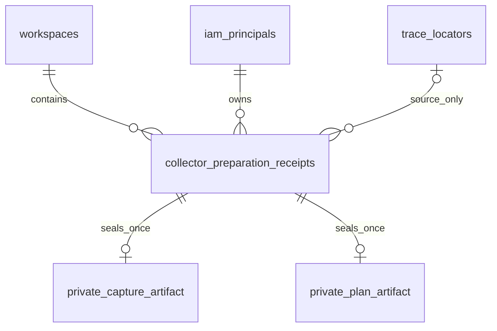

private_*_artifact为既有私有文件工件，非新增SQL表。Source实际状态继续关联原A ledger/ingest_batches，不在本表镜像accepted/indexed。

协议增加begin_preparation、seal_capture、seal_plan、commit_prepared、preparation_status，沿collector-source/v1精确正文proof、实际API write和strictowner。begin在返回前原子保存首次Node字符串/context与A reserve；capture竞争只认首次输入；plan不可覆盖。根快照/完成只消费sealed plan；非空child/thread计划明确pending，不半提交。ThreadOnly仅可封存，尚不执行Thread控制效果。

C1a不增加reject_changed_context，不因annotation变化释放或终止合法采集意图，也不清/覆盖人工annotation；异步结果fence留C3。Root Source/IAM/deletion guard沿A。Session元数据独立保存为state.session_ref及op.prior_session_ref：无Execution完成只有控制数据，重复完成保留首次start；已有Execution无Session的完成则索引真实原空Session投影。

输入的semantic hash与原JSON表示hash分开。字符串解析值必须与canonical结构逐值一致，数组顺序、0/null/扩展保留；新输入在首次reserve返回前保存。后续prior Session必须取最新已applied、source revision及snapshot hash匹配的计划serialized表示；旧A/unprepared写入没有对应表示时标legacy_canonical，禁止套用更早计划的字符串。旧A receipts/heads不重写，不编造不可恢复的旧key order或payload hash。


## 017：采集Thread与执行成员（C1b）

新增三表（69事务表+15CH）。TEXT identifier非空且1..512字符；BIGINT时间0..2^63-1，SQLite同时要求实际integer；revision默认1且更新精确+1；created_at_ms不变、modified_at_ms不倒退。原业务started/updated/completed允许NULL，不添加时间先后约束或新默认时钟。JSON字段保留Node字符串，不在Python重排。

| 表 | 字段（?为可空） | 主键、外键与唯一约束 | 索引 |
|---|---|---|---|
| collector_trace_threads | workspace_id TEXT, thread_id TEXT, owner_principal_id TEXT, framework TEXT, source_thread_id TEXT, legacy_username TEXT, source_kind TEXT?, started_at_ms BIGINT?, updated_at_ms BIGINT?, metadata_json TEXT?, revision BIGINT=1, created_at_ms BIGINT, modified_at_ms BIGINT | PK(workspace_id,thread_id); FK workspace/owner；UNIQUE(workspace_id,owner_principal_id,framework,source_thread_id)；identity/owner/natural key不可改 | (workspace_id,owner_principal_id,framework,updated_at_ms,thread_id) |
| collector_trace_thread_events | workspace_id TEXT, event_key TEXT, event_id TEXT, thread_id TEXT, execution_trace_id TEXT?, related_trace_id TEXT?, kind TEXT, status TEXT?, source_turn_id TEXT?, phase_id TEXT?, started_at_ms BIGINT, completed_at_ms BIGINT?, payload_json TEXT?, revision BIGINT=1, created_at_ms BIGINT, modified_at_ms BIGINT | PK(workspace_id,event_key); UNIQUE(workspace_id,event_id)；FK(workspace_id,thread_id)→threads；两个可空trace引用同workspace locator；event identity/thread不可改 | (workspace_id,thread_id,started_at_ms,event_key); (workspace_id,execution_trace_id,started_at_ms,event_key) |
| collector_trace_thread_executions | workspace_id TEXT, trace_id TEXT, thread_id TEXT, owner_principal_id TEXT, execution_id TEXT, task_id TEXT, source_execution_id TEXT?, timestamp_ms BIGINT | PK(workspace_id,trace_id)；同workspace FK locator/thread，FK owner；一个Execution仅一个当前Thread；source_execution_id没有unique | (workspace_id,thread_id,timestamp_ms,trace_id); (workspace_id,thread_id,source_execution_id) |

事件指向locator不要求属于当前member；成员移动/派生退休只调整关系，不级联删Thread/event或Session。实际owner在同一业务事务内根据IAM/source核验，不能凭传入owner写入其他人的Thread。事务库提供关系原子性；CH无跨库FK，继续通过immutable descriptor和ingest_batches的实际indexed回执建立完整图读屏障。三种DDL只新增017，历史001–016不改写，显式升级须备份原库；新增catalog参与关系库source evidence。

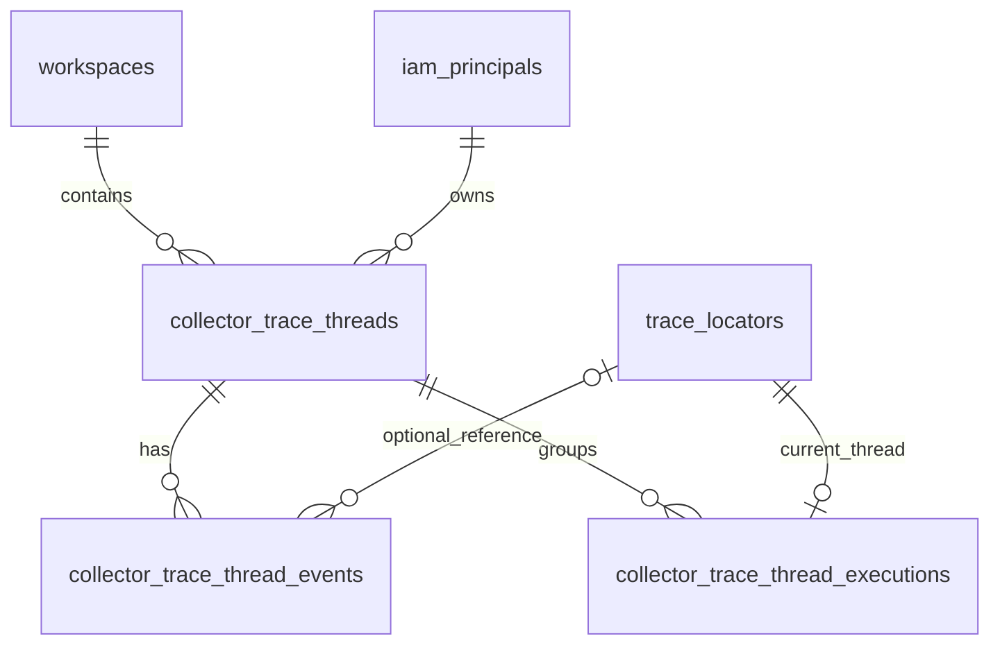

图descriptor为现私有artifact，不是SQL表。ThreadOnly的effect inbox是现inbox_receipts，source_id固定collector-preparation-effects/v1，event_id为workspace内scope/op稳定hash、content_hash为首次plan_hash；它只去重同事务控制效果，不镜像indexed。原A source operation仍保留自身batch refs，descriptor额外绑定同一sealed计划全部member refs；不得把其他Trace batch refs塞入自身packet验证结构。
