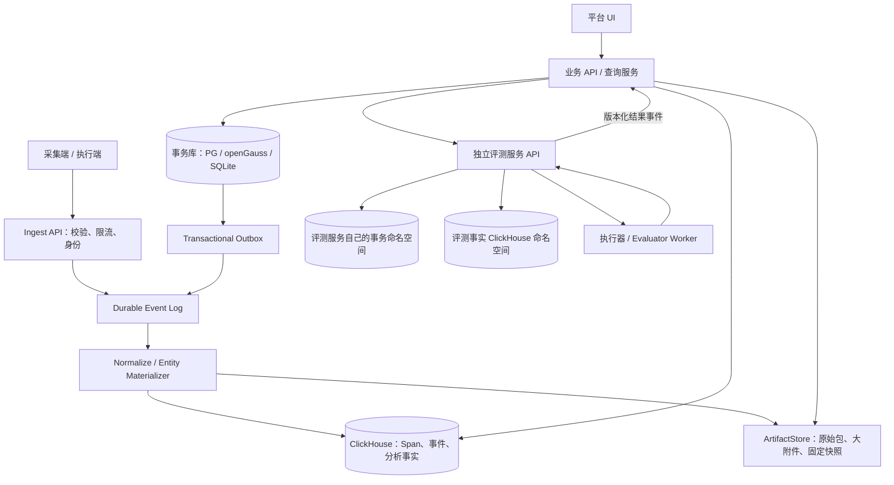

# 分析与事务存储完整重构 — 需求设计

日期：2026-11-11。状态：待评审。本文所有表、接口与容量均为目标设计，不是已实现契约。需求及负载见 [phase1](phase1-requirements-analysis.md)，开发门禁见 [phase3](phase3-development-plan.md)。

本轮实现/验证边界见 [实施状态](implementation-status.md)。核心物理定义以 [完整字段字典](core-table-dictionary.md) 与 `services/storage/schema/` 为准；本文保留总体领域划分。字段字典明确首批表与后续表，不能把全部逻辑表目录当成已经实现。

补充规范：内部 Trace ID 删除后永久不复用；相同原生 ID 的新生命周期映射新内部 ID。revision/fence/etag 使用统一的 1..2^63-1 范围；跨分区发布水位为带 epoch/topic/partition-offset vector 和 sink 确认的结构化值。资产 release 的依赖集合一并封存；运行计划冻结后不能改回 draft。

## 1. 设计决策

| 编号 | 决策 | 取舍 |
| --- | --- | --- |
| D01 | ClickHouse 是观测、运行、评分和统计事实的查询主存储 | 不在 OLTP 长期复制所有 Span、正文和分数 |
| D02 | PostgreSQL / openGauss / SQLite 实现同一业务事务契约 | 方言、迁移、领取任务各自适配；不是同一份 SQL 换 URL |
| D03 | 参考生产拓扑使用 PG 或 openGauss；SQLite 是单机部署档 | 功能一致，资源、并发和 HA 边界不同 |
| D04 | 资产身份、草稿和发布流程在 OLTP，不可变内容与大制品按需进入 ArtifactStore | 数据集大规模样本/成员及统计在 CH，不能用 casesJson 装整库 |
| D05 | Trace 分摘要、节点、正文、事件；每个逻辑 Span 可单独读取 | 废弃整段 Session JSON 作为主存储，完整 Bundle 仍可显式导入导出 |
| D06 | 原始事件先可靠接收，再生成 CH 投影 | 接收、查询可见、发布完成是三个状态；跨库无原子事务 |
| D07 | 资产发布和实验输入都使用不可变清单 | 增加内容存储和快照成本，换取可追溯重评 |
| D08 | 重试、重评、人工裁决追加新事实，旧事实保留 | 有效结果由版本化选择规则确定，不把历史全部相加 |
| D09 | 普通插件靠 Manifest、Schema 和版本扩展 | 核心表不出现 SWE-bench、某模型或某框架专属字段 |
| D10 | 三事务后端仅能通过受控迁移切换，一个部署同时只有一个写入权威 | 不支持直接热切换、后台隐式降级或跨库双活 |

## 2. 运行架构与数据所有权



**“适合 CH 的数据都放 CH”按职责解释**：不可变事实、大规模明细、筛选维度、分析指标进入 CH；当前状态、唯一性、授权、编辑、租约与发布指针进入事务库；二进制文件、超大原始包和代码/容器制品进入 ArtifactStore。不能因为一个表含统计字段就把调度状态机一并搬 CH。

平台与独立评测服务分别拥有自己的表及凭据，可共用物理集群但不共享 ORM Session、外键或写权限。无平台时评测服务仍可提交固定输入执行；无评测服务时平台仍可观测。跨服务结果使用来源服务 ID、运行 ID、版本和摘要去重。

| 数据 | 权威归属 | 其他存储中的允许副本 |
| --- | --- | --- |
| 用户、权限、凭据、资产发布指针、任务/租约 | 所属服务 OLTP | CH 中经脱敏的审计/统计维度 |
| 规范化 Span、运行事件、评分明细、样本修订 | 所属领域 CH | 可靠日志/制品留可重放源；OLTP 仅回执和引用 |
| 原始载荷、不可变正文包、代码、附件 | ArtifactStore 或明确的 CH 正文表 | 内容摘要、大小、访问域和对象引用 |
| 有效结果选择、人工裁决当前指针、删除屏障 | OLTP | 以 Outbox 投影到 CH 供筛选分析 |
| 已发布实验结果/数据集成员清单 | 不可变 CH 清单 + ArtifactStore manifest | OLTP 保存发布状态、根摘要和准备完成水位 |

事实写入可有恢复副本；这里的“权威”是业务语义和写入所有权，不等于只允许一份物理备份。

## 3. 通用身份、类型与修订契约

- 所有记录包含不可空 `workspace_id`，现有 username 映射为稳定主体 ID；公共资源使用显式 public workspace，不以 NULL 表示全局可见。
- 资源 ID 在应用生成，跨后端保持不变；规范化 Trace ID 不假设来自 UUID。保存 `source_namespace`、原生 Trace/Span ID 和内部 ID 的映射；不同来源相同原生 ID 不碰撞。
- 对外资源 key 与内部 ID 分开。Skill API 仍使用 name；重命名是显式动作，旧版本内部依赖不受影响。
- 时间统一 UTC，CH 使用 `DateTime64(6, 'UTC')`；原生纳秒时间另存整数，不经 JS number 损失精度。API 大整数和高精度金额使用十进制字符串，耗时另有单位。
- Token 用 64 位整数；未知使用 NULL/known flag，不以 0 替代。成本使用带币种和价格规则版本的定点值，区分原始报价和按新规则重算值。
- `schema_version` 是内容契约版本，`revision` 是实体物化次序，`release_id` 是不可变资产版本，`attempt_id` 是一次执行，不能混用。
- Hash 对规范化字节和资源清单计算 SHA-256；记录规范化算法版本。浮点、键顺序、Unicode、文件权限与路径规则有固定规范，不把非确定 JSON stringify 当跨语言哈希标准。
- 审计/展示时间不用于决定分布式更新先后。相同实体必须有可恢复的唯一物化所有者；生产日志按稳定实体 key 分区，先重放恢复状态再接受新修订。
- `revision` 契约为正的 signed-63 范围，CH 物理使用 UInt64；使用持久的 authority epoch 与日志序号构造，禁止各进程自行拼墙钟。epoch 变更时先 fencing 旧所有者并恢复状态；序号宽度溢出、日志重分区、回填都需显式新 epoch/转换映射。相同 revision 的不同内容属于冲突，隔离处理，不能随机取一个。
- `trace_bucket` 在首次规范化时冻结，保存至 locator/事件信封；迟到数据修正 start_time 不改变 bucket。同实体所有版本分区归属一致。

没有原生 Span ID 的历史 interaction 使用持久化映射生成内部节点 ID，不能以易变化的数组下标作为永久身份；保留原始 interaction/Span 的多对多映射和排序。跨 Trace 协作关系不改写原生 parent/root。摘要中的超时状态按最后活动时间与当前时刻派生，不能只在接收时落一个永远不变的 timed_out 字段。

## 4. 事务领域表

下表为目标逻辑表目录。每张表有 workspace、创建/更新时间或不可变创建时间；所有外键均限所属 OLTP 内部。跨 CH 引用为显式业务引用，不声明数据库外键。

| 表 | 主要字段/约束 | 职责 |
| --- | --- | --- |
| `iam_principals`, `iam_memberships`, `iam_credentials` | principal_id；workspace+principal 唯一；凭据仅密钥摘要或 SecretRef | 用户、角色、凭据撤销与唯一性 |
| `asset_identities` | asset_id PK；workspace+kind+name 唯一；kind=skill/agent/evaluator/dataset/benchmark | 资源身份和可见性，不保存所有版本内容 |
| `asset_drafts` | draft_id、asset_id、base_release_id、branch、edit_revision、manifest_ref；CAS | 并行编辑、分支与草稿引用 |
| `asset_releases` | release_id PK；asset_id+version_label 唯一；content_hash、schema_version、manifest_ref、publisher | 不可变版本元数据；变更内容必须新版本 |
| `asset_release_dependencies` | release_id+role+dependency_release_id；依赖角色和版本条件校验 | Skill/Agent/评估器/数据集/Benchmark 的固定依赖图 |
| `asset_aliases` | asset_id+alias 唯一；target_release_id、etag | latest/stable/production 等可变指针；运行前解析一次并冻结 |
| `asset_publication_jobs` | publication_id、draft_revision、manifest_hash、facts_watermark、phase、error | 大型 Dataset/Benchmark 的分阶段发布 |
| `extension_definitions` | key+version、kind、schema_ref/hash、capabilities、package_digest | Framework/Evaluator/Runtime/Benchmark/Normalizer 插件版本注册 |
| `metric_definitions`, `attribute_definitions` | workspace+namespace+key+schema_version；type/unit/aggregation/searchability | 指标和扩展字段注册，禁止动态列无界增长 |
| `runs`, `run_groups`, `run_inputs` | run_id、plan_hash、dataset_release_id、expected_case_count、status、selection_ref | 实验计划、分组和冻结输入，不存全量结果正文 |
| `work_items`, `work_attempts` | work_item_id；item+attempt_no 唯一；phase、lease_owner、lease_until、fence、etag | Case 执行/评分/诊断/优化/FI 的任务状态；不合并各领域业务配置 |
| `result_receipts`, `result_selections` | attempt_id+receipt_key 唯一；result_id/hash/ref、selected_attempt_id、selection_revision | 终态与事实交付确认、有效尝试选择；不存每项 score |
| `review_decisions`, `review_comments` | result_id、decision_id、revision、reviewer、reason、replacement_ref | 人工裁决与评论的编辑权威；评分变化发布 CH 新事实 |
| `outbox_events`, `inbox_receipts` | event_id 唯一；aggregate_id、revision、payload_ref/hash、state、next_retry | 原子业务提交后的可靠投递和回调去重 |
| `trace_locators`, `resource_refs` | workspace+trace_id；source、bucket、incarnation、retention_class；referrer+target | ID 路由、数据生命周期、快照固定引用；不逐 Span/心跳更新 |
| `tag_definitions`, `resource_annotations` | tag_id / resource+annotation_key；revision、etag | 标签与用户注释的事务编辑；CH 保存检索投影 |
| `artifact_metadata`, `snapshot_manifests` | artifact/snapshot_id；hash、size、namespace、publication_state、pin_count | 制品和不可变输入快照生命周期，正文不进入元数据表 |
| `clients`, `client_credentials`, `commands`, `config_releases`, `config_deliveries` | 稳定 client_id；命令幂等 key、确认/撤销、配置 release | 安装、权限、命令和配置交付；高频遥测另进 CH |
| `source_configs`, `integration_bindings`, `user_settings` | scope+key 唯一；secret_ref、etag | 基础设施连接、接入映射和设置 |
| `domain_sessions`, `domain_plans`, `domain_links` | domain、owner、status、typed_config_ref、revision | Skill 工作台、诊断、优化、Goal Plus 与协作的控制状态；领域校验独立 |
| `deletion_requests`, `retention_pins`, `migration_checkpoints` | operation_id、resource scope、barrier、phase、generation | 删除、留存和迁移的可恢复协调 |

`work_items` 仅共享领取、续租、取消、尝试等执行原语；FI 的撤销/环境恢复、Goal 的候选采纳、协作端点绑定等必须在各自领域表或有类型的领域配置中表达，不用一个任意 JSON 状态机取代领域语义。大量消息、计划历史和工作台操作记录进入 CH 事件，当前编辑状态和用户决策留 OLTP。

高频在线状态采用可重建缓存和采样持久化；撤销凭据、命令 ACK、任务终态不能等待心跳采样。不存在每一个 Span 都更新 runs/clients 计数的写热点。精确汇总从事实计算，运行进度按时间或批次合并更新。

### 4.1 三事务后端的统一能力

业务接口使用 `TransactionManager`、`AssetRepository`、`WorkRepository`、`OutboxRepository` 等领域 port，不向 API/插件返回 ORM client。本批Python基础实现使用标准库SQLite与显式DB-API连接工厂共享领域操作，PG/openGauss分别认证驱动与DDL；ORM/SQLAlchemy仍可作为后续实现选择，不推定官方ORM支持。现有 TS 过渡适配实现同样的 wire DTO 和合同测试。

| 能力 | PostgreSQL | openGauss | SQLite |
| --- | --- | --- | --- |
| 类型与迁移 | 专属 DDL，BIGINT/定点/UTC 时间映射 | 专属 DDL，实测编码、时间/精度、兼容模式 | INTEGER/TEXT 等映射，应用校验同样精度 |
| CAS / 唯一性 | unique+条件 UPDATE / transaction | 对目标发行版实测，不复用未认证 PG 语法 | unique+条件 UPDATE，短事务 |
| 领取任务 | 可用 SKIP LOCKED 优化，配合 fence | 默认通用 CAS；通过能力测试后才开专属优化 | BEGIN IMMEDIATE 短事务串行写；无网络共享 DB |
| Outbox | 与状态更新同事务 | 与状态更新同事务 | 与状态更新同事务；批量、串行 writer |
| 部署 | 多 API/Worker；连接池预算 | 多 API/Worker；能力/HA 按发行版认证 | 单机事务服务，同主机文件访问；不承诺生产千级写负载 |

公共基线采用 etag 条件更新和有限重试：候选查询后 `UPDATE ... WHERE status=queued AND etag=old`，仅成功更新者获得任务。续租/完成同样必须匹配 fence 和 attempt。专属锁语法只影响效率，不改变正确性。

### 4.2 账号密码登录、用户组与组管理员（新增明确需求）

2026-11-12 补充：此前 workspace_id 与 IAM 逻辑目录只是身份/隔离预留，不代表已经支持账号密码、用户组或组管理员。本批以002新增10张IAM表及统一授权基础库，核心物理表增至44张；现有Web尚未接管。不修改001核心DDL或其checksum。

**身份、凭据、成员关系和数据归属分开。** principal 是稳定用户身份，登录名可变；密码、API Key和外部身份是不同的认证方式。group 是成员和角色边界，workspace 是数据隔离/查询分区。一个用户可加入多个组，一个组可绑定一个或多个 workspace；workspace 同时只属于一个组或一个明确的个人空间。初始产品可用“每组一个 workspace”，不能把 principal_id、group_id、workspace_id 混为同一个ID。

| 目标事务表 | 关键字段与约束 | 用途 |
| --- | --- | --- |
| `iam_principals` | principal_id PK；normalized_login_name UNIQUE；display_name、status、auth_version、created/updated | 账号主体，不保存明文密码；停用主体撤销所有认证入口 |
| `iam_password_credentials` | principal_id PK/FK；password_hash、scheme、parameters、credential_version、changed_at | 加盐的专用密码哈希和升级/重置版本；不使用普通SHA内容hash代替密码哈希 |
| `iam_api_credentials` | credential_id PK；principal_id FK；token_hash、group/workspace scope、capabilities、expires/revoked_at | 采集/自动化身份与权限，独立轮换；不因UI登录获得所有API Key |
| `iam_external_identities` | provider+issuer+subject UNIQUE；principal_id FK | 与现有外部登录关联，同一主体可有多种登录方式 |
| `iam_sessions` | session_token_hash UNIQUE；principal_id FK；issued/expires/revoked_at、auth_version | 可撤销登录会话；退出、改密、停用后的失效规则；active_group只是上下文，不是授权凭据 |
| `iam_groups` | group_id PK；group_key UNIQUE；name、status、created_by、policy_revision | 用户组/团队定义，不复用实验run_groups |
| `iam_group_memberships` | PK(group_id,principal_id)；role、status、etag；外键指向group和principal | 多对多成员关系；role初值owner/admin/member/viewer，变更使用CAS |
| `iam_workspace_bindings` | workspace_id PK/FK；owner_type、owner_group_id/owner_principal_id XOR；binding_revision | 明确数据空间归属，支持以后组下多个workspace；转移必须显式审计 |

以上八张身份领域表加上`iam_resource_access`（资源归属/可见性）和`iam_resource_grants`（显式共享）两张表，共十张002表；与原`iam_principals/iam_memberships/iam_credentials`逻辑目录归并，不把新名称与旧占位表重复建两套。除workspace绑定外，principal/group是控制面身份，不因所有业务表有workspace_id而强行套复合tenant主键。密码派生已固定为标准库PBKDF2-HMAC-SHA256/600000次及随机盐；随机会话/API令牌只存摘要，原生合同已验证。Web会话协议、账号恢复及限流仍待Web接入批次实现。

**权限矩阵：**

| 身份 | 业务数据读取 | 管理权限 |
| --- | --- | --- |
| 组owner/admin | 该组绑定workspace内全部成员产生的数据，包括Trace/Span/正文、资产与版本、数据集、实验、评分、报告、制品和分析 | 按角色管理组成员与组内配置；owner控制所有权转移，不允许删除最后一个有效owner |
| 普通member | 默认本人创建或明确共享给自己的组内资源；产品可选组内全员可读策略 | 仅授权的创建/执行/编辑操作；能读取不等于可删除、发布或改成员角色 |
| viewer | 获授权的组内只读数据 | 不允许编辑、执行、发布或成员管理 |
| 平台管理员 | 单独的全局授权策略，不能由组admin角色推导 | 不使用去掉user过滤条件作为通用鉴权实现 |

“看所有组内数据”按**数据所属组**判断，不能临时查询“该组当前用户名列表”后拼user过滤。新写入在服务端确定当前组/workspace，记录created_by_principal_id用于归因；用户转组/退出后，历史组数据仍留原组，原组管理员仍可查看。个人空间和其他组的数据不因成员重叠而自动公开。若产品不提供个人空间，则账号入组后所有新业务写入均进入所选组空间；历史个人数据归组必须有明确迁移映射。

业务读取权限不等于读取成员密码、API Key明文或私有评测gold。组管理员可看业务结果和证据，但凭据只允许查看状态/撤销/重置，private gold仍遵守评测隔离协议。

**请求与跨库授权规则：**

1. 认证服务解析会话或API凭据，确认账号、凭据和成员关系有效，再由服务端生成有界`AccessScope(principal_id, allowed_workspace_ids, roles, capabilities, policy_revision)`。客户端传group_id/workspace_id只代表选择，不能自授权限。
2. 所有列表、单ID详情、搜索、聚合、Span正文、快照、导出和Artifact下载都校验同一scope。CH使用服务端绑定的workspace过滤，不能用`undefined`或缺少过滤表示管理员。空授权集合必须拒绝/返回无授权结果，不能退化成全库。
3. 组管理员的跨workspace统计仍限定该组workspace集合，并显示范围与数据水位；不得复用未带授权范围的全局缓存。查询/游标/缓存键包含workspace集合、policy_revision及查询条件。
4. 每个新请求使用当前成员/账号状态，角色撤销与转组发布缓存失效事件；长导出/评测任务在领取、结果下载或权限敏感阶段重新确认scope。投影延迟不能延长已撤销的访问权。
5. 人员登录会话与采集API凭据分开，采集凭据固定组/workspace和能力。用户退出组时，相应组凭据/会话访问同步撤销或受控移交；服务任务不依赖操作人会话永久存活。
6. SQLite/PG/openGaussControlStore和CH适配器仍是内部可信端口，workspace参数不能作为外部授权结果；新增AuthorizedStorage门面实施上述规则，新增Web入口必须接入门面。只读快照不占写锁，CH读取前后校验当前权限。

**迁移与验收：** 旧User.id/username/externalAccount/apiKey映射稳定principal与独立credential；旧库没有可还原密码时使用显式邀请/重置，不生成通用默认密码，也不把API Key当登录密码。组/角色/历史数据归属通过管理员提供的映射确定，禁止按同名/邮箱域自动获得组管理员。旧username仅作来源信息与兼容映射，不作为跨库权限主键。

增量迁移已实现002 IAM版本，不就地改001checksum。先准备账号与组、workspace绑定和历史映射，再切换授权入口；没有明确归组的旧数据保持隔离并进入待确认清单。必须验证多组用户、组admin看到其他成员全部组数据、普通成员隔离、组间隔离、单Span/正文/统计/下载同权限、退出组和停用/改密撤销、同名不同人不串数据，以及PG/openGauss/SQLite合同一致。截至002已实施44张，003项目预留增至46张；最新测试、适配版本与尚未接管领域见[实施状态](implementation-status.md)及[本批计划](phase5-iam-adapters-plan.md)。

### 4.3 项目预留：当前统一归属 default

2026-11-12 用户确认：支持未来一个用户加入多个项目、Owner读取全项目、成员读取本人数据；当前先预留项目概念，所有现有数据归入`default`，暂不建设完整项目管理。本批实现范围是新存储基础库的兼容目录/请求上下文；现有Next.js/Prisma入口仍按既有接管计划迁移。

**项目与workspace分开。** 项目是未来产品协作边界，workspace继续作为现有数据隔离和查询路由键。新增`projects`（项目目录）与`project_workspaces`（workspace到项目的唯一归属），以追加`003_projects.sql`实现。当前仅支持`project_id=default`；一个项目可含多个workspace，一个workspace只归一个项目。项目和IAM组不互相当作别名，组/个人既有权限继续按workspace与资源校验。

| 新增表 | 字段与约束 | 当前行为 |
|---|---|---|
| projects | project_id TEXT PK；name TEXT；status active/disabled；created_at_ms/updated_at_ms BIGINT非负 | 固定种子default，禁止删除或修改其ID；状态停用时拒绝该项目访问 |
| project_workspaces | workspace_id TEXT PK/FK workspaces；project_id TEXT FK projects；created_at_ms BIGINT非负；索引(project_id,workspace_id) | 每workspace唯一归属；绑定不可UPDATE/DELETE，后续转移走显式迁移协议 |

**兼容和权限规则：**

1. 003创建default目录并给每个既有workspace补一条归属记录，保持原workspace/业务ID、原生Trace映射、用户/组绑定、资源ACL、版本hash和CH排序身份不变。业务数据通过workspace间接归属项目，不逐条改写CH事实。
2. 新建workspace时，在同一事务中注册default归属。001/002旧核心库保持可读且不隐式升级；新的IAM/项目上下文功能要求显式升级003。迁移继续先备份/核验证据，失败原子回滚，不操作默认业务库。
3. 未传项目时兼容解析为default；显式default也接受。空字符串/空白/未知项目拒绝，不能把错误project_id静默落入default。当前不开放任意项目创建与切换。
4. AccessScope显式携带project_id，scope/cache指纹包含项目。项目目录仅约束路由，不授予读取权：处于同一个default项目不代表普通用户可以读取其他workspace或其他人的资源；不自动产生default项目Owner或平台管理员。
5. ProjectContext解析器同时核对default项目有效、workspace有效且归属存在。对外授权门面绑定default上下文；配置其他project_id时失败关闭，不把只传workspace当作绕过项目边界的路径。
6. 采集API凭据仍绑定现有principal/workspace，项目由唯一归属映射推导。网页查看上下文、客户端上传目的地和Trace归属将来分别管理；本批不改变任何已部署客户端配置。
7. 后续项目成员/邀请/Owner及严格本人数据策略属于独立增量。成员身份必须由认证上下文建立，不能信任payload用户名；项目切换只影响新Trace，运行中和待重传Trace保留原目的地。默认目录不提前实现这些产品能力。

新增两表后核心物理数量为**33张事务表+13张CH表=46张**。001/002原始字节保持不变，旧库原始导出/转换的目标默认项目显式为default。项目归属当前不可转移，后续多项目迁移须重新验证源/目标权限及跨库路由一致性。

## 5. ClickHouse 表目录与核心键

所有排序键非空；不存在可变 status/model/tag 进入替换身份键的设计。以下引擎写作逻辑 `MergeTree`/`ReplacingMergeTree`；生产部署由拓扑映射为 Replicated 家族，不能把非复制示例当 HA 配置。

| 表 | 一行语义与关键内容 | 引擎 / 排序身份 |
| --- | --- | --- |
| `obs_trace_current` | 一个 Trace 的最新摘要：root、时间、状态事实、指标、Agent/模型维度、revision | RMT(revision)；workspace,bucket,trace_id |
| `obs_span_current` | 一个 Span 的最新结构和可分析字段：parent、kind、name、duration、token、error、正文版本引用 | RMT(revision)；workspace,bucket,trace_id,span_id |
| `obs_payload_chunks` | 一份不可变 Span 正文的一个块：payload_revision、section、chunk_no、bytes/hash | RMT(retry_version)；workspace,bucket,trace_id,span_id,payload_revision,section,chunk_no |
| `obs_events` | 原始/规范化运行事件：event_id、sequence、event_type、schema、内容引用 | RMT(retry_version)；workspace,bucket,trace_id,event_id |
| `obs_entity_relations` | 原生父子以外的协作、跨 Trace、Goal、基础设施等关系修订 | RMT(revision)；workspace,bucket,relation_id |
| `obs_annotations_current` | 用户标签、注释和派生维度的检索投影，可带删除标记 | RMT(revision)；workspace,bucket,resource_id,annotation_id |
| `snapshot_nodes` | 已发布 Trace/评测输入快照的一个节点，含精确 payload_revision 和原始来源 | RMT(retry_version)；workspace,snapshot_bucket,snapshot_id,node_id |
| `dataset_sample_revisions` | 不可变样本版本：case_key、sample_revision_id、input/ref、private_ref、field_schema | RMT(retry_version)；workspace,sample_bucket,dataset_id,sample_revision_id |
| `dataset_release_members` | 一个 Dataset 发布版的一个成员：ordinal、case_key、sample_revision_id | RMT(retry_version)；workspace,release_bucket,dataset_release_id,ordinal |
| `eval_result_facts` | 一次评估结果/修订的不可变结论：run/case/attempt/evaluator_release、输入快照、verdict、证据引用 | RMT(retry_version)；workspace,result_bucket,result_id |
| `eval_metric_facts` | result_id × metric_definition_release × dimension/path：数值/分类、unit、method、evidence_ref | RMT(retry_version)；workspace,result_bucket,result_id,metric_key,dimension_key |
| `eval_result_selection_current` | 每个 run/case/evaluator 槽的当前选择，指向有效 result_id/人工裁决版本 | RMT(selection_revision)；workspace,run_bucket,run_id,case_key,evaluator_slot |
| `eval_publication_members` | 已发布结果清单的一个槽，固定 result_id、裁决、分母和排除原因 | RMT(retry_version)；workspace,publication_bucket,publication_id,ordinal |
| `ops_events` | RAS/FI、任务、安装、审计、诊断/工作台消息、协作事件：domain+event_id | RMT(retry_version)；workspace,event_bucket,domain,event_id |
| `telemetry_samples` | 基础设施、客户端遥测、平台用量的一个样本 | RMT(retry_version)；workspace,time_bucket,source_id,event_id,metric_key |
| `analytics_rollup_generations` | 一份分析结果在固定输入水位下的汇总：rule_version、generation_id、维度、统计状态 | MergeTree/RMT；workspace,window,rule_version,generation_id,dimension_key |

这里 retry_version 只是**同一不可变逻辑记录的重复投递**选择；内容摘要必须相同，否则隔离。所有 `RMT` 表的正确查询都需要去重语义，不能依赖后台已经合并。事实身份、发布根摘要与重试幂等由应用保证，CH 的 ORDER BY 不提供事务库式唯一约束。

分区初值为冻结 bucket 的月分区，按热数据量和 TTL 验证日/月粒度；不按 Trace ID 或用户 ID 建高基数分区。按 ID 点查先解析 locator/bucket，再命中对应 shard；主路由采用 `hash(workspace_id, trace_id)`。若新增分片，显式记录路由 epoch 并迁移，不悄悄改变 hash 后丢失旧路由。版本/数据集等表按自身实体 key 分片，跨域分析走分布式查询而非事务跨库 JOIN。

### 5.1 核心 DDL 草案

以下定义演示行身份、字段和正文拆分，未实机执行；索引、复制路径、Codec 和投影由 PoC 冻结。其余表遵循上表键契约，不使用 `CREATE AS` 克隆可变业务列作为去重身份。

```sql
CREATE TABLE obs_span_current (
  workspace_id String,
  trace_bucket Date,
  trace_id String,
  span_id String,
  parent_span_id String,
  source_namespace LowCardinality(String),
  native_span_id String,
  kind LowCardinality(String),
  name String,
  started_at Nullable(DateTime64(6, 'UTC')),
  ended_at Nullable(DateTime64(6, 'UTC')),
  duration_us Nullable(UInt64),
  model LowCardinality(String),
  tool_name LowCardinality(String),
  execution_status LowCardinality(String),
  error_type LowCardinality(String),
  input_tokens Nullable(UInt64),
  output_tokens Nullable(UInt64),
  payload_revision String,
  attributes_json String,
  schema_version UInt16,
  revision UInt64,
  is_deleted UInt8
) ENGINE = ReplacingMergeTree(revision)
PARTITION BY toYYYYMM(trace_bucket)
ORDER BY (workspace_id, trace_bucket, trace_id, span_id);

CREATE TABLE obs_payload_chunks (
  workspace_id String,
  trace_bucket Date,
  trace_id String,
  span_id String,
  payload_revision String,
  section LowCardinality(String),
  chunk_no UInt32,
  chunk_count UInt32,
  uncompressed_bytes UInt32,
  content_hash String,
  body String,
  retry_version UInt64
) ENGINE = ReplacingMergeTree(retry_version)
PARTITION BY toYYYYMM(trace_bucket)
ORDER BY (workspace_id, trace_bucket, trace_id, span_id,
          payload_revision, section, chunk_no);
```

通用未知文本在低基数列中可规范为显式 unknown 值，属性仍保留原始缺失信息；不是把数值未知强制填 0。attributes_json 在基线版本作为 String 保留，稳定可查询字段升为 typed 列；原生 JSON、文本索引和投影有能力探测及回退查询，不作为旧 CH 版本必然具备的功能。

### 5.2 最新态查询规则

必须先得到同一逻辑 Span 的最新有效版本，再对可变 model/status/error 等条件筛选。不能先筛出旧的失败版本，再把它误判为当前失败。`FINAL` 或完整行 tuple 的 `argMax` 由适配器实现；不能对每列各取不同版本，也需保留 Nullable 字段语义。

热点索引、投影、物化分析副本必须有同样的最新态规则，不能绕开去重。结构分页游标包含 query_hash、排序值、span_id 和观察代次；持续追加/改父关系时返回代次变化，允许刷新，而不是声称跨请求冻结。

**交互式 current 表不提供历史快照读取保证。** ReplacingMergeTree 合并后旧版本可能消失，`WHERE revision <= old_watermark` 不能恢复旧态。精确历史评测、导出和分页一致性使用下一节的不可变 snapshot。

## 6. 上万 Span 与正文读取

读路径：Trace 摘要 → 指定父节点的子节点页或限定时间窗口结构 → 单 Span 正文块。树页初值 200、最大 1,000，正文块最大 256KiB；前端虚拟化，调用树可按层展开，时间轴可分窗口，禁止先拉完整 10 万节点再前端分页。

正文组织：`payload_revision` 是不可变内容包 ID，含 sections、chunk_count、总字节和根 hash。先写所有块并验证完整，再让 Span 引用该 revision。部分落库时保留 pending/incomplete 状态并重试，不返回“空正文”掩盖缺失。某 Span 正文再变化创建新 revision；旧 payload 按引用留存，不能在同一 revision 上就地改块。

持久原始包和大附件在 ArtifactStore；正文表默认适合可分块文本，小正文可单块。二进制和超大连续输出通过引用流式读取，不经 API 一次性 base64。CH 文本检索使用单独受控 search 字段，避免把每个块边界当词边界；跨块子串、中文分词和大小写语义有验收样例。搜索命中和 UI 展示使用同一 payload_revision。

快照流程：确定接收日志高水位 → 在实体物化器恢复到该水位的状态上生成 snapshot → 固定节点、映射和每个正文 revision → 校验数目/根 hash → 事务提交发布指针。构建时高水位后的事件延迟处理或独立分支继续处理，不能直接扫描正在变化的 current 表冒充冻结。发布节点存在 `snapshot_nodes`，正文可按不可变引用复用。快照构建失败不发布，清理无引用残留。

评估器声明 `full_trace` / `selected_spans` / `final_answer` / `artifact` 输入能力与预算。full_trace 使用快照流式读取；模型上下文不能装下时按评估器版本规定分段/摘要，保存选择规则与实际输入摘要；不静默截断或承诺 10 万 Span 可一次塞进模型。

## 7. 资产、Dataset 与版本依赖

### 7.1 统一版本，不统一所有业务内容

```text
Asset identity
  -> mutable draft / branch (CAS edit_revision)
  -> immutable release (content_hash + manifest)
  -> exact dependency release IDs

RunPlan
  -> Dataset release + ordered case selection manifest
  -> Agent release + Skill releases
  -> Evaluator releases + Metric schema releases
  -> Benchmark / Adapter / Normalizer / Environment release
  -> model profile snapshot + actual provider/model metadata
  -> input Trace snapshot + seed/config/permission boundary
```

共用身份、发布、依赖和审计；每种 kind 有独立 Schema：

| kind | 必须冻结 |
| --- | --- |
| Skill | 全部文件、入口、依赖、权限/工具要求、内容 hash；对外 name |
| Agent | Runtime adapter、Prompt、工具/MCP目录、模型 profile、参数、Skill releases、环境引用 |
| Evaluator | 输入能力、Prompt/代码/Skill、输出 Schema、评分/聚合规则、模型配置、超时预算、gold 权限 |
| Dataset | 字段 Schema、样本修订、成员顺序、拆分/标签、公私数据引用和许可来源 |
| Benchmark | manifest、adapter/harness/normalizer digest、协议版本、数据集版本、环境镜像 digest、指标契约 |

同名同 version_label 不可重新上传不同内容。依赖图必须无环，发布时检查类型/能力/访问域；Fork 是新身份加 parent_release，别名回滚只移动指针。secret 仅冻结 SecretRef 和凭据版本标识，不把真实密钥放入版本包或差异页。外部模型即使名称相同也可能变化，记录实际版本/请求配置和响应元数据；固定资产提供可追溯条件，不保证模型逐字确定复现。

### 7.2 大规模评测集

Dataset 元数据/草稿编辑日志在 OLTP，样本正文与不可变修订在 CH/ArtifactStore。草稿修改保存 patch log 与 edit_revision，不在单字段保存全部 cases。UI 分页读有水位的 Dataset 草稿视图；提交修改采用 case_key + base_sample_revision 条件，冲突显式处理。

发布：锁定草稿 edit_revision → 构建有序成员清单并去重/校验引用 → 写 `dataset_sample_revisions` / `dataset_release_members` 与 manifest → 验证根 hash、行数、public/private ACL 和索引水位 → OLTP 原子创建 asset_release 并移动 alias。事务里只提交小元数据；不在长事务中导入百万样本。失败留下 staging，可重试或回收。

实验冻结 Dataset release 和实际选中的 case_key+sample_revision，不能按 input 文本分组代替样本身份；不能在运行中重读最新数据集。Private gold 永不进入普通 Agent 输入、公共检索索引或公开 release 包；以独立存储域/凭据隔离，不仅依赖 JSON 字段隐藏。

## 8. 任务、评测事实与 Benchmark 扩展

### 8.1 状态与结果分离

Case 执行和评估各有自己的 attempt_id、租约和 fence。Worker 执行完先保存可恢复的结果包，再以 attempt+fence+receipt_key 交付；OLTP 同事务记录回执、状态和 Outbox。事实由物化器写 CH，再确认 result indexed。只有验证必需评分、制品和清单后才发布实验结果。执行成功、评分成功、查询可见、正式发布分别表达。

重试新建 attempt，重评新建 result；原始 score 不覆盖。人工修正是 review_decision 和独立事实，包含 author/reason/time；选择策略明确 `machine_only` 或 `reviewed`，而不是任意覆盖机器结果。结果状态区分 failed/cancelled/inconclusive/not_applicable 与业务 pass/fail；无分不填 0。

实验聚合固定 expected_case_count、覆盖率、失败/缺失/取消数量及评分分母；重试只选有效叶子。一个 case 多评估器、多指标不得放大 case 数。历史版本比较包含 Dataset/评估器/Agent/Benchmark/模型配置指纹，不把条件不同的实验直接画成同一口径趋势。

### 8.2 Benchmark 与 Evaluator 插件契约

Benchmark 包声明 Case/public/private Schema、构建任务、提交校验、EvaluationJob、环境准备、结果归一化、指标/聚合和展示契约；沿用现有五方法 Adapter 的职责，新增内容通过版本契约演进。协议版本、包版本和镜像 digest 分开保存。

Evaluator 支持声明式 Judge、代码/容器、Skill-based 等实现；统一输入快照和输出事实，不可访问底层数据库或随意修改任务终态。Benchmark/评估器可独立发布与组合，兼容性根据声明能力检查，不要求 adapterKey 等于 evaluatorKey。

新增指标使用 metric_definition release（key、type、unit、direction、range、missing、aggregation、dimension schema）；值进入 `eval_metric_facts`，公共表不新增 benchmark_x_score 列。布尔、整数、定点、浮点、分类等使用有类型值槽及 discriminator，分布/复杂证据用 ArtifactRef；索引化的维度必须是小型受控值，长路径/正文不塞进 dimension_key。

新插件验收：只增加接入包及注册产物即可跑通至少两个不同数据/指标形态的 Benchmark；拒绝公私数据越权；不支持 multi-turn/full_trace 的目标给明确错误；版本不兼容不退回“差不多能用”的默认实现。

## 9. 可靠接收、投影与跨库一致性

### 9.1 日志与确认

生产参考使用分区持久日志（Kafka 协议实现由 PoC 冻结），至少三副本、明确 ack/min-ISR 和故障域；原始大载荷先写持久 ArtifactStore，再将 hash/ref 写日志。只有日志和其引用的对象达到约定持久性后返回 accepted。客户端超时可重试，事件幂等 key 不变。

单机可使用 fsync、校验、原子段切换和 checkpoint 的持久文件日志适配；其故障半径是单主机，不宣称与三副本日志相同 HA。SQLite 部署也可以选择外部日志，事务后端与日志后端独立配置。

接收信封包括 workspace/source、schema/normalizer release、event_id、payload_hash、trace identity、source sequence/epoch、ingested_at。相同 event_id 不同 hash 视为冲突。未来 Schema 或非法内容进入可恢复隔离队列，不推进成“正常成功”；原始事件记录隔离原因。

### 9.2 物化与幂等

同一 Trace 的 canonical 状态按稳定分区串行合并，不对每 Span 单独发 OLTP 更新。迟到、部分字段、结束事件和修订使用版本化 merge policy，保存 field provenance；不做旧快照覆盖新状态，也不能仅以 interactions 数更大判断完整。

合批由行数、字节和等待时间任一阈值触发。PoC 初值为每 sink 256–4,096 行、最大约 4MiB 或 100–200ms；大正文走独立块队列，不让单个 64MiB Span 阻塞其他 Trace。阈值按 CH parts/merge、日志积压和可见性校准，受工作区公平队列、全局有界缓冲、重试退避及并发上限约束；这些初值不是最佳参数承诺。

正文块 → Span 行 → 摘要/关系，各 sink 成功后记录本批 indexed checkpoint，最后提交消费 offset；宕机后允许重复投递，按稳定逻辑身份去重。CH 不提供跨这些表的发布事务：处理中可显示 pending，不能对客户端伪装全链路原子可见。

业务 OLTP 状态变化通过同事务 Outbox 发布，Worker 回调经 Inbox 去重。禁止同步双写后只成功一个存储就返回全部成功。CH 故障时常规上报可在持久日志容量内继续 accepted；达到配额后明确限流，不无限占内存或磁盘。读接口返回延迟/未就绪，不用空列表代替存储失败。

多副本读取要验证实际查询目标已覆盖水位；`wait_for_async_insert=1` 仅解决对应异步 flush 确认，不能代替复制 quorum、fsync、备份或跨表可见性。多 AZ/介质故障 RPO/RTO 随实测拓扑声明。

## 10. 分析、索引与资源隔离

基线 correctness-first：在有限时间窗口得到最新有效实体，再做精确聚合。对常用面板建立可重算的窗口汇总 generation，汇总从固定输入快照/水位计算，构建后切换 published_generation；旧代次供仍在读的请求使用。

不能把累计 Token=100、150 两个快照直接 SUM 为 250；不能指望 RMT 合并会撤销已进入增量 MV 的贡献。第一阶段不对 mutable current 表直接建立累加 MV。后续只有不可变且幂等的事实或具备完整冲销语义的数据才能启用增量聚合。

失败率、成本、P95 口径随 rule_version 保存；P95 必须从调用事实/可合并分布计算，不能平均各 Trace 的 P95。删除、改分、重评、价格重算引发受影响窗口新 generation，记录 freshness 与计算基线。

属性扩展注册 namespace+key+version+type，公共稳定字段为 typed 列；稀疏动态属性用受控 Map/JSON/String 原始副本。每租户有 key 数量、值大小、维度基数和索引预算；热门字段经过回填/校验后提升 typed 列/投影。类型变化创建新 Schema，不能在同一 key 中任意混用金额和文本。

查询统一 Filter AST（字段注册、类型、操作符、AND/OR、exists/缺失语义），服务端绑定参数和权限范围，不接受任意 SQL。标签先使用版本化 CH 投影，编辑响应带 revision；需要读己之写时等待限定水位或返回 indexing，不能对百万 Trace 逐条回 OLTP JOIN。

列表、交互详情、统计、导出、评测快照分别设连接池/并发/内存/超时/扫描配额；重型分析与接收物化隔离 Worker 和资源预算。高并发查询会竞争 CPU/I/O，ClickHouse 也不等于无限并发。首页不默认精确 COUNT 全历史，facet/总数带口径和水位，可异步刷新。

## 11. API 与领域访问边界

以下为新版本语义建议，旧路由由 DTO adapter 在过渡期兼容，不强制原样维持旧 JSON shape。

| 接口能力 | 请求/返回契约 |
| --- | --- |
| 接收批次 | POST /api/v2/ingest/batches；batch/event id、hash；返回 accepted receipt，不返回虚构 indexed |
| Trace 列表 | POST /api/v2/traces/search；typed filters、时间窗、cursor；仅摘要，freshness 和可选 count |
| Trace 结构 | GET /api/v2/traces/:traceId/spans；parent/span window、cursor；结构页、generation、has_more |
| 单节点 | GET /api/v2/traces/:traceId/spans/:spanId；元数据和精确 payload_revision |
| 正文块 | GET .../:spanId/payloads/:payloadRevision；section、cursor；块/流、hash、完整性 |
| 固定快照/导出 | POST /api/v2/trace-snapshots 或 exports；异步任务，发布后返回 immutable snapshot/artifact |
| 资产草稿/发布/别名 | /api/v2/assets/:kind/:name/...；edit etag、release_id、manifest hash；Skill 路由 name |
| Dataset 样本/发布 | 分页样本修订与修改 CAS；异步成员清单发布；不返回整库 casesJson |
| 实验创建 | frozen RunPlan + idempotency_key；固定全部 releases；返回 run_id |
| Worker 领取/回调 | attempt、lease、fence、receipt_key、artifact hash；拒绝旧 owner 终态提交 |
| 分析查询 | POST /api/v2/analytics/query；指标版本、维度、filters、snapshot/watermark、exact/approx |

所有接口包含 workspace 权限和错误类别，schema_version 不支持则显式失败；超大列表使用 cursor，完整 JSON 组装只在显式快照/导出任务中执行。每次正文按 parent Trace/Span 权限授权，不仅凭 payload ID 取对象。

## 12. 删除、留存、备份与切换事务后端

删除事务先建立 resource incarnation 的 delete barrier 并撤销读取资格，再 Outbox 传播 CH 墓碑、搜索/聚合失效和对象清理。法务/强制删除可覆盖 pin 并记录 broken_reference；普通 TTL 必须尊重 Dataset、实验快照和审计留存引用。

物理清理之前确认所有消费者/隔离队列/历史回填已越过 barrier，恢复时必须恢复删除账本；不按固定天数独立 TTL 删除墓碑后让旧事件复活。CH mutation/TTL 完成、对象版本/备份到期、快照引用清理分别有状态，不能在发出 DELETE 时立即声称所有介质已清除。

三事务库切换流程：校验源目标版本/能力 → 备份演练 → 新目标 schema → 一致性快照导入 → 单写权威下追加变更追平 → 短暂停写，排空租约/命令并记录 Outbox/epoch → 校验主键、唯一性、外键、manifest hash、序列/时间/精度 → 原子切换部署 storage profile → 验证后开放写。CH 集群和已有 release/Trace ID 不随事务库选择变化。

目标已有新写入后，回退不能只改旧 URL；必须暂停、反向迁移增量或恢复完整快照，更新 writer epoch 和未完成任务 fence。SQLite 不能在 NFS 上充当共享多实例事务库。openGauss 无未认证能力时部署失败并给原因，不偷偷使用 PG/SQLite。

## 13. 参考部署与容量规划

| 档位 | 事务/日志/事实存储 | 承诺边界 |
| --- | --- | --- |
| Local | SQLite 单机事务服务 + 文件日志 + 单节点 CH + 持久目录 ArtifactStore | 同业务功能；进程故障恢复；不承诺节点故障 HA 与千级混合吞吐 |
| Server | PG 或 openGauss + 持久日志 + CH + 共享对象存储 | 生产混合负载基线，实测前不声明容量 |
| HA reference | 经认证 OLTP HA、3 副本日志、CH 初始 2 shard×2 replica + 3 Keeper、持久对象存储 | 仅作为故障/容量试验拓扑；CPU/RAM/NVMe、带宽和副本策略由压测校准 |

物理节点可合并与否取决于故障域和资源竞争；节点数量不是容量证明。按 phase1 算式计算结构、正文、raw log、快照、索引、版本放大、备份、复制与安全余量。原始包、正文、明细、汇总、审计分别配置留存；不把重复保存的 raw+body 当压缩后免费空间。

## 14. 旧模型领域归属与迁移原则

迁移不是 90 张旧表逐表改引擎，而是拆分再重建：

| 旧模型族 | 新的控制面归属 | CH / 制品归属 |
| --- | --- | --- |
| User/Config/UserSettings/UserGuideState | IAM、设置、接入配置 | 脱敏审计/用量事件 |
| Skill/SkillVersion/CustomEvaluatorList/RegisteredAgent | asset identity/draft/release/dependencies；运行实例与资产版本分开 | 内容包 ArtifactStore；分析维度快照 |
| AgentEvalDataset/SkillTriggerEvalSet/BenchmarkDataset/Case | Dataset identity、发布任务、权限 | sample revisions、release members、公私内容包 |
| Execution/Session/ExecutionSkill/SessionInfraLink | trace locator、引用与删除屏障 | summary、Span、正文、事件、关系、Skill 维度 |
| Tag/ExecutionTag | tag definitions、annotations 的编辑权威 | annotations 检索投影 |
| Evaluation/TraceEvaluation/ExperimentEvalResult/TrajectoryEvalResult/SkillSnapshotEvaluation | work attempts、receipts、selection、review | 不可变 result/metric/evidence facts；机器/人工值分离 |
| Experiment/Group/Case/TraceAttempt/Cancellation/LocalExecution | run plan、frozen inputs、work items、attempts、取消协调 | 运行事件、已发布成员、统计；任务分母固定 |
| BenchmarkCaseRun/Evaluation/DispatchOutbox/Artifact | 执行/评分 attempt、Outbox、Artifact 元数据 | raw/normalized result、metric、evidence；插件 release 引用 |
| SkillGenerator/SkillOpt/SkillWorkbench/Optimization/Debug/Diagnosis 各 Session/Plan/Task | 各领域当前会话、计划和任务，资产候选分支 | 消息、历史迭代、诊断和优化报告/证据，原始附件 |
| FI Task/Run/Worker 与 Reliability Client/Command/Config/Delivery | 可恢复控制、凭据、命令、配置发布与确认 | 执行/加载/恢复事件、RAS 异常和事实 |
| InfraSource/InfraMetricSample/PlatformUsageEvent/Daily | 连接配置；用量配额/计费结算若要求事务另建账本 | 采样与使用事实、可重建汇总；非事务统计不能冒充账本 |
| GoalPlus/Collaboration 各模型 | Goal/Run/候选采纳/会话绑定/协作编辑 | 迭代事件、历史快照、Trace 关联与分析事实 |
| TraceDatasetGenerationJob/OperationReceipt | 生成任务、幂等回执 | 来源 Trace 快照、生成样本修订、发布清单 |

实施前为实际部署版本的每一个旧模型生成逐字段映射、ID/归属/时间/未知语义和计数核对。旧关系/级联不能直接跨库照搬；源数据只读保留，无法可靠转换的记录带原因隔离并可追溯，绝不静默丢弃。迁移时新数据采用新领域模型，不以兼容旧表阻塞重构。

## 15. 技术依据与待验证项

- [ClickHouse ReplacingMergeTree](https://clickhouse.com/docs/concepts/features/operations/update/replacing-merge-tree)：按排序键替换、版本去重、稳定键与分区；不能依赖后台合并即时完成。
- [ClickHouse 写入策略](https://clickhouse.com/docs/concepts/best-practices/selecting-an-insert-strategy)：合批和异步确认的边界；不是完整 HA/备份保证。
- [ClickHouse 增量物化视图](https://clickhouse.com/docs/concepts/features/materialized-views/incremental-materialized-view)：对插入块触发，不能假设源表更新/合并会修正旧贡献。
- [SQLite WAL](https://www.sqlite.org/wal.html)：支持读写并行但单写者，同主机访问要求。
- [PostgreSQL SELECT](https://www.postgresql.org/docs/current/sql-select.html)：行锁与 SKIP LOCKED；公共正确性不依赖独占 PG 优化。
- [openGauss 7.0 INSERT](https://docs.opengauss.org/en/docs/7.0.0/sql_reference/insert.html)：能力随发行版本变化，应以选定部署版验证，不据文档推断旧版兼容。

待 PoC 冻结：三库/驱动最低版本、openGauss 兼容模式、CH 复制与一致性配置、日志实现、索引/分区/正文阈值、硬件和全部容量指标。它们是工程门禁，不影响上述领域所有权、不可变版本和一致性契约。


## C1a：公共采集准备的最小持久契约（016）

新增一张collector_preparation_receipts，字段、约束、索引及关系见core-table-dictionary的016节。优先完成真实Node→sidecar→根Source/empty completion准备、提交、索引及恢复；不启用public入口，不提前做Thread/child半图或异步模型。A仍唯一决定ingest状态，准备表仅封存首次输入/context/capture/plan。

原Node序列化字符串在begin返回前存储，恢复使用当前source revision及snapshot hash绑定的最新applied字符串。canonical对象用于结构校验，字符串用于保留原merge/payload-version输入顺序；旧A缺失原表示则明确legacy_canonical。header credential不进入工件，rawbody.user不授权。annotation当前值可记录前态，但C1a不清除人工覆盖、不因其变化终止采集；异步fence与原handler编排留C3。

016显式升级保留原65表数据与A历史operation；无事实的独立Session不制造Execution/CH Span。实际Node wire、SQLite/CH索引/丢ACK/重启恢复及三库DDL专项作为本片门禁，后续C候选集中完整回归。

旧A的reserved操作被begin接管时（包含resume_pending返回的旧意图、已有准备回执恢复），同事务写入preparation_required守卫，不能再通过旧commit/complete绕过首次计划；准备回执与守卫一起回滚。已committed的旧A历史只兼容回放，不补写守卫或改写原source状态，原表示仍诚实标记legacy_canonical。


## C1b：原子采集图与原Thread控制关系（017）

本片只接通原子Agent派生、Thread/event/member及ExecutionSkill来源，不启用公共handler/UI或新分析算法。017新增三张必要Thread控制表，合计69事务表+15CH；字段目录见core-table-dictionary的017节。不新建graph ledger，继续由A operation/ingest_batches/worker决定accepted/indexed，现inbox_receipts只记录一次控制副作用是否已应用。

seal_capture在同事务核对child前态并以A pending预留实际候选/退休意图，失败则capture槽和成员预留一起回滚；普通child请求不能接管parent graph专属意图，待该图完成后重试。一次sealed plan的root/children/Thread/member/派生退休和现有Outbox在一个事务中提交；所有成员的当前owner、来源/别名、基线revision及删除屏障先验证，任一失败全部回滚。每个source保留自己的packet refs，另保存绑定root receipt、plan hash和全部成员batch refs的不可变graph descriptor。当前初始读取和后续reserve须等整份vector indexed；历史已indexed ACK只看原vector，不因成员后来独立更新回退，不重放退休效果。ThreadOnly沿snapshot权限封存与应用，用inbox实际plan hash去重，不造locator/Execution/Span。pending Codex parent仍由原上层入口先拦截，本片不能为其伪造Trace成功。

Thread沿原Node prepareTraceThread的create/update/eventKey及日期/undefined语义，三库只消费封存计划；先Thread再snapshot-shrinkguard，pending-parent先于Thread。成员按当前Execution的thread/sourceExecutionId保存；reconcile复用原sourceTurnId/previous/related/nextSourceExecutionId规则。事件对Execution只持locator可空引用，不能要求必须是当前Thread member，否则会改变Thread-before-shrink。sourceExecutionId不新增唯一约束。新事件/Thread稳定内部ID不作为原UI新增字段。

先捕获必要child当前快照、独立Session、原表示及Skill来源，再封存纯计划；child Session无显式start不覆盖首次start，Execution本轮未写字段保留。每个child单独封serialized_session_json，state marker须指向该child并匹配当前applied revision，不能借root字符串。旧016缺新projection的capture维持其原binding hash以便恢复。首次静态/动态捕获与whole plan的竞争仍只认首次sealed值。

派生退休只限当前root的derived集合且isSubagent/root匹配：保留Session、alias、locator、工件和历史回执，生成Span及摘要更高revision墓碑并标记execution_retired；不等同用户删除。普通缺facts仍503，只有可信退休源可发布空摘要墓碑。旧Session后续由原headless Session读流程返回，列表及Execution定位不再展示退休Execution。当前手工annotation不由采集raw覆盖，后到合法来源可按新op重新派生，旧ACK不复活。

ExecutionSkill/origin沿原dedupe、版本、incoming/prior匹配、平台/locator校验规则抽为纯准备；封存在source投影及原capsule必要字段，不另加技能关系表或泛化ORM。候选别名被其他来源/root占用时显式冲突并保留输入，禁止暗中adopt或改sealed ID。

实施顺序：补017字段字典→ThreadOnly/upsert/reconcile RED-GREEN→root/child同事务及完整vector屏障→退休保Session与首child表示→Node typed graph-context及纯原算法前态→必要相邻测试与中英reference；稳定后冻结交接供Spec→Quality及根代理集中真实CH/016→017/native验证。原v10基线22组/24次真实旧handler写请求为行为对照，不重复扩未来能力。

### 公共采集消费者与原 Session 投影接线

在017之上复用现有source、准备回执、outbox和worker，不新增同义Session或图表。只读`observe/session-source`按实时read权限返回source的原Session JSON表示、可空Execution、原Thread字段及关系引用；空completion/派生退休可以保留Session而无Execution，普通非collector仍走既有兼容读取。Node保留原规范化、Dify/协作组合、payload版本和各视图算法。写入统一使用可信采集身份及首次封存计划；代理Session的创建/追加/结束使用相同source与CAS，供应商Authorization不作为采集授权。异步分析保存可恢复意图，结果发布核对source revision、用户标注及删除屏障，原算法与响应字段不改。新日志接收保存私有可验证来源，所有图批次indexed后确认消费者游标；缺证明的旧积压保留待映射。root在capture封存后、整图commit前删除时，同事务终止其尚reserved派生预留，避免阻塞独立child或迟到复活。

公共采集连续实现补充：OTLP traces与logs/context统一经过已认证receiver原包记录及原框架聚合器，公共双OTLP/snapshot使用同collector canonical identity，专用native入口保持独立。`collector.logs.packet.v1`在原Outbox中保存owner/channel/session递增版本、Jiuwen原bucket/session marker关系、首次输出清单及完整indexed回执向量；`collector.logs.raw.v1`确认接收与消费确认分离。proxy end首次Session/时钟、模型选择摘要、投递checkpoint及响应也复用Outbox；无新DDL。GET懒query使用原source/annotation CAS和owner+execute，write不隐含模型执行权。core不读取/确认旧无证明spool；SkillGenerator bridge采用同owner独立spool，保留原客户端上报而不借tag切换主体。完整验收、UI与迁移仍集中执行。


### 第一版 Infra 数据适配（018）

按原 API/DTO 和纯计算函数实施：只新增 infra_sources、session_infra_links 两张事务表及 CH infra_metric_samples 一张采样事实表，目标71事务表+16CH。source 私有权限随 workspace/owner，普通成员只访问本人源，组管理员可读取组内源；写入始终实际 owner。旧无 owner 源必须显式映射后迁移，不能凭 endpoint/model/body.user 认领。

source 按 workspace+owner+active endpoint 唯一，保存原 endpoint/scrapeUrl/kind/model/硬件/间隔/enabled/创建更新时间；authHeaders 仅 private artifact 引用，所有私有 RPC 用 infra/v1 controller proof，浏览器沿原 redactSource 只返回 header 名和 hasAuth。省略 auth 保留，null/空串清除。删除逻辑隐藏 source 和旧 samples，保留物理历史与人工关联；重新注册产生新 source ID，不复活旧采样。

人工 links 使用准确 root Trace、source ID、nullable model 和创建顺序；同事务整体替换，包含 null 的重复项应用层去重，空集合恢复自动推断。读取 source 前及 CH 返回前复核当前 IAM。后台 poller 逐明确映射 owner 执行，keyless metrics 只有显式 DEFAULT_INGEST_USER 私有映射才可写，无配置保持原 accepted/attachedTo:null 且不写。

采样 ts_ms 为 Float64，保存0及小数；四个原 JSON分区以原字符串保存，Infinity 桶界继续由现 serialize/deserialize 以null往返。每次独立接收新 sampleID，同次 operation 重试复用；inbox 唯一接收摘要，outbox/lease 负责发布和重试，CH ReplacingMergeTree 以 sampleID 去重重投。不得以时间/model或内容hash去重独立样本。原 push 单合并样本、pull 按model分样本、best-effort ACK 及查询/诊断/导出算法不变；accepted 不是 indexed 证明。完整三库/CH/UI验收按用户新节奏在全部逻辑接完后集中进行。
