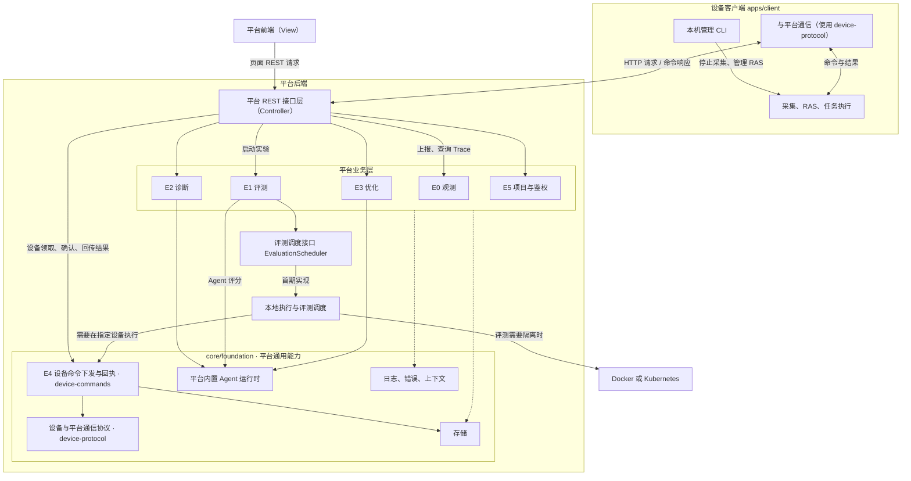
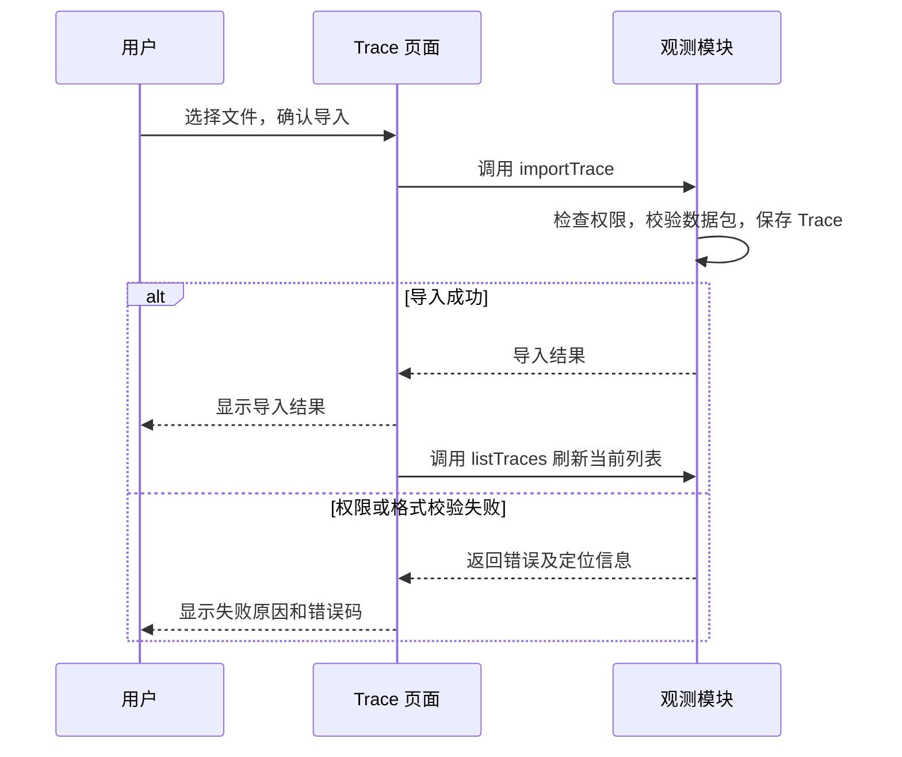
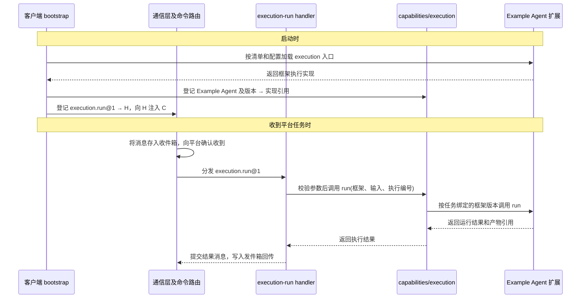
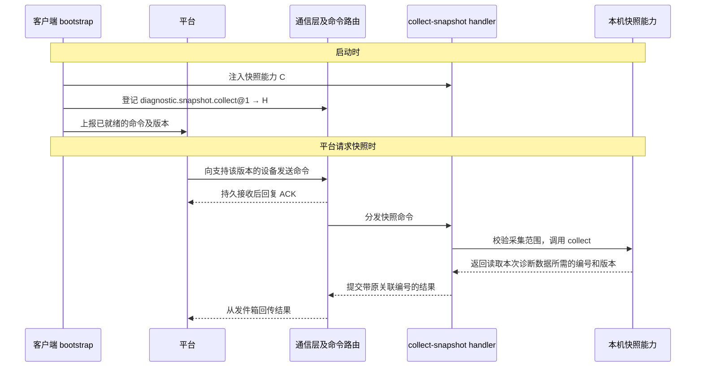
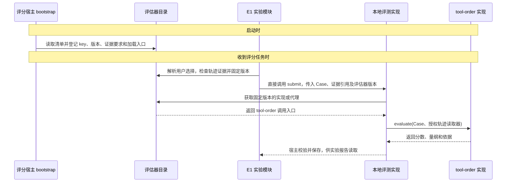
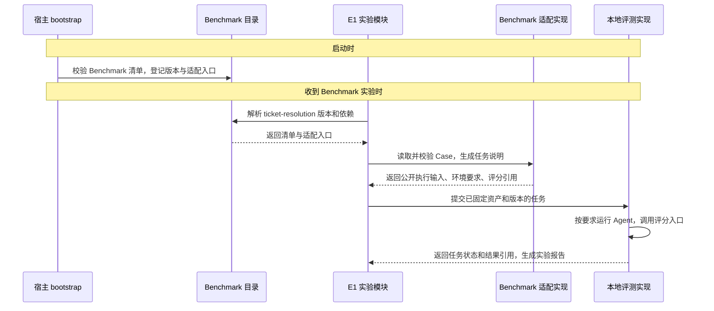
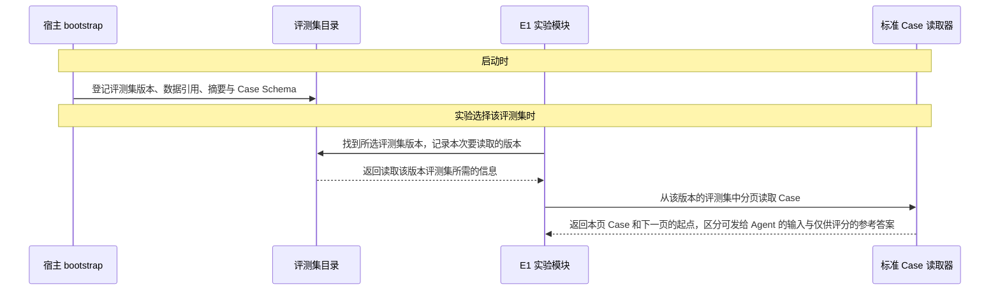
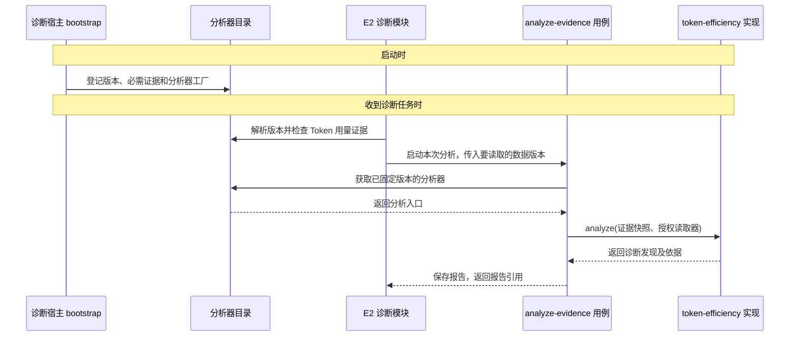

# Agent Insight 前后端重构方案（评审稿）

## 1. 目标与架构

### 1.1 重构要达到什么目标

| 目标 | 设计决定 |
| --- | --- |
| 前后端分离 | 页面通过 REST 调用 TypeScript 后端；平台前后端同版发布与回滚。 |
| 独立客户端 | 设备侧负责采集、RAS 和任务执行。管理员在设备上用 CLI 管理采集和 RAS；平台下发业务任务，接收状态与结果。 |
| 可扩展 | 框架、评估器、Benchmark、评测集和诊断分析器独立登记；平台内置 Agent 运行时与存储可替换。 |

### 1.2 页面、平台和设备怎样连接



首期评测在平台进程内运行，外部系统可通过 REST 提交任务。需要隔离时由运行器启动容器。

## 2. 模块职责与目录结构

### 2.1 平台有哪些模块，各自负责什么？

一个模块是一组共同完成某项工作的代码。例如，观测模块负责接收和查询 Agent 的运行记录；评测模块负责用这些记录给测试用例评分。用户在实验里选一条已有 Trace 时，评测向观测取得指定版本的数据，再调用评估器并保存得分。

下表的目录都位于 `packages/core/` 下，对应第一章架构图中的 E0～E5。

| 模块 | 负责什么 | 目录 |
| --- | --- | --- |
| E0 观测 | 保存上报原文和批次回执。按项目和 Trace 标识合并落到不同实例的数据，供页面、诊断和评测查询。 | `observation/` |
| E1 评测 | 保存实验和任务，安排执行与评分，记录取消请求。执行方领取任务、报告进度，评测模块决定中断后从哪一步恢复。 | `evaluation/` |
| E2 诊断 | 分析运行记录，给出问题、依据和诊断报告。对后台诊断任务，诊断模块保存进度并定义可重试的步骤。 | `diagnosis/` |
| E3 优化 | 根据诊断结果生成待验证的 Skill 版本，调用评测验证改动效果。 | `optimization/` |
| E4 设备命令 | 持久登记发给设备的命令。HTTP 领取时从共享记录分配命令。若启用 WebSocket 推送，将命令送到持有设备连接的进程。按命令编号保存收件确认和执行结果，设备重连后补投未确认命令，客户端按编号去重。 | `foundation/device-commands/` |
| E5 项目与鉴权 | 负责 IAM 登录和外部账号绑定。Controller 处理跳转和回调，认证适配器验证外部身份，模块按提供方和稳定账号标识找到同一个平台用户。登录时无需选项目，访问项目时再由 `AccessService.authorize()` 检查成员权限。 | `project-auth/` |

`foundation/` 集中放平台共用的代码。除了设备命令，里面还有设备通信协议、存储、日志和平台内置 Agent 运行时。

### 2.2 各目录分别放什么

| 位置 | 维护什么 |
| --- | --- |
| `apps/web/` | 页面、组件、HTTP 请求和界面错误展示。 |
| `apps/server/` | `rest-interfaces/` 放 OpenAPI；`controllers/` 接页面和设备的 HTTP 请求，设备领取命令、确认和回传结果的入口在 `clients.ts`，OTLP Trace 上报由 `traces.ts` 接收；`bootstrap/` 按配置创建服务，把服务交给对应的请求处理函数，然后启动 HTTP 服务。 |
| `apps/client/` | `src/communication/` 负责与平台可靠收发，`src/handlers/` 分派平台命令。`cli/` 接收本机管理命令，两种入口共用 `src/capabilities/` 中的业务能力。 |
| `packages/core/` | 包含观测、评测、诊断、优化、项目与鉴权五个业务模块，以及平台通用能力 foundation。模块的 `*-service.ts` 集中定义供其他模块调用的接口和供扩展作者实现的接口，`application/` 实现业务流程及其内部规则。 |
| `packages/core/foundation/storage/` | 稳定存储接口、数据库及文件和缓存实现、表结构迁移。从本包 `index.ts` 导入。 |
| `packages/core/foundation/` | 下设 device-commands、device-protocol、agent-runtime、storage 和 common。common 集中提供上下文、分页、产物引用、错误与日志。 |
| `extensions/` | 一级按所属模块划分，二级按扩展类型划分。每一类在自己的 registry.json 登记实现。 |
| `deploy/`、`docs/`、`design/` | 部署文件、公开指南、仓内需求与设计。 |

### 2.3 新代码和测试放在哪里

| 开发时要判断什么 | 放置规则 |
| --- | --- |
| 页面跨模块 | 按主要操作归组。实验详情归评测；Trace 共用组件放 `apps/web/src/components/`。括号路由组保留原 URL。 |
| UT 与 ST | 单元测试放在 `test/UT/<模块>/`。系统测试直接放在 `test/ST/`，每个用例验证一条完整流程，例如采集器上报 Trace 后用户能在页面查到。Benchmark 发布的 Case 随业务资产交付。 |
| foundation 的依赖 | 业务模块按需引用 foundation；其子模块内部单向依赖。客户端按需引用 device-protocol 的共享代码，交付时核对依赖。 |
| 谁启动评测 | 启动实验由 Controller 调用 ExperimentService.start；直接提交评测作业则调用 EvaluationScheduler.submit。服务启动时由 `composition.ts` 注入本地评测实现，评测模块负责执行、记录进度和返回结果。 |

### 2.4 设备管理员怎样使用本机 CLI

以下命令名为设计示例。

| 管理员在设备上执行 | 运行中的客户端如何处理 |
| --- | --- |
| `client collection stop <采集实例ID>` | CLI 通过本机进程间通信把 ID 交给采集能力。客户端停止该实例的订阅，返回停止结果，其他采集实例继续运行。 |
| `client ras start`、`client ras stop` | 客户端启动或停止本机 RAS，返回实际运行状态。 |
| `client ras config show`、`client ras config apply <文件>` | 查看本机生效配置，或校验新配置并在本机应用、保存。校验失败时返回错误码，保留上次有效配置。 |

设备管理员可在平台离线时完成上述操作。平台接收设备上报的状态和结果；如提供集中配置，作为可选配置来源。已由管理员在本机明确设置的项以本机值为准。

### 2.5 完整项目目录树

下图描述功能迁入后的目标结构。分支先登记目录和首批接口，具体页面、启动脚本、数据库驱动及部署文件由对应模块补齐。迁移期间，旧项目按原布局暂存在仓根 [legacy/](../../../legacy/)。

<details><summary>展开完整目标目录（含各模块文件）</summary>

```text
agent-insight/
├── apps/
│   ├── web/src/
│   │   ├── app/                    # 页面按主要工作流归类，以下为现有页面的目标位置示例
│   │   │   ├── layout.tsx
│   │   │   ├── page.tsx
│   │   │   ├── login/page.tsx
│   │   │   └── (main)/             # 共用主导航；括号目录不进入 URL
│   │   │       ├── layout.tsx
│   │   │       ├── (observation)/  # trace/、observe/collaborations/
│   │   │       ├── (evaluation)/   # experiments/（含 new、[id]、Case 详情）、dataset/
│   │   │       ├── (diagnosis)/    # fault/
│   │   │       ├── (optimization)/ # skill-workbench/、skill-opt/[name]/[version]/
│   │   │       └── (platform)/     # dashboard/、accessconfig/client/、modelconfig/
│   │   ├── components/             # 页面共用控件
│   │   └── lib/{api,errors}/       # 发 HTTP 请求、展示可定位的错误
│   ├── server/
│   │   ├── rest-interfaces/
│   │   │   └── <领域>.openapi.yaml  # 六个领域分别维护路径和请求响应
│   │   └── src/
│   │       ├── controllers/{traces,experiments,evaluation-jobs,diagnoses,candidates,clients,access}.ts
│   │       └── bootstrap/{http,composition}.ts
│   └── client/                         # 独立部署在设备上
│       ├── cli/                        # 本机管理员的命令行入口
│       │   ├── index.ts                # 解析参数，连接本机客户端，显示结果或错误码
│       │   ├── collection.ts           # 按采集实例 ID 停止指定采集
│       │   └── ras.ts                  # 启动、停止 RAS，查看或修改本机配置
│       └── src/
│           ├── local-management.ts      # 接收本机 CLI 请求，调用运行中客户端的能力
│           ├── bootstrap/register-handlers.ts  # 启动客户端：加载已启用的框架能力，登记命令处理函数，启动通信和采集订阅
│           ├── communication/           # 连接平台、重连、本地持久收发队列
│           ├── handlers/                # 标准命令处理函数；运行时路由由 bootstrap 装配
│           └── capabilities/
│               ├── collection/          # 管理采集会话、绑定已启用的采集实现、提交上报
│               ├── ras/                 # 本机检测、处置与恢复
│               └── execution/           # 接收执行参数、调用运行器、收集产物
├── packages/
│   └── core/
│       ├── observation/
│       │   ├── trace-service.ts  # TraceService；采集适配 ObservationAdapter、数据处理 ObservationProcessor
│       │   └── application/
│       │       ├── accept-trace.ts  # 保存上报原文，记录哪些批次已接收、哪些待写入分析库
│       │       ├── reconcile-trace-batch.ts # 核对中断批次并恢复投递
│       │       ├── list-traces.ts
│       │       └── freeze-trace.ts
│       ├── evaluation/
│       │   ├── evaluation-service.ts  # ExperimentService、EvaluationScheduler；扩展接口 Evaluator、Benchmark
│       │   ├── application/
│       │   │   ├── evaluation-jobs.ts
│       │   │   ├── run-evaluation.ts       # 按 Case 执行与评分，更新评测作业进度
│       │   │   ├── evaluation-backend.ts   # 需要隔离执行时，由评测模块调用
│       │   │   ├── create-experiment.ts
│       │   │   ├── start-experiment.ts  # 同一事务更新实验状态并创建首批任务
│       │   │   ├── read-report.ts
│       │   │   ├── evaluation-evidence-reader.ts # 宿主提供的证据读取接口
│       │   │   └── dataset-catalog.ts           # 按登记版本读取 Case 的内部接口
│       │   └── adapters/
│       │       ├── evidence-reader.ts
│       │       └── dataset-catalog.ts
│       ├── diagnosis/
│       │   ├── diagnosis-service.ts  # DiagnosisService；扩展接口 DiagnosisAnalyzer
│       │   ├── adapters/
│       │   │   └── evidence-reader.ts
│       │   └── application/
│       │       ├── analyze-evidence.ts
│       │       ├── read-diagnosis.ts
│       │       └── diagnosis-evidence-reader.ts  # 宿主提供的证据读取接口
│       ├── optimization/
│       │   ├── optimization-service.ts
│       │   ├── adapters/
│       │   │   └── skill-candidate-generator.ts  # 规划，抽取现有生成逻辑
│       │   └── application/
│       │       ├── propose-candidate.ts
│       │       ├── retest.ts
│       │       └── candidate-generator.ts   # 内部候选策略接口（规划）
│       ├── project-auth/                 # 平台侧身份、项目成员和访问权限
│       │   ├── access-service.ts         # 对其他模块提供身份识别、授权和成员查询接口
│       │   ├── adapters/
│       │   │   └── credentials/          # 按已配置的认证方式验证凭据，返回可信身份
│       │   └── application/
│       │       ├── get-identity.ts       # 调用凭据验证接口，取得调用方身份
│       │       ├── authorize.ts          # 根据身份、项目和策略判断是否允许本次操作
│       │       ├── list-members.ts       # 检查访问权限后列出项目成员
│       │       └── credential-verifier.ts # 内部接口，由 adapters/credentials/ 实现
│       └── foundation/                 # 平台通用能力，子模块独立引用
│           ├── device-commands/            # E4 设备任务下发、投递状态和回执
│           │   ├── device-command-service.ts # 对其他模块提供下发命令、查询回执的接口
│           │   └── application/
│           │       ├── enqueue-command.ts       # 给指定设备登记待领取命令
│           │       ├── get-receipt.ts           # 按设备和消息编号查询投递状态
│           │       └── delivery-state-rules.ts  # 根据当前状态和新回执判断下一状态
│           ├── device-protocol/            # 设备与平台共用的消息格式、确认与重试规则
│           │   ├── index.ts                # 客户端与平台共用的协议入口
│           │   ├── schemas/             # 各版本的消息公共字段、收件确认、执行结果及兼容样例
│           │   ├── ports.ts             # MessageChannel、MessageHandler、DeviceTransport
│           │   └── delivery.ts          # 双端共用的去重、重试及确认规则
│           ├── agent-runtime/     # 平台执行内部 Agent 任务的共用入口
│           │   ├── index.ts                # 定义并导出 AgentRuntime、AgentRuntimeProvider 及公共输入输出
│           │   ├── registry.ts             # 校验并选择启用的运行时实现
│           │   └── providers/opencode/     # 首期适配平台已有的 OpenCode 运行逻辑
│           ├── storage/                    # 仓内的公共存储模块，由数据库重构专项维护
│           │   ├── index.ts                # 导出存储契约和 StorageProvider 的创建约定
│           │   ├── registry.ts             # 存储模块内部维护：按存储职责和配置名查找创建函数
│           │   ├── storage-interfaces/     # 按职责定义可替换实现必须满足的读写约定
│           │   │   ├── operations.ts          # 绑定操作类型、授权范围、输入和结果
│           │   │   ├── transactional.ts       # 业务方统一的只读和原子写入口
│           │   │   ├── transaction-session.ts # 存储宿主本地的同连接读写和行锁
│           │   │   ├── maintenance.ts         # 部署侧检查、初始化和迁移
│           │   │   ├── analytical.ts          # 批量写入、按键分页读取和聚合
│           │   │   ├── artifacts.ts           # 按引用保存、读取与清理持久内容
│           │   │   └── cache.ts               # 按键读写、过期和删除
│           │   ├── adapters/
│           │   │   ├── transactional/       # 同一事务存储契约的候选实现
│           │   │   │   ├── sqlite/           # SQLite 后端
│           │   │   │   ├── postgresql/       # PostgreSQL 后端
│           │   │   │   └── opengauss/        # openGauss 后端
│           │   │   ├── analytical/clickhouse/   # Trace/Span 写入、查询和聚合
│           │   │   ├── artifacts/filesystem/ # ArtifactStore：本地持久目录，后续可接 S3
│           │   │   └── cache/memory/        # CacheStore：进程内缓存，后续可接 Redis
│           │   ├── schema/                 # 各数据库的表、索引、约束及版本演进
│           │   │   ├── transactional/
│           │   │   │   ├── sqlite/{current.sql,upgrades/}
│           │   │   │   ├── postgresql/{current.sql,upgrades/}
│           │   │   │   └── opengauss/{current.sql,upgrades/}
│           │   │   └── analytical/clickhouse/{current.sql,upgrades/}
│           │   └── migration_tools/        # 跨库或旧模型的数据导出、转换、回填和校验
│           └── common/                         # 各业务模块共同使用的能力
│               ├── context/call-context.ts      # 当前身份、项目、请求编号、取消信号
│               ├── shared-interfaces/{pagination,artifact-ref}.ts
│               ├── errors/{app-error,error-code,safe-error}.ts
│               └── logging/{logger,redaction,rotation}.ts
├── extensions/                     # 模块 / 扩展类型 / 具体实现
│   ├── observation/
│   │   ├── agent-runtimes/         # 接入用户侧 Agent 运行时；各包在 registry.json 登记，可提供采集、RAS 和执行能力
│   │   └── processors/             # registry.json 和各上报数据处理实现
│   ├── evaluation/
│   │   ├── evaluators/             # registry.json 和各结果或轨迹评估器
│   │   ├── benchmarks/             # registry.json 和各 Benchmark 任务定义
│   │   └── datasets/               # registry.json 和各独立评测集
│   └── diagnosis/
│       └── analyzers/              # registry.json 和各诊断分析器
├── deploy/                         # 平台部署入口，按构建和运行方式组织
│   ├── images/
│   │   ├── Dockerfile              # 从指定版本的发布包构建平台镜像，两种 CPU 架构共用
│   │   ├── Dockerfile.local        # 从本地源码构建
│   │   ├── Dockerfile.dockerignore、Dockerfile.local.dockerignore
│   │   └── docker-entrypoint.sh、container-runtime.py  # 容器内启动与运行支持
│   └── compose/
│       ├── compose.yaml            # 单机运行，引用统一版本的多架构镜像
│       └── compose.source.yaml     # 源码挂载、缓存和启动参数的附加配置
├── scripts/develop_start.sh        # 本地开发启动脚本
├── docs/                           # 面向使用者、部署人员和开发者的公开文档
│   ├── README.md                   # 文档导航
│   ├── zh/                         # 中文；按 tutorial、how-to、reference、explanation 分类
│   └── en/                         # 对应英文文档
├── design/                         # 仓内需求分析、方案设计和开发计划
│   ├── README.md                   # 需求清单与设计导航
│   └── <业务领域>/<主题>/           # 单项需求资料
└── test/                           # 项目测试统一放在这里
    ├── UT/                         # 单元测试，按被测模块组织
    │   ├── apps/{web,server}/
    │   ├── apps/client/{cli,src}/
    │   ├── core/{observation,evaluation,diagnosis,optimization,project-auth}/
    │   ├── core/foundation/{device-commands,device-protocol,agent-runtime,storage,common}/
    │   └── extensions/<模块>/<类型>/<实现名>/
    └── ST/                         # 系统测试，用例直接放在此目录，按端到端场景命名
```

</details>

### 2.6 业务模块内部的文件职责

| 模块内位置 | 职责 |
| --- | --- |
| `*-service.ts` | 写模块的公开类型和方法签名。新增一种评估器时，在 `extensions/evaluation/evaluators/<名称>/` 编写实现并在该类注册表登记。沿用现有评分约定时无需改服务文件。 |
| `application/` | 实现业务步骤、调用已选的扩展、决定事务范围。只在模块内部使用的协作接口随用例放置。简单规则可以写成同文件的函数。多个流程共用或需要独立测试的规则，在本目录按业务含义命名。例如 `delivery-state-rules.ts` 规定设备命令执行成功后，再收到“已收件”仍保留成功状态。 |
| `adapters/`（按需） | 封装有独立职责的接入或转换，如验证外部凭据、按授权范围读取证据。与 dev 对接时，存储适配接入 Storage Core，数据库驱动和方言由存储宿主管理。 |

## 3. 模块接口怎么设计

### 3.1 哪些方法要提供给模块外的代码调用？

**“公开”是相对于当前模块而言的。** 写进模块服务接口（`*-service.ts`）的方法，其他业务模块、平台 Controller 或本地 SDK 都可以按约定调用。是否给前端或外部系统提供 HTTP 路径，以及谁有权限调用，由 REST 和授权设计分别决定。

A、B、D 取自现有观测页，表中服务和函数名是重构建议。C 使用后文的工具调用顺序评估器作为扩展示例。

| 设计步骤 | A．导入 Trace 文件 | B．把已有 Trace 加入评测集 | C．客户自定义评分规则 | D．列表和统计共用筛选规则 |
| --- | --- | --- | --- | --- |
| **1. 找到调用者：谁要完成什么事？** | 用户在观测页选取同事发来的 Trace 文件，想把它保存到项目里供团队查看。 | 用户勾选项目里已有的 Trace，想把它们整理成评测用例。 | 用户为实验选定评估器。评测模块执行用例时，请它判断 Agent 是否先查询工单再更新工单。 | 用户在观测页筛选失败的 Trace。页面既要列出当前页的记录，也要显示全部匹配记录的数量。 |
| **2. 说清成功结果：调用者在等什么？** | Trace 已保存，页面拿到导入结果即可提示成功。 | 用户先拿到可编辑的草稿，也可以放弃。只有确认保存后，才看到新增和跳过的用例数。 | 评测模块拿到单条用例的分数和理由，随后保存结果、更新实验进度。 | 列表和统计按同一条件筛选。用户翻页时，记录随页码变化，匹配总数保持一致。 |
| **3. 决定方法粒度：调用几次才能得到这个结果？** | 调用一次 `importTrace()`。观测模块在一次调用内完成权限检查、文件校验和保存。 | 分两次调用。先用 `prepareCaseFromTrace()` 生成草稿，等用户确认后再用 `saveCasesToDataset()` 写入评测集。 | 每条用例调用选定评估器的 `evaluate()` 一次。客户可以更换判分算法，平台沿用同一套实验执行流程。 | 列表和统计各有一个查询方法。两者在内部调用普通函数 `buildTraceFilter()` 生成查询条件，页面只取查询结果。 |
| **4. 确定归属：谁定义、谁实现、谁调用？** | **定义**　观测模块定义 `TraceTransferService.importTrace()`。<br>**实现**　观测模块的 `application/` 实现导入流程。<br>**调用**　观测页发起导入请求，由平台的 Trace 导入 Controller 调用该方法。 | **定义**　评测模块定义 `DatasetService.prepareCaseFromTrace()` 和 `DatasetService.saveCasesToDataset()`。<br>**实现**　评测模块的 `application/` 分别实现草稿生成和用例保存。<br>**调用**　观测页请求预览时，评测集 Controller 调用前者。用户确认加入后，Controller 再调用后者。 | **定义**　评测模块在 `evaluation-service.ts` 定义 `Evaluator.evaluate()`。<br>**实现**　客户在 `extensions/evaluation/evaluators/tool-order/` 实现算法，并在评估器目录的 `registry.json` 登记。<br>**调用**　评测模块的 `application/run-evaluation.ts` 按实验选定的版本调用该实现。 | **定义**　观测模块定义 `TraceService.listTraces()` 和 `TraceService.getStatistics()`。<br>**实现**　观测模块的 `application/` 实现两个查询，并在内部定义和实现 `buildTraceFilter()`。<br>**调用**　观测页通过 Controller 调用两个查询方法。直接调用筛选函数的是这两个方法的实现。 |

现有实现可核对 [Trace 文件导入](https://atomgit.com/openeuler/agent-insight/blob/eabde5b02f69797fe7e09b446b3f178374325d82/src/app/api/observe/traces/import/route.ts#L46)、[观测页的加入评测数据集按钮](https://atomgit.com/openeuler/agent-insight/blob/eabde5b02f69797fe7e09b446b3f178374325d82/src/app/%28main%29/trace/page.tsx#L1264)、[从 Trace 生成草稿](https://atomgit.com/openeuler/agent-insight/blob/eabde5b02f69797fe7e09b446b3f178374325d82/src/app/api/agent-datasets/trace-drafts/route.ts#L70) 和 [确认后保存用例并显示结果](https://atomgit.com/openeuler/agent-insight/blob/eabde5b02f69797fe7e09b446b3f178374325d82/src/components/observe/TraceBackflowDialog.tsx#L388)。[现有 Trace 列表与统计如何使用同一批筛选结果](https://atomgit.com/openeuler/agent-insight/blob/eabde5b02f69797fe7e09b446b3f178374325d82/src/app/api/observe/data/route.ts#L618)

### 3.2 方法确定后，Controller、服务接口和 application 各做什么？

在 3.1 的场景 A 中，用户只需确认一次导入，因此观测模块提供一个方法 `TraceTransferService.importTrace()`。用户在页面点击“导入”时，Controller 会调用这个方法。服务接口约定怎样调用它，`application/` 中的代码负责执行它。

| 位置 | 职责 | 在这次 Trace 导入中做什么 |
| --- | --- | --- |
| 平台 Controller（`apps/server/src/controllers/`） | 把 HTTP 请求转成方法调用，把调用结果转成 HTTP 响应。 | 从请求中取得已认证的调用者身份、目标项目和上传文件，调用 `importTrace()`。成功时把导入结果返回页面，失败时按统一错误格式返回错误码。 |
| 观测模块的服务接口（`observation/trace-service.ts`） | 声明方法名、输入和返回结果，供调用方和实现方共同遵守。 | 在 `TraceTransferService` 中声明 `importTrace()`，约定调用方要提供调用上下文、目标项目和 Trace 数据包，成功返回表示 Trace 已保存到该项目。 |
| 观测模块的 `application/` | 实现接口中声明的方法，按业务规则组织各个步骤。 | 实现 `importTrace()` 时，先检查调用者能否向该项目导入 Trace，再校验数据包。检查通过后调用存储能力保存 Trace，返回导入结果。其他模块直接调用这个方法，也会执行相同的检查。 |

评审每个公开方法时，写清调用场景、方法名和参数、成功条件，以及失败后可以重试哪一步。例如导入已成功、页面刷新列表失败时，页面只需重试列表查询。

### 3.3 Trace 页面上的操作分别调用什么方法？

下面用现有页面举例。中列是**建议的方法名**，便于讨论。已定义的观测接口见[观测模块服务契约](../../../packages/core/observation/trace-service.ts)。[Trace 页面实现](https://atomgit.com/openeuler/agent-insight/blob/eabde5b02f69797fe7e09b446b3f178374325d82/src/app/%28main%29/trace/page.tsx#L835) · [SDK 草案](Agent-Insight平台SDK.d.ts)

| 用户做什么 | 后端提供什么方法（建议） | 为什么这样分 |
| --- | --- | --- |
| 打开列表、搜索、筛选、排序或翻页 | `TraceService.listTraces(query)` | 都是要查一页 Trace，变化的只是查询条件。 |
| 看总数和失败数 | `TraceService.getStatistics(filter)` | 数字要统计所有符合条件的记录。翻到第二页时，只需重新查列表。 |
| 打开一条 Trace，再点开一次交互的正文 | `TraceService.getTraceDetail(id)`、`getInteractionDetail(...)` | 先取概览，点开交互时再取正文。用户只看概览时可以少加载数据。 |
| 导入文件、导出 Trace | `TraceTransferService.importTrace(input)`、`exportTrace(selection)` | 导入返回保存结果；导出返回可下载的文件。 |
| 添加或移除标签 | `TraceTagService.attachTag(traceId, tagId)`、`removeTag(traceId, tagId)` | 用户要改变某条 Trace 上的标签，操作成功后就能看到更新后的标签。 |
| 勾选几行，再清空选择 | 页面保存选中项 | 勾选只改变本页状态。等用户点击导出，再调用后端。 |

还要检查页面之外的调用者。例如采集器向平台上报 Span，平台保存原始数据后用 `TraceService.accept()` 登记这批数据。评测和诊断则调用 `TraceService.freeze()` 选定一个版本，之后读取的始终是选定时的那份 Trace。[SDK 草案](Agent-Insight平台SDK.d.ts)

### 3.4 导入 Trace 时，后端做到哪一步？



| 实际问题 | 谁来处理 |
| --- | --- |
| 文件能不能导入？ | 观测模块在 `importTrace()` 中检查权限、校验文件，检查通过后保存。其他模块直接调用它也会经过相同检查。 |
| 导入成功了，列表没刷新怎么办？ | 页面只重试列表查询。文件已经导入，再提交一次可能重复写入。[现有页面的刷新逻辑](https://atomgit.com/openeuler/agent-insight/blob/eabde5b02f69797fe7e09b446b3f178374325d82/src/app/%28main%29/trace/page.tsx#L951) |
| 要不要单独提供 `validateBundle()`？ | 如果用户需要先拿到问题清单、修改文件、稍后再导入，就提供“预检”方法。只有导入时需要校验，校验函数就留在模块内部。 |
| 用户的 Agent 上报自有格式，谁来转换？ | 接入方实现 `ObservationAdapter`，把自有格式转成平台能读的格式；观测模块决定何时调用它、何时保存数据。 |

### 3.5 各模块提供哪些接口，方法怎么命名？

用 TypeScript 的 `interface` 写明调用者能用哪些方法。接口名写角色（如“评估器” `Evaluator`），方法名写动作（如“评分” `evaluate`），输入输出写数据名称（如“报告” `Report`）。多种实现需要继承同一段代码或状态时，再考虑抽象类。[TypeScript 手册](https://www.typescriptlang.org/docs/handbook/2/classes.html#abstract-classes-and-members)

| 模块 | 其他模块可以调用什么 | 谁来提供具体实现 |
| --- | --- | --- |
| E0 观测 | `TraceService`：登记已保存的上报批次、查询 Trace、取得指定版本的数据引用。 | 框架接入方实现 `ObservationAdapter`，将来源数据转成标准 Span；数据处理扩展实现 `ObservationProcessor`。 |
| E1 评测 | `ExperimentService`：创建实验、启动运行、读取报告。`EvaluationScheduler`：提交、查询、取消评测作业及读取结果。前者管理实验，后者也服务于直接提交作业的调用方。 | 评估器作者实现 `Evaluator.evaluate()`；Benchmark 接入方提供测试任务定义及所需适配。标准评测集可以直接登记数据文件。 |
| E2 诊断 | `DiagnosisService`：发起诊断、查询状态和报告。 | 分析器作者实现 `DiagnosisAnalyzer.analyze()`，分析指定数据并返回发现。 |
| E3 优化 | `OptimizationService`：生成候选、发起复测。 | 候选生成由优化模块内部实现；复测调用 E1。 |
| E4 设备命令 | `DeviceCommandService`：登记待发命令、查询收件或处理状态。 | 平台实现命令服务；`DeviceTransport` 约定领取、确认、上报，设备处理函数实现 `MessageHandler.handle()`。 |
| E5 项目与鉴权 | `AccessService`：识别调用者、检查操作权限、列出项目成员。 | `CredentialVerifier.authenticate()` 由平台的认证适配实现。 |
| foundation 共享能力 | `AgentRuntime.run()` 供诊断、评测、优化运行平台内置 Agent；其他模块通过对应的存储接口读写业务记录、Trace、文件和缓存。 | 运行时提供方实现 `AgentRuntimeProvider`；存储实现分别遵守对应的读写约定。 |

命名按[模块接口与评审规则](../../../docs/zh/how-to/platform/refactor-module-boundaries.md)检查。接口用大驼峰角色名（如 `TransactionalStore`），方法用小驼峰动作名（如 `importTrace`），文件用连字符分词。

SDK 草案中的四个方法名建议改得更明确：`report()` → `getReport()`、`results()` → `listResults()`、`identity()` → `getIdentity()`、`members()` → `listMembers()`。最终签名以评审后的 SDK 为准。[当前 SDK 契约稿](Agent-Insight平台SDK.d.ts)

### 3.6 状态归谁？下一次请求换到另一实例后怎么继续？

设计需要跨请求保存状态的方法时，模块负责人要回答三个问题：**哪个模块负责这份状态？另一个实例凭什么编号能找到它？原进程退出或请求重发时，谁接着处理？** A、B 表示运行同一版本平台的两个实例。

| 状态 | 谁保存、凭什么找到 | 请求从 A 换到 B 后怎么办 |
| --- | --- | --- |
| 跨请求的业务记录 | 业务模块决定何时写入，存储模块提供持久读写。实验按项目和运行编号查询，Trace 批次按来源和批次编号查询，设备命令按设备和命令编号查询。 | B 验证调用者权限后，从共享存储读取进度、回执或产物。创建请求的响应丢失时，用原幂等键和相同参数重试，返回已保存的结果。 |
| 正在执行的任务 | 评测或诊断模块维护任务状态。执行方在共享库中领取任务，取得本次领取编号和有效期，并在执行中续期。 | B 可以查询或登记取消，由当前执行方处理。只有领取有效期已过，其他执行方才能接管。接管前按执行编号核对已下发的工作。写回时校验领取编号，过期执行方的迟到结果不能覆盖新结果。 |
| 登录过程和平台身份 | `project-auth` 负责将登录回调与原请求对应，并建立平台登录会话。各实例使用一致的回调配置。签名凭据由各实例用一致的密钥验证，保存在服务端的会话记录由各实例共享。 | A 发起登录，B 能验证回调并绑定到同一平台用户。后续业务请求凭已验证的身份和目标项目执行授权。 |
| 本机临时数据 | 解析缓存可放在各实例内存中。设备连接由建立它的进程持有，设备命令及回执另存到共享存储。 | B 缓存未命中时从原始数据重算。设备连在 A 时，B 发起的推送须到达 A。A 退出后，设备重连后，平台补投未确认命令，客户端按命令编号识别重复投递。 |

首期评测可以直接在平台进程内执行，同样在返回“已受理”前保存任务。以后采用独立执行进程时，继续按同一任务编号领取、查询和写回。（见数据库专项《Agent-Insight 数据库切换与表结构设计方案》）

## 4. 扩展接入

### 4.1 平台内置 Agent 怎样接入

| 谁负责 | 约定 |
| --- | --- |
| 诊断、评测、优化 | 注入 `AgentRuntime`。传系统 Agent 标识、指令、可选证据与超时；调用模块处理返回的文本和已保存的文件。 |
| 运行时实现 | 实现 `AgentRuntimeProvider` 的 key、version 和 run。响应取消与超时，释放资源；输出可关联 Trace。 |
| 平台宿主 | 隔离项目、调用者、工作区和凭据；composition 按配置装配。缺失实现或重复注册时启动报错。 |
| 首期与后续 | OpenCode 复用 `engine/general-agent/runner.ts` 和进程管理。取消信号由调用方传入。先接诊断、优化自验证，再迁移直接访问 OpenCode 的评估器。Pi 是扩展示例；流式与多轮调用迁移前单独核对。 |

### 4.2 各类扩展在哪里实现和登记

| 要新增什么 | 开发者改哪里 |
| --- | --- |
| Agent 框架 | 在 `extensions/observation/agent-runtimes/<key>/` 声明采集、RAS、执行入口，按需启用；使用自有格式上报时，可提供服务端函数将数据转成平台格式。 |
| 上报数据处理 | 在 `extensions/observation/processors/<key>/` 实现 ObservationProcessor，声明阶段与版本，在该类注册表登记。框架专用格式转换由框架包的服务端入口实现。 |
| 客户端命令 | 增加版本化消息契约、handler 和相应 capability。已有命令接入新框架时复用原 handler。 |
| 评估器 | 在 `extensions/evaluation/evaluators/` 声明输入要求并实现评分。输入可以是结果、轨迹或两者。 |
| Benchmark、评测集 | Benchmark 组织整套评测任务；独立评测集提供可复用 Case。同格式的新数据集复用现有读取方式。 |
| 诊断分析器 | 在 `extensions/diagnosis/analyzers/` 实现 `DiagnosisAnalyzer`，声明所需证据，返回发现及依据。 |

### 4.3 一个 Agent 框架包怎样注册和启用

<details><summary>展开新框架的目录、注册表、manifest 和启用配置</summary>

**以下全部为目标设计示例。** 假设 Example Agent 有私有事件格式、本机健康检查和运行任务的 API。整个框架包在 `extensions/observation/agent-runtimes/` 下维护。采集、RAS 和执行可分别启用，同一个包只登记一次。只实现采集的框架可以只交付 collection。部署时也可以只启用已交付能力中的一部分。

```text
extensions/observation/agent-runtimes/
  registry.json                       # 所有框架包的目录，人工维护
  example-agent/
    manifest.json                     # 本包的版本、能力与各端入口，人工维护
    client/
      collection/index.ts             # 订阅/释放框架事件，交给客户端上报
      ras/index.ts                    # 调用框架健康检查和恢复 API
      execution/index.ts              # 启动/取消 Agent，返回进度、输出，以及读取已保存文件所需的信息
    server/
      collection/normalize.ts         # 私有格式 → 标准 Span；使用标准 OTLP 可省略

test/UT/extensions/observation/agent-runtimes/example-agent/
  {collection,ras,execution}.test.ts

apps/client/cli/                             # collection.ts、ras.ts 负责本机管理命令
apps/client/src/
  local-management.ts                  # 本机 CLI 接入运行中的客户端
  bootstrap/register-handlers.ts      # 绑定标准命令处理函数，加载本机启用的框架能力
  handlers/{ras-check,ras-recover,execution-run,execution-cancel}.ts
  capabilities/{collection,ras,execution}/
  communication/                      # 接收确认、去重、重试与结果回传
```

**第一步：在分类目录根部登记框架包。** 下例是 extensions/observation/agent-runtimes/registry.json 的完整示例。每个 key 和 version 组合只出现一次。

```json
[
  {"key":"example-agent","version":"1.0.0","manifest":"./example-agent/manifest.json"}
]
```

**第二步：在框架目录根部声明包提供的能力。** 下例是 example-agent/manifest.json。包版本标识一次发布，contract 标识各能力遵守的接口版本。每个入口路径相对于该 Manifest。采集可以有客户端和服务端两个入口，仍属于同一项采集能力。

```json
{
  "key": "example-agent",
  "version": "1.0.0",
  "capabilities": {
    "collection": {
      "client": {"contract":"collection-source/v1","entry":"./client/collection/index.ts"},
      "server": {"contract":"observation-adapter/v1","entry":"./server/collection/normalize.ts"}
    },
    "ras": {
      "client": {"contract":"ras-provider/v1","entry":"./client/ras/index.ts","operations":["check","recover"]}
    },
    "execution": {
      "client": {"contract":"agent-execution/v1","entry":"./client/execution/index.ts","operations":["run","cancel"]}
    }
  }
}
```

**第三步：按部署启用。** 示例客户端配置如下。本机只加载采集和执行。RAS 代码虽已随包发布，本机上报的可用能力只包含已启用、契约兼容且初始化成功的项。平台根据客户端身份、目标框架和可用操作下发任务。平台另行选择需要加载的服务端入口。

```json
{"framework":"example-agent","version":"1.0.0","enable":["collection","execution"]}
```

**handlers/ 放处理函数。** 客户端启动时形成两份不同的运行时映射。第一份按“消息类型 + 消息版本”找到标准 handler，例如 execution.run@1 对应 execution-run.ts。第二份按“框架 + 已锁定包版本 + 能力”找到已启用的实现。两种框架都可以处理 execution.run@1，各自提供自己的运行器。消息路由由客户端统一装配，框架扩展实现公开能力接口。增加框架时只改框架目录和分类注册表；增加全新的命令语义时才扩展命令契约与 handler。采集可由本地事件主动触发，直接走上报通道。

</details>

### 4.4 扩展在启动时怎样加载，运行时怎样调用

<details><summary>A. 新 Agent 框架：同一个执行 handler 调用不同的框架实现</summary>

假设加入 Example Agent，源码位于 `extensions/observation/agent-runtimes/example-agent/`。开发者在分类根目录登记包，在包内 manifest 声明 collection、ras、execution 入口。本例部署启用 execution。图中的命令表与执行能力中的框架实现表都属于运行进程。



换框架时替换 C 调用的实现。主动采集走另一条路径：bootstrap 启动已启用的 collection 订阅，框架 Hook 收到新 Span 后交给采集能力，经发件箱上报。

</details>

<details><summary>B. 新客户端处理逻辑：增加一种标准命令</summary>

假设增加“采集本机诊断快照”。新增命令载荷契约 `diagnostic.snapshot.collect@1`、`handlers/collect-snapshot.ts` 和 `capabilities/diagnostic-snapshot/`。本例只读取客户端自己的诊断信息，可在不同 Agent 框架上共用。



A 扩展的是同一命令背后的框架实现；B 扩展的是平台可向设备发出的命令。两者共用消息投递、确认和重试机制。

</details>

<details><summary>C. 新评估器：根据工具调用轨迹评分</summary>

示例包 `extensions/evaluation/evaluators/tool-order/` 实现 Evaluator，声明必需证据为 trajectory。注册记录放在 `extensions/evaluation/evaluators/registry.json`。实验提交时固定评估器版本，执行时评测处理器按同一个版本取实现。



</details>

<details><summary>D. 新 Benchmark：组装整套测试任务</summary>

以示例 `ticket-resolution/` 为例，在 `extensions/evaluation/benchmarks/registry.json` 登记其 benchmark.yaml。包内声明 Case 格式、所需运行环境及评分方式。本例使用已有的 tool-order 评估器；需要专用 Harness 的 Benchmark 可在同一清单中指定自己的入口。



</details>

<details><summary>E. 新评测集：增加一份标准数据</summary>

`extensions/evaluation/datasets/support-orders/` 提供 manifest、Case Schema 和用例数据。在 `extensions/evaluation/datasets/registry.json` 登记一项。标准格式复用宿主已有的读取器，新增数据即可接入。



</details>

<details><summary>F. 新诊断分析器：分析 Token 使用效率</summary>

在 `extensions/diagnosis/analyzers/token-efficiency/` 提供分析实现，在同级分类注册表登记版本和入口。诊断模块登记任务和状态，调用所选分析器并保存报告。



</details>

## 5. 存储与部署

### 5.1 各类数据保存在哪里

| 数据 | 目标存储 | 关键保证 |
| --- | --- | --- |
| 实验、任务、权限 | SQLite / PostgreSQL / openGauss | 共用逻辑模型；每种实现都验证事务、唯一约束和并发行为。 |
| Trace、Span、聚合 | ClickHouse | 批量写入、分页查询。观测模块核对整批数据写入完整后才允许查询；中断时按批次补写或补记完成状态。 |
| 原始批次、报告、附件 | ArtifactStore：持久磁盘，后续可接 S3 | 保存不可变内容，引用含范围、大小及摘要；切换后历史引用仍可读。 |
| 可重算数据 | CacheStore：内存，后续可接 Redis | 支持读写和删除，可设置缓存多久后自动过期（TTL）；回执、任务和恢复进度写持久存储。 |

### 5.2 数据库接入、建表与迁移

**统一入口。** 业务模块以操作名、授权上下文和输入调用 `storage.transactional.read(...)` 或 `storage.transactional.transaction(...)`。业务模块声明各操作的输入、结果和权限范围，例如“保存指定版本的评测集”。foundation 只定义只读快照、事务、批写、分析查询等通用能力。宿主登记操作名并校验参数和权限。登录前的凭据验证由专用认证入口处理；普通工作区操作必须携带已验证的 workspace。

**事务在哪里执行。** 对接 dev 时，一次已登记的操作可映射到 Storage Core 已有的类型化入口或批提交协议。业务流程决定哪些写入必须一起成功，拥有连接的存储宿主在同一事务内读取、判断、写入、提交或回滚。例如保存评测集时，版本头、release、别名、操作回执和 outbox 一起提交。TS 回调只用于进程内实现，跨进程调用传操作名和数据。宿主维护三种事务库的方言、驱动、迁移与备份校验；目录树中的后端位置是可选实现位置，接入 dev 时直接适配已有存储服务。[dev 事务实现](https://gitcode.com/openeuler/agent-insight/blob/c6ef915e82760472fe5492d8eefd2c4ac65b3d55/services/storage/relational.py#L196)

| dev 中的实际操作族 | 通用契约如何承接 | 业务方或适配器必须保留的语义 |
| --- | --- | --- |
| IAM、项目、评测集、资产、报告、诊断、实验状态与版本 | 只读快照 + 写事务；宿主 session 提供参数化 query、execute、executeMany 和受影响行数 | 多表提交、唯一键初建、条件更新、批量全成或全退。按真实范围复核身份；全局账号使用 principal 范围。 |
| 任务领取、续租、取消、配额、回执、outbox、导入检查点 | 一个注册写操作组织行锁、条件写和回执记录 | 按执行代次拒绝迟到写回。相同幂等键和摘要重放原结果，内容变化返回冲突。 |
| ClickHouse Span、RAS、基础设施、使用量与分析事实 | analytical.append 批写，query 承接单条、分页、筛选、聚合以及按版本按块读正文，remove 承接范围删除 | 各查询定义游标、顺序和结果，删除区分受理和生效。授权范围、稳定事件 ID、修订、摘要与投影水位由对应操作校验。[dev 分析读写](https://gitcode.com/openeuler/agent-insight/blob/c6ef915e82760472fe5492d8eefd2c4ac65b3d55/services/storage/clickhouse.py) |
| 原文、制品、可重算缓存 | ArtifactStore 流式保存和读取不可变引用，CacheStore 按授权范围读写和过期 | 原件按摘要校验。关系库提交不能撤回已写文件或 CH 数据，可靠投递沿用 outbox、版本和回执。 |
| 就绪检查、空库初始化、升级、旧库搬迁 | 部署进程注入 StorageMaintenance；搬迁工具使用各自源快照、受控批次和检查点 | schema 版本、历史迁移校验和、备份凭证、回滚与在线业务隔离由数据库专项维护。 |

本次映射以 dev 提交 `c6ef915e8` 为基线。核对入口包括事务内单条与批量 SQL、条件更新、快照查询和 ClickHouse 读写。按下表找实际调用方，再为其登记具体操作。新基础接口覆盖的是操作种类，每个业务操作的输入、绑定、授权和真实后端验收随该能力迁移。

| dev 源码（`services/storage/`） | 迁移时必须一起覆盖的写者或读取者 |
| --- | --- |
| `iam.py`、`authorized.py`、`control.py`、`platform_controls.py` | 账号、组、授权和资产身份；草稿、别名；平台记录批量提交与授权版本 |
| `datasets.py`、`dataset_generation.py`、`evaluator_assets.py`、`experiments.py`、`trigger.py` | 资产版本头、发布/删除/恢复、生成任务、RunPlan、实验和复核结果 |
| `benchmark_core.py`、`benchmark_cancellation.py`、`diagnosis.py`、`diagnosis_runs.py`、`trace_reports.py` | 下发、领取、取消、额度、诊断轮次和报告发布 |
| `observations.py`、`collector_*.py`、`agent_traces.py`、`trace_metadata.py`、`trace_outcome.py`、`trace_transfer.py` | OTLP 和采集器并行入队、Span 版本与删除、标签、线程关联、转移与回执 |
| `clickhouse.py`、`trace_list_sql.py`、`trace_analytics.py`、`semantic_usage.py`、`infra.py` | 受限范围读取、聚合、分块正文、用量、基础设施和跨库投影 |
| `legacy_import.py`、`migrations.py`、`relational.py` | 离线迁移、版本核验、备份证据、分批恢复和迁移屏障 |

#### 两个请求写入同一数据库时，谁能同时提交？

dev 基线的 PostgreSQL 事务入口使用 `schema_meta` 上同一行的排他锁，openGauss 继承该行为。即使同一用户在同一工作区分别编辑甲、乙两个评测集也会排队。新契约要求 PG/openGauss 的普通写者共享迁移屏障，业务互斥只覆盖会共同改变同一规则的记录。宿主为每个写操作登记保护资源、键字段和方式（唯一键、条件写或行锁），可从 TransactionHandler.guards 反查所有共同写者。守卫描述供审查，约束仍须通过数据库语句和实际连接验证。SQLite 保留单写行为。迁移使用独占屏障并重新核验 schema 和备份；PG/openGauss 的锁模式分别在真实数据库上验证。

- **已有对象和初次创建。** 以工作区和对象键锁定版本头，或按预期版本条件更新并检查影响行数。同一对象的保存、删除、恢复、后台发布采用相同规则。首次创建使用唯一键或稳定父记录，获得保护后复查 owner、版本、回执及摘要。未找到的行无法用行锁保护。
- **真正共享的约束。** 采集的队列顺序记录和工作区容量、Benchmark 的工作区额度、组内最后一名 owner 等有各自的保护范围。所有写入口按一致顺序获取多把锁，同类记录按键排序。队首有有效租约时保持原顺序。死锁回滚和使用过期版本编辑应返回可区分的错误。受保护写入和撤权须共享可排序的授权依据。
- **跨库和恢复。** CH 写入、设备下发和模型调用放在事务外。先保存意图和稳定操作编号，再执行外部动作，最后用当前代次登记结果。提交结果未知时先查回执。重放已有 dev 路径中的外部副作用前必须证实其幂等性。
- **验收门槛。** 各后端用独立连接、受控暂停点、有界超时及最终读回验收。类型检查只证明调用形状。PG 和 openGauss 必须分别记录以下结果，SQLite 单独验证既有语义。[dev 关系库测试](https://gitcode.com/openeuler/agent-insight/blob/c6ef915e82760472fe5492d8eefd2c4ac65b3d55/services/storage/tests/test_relational.py)

| 用例 | 必须观察的结果 |
| --- | --- |
| T1 独立写 / T2 同对象旧版本 | A 写甲但未提交时，先观察 B 写乙已提交，再释放 A。同写甲时只有一个新版本，过期方得到版本冲突。 |
| T3 初建重放 / T4 认领与最后一个名额 | 同键同内容返回原回执，异内容冲突。两个领取者或两个实验竞争最后一个名额，仅一个有效占用。 |
| T5 采集 | 并发入队遵守队首和容量，重复批次返回原回执；删除和迟到 Span 交错后不复活 Trace，indexed 可与 CH 事实核对。 |
| T6 生命周期与权限 / T7 迁移与回滚 | 取消或撤权后旧代次和旧权限均不能生效。迁移与业务写双向互斥，多表中途失败后版本、额度、回执全部回滚。 |

### 5.3 多架构镜像和部署文件放在哪里

`deploy/images/` 和 `deploy/compose/` 统一管理。同一发布标签支持 AMD64 / ARM64；后续 Kubernetes 放 `deploy/kubernetes/base/`，OpenShift 差异放 `overlays/openshift/`。

集群中各平台副本连接同一事务库，并能读取同一份原始 Trace、附件和报告。部署时单独完成数据库升级和首次管理员初始化。新增副本只检查依赖与数据库版本，再开始接收请求。已有任务按第 3.6 节的领取有效期判断是否接管。（见部署专项《Agent Insight 多实例部署改造分析》）

## 6. REST 契约、迁移与验收

### 6.1 REST 路径与接口清单

页面 API 按业务模块命名。项目入口形如 `/v1/projects/{projectId}/evaluation/jobs`；采集器和设备同样使用新版路径。采集器配置项目的上报 URL，发送 OTLP 数据；登录回调归 /v1/auth。九组核心工作流的参数表、输出和流程图、旧能力映射及源码统一见[REST 接口评审总表](目标REST接口总表与存量行为覆盖.md)。模块调用与扩展类型见[TypeScript 契约稿](Agent-Insight平台SDK.d.ts)。

### 6.2 重试、收件确认与任务状态

<details><summary>展开接口约定与调用示例</summary>

| 操作 | 协议保证 |
| --- | --- |
| 创建 / 启动 | 按契约携带 Idempotency-Key；同项目、身份、操作下，用相同的键和参数重试会得到首次提交的结果。沿用同一个键却改了参数，返回 409。202 表示任务已保存，执行进度需另行查询。 |
| 设备消息 | 设备领取命令后，平台仍等待确认。设备将命令保存到本地，再发 ACK，带上消息编号和内容校验值。执行结束后另行上报结果，用 correlationId 对应到原命令。 |
| 评分与取消 | score_only 按 Case ID 找到指定版本的运行数据并评分。execute_then_score 将测试输入发给指定执行端，参考答案只供评分使用。取消后查询最终状态。 |
| 断线与重试 | 按来源和消息编号识别重复消息，重发未确认的消息。平台恢复后按执行编号核对任务状态，避免重复启动。 |
| 查询与错误 | 分页以各操作契约为准。ApiError 包含错误码与定位编号；400 参数、401 身份、403 权限、404 不可见、409 冲突、429/503 暂不可受理。 |

示例：向项目 p1 的 `POST /v1/projects/p1/evaluation/jobs` 提交任务，返回 202 和任务编号。

```json
{"mode":"execute_then_score","dataset":{"id":"orders","revision":"1","digest":"sha256:example"},"executionTarget":"runner-a","evaluators":[{"key":"exact-match","version":"1.0.0"}]}
```

</details>

### 6.3 怎样从页面错误找到日志

服务入口捕获异常，响应携带错误码、`error_id` 和 `request_id`。页面展示错误码和本次错误的 `error_id`，运维可以据此找到日志，再用 `request_id` 查看同一次请求的记录。生产默认记录 WARN 及以上级别。宿主按 LoggingPolicy 选择 stdout 或文件；文件轮转按单文件上限、总量上限及保留天数配置。ErrorReporter 在入口捕获一次，已知错误沿用模块定义的稳定错误码（如 TRACE_INDEXING），未知异常使用安全通用码。响应通过 ApiError 返回，原因和堆栈由 LogRedactor 过滤后记入受控日志。

### 6.4 各阶段如何验收

| 实施顺序 | 验收结果 |
| --- | --- |
| 1. 接通已有 Trace 评分 | 页面经真实 REST 启动实验，使用提交时选定的测试数据和评估器版本完成评分；跨项目请求被拒绝，重复提交只受理一次。 |
| 2. 接通设备执行与后台恢复 | 客户端生成 Trace 后完成评分；断线、ACK 丢失、取消或进程重启后，能核对状态和产物，避免重复执行。 |
| 3. 验证扩展和存储边界 | 新增评估器并登记，用户能在界面选用并核对报告；同类存储实现通过相同契约测试；用一次页面报错验证上面的日志定位步骤。 |
| 4. 迁移其余页面并成套发布 | 按接口总表逐模块覆盖权限、错误和完整用户操作；验证多架构镜像、部署与配套版本回滚。 |

### 6.5 跨实例验收场景

下列场景列入 `test/ST/` 的系统验收计划。使用两个平台实例 A、B，共用事务库、Trace 分析库和产物存储。测试中指定每一步由哪个实例接收，以便验证请求确实跨了实例。

| 场景 | 怎么验证 | 通过条件 |
| --- | --- | --- |
| 实验启动、重试和接管 | A 持久化启动请求后模拟响应丢失，向 B 用相同幂等键和参数重试。原执行方运行期间启动另一执行方，随后中断原执行方，等待接管，再模拟旧执行方迟到写回。 | 重试返回同一运行编号，只有一份实验运行。有效期内无人抢占，过期后新执行方接续任务，旧写回被拒绝。从任一实例均能查到同一终态和结果。 |
| Trace 分批上报和跨实例读取 | 将已知 Span ID 及父子关系的一条 Trace 分两批，分别报给 A、B。向 B 重发 A 已确认的那批，停掉 A，再从 B 查详情并读取原始批次。 | 重发返回同一批次回执。数据可查询后，Span ID、数量及父子关系与输入一致，原始批次可从 B 读取且摘要一致。 |
| IAM 登录和项目授权 | 为测试用户配置一个可访问项目和一个无权访问的项目。从 A 发起登录，将同一浏览器的回调交给 B，登录完成后分别经 A、B 访问两个项目。 | 回调通过校验，只绑定一个平台用户，两边识别出的用户编号相同。两个实例均允许访问已授权项目，拒绝访问未授权项目。 |
