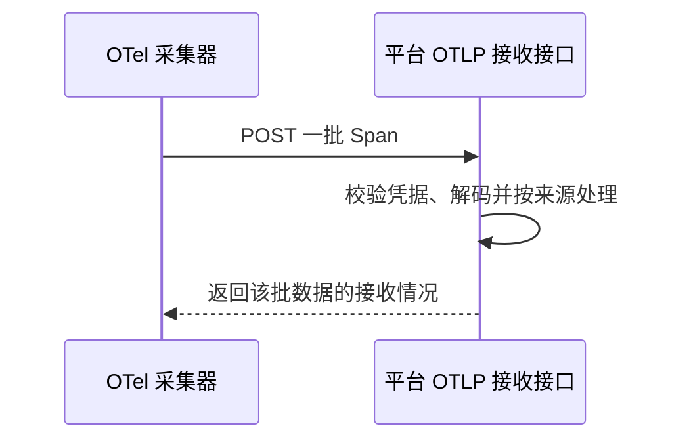
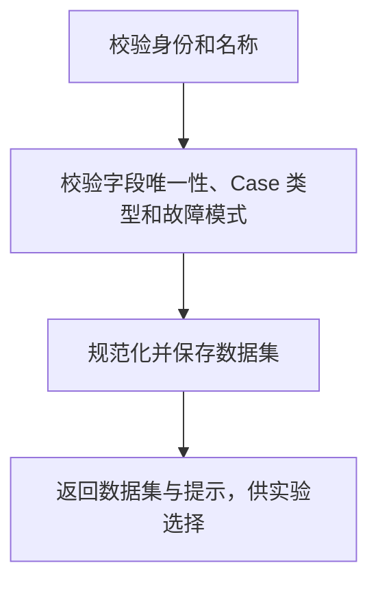
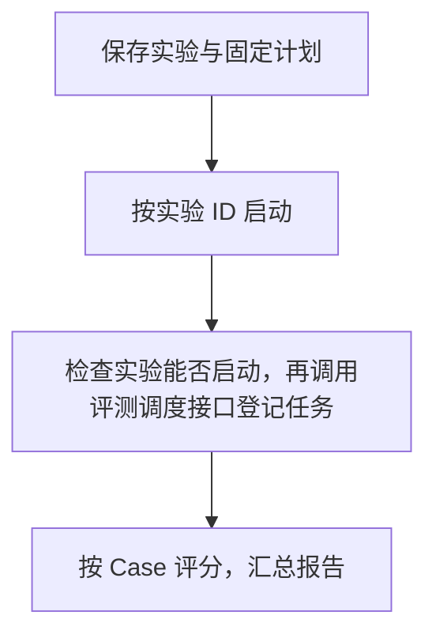
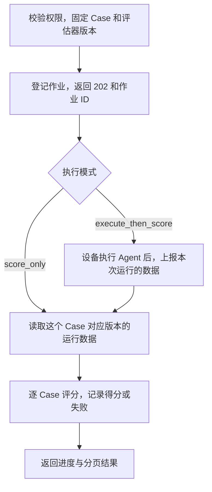
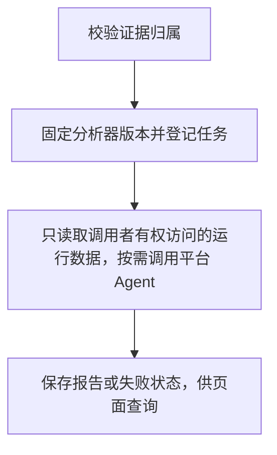
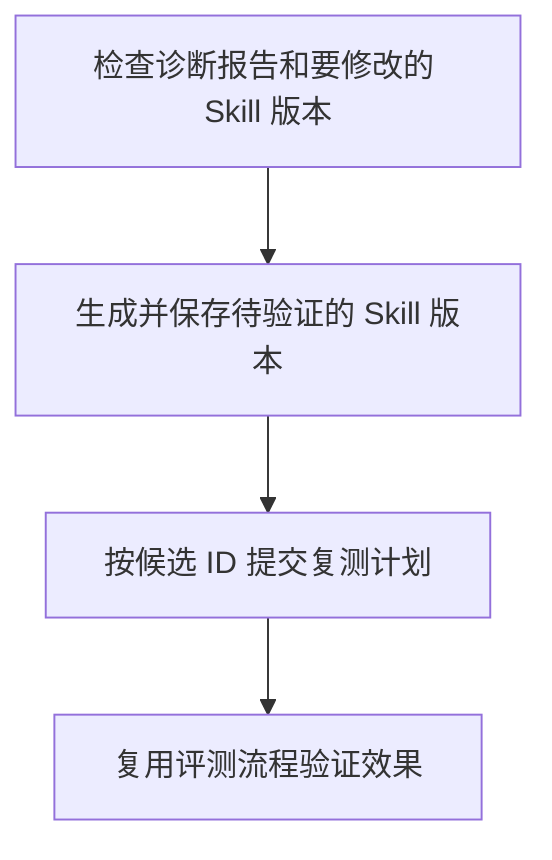
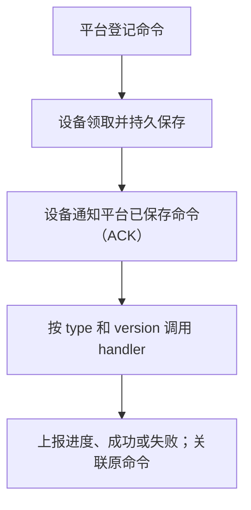
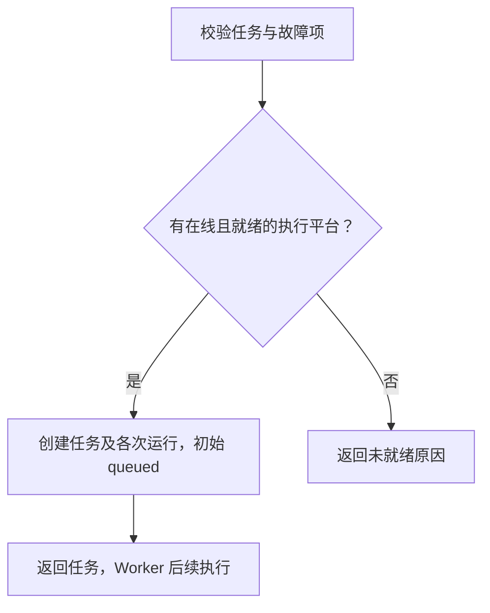
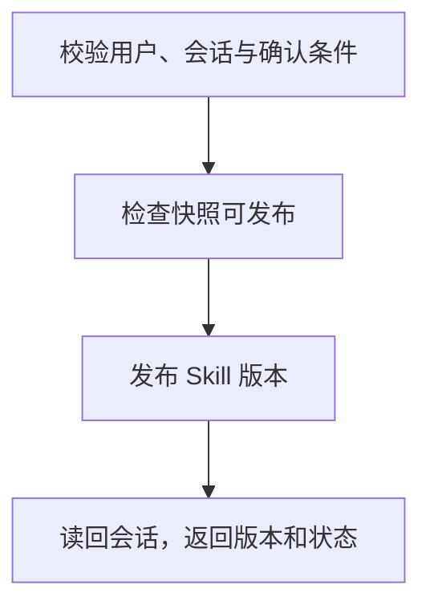
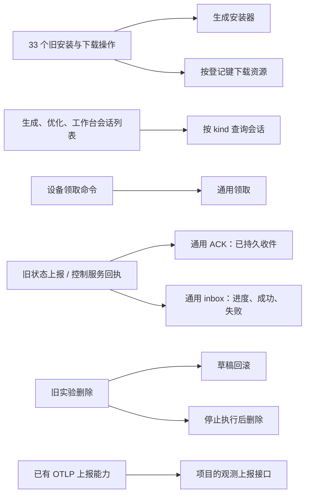

# REST 接口评审总表

**339 项新版操作**，其中页面与平台业务 282 项、设备与外部协议 57 项。358 项旧操作中，357 项已列出对应的新版接口，1 项为固定返回 501 的占位。第三列用旧地址定位原功能和源代码。表中列出设计上的对应关系。还需联调验证新版能否完成相同操作、返回相同结果。

按新版入口查同一行即可看到旧操作、调用点与处理代码。搜索旧路径也能反查；同一旧操作出现在多行表示按业务分支拆分。标有“契约稿”的 30 项可查[字段与状态码](重构接口.openapi.json)；旧接口按以下代码版本核对：`eabde5b0`。

接口拆分、合并与跨模块调用的评审依据见[主方案 · 模块接口怎么设计](Agent-Insight前后端重构方案.md#3-模块接口怎么设计)。

## URL 规则

页面按**业务归属**找入口。项目资源使用 `/v1/projects/{projectId}/{模块}/{资源}`；全局管理资源使用 `/v1/{模块}/{资源}`，按原调用方权限与资源归属授权。模块名为 observation、evaluation、diagnosis、optimization、platform、access。例：实验列表为 `GET /v1/projects/{projectId}/evaluation/experiments`，即使页面同时展示 Trace，列表仍归评测。URL 表达公开能力，数据库、Controller 名和所用运行时由实现选择。

登录与 OAuth 回调归 /v1/auth。采集器、设备和第三方也使用新版 URL。项目级操作带 projectId，平台按调用方凭据核验项目访问权。平台下发命令和设备领取命令共享 clients 资源。外部系统主动使用平台的新版评测接口时，与页面使用同一个 evaluation 命名空间。旧地址和源码见总表第三列。

客户端的日常管理从本机 CLI 进入。停止采集、启停 RAS 和修改本机 RAS 配置直接调用设备上的客户端。表中的平台配置接口用于可选的集中管理，设备本地设置优先；任务下发、状态上报和结果回传仍使用设备通信接口。

## 核心业务入口

下表按使用者要完成的事情分组，例如上报 Trace、启动实验、发布 Skill，也列出了平台向设备下发任务的过程。列表筛选、登录鉴权、安装下载及外部协议仍在下方全量表中。九组是评审顺序，组内包含关联的查询或回执操作。

| 编号 | 工作流 | 可观察的结果 |
| --- | --- | --- |
| 1 | 采集器通过 OTLP 上报 Trace | 平台告诉采集器这批 Span 的接收情况。页面查询、实验选用某个版本是另外的操作 |
| 2 | 创建评测集 | 可选用的 Case 集合 |
| 3 | 启动实验 | 实验记录、进度与报告 |
| 4 | 提交评测作业 | 各 Case 的评分或失败原因 |
| 5 | 发起诊断 | 诊断报告 |
| 6 | 生成优化候选并复测 | 待验证的 Skill 版本和复测任务编号 |
| 7 | 下发设备任务 | 设备先确认已保存命令，执行后再上报成功或失败 |
| 8 | 创建故障注入任务 | 任务编号和每个故障项的执行记录 |
| 9 | 将会话中已保存的 Skill 内容发布为新版本 | 已发布的 Skill 版本 |

**新版平台 REST 的共用字段**（OTLP 采集入口沿用自己的请求与响应格式）

| 字段 / 位置 | 必填 | 含义 |
| --- | --- | --- |
| projectId / 路径 | 路径含此参数时必填 | 所属项目；服务端核验资源归属和调用者权限。 |
| Authorization / 请求头 | 按入口鉴权 | 项目操作验证调用方；设备操作还须绑定设备身份。 |
| Idempotency-Key / 请求头 | 契约指定时必填 | 保存 Trace 指定版本、实验创建和启动、提交评测、发起诊断、候选创建和复测、命令入队。同一项目、调用身份和操作下，重试时用相同的键和参数可取回第一次的结果。复用该键却更改参数会返回 409。 |
| Asset | 指向已保存的数据时三项必填 | id 表示哪份数据，revision 表示哪个版本，digest 是用来核对内容的校验值。例如可用这三个值找到本次实验使用的评测集。 |
| Evidence | artifact 必填，traceId 可选 | artifact 指向本次评分或诊断要读取的运行数据。若数据来自 Trace，可用 traceId 找到原始记录。 |
| ApiError / 错误响应 | 采用该契约时 | code、error_id、request_id、message、retryable 均必返；页面展示错误码与定位编号。 |

展开各流程可看完整 URL、参数和时序。标注“字段待定稿”的三组列的是现有后端实际接收和返回的字段。新版字段和状态码仍待确认。

1 · 观测：采集器怎样上报 Trace？

**采集器上报 · 新版接口**

**POST** `/v1/projects/{projectId}/observation/traces`

Agent 的 OpenTelemetry 导出器或 Collector 将一批 Span 发给平台。平台返回这批数据的接收情况，这次上报就结束了。部署时把采集器的 Trace 专用 endpoint 配成含实际项目编号的完整 URL，例如 `https://insight.example/v1/projects/demo/observation/traces`。

| 输入位置 | 字段或格式 | 必填 | 含义 |
| --- | --- | --- | --- |
| 路径 | projectId | 是 | 接收这批数据的项目编号；平台校验上报凭据对该项目的写权限 |
| 请求体 | OTLP Trace 请求 | 是 | 直接发送 Span 数据。JSON 格式中按 resourceSpans → scopeSpans → spans 分组，也支持 Protobuf 编码 |
| 请求头 | Content-Type | 按编码填写 | JSON 使用 application/json，Protobuf 使用 application/x-protobuf |
| 请求头 | x-witty-api-key 或来源对应的凭据 | 是，任选一种已配置方式 | 平台 API Key 或已配置的来源凭据必须有权向目标项目上报 |

| 输出 | 字段 | 含义 |
| --- | --- | --- |
| HTTP 200 | status、received、sessions | 返回接收状态、数量及关联会话。不同来源的具体计数口径可能不同 |
| HTTP 200，常规写入分支 | persisted、deduplicated | 本次写入和识别为重复的事件数 |
| 错误或部分接收 | 按分支返回 | 无效凭据返回 401，对该项目无上报权限返回 403。常规写入分支遇到存储限制时可返回 413 和 status=partial，详见 rejected |

**用户查看或选用 Trace 时调用的接口**

**查看 Trace 列表：用户打开观测页面时调用**

**GET** `/v1/projects/{projectId}/observation/traces`

| 输入位置 | 字段 | 类型 | 必填 | 含义 |
| --- | --- | --- | --- | --- |
| 路径 | projectId | 字符串 | 是 | 所属项目编号 |
| 查询参数 | cursor | 字符串 | 否 | 续页填上次响应的 nextCursor |
| 查询参数 | limit | 整数 | 否 | 每页条数，默认 50，最多 200 |

| HTTP 状态 | 输出字段 | 必返 | 含义 |
| --- | --- | --- | --- |
| 200 | items | 是 | 每条含 Trace 编号 id、版本 revision、Span 数 spanCount |
| 200 | nextCursor | 否 | 读取下一页时传入 cursor |

**保存指定版本：实验或诊断需要重复读取同一份数据时调用**

**POST** `/v1/projects/{projectId}/observation/traces/{traceId}/snapshots`

| 输入位置 | 字段 | 类型 | 必填 | 含义 |
| --- | --- | --- | --- | --- |
| 路径 | projectId | 字符串 | 是 | 所属项目编号 |
| 路径 | traceId | 字符串 | 是 | 要选用的 Trace 编号 |
| 请求头 | Idempotency-Key | 字符串 | 是 | 重试同一次操作时沿用此键 |
| 请求体 | revision | 字符串 | 是 | 从 Trace 查询结果中选定的版本 |

| HTTP 状态 | 输出字段 | 必返 | 含义 |
| --- | --- | --- | --- |
| 201 | artifact | 是 | 该版本数据的 id、revision、digest。例如选定 100 个 Span 的版本后，原 Trace 后续新增的 Span 不会进入本次评分 |
| 201 | traceId | 否 | 对应的原始 Trace 编号 |

2 · 评测集：创建可复用的 Case 集合（字段待定稿）

**POST** `/v1/projects/{projectId}/evaluation/datasets`

| 输入（默认请求体） | 类型 | 必填 | 含义 |
| --- | --- | --- | --- |
| name | string | 是 | 数据集名称 |
| datasetKind / fields / cases | 类型标识 / 数组 / 数组 | 否 | 按评测集类型整理字段和测试用例；Benchmark 使用专门的导入流程 |
| description / targetAgent / targetSkill / tags | 描述、目标或标签 | 否 | 展示和筛选元数据 |

| 操作 / 成功状态 | 输出字段 | 必返 | 含义 |
| --- | --- | --- | --- |
| 创建 200（旧行为） | success、dataset、warnings | 是 | 保存后的数据集及预处理提示 |
| Case 校验失败 422（旧行为） | details[].caseId、field | 按失败项 | 定位有问题的 Case 和字段 |

3 · 实验：创建 → 启动 → 查看报告

**创建实验**

**POST** `/v1/projects/{projectId}/evaluation/experiments`

| 输入位置 | 字段 | 类型 | 必填 | 含义 |
| --- | --- | --- | --- | --- |
| 路径 | projectId | 字符串 | 是 | 所属项目编号 |
| 请求头 | Idempotency-Key | 字符串 | 是 | 重试同一次操作时沿用此键 |
| 请求体 | name | string | 是 | 实验名称 |
| 请求体 | plan | JobSpec | 是 | 评测集、评估器及执行模式，字段见流程 4 |

| HTTP 状态 | 输出字段 | 必返 | 含义 |
| --- | --- | --- | --- |
| 201 | id | 是 | 实验编号 |

**启动实验**

**POST** `/v1/projects/{projectId}/evaluation/experiments/{experimentId}/runs`

| 输入位置 | 字段 | 类型 | 必填 | 含义 |
| --- | --- | --- | --- | --- |
| 路径 | projectId | 字符串 | 是 | 所属项目编号 |
| 路径 | experimentId | 字符串 | 是 | 实验编号 |
| 请求头 | Idempotency-Key | 字符串 | 是 | 重试同一次操作时沿用此键 |

| HTTP 状态 | 输出字段 | 必返 | 含义 |
| --- | --- | --- | --- |
| 202 | id | 是 | 本次实验运行的编号 |

**查询实验报告**

**GET** `/v1/projects/{projectId}/evaluation/experiments/{experimentId}/report`

| 输入位置 | 字段 | 类型 | 必填 | 含义 |
| --- | --- | --- | --- | --- |
| 路径 | projectId | 字符串 | 是 | 所属项目编号 |
| 路径 | experimentId | 字符串 | 是 | 实验编号 |

| HTTP 状态 | 输出字段 | 必返 | 含义 |
| --- | --- | --- | --- |
| 200 | experimentId、job / results | 是 / 否 | experimentId 标识实验，job 包含任务进度。结果生成后可通过 results 读取 |

4 · 评测作业：直接评分或执行后评分

**提交评测作业**

**POST** `/v1/projects/{projectId}/evaluation/jobs`

| 输入位置 | 字段 | 类型 | 必填 | 含义 |
| --- | --- | --- | --- | --- |
| 路径 | projectId | 字符串 | 是 | 所属项目编号 |
| 请求头 | Idempotency-Key | 字符串 | 是 | 重试同一次操作时沿用此键 |
| 请求体 | mode | string | 是 | score_only 或 execute_then_score |
| 请求体 | dataset | Asset | 是 | 本次评测使用的评测集编号、版本和内容校验值 |
| 请求体 | evaluators[] | EvaluatorRef[] | 是，至少一项 | 每项 key、version 必填；如需额外配置，可用 config 指向已保存的配置 |
| 请求体 | evidence[] | CaseEvidence[] | 仅 score_only，至少一项 | 每项必填 caseId 和 evidence；Case 必须对应数据集 |
| 请求体 | executionTarget | string | 仅 execute_then_score | 可用的执行端 |

| HTTP 状态 | 输出字段 | 必返 | 含义 |
| --- | --- | --- | --- |
| 202 | id | 是 | 平台已保存任务，可用此编号查询执行进度 |

**查询进度**

**GET** `/v1/projects/{projectId}/evaluation/jobs/{jobId}`

| 输入位置 | 字段 | 类型 | 必填 | 含义 |
| --- | --- | --- | --- | --- |
| 路径 | projectId | 字符串 | 是 | 所属项目编号 |
| 路径 | jobId | 字符串 | 是 | 评测作业编号 |

| HTTP 状态 | 输出字段 | 必返 | 含义 |
| --- | --- | --- | --- |
| 200 | id、state、completedCases、totalCases | 是 | 任务状态和完成量 |

**读取评分结果**

**GET** `/v1/projects/{projectId}/evaluation/jobs/{jobId}/results`

| 输入位置 | 字段 | 类型 | 必填 | 含义 |
| --- | --- | --- | --- | --- |
| 路径 | projectId | 字符串 | 是 | 所属项目编号 |
| 路径 | jobId | 字符串 | 是 | 评测作业编号 |
| 查询参数 | cursor | 字符串 | 否 | 续页填上次响应的 nextCursor |
| 查询参数 | limit | 整数 | 否 | 每页条数，默认 50，最多 200 |

| HTTP 状态 | 输出字段 | 必返 | 含义 |
| --- | --- | --- | --- |
| 200 | items / nextCursor | 是 / 否 | 每条结果对应一个 Case 和一个评估器。成功时返回得分及分值范围，失败时返回错误详情 |

**请求取消作业**

**PUT** `/v1/projects/{projectId}/evaluation/jobs/{jobId}/cancellation`

| 输入位置 | 字段 | 类型 | 必填 | 含义 |
| --- | --- | --- | --- | --- |
| 路径 | projectId | 字符串 | 是 | 所属项目编号 |
| 路径 | jobId | 字符串 | 是 | 评测作业编号 |

| HTTP 状态 | 输出字段 | 必返 | 含义 |
| --- | --- | --- | --- |
| 200 | state | 是 | cancel_requested、cancelled 或 already_terminal |

5 · 诊断：分析指定的运行数据，生成诊断报告

**发起诊断**

**POST** `/v1/projects/{projectId}/diagnosis/runs`

| 输入位置 | 字段 | 类型 | 必填 | 含义 |
| --- | --- | --- | --- | --- |
| 路径 | projectId | 字符串 | 是 | 所属项目编号 |
| 请求头 | Idempotency-Key | 字符串 | 是 | 重试同一次操作时沿用此键 |
| 请求体 | evidence[] | Evidence[] | 是，至少一项 | 每项用 artifact 指定要分析的那份运行数据及其版本，可附原始 traceId |
| 请求体 | analyzer | AnalyzerRef | 否 | 指定时 key、version 均必填；省略使用配置的默认版本 |

| HTTP 状态 | 输出字段 | 必返 | 含义 |
| --- | --- | --- | --- |
| 202 | id | 是 | 诊断编号 |

**查询诊断进度与报告**

**GET** `/v1/projects/{projectId}/diagnosis/runs/{diagnosisId}`

| 输入位置 | 字段 | 类型 | 必填 | 含义 |
| --- | --- | --- | --- | --- |
| 路径 | projectId | 字符串 | 是 | 所属项目编号 |
| 路径 | diagnosisId | 字符串 | 是 | 诊断任务编号 |

| HTTP 状态 | 输出字段 | 必返 | 含义 |
| --- | --- | --- | --- |
| 200 | id、state | 是 | queued、running、completed 或 failed |
| 200 | report、analyzer | 否 | report 指向已保存的报告，analyzer 标明实际使用的分析器及版本 |

6 · 优化：生成候选 → 复测

**创建优化候选**

**POST** `/v1/projects/{projectId}/optimization/candidates`

| 输入位置 | 字段 | 类型 | 必填 | 含义 |
| --- | --- | --- | --- | --- |
| 路径 | projectId | 字符串 | 是 | 所属项目编号 |
| 请求头 | Idempotency-Key | 字符串 | 是 | 重试同一次操作时沿用此键 |
| 请求体 | diagnosisId | string | 是 | 已完成诊断且已生成报告的诊断任务编号 |
| 请求体 | skill | Asset | 是 | 从哪个 Skill 版本开始修改 |

| HTTP 状态 | 输出字段 | 必返 | 含义 |
| --- | --- | --- | --- |
| 201 | id | 是 | 已保存的候选编号 |

**提交复测**

**POST** `/v1/projects/{projectId}/optimization/candidates/{candidateId}/retests`

| 输入位置 | 字段 | 类型 | 必填 | 含义 |
| --- | --- | --- | --- | --- |
| 路径 | projectId | 字符串 | 是 | 所属项目编号 |
| 路径 | candidateId | 字符串 | 是 | 候选编号 |
| 请求头 | Idempotency-Key | 字符串 | 是 | 重试同一次操作时沿用此键 |
| 请求体 | plan | JobSpec | 是 | 复测计划，字段见流程 4 |

| HTTP 状态 | 输出字段 | 必返 | 含义 |
| --- | --- | --- | --- |
| 202 | id | 是 | 本次复测任务的编号。用户根据复测结果决定是否发布 |

7 · 设备：下发任务 → 领取 → 确认 → 回传

**平台登记待发命令**

**POST** `/v1/projects/{projectId}/clients/{clientId}/commands`

| 输入位置 | 字段 | 类型 | 必填 | 含义 |
| --- | --- | --- | --- | --- |
| 路径 | projectId | 字符串 | 是 | 所属项目编号 |
| 路径 | clientId | 字符串 | 是 | 目标设备编号 |
| 请求头 | Idempotency-Key | 字符串 | 是 | 重试同一次操作时沿用此键 |
| 请求体 | messageId、type、version、correlationId、payload | 各类设备消息共用的字段 | 是 | messageId 标识这条消息，type 和 version 用来选择处理函数，correlationId 把结果与原命令关联，payload 指向具体内容 |
| 请求体 | attempt / sequence | 非负整数 | 否 | 重试序号及消息顺序 |

| HTTP 状态 | 输出字段 | 必返 | 含义 |
| --- | --- | --- | --- |
| 202 | id | 是 | 已登记命令的编号 |

**设备领取命令**

**GET** `/v1/projects/{projectId}/clients/{clientId}/commands`

| 输入位置 | 字段 | 类型 | 必填 | 含义 |
| --- | --- | --- | --- | --- |
| 路径 | projectId | 字符串 | 是 | 所属项目编号 |
| 路径 | clientId | 字符串 | 是 | 目标设备编号 |
| 查询参数 | waitSeconds | 整数 | 否 | 等待命令的最长秒数，默认 25，最多 30 |

| HTTP 状态 | 输出字段 | 必返 | 含义 |
| --- | --- | --- | --- |
| 200 | items | 是 | 待处理消息列表 |

**设备确认已保存命令**

**PUT** `/v1/projects/{projectId}/clients/{clientId}/commands/{messageId}/ack`

| 输入位置 | 字段 | 类型 | 必填 | 含义 |
| --- | --- | --- | --- | --- |
| 路径 | projectId | 字符串 | 是 | 所属项目编号 |
| 路径 | clientId | 字符串 | 是 | 目标设备编号 |
| 路径 | messageId | 字符串 | 是 | 设备消息编号 |
| 请求体 | messageId | 字符串 | 是 | 与路径中的消息编号一致 |
| 请求体 | receivedDigest | 字符串 | 是 | 设备已保存的消息内容的校验值 |

| HTTP 状态 | 输出字段 | 必返 | 含义 |
| --- | --- | --- | --- |
| 200 | messageId、receivedDigest | 是 | 接收方返回消息编号和内容校验值，发送方据此确认消息已保存 |

**设备上报消息**

**POST** `/v1/projects/{projectId}/clients/{clientId}/inbox`

| 输入位置 | 字段 | 类型 | 必填 | 含义 |
| --- | --- | --- | --- | --- |
| 路径 | projectId | 字符串 | 是 | 所属项目编号 |
| 路径 | clientId | 字符串 | 是 | 目标设备编号 |
| 请求体 | messageId、type、version、correlationId、payload | 各类设备消息共用的字段 | 是 | messageId 标识这条消息，type 和 version 用来选择处理函数，correlationId 把结果与原命令关联，payload 指向具体内容 |
| 请求体 | attempt / sequence | 非负整数 | 否 | 重试序号及消息顺序 |

| HTTP 状态 | 输出字段 | 必返 | 含义 |
| --- | --- | --- | --- |
| 200 | messageId、receivedDigest | 是 | 接收方返回消息编号和内容校验值，发送方据此确认消息已保存 |

**查询消息处理状态**

**GET** `/v1/projects/{projectId}/clients/{clientId}/messages/{messageId}`

| 输入位置 | 字段 | 类型 | 必填 | 含义 |
| --- | --- | --- | --- | --- |
| 路径 | projectId | 字符串 | 是 | 所属项目编号 |
| 路径 | clientId | 字符串 | 是 | 目标设备编号 |
| 路径 | messageId | 字符串 | 是 | 设备消息编号 |

| HTTP 状态 | 输出字段 | 必返 | 含义 |
| --- | --- | --- | --- |
| 200 | messageId、state / error | 是 / 否 | queued、received、processed、failed；可附错误 |

8 · 可靠性：创建故障注入任务（字段待定稿）

**POST** `/v1/platform/fault-injection/tasks`

| 输入（默认请求体） | 类型 | 必填 | 含义 |
| --- | --- | --- | --- |
| platform、agent | string | 是 | 执行平台和目标 Agent |
| items[] | 数组 | 是，至少一项 | 每项 fault 必填，submode 可选 |
| name / prompt / model | string | 否 | 任务名称、输入和模型 |
| workspace / timeout_seconds | 工作区配置 / 数值 | 否 | 指定工作区和超时，旧实现默认 180 秒 |

| 操作 / 成功状态 | 输出字段 | 必返 | 含义 |
| --- | --- | --- | --- |
| 创建 200（旧行为） | task、async、needsWorker | 是 | task 是已创建的任务，async 表示稍后执行，needsWorker 表示是否需要后台执行进程 |

9 · Skill 工作台：将会话中已保存的 Skill 内容发布为新版本（字段待定稿）

**POST** `/v1/projects/{projectId}/optimization/skill-workbench/sessions/{id}/publish`

| 输入（默认请求体） | 类型 | 必填 | 含义 |
| --- | --- | --- | --- |
| id | string，路径 | 是 | 待发布快照所属会话 |
| confirmed | boolean | 条件必填 | 要求二次确认的发布流程必须为 true；旧版生成流程何时需要确认仍待核对 |

| 操作 / 成功状态 | 输出字段 | 必返 | 含义 |
| --- | --- | --- | --- |
| 发布 200（旧行为） | skill、version、session | 是 | 已发布 Skill、版本及更新后的会话 |

**仍待补齐。** 接口草案还需说明三件事：复制实验时沿用哪一版配置，启动时允许更改哪些参数，以及怎样查询单个优化候选的详情。三个已有入口的 JSON 示例保留在[目标 OpenAPI](重构接口.openapi.json)。

## 新旧接口覆盖总表

展开典型合并与拆分关系图

| 调用方 · 模块 | 新版入口 | 对应旧操作与源码 | 处置与验收 |
| --- | --- | --- | --- |
| 页面/平台 · 观测 | `GET /v1/projects/{projectId}/observation/agents` | `GET /api/agents` [前端](https://atomgit.com/openeuler/agent-insight/blob/eabde5b02f69797fe7e09b446b3f178374325d82/src/app/%28main%29/agents/page.tsx#L476) · [handler](https://atomgit.com/openeuler/agent-insight/blob/eabde5b02f69797fe7e09b446b3f178374325d82/src/app/api/agents/route.ts#L116) | 迁移路径，保留业务行为 |
| 页面/平台 · 观测 | `DELETE /v1/projects/{projectId}/observation/agents/{id}` | `DELETE /api/agents/[id]` [前端](https://atomgit.com/openeuler/agent-insight/blob/eabde5b02f69797fe7e09b446b3f178374325d82/src/app/%28main%29/agents/page.tsx#L457) · [handler](https://atomgit.com/openeuler/agent-insight/blob/eabde5b02f69797fe7e09b446b3f178374325d82/src/app/api/agents/%5Bid%5D/route.ts#L26) | 迁移路径，保留业务行为 |
| 页面/平台 · 观测 | `GET /v1/projects/{projectId}/observation/dashboard/stats` | `GET /api/dashboard/stats` [handler](https://atomgit.com/openeuler/agent-insight/blob/eabde5b02f69797fe7e09b446b3f178374325d82/src/app/api/dashboard/stats/route.ts#L58) | 迁移路径，保留业务行为 |
| 页面/平台 · 观测 | `GET /v1/projects/{projectId}/observation/fleet/agent` | `GET /api/fleet/agent` [前端](https://atomgit.com/openeuler/agent-insight/blob/eabde5b02f69797fe7e09b446b3f178374325d82/src/app/%28main%29/dashboard/page.tsx#L1366) · [handler](https://atomgit.com/openeuler/agent-insight/blob/eabde5b02f69797fe7e09b446b3f178374325d82/src/app/api/fleet/agent/route.ts#L30) | 迁移路径，保留业务行为 |
| 页面/平台 · 观测 | `GET /v1/projects/{projectId}/observation/fleet/breakdowns` | `GET /api/fleet/breakdowns` [前端](https://atomgit.com/openeuler/agent-insight/blob/eabde5b02f69797fe7e09b446b3f178374325d82/src/app/%28main%29/dashboard/page.tsx#L167) · [handler](https://atomgit.com/openeuler/agent-insight/blob/eabde5b02f69797fe7e09b446b3f178374325d82/src/app/api/fleet/breakdowns/route.ts#L59) | 迁移路径，保留业务行为 |
| 页面/平台 · 观测 | `GET /v1/projects/{projectId}/observation/fleet/reliability` | `GET /api/fleet/reliability` [前端](https://atomgit.com/openeuler/agent-insight/blob/eabde5b02f69797fe7e09b446b3f178374325d82/src/app/%28main%29/dashboard/page.tsx#L182) · [handler](https://atomgit.com/openeuler/agent-insight/blob/eabde5b02f69797fe7e09b446b3f178374325d82/src/app/api/fleet/reliability/route.ts#L27) | 迁移路径，保留业务行为 |
| 页面/平台 · 观测 | `GET /v1/projects/{projectId}/observation/fleet/trends` | `GET /api/fleet/trends` [前端](https://atomgit.com/openeuler/agent-insight/blob/eabde5b02f69797fe7e09b446b3f178374325d82/src/app/%28main%29/dashboard/page.tsx#L156) · [handler](https://atomgit.com/openeuler/agent-insight/blob/eabde5b02f69797fe7e09b446b3f178374325d82/src/app/api/fleet/trends/route.ts#L69) | 迁移路径，保留业务行为 |
| 页面/平台 · 观测 | `DELETE /v1/projects/{projectId}/observation/ingest/ras-events` | `DELETE /api/ingest/ras-events` [handler](https://atomgit.com/openeuler/agent-insight/blob/eabde5b02f69797fe7e09b446b3f178374325d82/src/app/api/ingest/ras-events/route.ts#L127) | 使用新版地址验证鉴权、请求及返回结果 |
| 页面/平台 · 观测 | `GET /v1/projects/{projectId}/observation/ingest/ras-events` | `GET /api/ingest/ras-events` [handler](https://atomgit.com/openeuler/agent-insight/blob/eabde5b02f69797fe7e09b446b3f178374325d82/src/app/api/ingest/ras-events/route.ts#L69) | 使用新版地址验证鉴权、请求及返回结果 |
| 页面/平台 · 观测 | `GET /v1/projects/{projectId}/observation/collaborations` | `GET /api/observe/collaborations` [handler](https://atomgit.com/openeuler/agent-insight/blob/eabde5b02f69797fe7e09b446b3f178374325d82/src/app/api/observe/collaborations/route.ts#L24) | 迁移路径，保留业务行为 |
| 页面/平台 · 观测 | `POST /v1/projects/{projectId}/observation/collaborations/relink` | `POST /api/observe/collaborations/relink` [handler](https://atomgit.com/openeuler/agent-insight/blob/eabde5b02f69797fe7e09b446b3f178374325d82/src/app/api/observe/collaborations/relink/route.ts#L22) | 迁移路径，保留业务行为 |
| 页面/平台 · 观测 | `GET /v1/projects/{projectId}/observation/collaborations/{collaborationId}` | `GET /api/observe/collaborations/[collaborationId]` [handler](https://atomgit.com/openeuler/agent-insight/blob/eabde5b02f69797fe7e09b446b3f178374325d82/src/app/api/observe/collaborations/%5BcollaborationId%5D/route.ts#L22) | 迁移路径，保留业务行为 |
| 页面/平台 · 观测 | `DELETE /v1/projects/{projectId}/observation/data` | `DELETE /api/observe/data` [handler](https://atomgit.com/openeuler/agent-insight/blob/eabde5b02f69797fe7e09b446b3f178374325d82/src/app/api/observe/data/route.ts#L658) | 迁移路径，保留业务行为 |
| 页面/平台 · 观测 | `PATCH /v1/projects/{projectId}/observation/data` | `PATCH /api/observe/data` [handler](https://atomgit.com/openeuler/agent-insight/blob/eabde5b02f69797fe7e09b446b3f178374325d82/src/app/api/observe/data/route.ts#L714) | 迁移路径，保留业务行为 |
| 页面/平台 · 观测 | `GET /v1/projects/{projectId}/observation/executions/{executionId}/infra` | `GET /api/observe/executions/[executionId]/infra` [前端](https://atomgit.com/openeuler/agent-insight/blob/eabde5b02f69797fe7e09b446b3f178374325d82/src/components/observe/AgentTraceView.tsx#L3508) · [handler](https://atomgit.com/openeuler/agent-insight/blob/eabde5b02f69797fe7e09b446b3f178374325d82/src/app/api/observe/executions/%5BexecutionId%5D/infra/route.ts#L81) | 迁移路径，保留业务行为 |
| 页面/平台 · 观测 | `POST /v1/projects/{projectId}/observation/executions/{executionId}/infra` | `POST /api/observe/executions/[executionId]/infra` [前端](https://atomgit.com/openeuler/agent-insight/blob/eabde5b02f69797fe7e09b446b3f178374325d82/src/components/observe/AgentTraceView.tsx#L3450) · [handler](https://atomgit.com/openeuler/agent-insight/blob/eabde5b02f69797fe7e09b446b3f178374325d82/src/app/api/observe/executions/%5BexecutionId%5D/infra/route.ts#L122) | 迁移路径，保留业务行为 |
| 页面/平台 · 观测 | `GET /v1/projects/{projectId}/observation/executions/{executionId}/reliability` | `GET /api/observe/executions/[executionId]/reliability` [前端](https://atomgit.com/openeuler/agent-insight/blob/eabde5b02f69797fe7e09b446b3f178374325d82/src/app/%28main%29/trace/page.tsx#L268) · [handler](https://atomgit.com/openeuler/agent-insight/blob/eabde5b02f69797fe7e09b446b3f178374325d82/src/app/api/observe/executions/%5BexecutionId%5D/reliability/route.ts#L26) | 迁移路径，保留业务行为 |
| 页面/平台 · 观测 | `DELETE /v1/projects/{projectId}/observation/executions/{executionId}/tags` | `DELETE /api/observe/executions/[executionId]/tags` [前端](https://atomgit.com/openeuler/agent-insight/blob/eabde5b02f69797fe7e09b446b3f178374325d82/src/app/%28main%29/trace/page.tsx#L2340) · [handler](https://atomgit.com/openeuler/agent-insight/blob/eabde5b02f69797fe7e09b446b3f178374325d82/src/app/api/observe/executions/%5BexecutionId%5D/tags/route.ts#L79) | 迁移路径，保留业务行为 |
| 页面/平台 · 观测 | `GET /v1/projects/{projectId}/observation/executions/{executionId}/tags` | `GET /api/observe/executions/[executionId]/tags` [handler](https://atomgit.com/openeuler/agent-insight/blob/eabde5b02f69797fe7e09b446b3f178374325d82/src/app/api/observe/executions/%5BexecutionId%5D/tags/route.ts#L39) | 迁移路径，保留业务行为 |
| 页面/平台 · 观测 | `POST /v1/projects/{projectId}/observation/executions/{executionId}/tags` | `POST /api/observe/executions/[executionId]/tags` [前端](https://atomgit.com/openeuler/agent-insight/blob/eabde5b02f69797fe7e09b446b3f178374325d82/src/app/%28main%29/trace/page.tsx#L2341) · [handler](https://atomgit.com/openeuler/agent-insight/blob/eabde5b02f69797fe7e09b446b3f178374325d82/src/app/api/observe/executions/%5BexecutionId%5D/tags/route.ts#L64) | 迁移路径，保留业务行为 |
| 页面/平台 · 观测 | `PUT /v1/projects/{projectId}/observation/executions/{executionId}/tags` | `PUT /api/observe/executions/[executionId]/tags` [handler](https://atomgit.com/openeuler/agent-insight/blob/eabde5b02f69797fe7e09b446b3f178374325d82/src/app/api/observe/executions/%5BexecutionId%5D/tags/route.ts#L49) | 迁移路径，保留业务行为 |
| 页面/平台 · 观测 | `GET /v1/projects/{projectId}/observation/goal-plus/goals` | `GET /api/observe/goal-plus/goals` [前端](https://atomgit.com/openeuler/agent-insight/blob/eabde5b02f69797fe7e09b446b3f178374325d82/src/app/%28main%29/goal-plus/page.tsx#L83) · [handler](https://atomgit.com/openeuler/agent-insight/blob/eabde5b02f69797fe7e09b446b3f178374325d82/src/app/api/observe/goal-plus/goals/route.ts#L23) | 迁移路径，保留业务行为 |
| 页面/平台 · 观测 | `GET /v1/projects/{projectId}/observation/goal-plus/goals/{goalId}` | `GET /api/observe/goal-plus/goals/[goalId]` [前端](https://atomgit.com/openeuler/agent-insight/blob/eabde5b02f69797fe7e09b446b3f178374325d82/src/app/%28main%29/goal-plus/%5BgoalId%5D/page.tsx#L59) · [handler](https://atomgit.com/openeuler/agent-insight/blob/eabde5b02f69797fe7e09b446b3f178374325d82/src/app/api/observe/goal-plus/goals/%5BgoalId%5D/route.ts#L23) | 迁移路径，保留业务行为 |
| 页面/平台 · 观测 | `POST /v1/projects/{projectId}/observation/goal-plus/relink` | `POST /api/observe/goal-plus/relink` [handler](https://atomgit.com/openeuler/agent-insight/blob/eabde5b02f69797fe7e09b446b3f178374325d82/src/app/api/observe/goal-plus/relink/route.ts#L23) | 迁移路径，保留业务行为 |
| 页面/平台 · 观测 | `GET /v1/projects/{projectId}/observation/goal-plus/runs/{runId}/trace` | `GET /api/observe/goal-plus/runs/[runId]/trace` [handler](https://atomgit.com/openeuler/agent-insight/blob/eabde5b02f69797fe7e09b446b3f178374325d82/src/app/api/observe/goal-plus/runs/%5BrunId%5D/trace/route.ts#L23) | 迁移路径，保留业务行为 |
| 页面/平台 · 观测 | `GET /v1/projects/{projectId}/observation/goal-plus/sources` | `GET /api/observe/goal-plus/sources` [前端](https://atomgit.com/openeuler/agent-insight/blob/eabde5b02f69797fe7e09b446b3f178374325d82/src/app/%28main%29/goal-plus/page.tsx#L82) · [handler](https://atomgit.com/openeuler/agent-insight/blob/eabde5b02f69797fe7e09b446b3f178374325d82/src/app/api/observe/goal-plus/sources/route.ts#L23) | 迁移路径，保留业务行为 |
| 页面/平台 · 观测 | `GET /v1/projects/{projectId}/observation/infra/export` | `GET /api/observe/infra/export` [handler](https://atomgit.com/openeuler/agent-insight/blob/eabde5b02f69797fe7e09b446b3f178374325d82/src/app/api/observe/infra/export/route.ts#L33) | 迁移路径，保留业务行为 |
| 页面/平台 · 观测 | `GET /v1/projects/{projectId}/observation/infra/history` | `GET /api/observe/infra/history` [前端](https://atomgit.com/openeuler/agent-insight/blob/eabde5b02f69797fe7e09b446b3f178374325d82/src/app/%28main%29/infra/source/%5Bid%5D/page.tsx#L213) · [handler](https://atomgit.com/openeuler/agent-insight/blob/eabde5b02f69797fe7e09b446b3f178374325d82/src/app/api/observe/infra/history/route.ts#L26) | 迁移路径，保留业务行为 |
| 页面/平台 · 观测 | `POST /v1/projects/{projectId}/observation/infra/poll` | `POST /api/observe/infra/poll` [前端](https://atomgit.com/openeuler/agent-insight/blob/eabde5b02f69797fe7e09b446b3f178374325d82/src/app/%28main%29/infra/sources/page.tsx#L274) · [handler](https://atomgit.com/openeuler/agent-insight/blob/eabde5b02f69797fe7e09b446b3f178374325d82/src/app/api/observe/infra/poll/route.ts#L25) | 迁移路径，保留业务行为 |
| 页面/平台 · 观测 | `DELETE /v1/projects/{projectId}/observation/infra/sources` | `DELETE /api/observe/infra/sources` [前端](https://atomgit.com/openeuler/agent-insight/blob/eabde5b02f69797fe7e09b446b3f178374325d82/src/app/%28main%29/infra/sources/page.tsx#L99) · [handler](https://atomgit.com/openeuler/agent-insight/blob/eabde5b02f69797fe7e09b446b3f178374325d82/src/app/api/observe/infra/sources/route.ts#L96) | 迁移路径，保留业务行为 |
| 页面/平台 · 观测 | `GET /v1/projects/{projectId}/observation/infra/sources` | `GET /api/observe/infra/sources` [前端](https://atomgit.com/openeuler/agent-insight/blob/eabde5b02f69797fe7e09b446b3f178374325d82/src/app/%28main%29/infra/sources/page.tsx#L202) · [handler](https://atomgit.com/openeuler/agent-insight/blob/eabde5b02f69797fe7e09b446b3f178374325d82/src/app/api/observe/infra/sources/route.ts#L29) | 迁移路径，保留业务行为 |
| 页面/平台 · 观测 | `PATCH /v1/projects/{projectId}/observation/infra/sources` | `PATCH /api/observe/infra/sources` [前端](https://atomgit.com/openeuler/agent-insight/blob/eabde5b02f69797fe7e09b446b3f178374325d82/src/app/%28main%29/infra/source/%5Bid%5D/page.tsx#L319) · [handler](https://atomgit.com/openeuler/agent-insight/blob/eabde5b02f69797fe7e09b446b3f178374325d82/src/app/api/observe/infra/sources/route.ts#L61) | 迁移路径，保留业务行为 |
| 页面/平台 · 观测 | `POST /v1/projects/{projectId}/observation/infra/sources` | `POST /api/observe/infra/sources` [前端](https://atomgit.com/openeuler/agent-insight/blob/eabde5b02f69797fe7e09b446b3f178374325d82/src/app/%28main%29/infra/sources/page.tsx#L234) · [handler](https://atomgit.com/openeuler/agent-insight/blob/eabde5b02f69797fe7e09b446b3f178374325d82/src/app/api/observe/infra/sources/route.ts#L35) | 迁移路径，保留业务行为 |
| 页面/平台 · 观测 | `GET /v1/projects/{projectId}/observation/infra/sources/derive` | `GET /api/observe/infra/sources/derive` [前端](https://atomgit.com/openeuler/agent-insight/blob/eabde5b02f69797fe7e09b446b3f178374325d82/src/app/%28main%29/infra/sources/page.tsx#L219) · [handler](https://atomgit.com/openeuler/agent-insight/blob/eabde5b02f69797fe7e09b446b3f178374325d82/src/app/api/observe/infra/sources/derive/route.ts#L26) | 迁移路径，保留业务行为 |
| 页面/平台 · 观测 | `GET /v1/projects/{projectId}/observation/infra/sources/overview` | `GET /api/observe/infra/sources/overview` [前端](https://atomgit.com/openeuler/agent-insight/blob/eabde5b02f69797fe7e09b446b3f178374325d82/src/app/%28main%29/infra/page.tsx#L106) · [handler](https://atomgit.com/openeuler/agent-insight/blob/eabde5b02f69797fe7e09b446b3f178374325d82/src/app/api/observe/infra/sources/overview/route.ts#L29) | 迁移路径，保留业务行为 |
| 页面/平台 · 观测 | `GET /v1/projects/{projectId}/observation/infra/sources/sessions` | `GET /api/observe/infra/sources/sessions` [前端](https://atomgit.com/openeuler/agent-insight/blob/eabde5b02f69797fe7e09b446b3f178374325d82/src/app/%28main%29/infra/source/%5Bid%5D/page.tsx#L239) · [handler](https://atomgit.com/openeuler/agent-insight/blob/eabde5b02f69797fe7e09b446b3f178374325d82/src/app/api/observe/infra/sources/sessions/route.ts#L27) | 迁移路径，保留业务行为 |
| 页面/平台 · 观测 | `GET /v1/projects/{projectId}/observation/infra/sources/test` | `GET /api/observe/infra/sources/test` [前端](https://atomgit.com/openeuler/agent-insight/blob/eabde5b02f69797fe7e09b446b3f178374325d82/src/app/%28main%29/infra/source/%5Bid%5D/page.tsx#L328) · [handler](https://atomgit.com/openeuler/agent-insight/blob/eabde5b02f69797fe7e09b446b3f178374325d82/src/app/api/observe/infra/sources/test/route.ts#L74) | 迁移路径，保留业务行为 |
| 页面/平台 · 观测 | `POST /v1/projects/{projectId}/observation/infra/sources/test` | `POST /api/observe/infra/sources/test` [前端](https://atomgit.com/openeuler/agent-insight/blob/eabde5b02f69797fe7e09b446b3f178374325d82/src/app/%28main%29/infra/sources/page.tsx#L186) · [handler](https://atomgit.com/openeuler/agent-insight/blob/eabde5b02f69797fe7e09b446b3f178374325d82/src/app/api/observe/infra/sources/test/route.ts#L52) | 迁移路径，保留业务行为 |
| 页面/平台 · 观测 | `GET /v1/projects/{projectId}/observation/session` | `GET /api/observe/session` [前端](https://atomgit.com/openeuler/agent-insight/blob/eabde5b02f69797fe7e09b446b3f178374325d82/src/app/%28main%29/fault/page.tsx#L637) · [handler](https://atomgit.com/openeuler/agent-insight/blob/eabde5b02f69797fe7e09b446b3f178374325d82/src/app/api/observe/session/route.ts#L167) | 迁移路径，保留业务行为 |
| 页面/平台 · 观测 | `GET /v1/projects/{projectId}/observation/task-stats` | `GET /api/observe/task-stats` [handler](https://atomgit.com/openeuler/agent-insight/blob/eabde5b02f69797fe7e09b446b3f178374325d82/src/app/api/observe/task-stats/route.ts#L22) | 迁移路径，保留业务行为 |
| 页面/平台 · 观测 | `GET /v1/projects/{projectId}/observation/traces/export` | `GET /api/observe/traces/export` [handler](https://atomgit.com/openeuler/agent-insight/blob/eabde5b02f69797fe7e09b446b3f178374325d82/src/app/api/observe/traces/export/route.ts#L27) | 迁移路径，保留业务行为 |
| 页面/平台 · 观测 | `POST /v1/projects/{projectId}/observation/traces/import` | `POST /api/observe/traces/import` [前端](https://atomgit.com/openeuler/agent-insight/blob/eabde5b02f69797fe7e09b446b3f178374325d82/src/app/%28main%29/trace/page.tsx#L951) · [handler](https://atomgit.com/openeuler/agent-insight/blob/eabde5b02f69797fe7e09b446b3f178374325d82/src/app/api/observe/traces/import/route.ts#L25) | 迁移路径，保留业务行为 |
| 页面/平台 · 观测 | `GET /v1/projects/{projectId}/observation/version-analysis/compare` | `GET /api/observe/version-analysis/compare` [前端](https://atomgit.com/openeuler/agent-insight/blob/eabde5b02f69797fe7e09b446b3f178374325d82/src/app/%28main%29/version-analysis/page.tsx#L366) · [handler](https://atomgit.com/openeuler/agent-insight/blob/eabde5b02f69797fe7e09b446b3f178374325d82/src/app/api/observe/version-analysis/compare/route.ts#L31) | 迁移路径，保留业务行为 |
| 页面/平台 · 观测 | `GET /v1/projects/{projectId}/observation/version-analysis/tags/{tagId}/traces` | `GET /api/observe/version-analysis/tags/[tagId]/traces` [前端](https://atomgit.com/openeuler/agent-insight/blob/eabde5b02f69797fe7e09b446b3f178374325d82/src/app/%28main%29/version-analysis/page.tsx#L408) · [handler](https://atomgit.com/openeuler/agent-insight/blob/eabde5b02f69797fe7e09b446b3f178374325d82/src/app/api/observe/version-analysis/tags/%5BtagId%5D/traces/route.ts#L33) | 迁移路径，保留业务行为 |
| 页面/平台 · 观测 | `GET /v1/projects/{projectId}/observation/tags` | `GET /api/tags` [前端](https://atomgit.com/openeuler/agent-insight/blob/eabde5b02f69797fe7e09b446b3f178374325d82/src/app/%28main%29/trace/page.tsx#L606) · [handler](https://atomgit.com/openeuler/agent-insight/blob/eabde5b02f69797fe7e09b446b3f178374325d82/src/app/api/tags/route.ts#L31) | 迁移路径，保留业务行为 |
| 页面/平台 · 观测 | `POST /v1/projects/{projectId}/observation/tags` | `POST /api/tags` [前端](https://atomgit.com/openeuler/agent-insight/blob/eabde5b02f69797fe7e09b446b3f178374325d82/src/app/%28main%29/trace/page.tsx#L2358) · [handler](https://atomgit.com/openeuler/agent-insight/blob/eabde5b02f69797fe7e09b446b3f178374325d82/src/app/api/tags/route.ts#L42) | 迁移路径，保留业务行为 |
| 页面/平台 · 观测 | `DELETE /v1/projects/{projectId}/observation/tags/{id}` | `DELETE /api/tags/[id]` [前端](https://atomgit.com/openeuler/agent-insight/blob/eabde5b02f69797fe7e09b446b3f178374325d82/src/app/%28main%29/version-management/page.tsx#L281) · [handler](https://atomgit.com/openeuler/agent-insight/blob/eabde5b02f69797fe7e09b446b3f178374325d82/src/app/api/tags/%5Bid%5D/route.ts#L51) | 迁移路径，保留业务行为 |
| 页面/平台 · 观测 | `PUT /v1/projects/{projectId}/observation/tags/{id}` | `PUT /api/tags/[id]` [前端](https://atomgit.com/openeuler/agent-insight/blob/eabde5b02f69797fe7e09b446b3f178374325d82/src/app/%28main%29/version-management/page.tsx#L266) · [handler](https://atomgit.com/openeuler/agent-insight/blob/eabde5b02f69797fe7e09b446b3f178374325d82/src/app/api/tags/%5Bid%5D/route.ts#L34) | 迁移路径，保留业务行为 |
| 页面/平台 · 观测 | `GET /v1/projects/{projectId}/observation/observation-data` | `GET /api/observe/data` [前端](https://atomgit.com/openeuler/agent-insight/blob/eabde5b02f69797fe7e09b446b3f178374325d82/src/app/%28main%29/fault/page.tsx#L263) · [handler](https://atomgit.com/openeuler/agent-insight/blob/eabde5b02f69797fe7e09b446b3f178374325d82/src/app/api/observe/data/route.ts#L233) | 建议的新地址 · 保留当前综合读取能力，先核对筛选、归属和各视图，再决定能否全部迁入 traces。 |
| 页面/平台 · 观测 | `GET /v1/projects/{projectId}/observation/traces` | 新增能力 | 契约稿 · TraceService_listTraces · 200 |
| 页面/平台 · 观测 | `POST /v1/projects/{projectId}/observation/traces/{traceId}/snapshots` | 新增能力 | 契约稿 · TraceService_freeze · 201 |
| 页面/平台 · 评测 | `GET /v1/projects/{projectId}/evaluation/config` | `GET /api/eval/config` [handler](https://atomgit.com/openeuler/agent-insight/blob/eabde5b02f69797fe7e09b446b3f178374325d82/src/app/api/eval/config/route.ts#L57) | 迁移路径，保留业务行为 |
| 页面/平台 · 评测 | `POST /v1/projects/{projectId}/evaluation/config` | `POST /api/eval/config` [handler](https://atomgit.com/openeuler/agent-insight/blob/eabde5b02f69797fe7e09b446b3f178374325d82/src/app/api/eval/config/route.ts#L69) | 迁移路径，保留业务行为 |
| 页面/平台 · 评测 | `POST /v1/projects/{projectId}/evaluation/config/backfill-routing` | `POST /api/eval/config/backfill-routing` [handler](https://atomgit.com/openeuler/agent-insight/blob/eabde5b02f69797fe7e09b446b3f178374325d82/src/app/api/eval/config/backfill-routing/route.ts#L54) | 迁移路径，保留业务行为 |
| 页面/平台 · 评测 | `POST /v1/projects/{projectId}/evaluation/config/create` | `POST /api/eval/config/create` [handler](https://atomgit.com/openeuler/agent-insight/blob/eabde5b02f69797fe7e09b446b3f178374325d82/src/app/api/eval/config/create/route.ts#L380) | 迁移路径，保留业务行为 |
| 页面/平台 · 评测 | `POST /v1/projects/{projectId}/evaluation/config/reparse` | `POST /api/eval/config/reparse` [handler](https://atomgit.com/openeuler/agent-insight/blob/eabde5b02f69797fe7e09b446b3f178374325d82/src/app/api/eval/config/reparse/route.ts#L289) | 迁移路径，保留业务行为 |
| 页面/平台 · 评测 | `POST /v1/projects/{projectId}/evaluation/evaluation` | `POST /api/eval/evaluation` [handler](https://atomgit.com/openeuler/agent-insight/blob/eabde5b02f69797fe7e09b446b3f178374325d82/src/app/api/eval/evaluation/route.ts#L32) | 迁移路径，保留业务行为 |
| 页面/平台 · 评测 | `POST /v1/projects/{projectId}/evaluation/rejudge` | `POST /api/eval/rejudge` [handler](https://atomgit.com/openeuler/agent-insight/blob/eabde5b02f69797fe7e09b446b3f178374325d82/src/app/api/eval/rejudge/route.ts#L24) | 迁移路径，保留业务行为 |
| 页面/平台 · 评测 | `GET /v1/projects/{projectId}/evaluation/settings` | `GET /api/eval/settings` [前端](https://atomgit.com/openeuler/agent-insight/blob/eabde5b02f69797fe7e09b446b3f178374325d82/src/app/%28main%29/skill-eval/trigger/%5BskillName%5D/page.tsx#L252) · [handler](https://atomgit.com/openeuler/agent-insight/blob/eabde5b02f69797fe7e09b446b3f178374325d82/src/app/api/eval/settings/route.ts#L23) | 迁移路径，保留业务行为 |
| 页面/平台 · 评测 | `POST /v1/projects/{projectId}/evaluation/settings` | `POST /api/eval/settings` [前端](https://atomgit.com/openeuler/agent-insight/blob/eabde5b02f69797fe7e09b446b3f178374325d82/src/components/config/ModelConfigManager.tsx#L235) · [handler](https://atomgit.com/openeuler/agent-insight/blob/eabde5b02f69797fe7e09b446b3f178374325d82/src/app/api/eval/settings/route.ts#L34) | 迁移路径，保留业务行为 |
| 页面/平台 · 评测 | `POST /v1/projects/{projectId}/evaluation/settings/test` | `POST /api/eval/settings/test` [前端](https://atomgit.com/openeuler/agent-insight/blob/eabde5b02f69797fe7e09b446b3f178374325d82/src/components/config/ModelConfigManager.tsx#L198) · [handler](https://atomgit.com/openeuler/agent-insight/blob/eabde5b02f69797fe7e09b446b3f178374325d82/src/app/api/eval/settings/test/route.ts#L32) | 迁移路径，保留业务行为 |
| 页面/平台 · 评测 | `POST /v1/projects/{projectId}/evaluation/terminate-all` | `POST /api/eval/terminate-all` [前端](https://atomgit.com/openeuler/agent-insight/blob/eabde5b02f69797fe7e09b446b3f178374325d82/src/app/%28main%29/skill-eval/_batch/page.tsx#L1325) · [handler](https://atomgit.com/openeuler/agent-insight/blob/eabde5b02f69797fe7e09b446b3f178374325d82/src/app/api/eval/terminate-all/route.ts#L37) | 迁移路径，保留业务行为 |
| 页面/平台 · 评测 | `DELETE /v1/projects/{projectId}/evaluation/trajectory/results` | `DELETE /api/eval/trajectory/results` [前端](https://atomgit.com/openeuler/agent-insight/blob/eabde5b02f69797fe7e09b446b3f178374325d82/src/app/%28main%29/skill-eval/page.tsx#L4380) · [handler](https://atomgit.com/openeuler/agent-insight/blob/eabde5b02f69797fe7e09b446b3f178374325d82/src/app/api/eval/trajectory/results/route.ts#L109) | 迁移路径，保留业务行为 |
| 页面/平台 · 评测 | `GET /v1/projects/{projectId}/evaluation/trajectory/results` | `GET /api/eval/trajectory/results` [handler](https://atomgit.com/openeuler/agent-insight/blob/eabde5b02f69797fe7e09b446b3f178374325d82/src/app/api/eval/trajectory/results/route.ts#L149) | 迁移路径，保留业务行为 |
| 页面/平台 · 评测 | `GET /v1/projects/{projectId}/evaluation/trajectory/results/{id}` | `GET /api/eval/trajectory/results/[id]` [handler](https://atomgit.com/openeuler/agent-insight/blob/eabde5b02f69797fe7e09b446b3f178374325d82/src/app/api/eval/trajectory/results/%5Bid%5D/route.ts#L80) | 迁移路径，保留业务行为 |
| 页面/平台 · 评测 | `PATCH /v1/projects/{projectId}/evaluation/trajectory/run` | `PATCH /api/eval/trajectory/run` [handler](https://atomgit.com/openeuler/agent-insight/blob/eabde5b02f69797fe7e09b446b3f178374325d82/src/app/api/eval/trajectory/run/route.ts#L948) | 迁移路径，保留业务行为 |
| 页面/平台 · 评测 | `POST /v1/projects/{projectId}/evaluation/trajectory/run` | `POST /api/eval/trajectory/run` [handler](https://atomgit.com/openeuler/agent-insight/blob/eabde5b02f69797fe7e09b446b3f178374325d82/src/app/api/eval/trajectory/run/route.ts#L579) | 迁移路径，保留业务行为 |
| 页面/平台 · 评测 | `DELETE /v1/projects/{projectId}/evaluation/trajectory/runs` | `DELETE /api/eval/trajectory/runs` [handler](https://atomgit.com/openeuler/agent-insight/blob/eabde5b02f69797fe7e09b446b3f178374325d82/src/app/api/eval/trajectory/runs/route.ts#L77) | 迁移路径，保留业务行为 |
| 页面/平台 · 评测 | `GET /v1/projects/{projectId}/evaluation/trajectory/runs` | `GET /api/eval/trajectory/runs` [handler](https://atomgit.com/openeuler/agent-insight/blob/eabde5b02f69797fe7e09b446b3f178374325d82/src/app/api/eval/trajectory/runs/route.ts#L151) | 迁移路径，保留业务行为 |
| 页面/平台 · 评测 | `POST /v1/projects/{projectId}/evaluation/evaluation/cancel` | `POST /api/evaluation/cancel` [handler](https://atomgit.com/openeuler/agent-insight/blob/eabde5b02f69797fe7e09b446b3f178374325d82/src/app/api/evaluation/cancel/route.ts#L21) | 迁移路径，保留业务行为 |
| 页面/平台 · 评测 | `GET /v1/projects/{projectId}/evaluation/experiments/eval-results` | `GET /api/experiments/eval-results` [前端](https://atomgit.com/openeuler/agent-insight/blob/eabde5b02f69797fe7e09b446b3f178374325d82/src/app/%28main%29/skill-eval/_batch/page.tsx#L679) · [handler](https://atomgit.com/openeuler/agent-insight/blob/eabde5b02f69797fe7e09b446b3f178374325d82/src/app/api/experiments/eval-results/route.ts#L74) | 迁移路径，保留业务行为 |
| 页面/平台 · 评测 | `GET /v1/projects/{projectId}/evaluation/experiments/eval-runs` | `GET /api/experiments/eval-runs` [前端](https://atomgit.com/openeuler/agent-insight/blob/eabde5b02f69797fe7e09b446b3f178374325d82/src/app/%28main%29/skill-eval/_batch/page.tsx#L255) · [handler](https://atomgit.com/openeuler/agent-insight/blob/eabde5b02f69797fe7e09b446b3f178374325d82/src/app/api/experiments/eval-runs/route.ts#L42) | 迁移路径，保留业务行为 |
| 页面/平台 · 评测 | `POST /v1/projects/{projectId}/evaluation/experiments/eval-traces` | `POST /api/experiments/eval-traces` [前端](https://atomgit.com/openeuler/agent-insight/blob/eabde5b02f69797fe7e09b446b3f178374325d82/src/app/%28main%29/skill-eval/_batch/page.tsx#L1127) · [handler](https://atomgit.com/openeuler/agent-insight/blob/eabde5b02f69797fe7e09b446b3f178374325d82/src/app/api/experiments/eval-traces/route.ts#L196) | 迁移路径，保留业务行为 |
| 页面/平台 · 评测 | `GET /v1/projects/{projectId}/evaluation/quality/agents` | `GET /api/quality/agents` [前端](https://atomgit.com/openeuler/agent-insight/blob/eabde5b02f69797fe7e09b446b3f178374325d82/src/app/%28main%29/quality/page.tsx#L74) · [handler](https://atomgit.com/openeuler/agent-insight/blob/eabde5b02f69797fe7e09b446b3f178374325d82/src/app/api/quality/agents/route.ts#L25) | 迁移路径，保留业务行为 |
| 页面/平台 · 评测 | `GET /v1/projects/{projectId}/evaluation/quality/executions` | `GET /api/quality/executions` [前端](https://atomgit.com/openeuler/agent-insight/blob/eabde5b02f69797fe7e09b446b3f178374325d82/src/components/quality/ExecutionScoreTable.tsx#L84) · [handler](https://atomgit.com/openeuler/agent-insight/blob/eabde5b02f69797fe7e09b446b3f178374325d82/src/app/api/quality/executions/route.ts#L53) | 迁移路径，保留业务行为 |
| 页面/平台 · 评测 | `GET /v1/projects/{projectId}/evaluation/quality/report` | `GET /api/quality/report` [前端](https://atomgit.com/openeuler/agent-insight/blob/eabde5b02f69797fe7e09b446b3f178374325d82/src/app/%28main%29/quality/page.tsx#L92) · [handler](https://atomgit.com/openeuler/agent-insight/blob/eabde5b02f69797fe7e09b446b3f178374325d82/src/app/api/quality/report/route.ts#L26) | 迁移路径，保留业务行为 |
| 页面/平台 · 评测 | `DELETE /v1/projects/{projectId}/evaluation/skill-eval/trigger/{skillName}` | `DELETE /api/skill-eval/trigger/[skillName]` [handler](https://atomgit.com/openeuler/agent-insight/blob/eabde5b02f69797fe7e09b446b3f178374325d82/src/app/api/skill-eval/trigger/%5BskillName%5D/route.ts#L132) | 迁移路径，保留业务行为 |
| 页面/平台 · 评测 | `GET /v1/projects/{projectId}/evaluation/skill-eval/trigger/{skillName}` | `GET /api/skill-eval/trigger/[skillName]` [前端](https://atomgit.com/openeuler/agent-insight/blob/eabde5b02f69797fe7e09b446b3f178374325d82/src/app/%28main%29/skill-eval/page.tsx#L1176) · [handler](https://atomgit.com/openeuler/agent-insight/blob/eabde5b02f69797fe7e09b446b3f178374325d82/src/app/api/skill-eval/trigger/%5BskillName%5D/route.ts#L41) | 迁移路径，保留业务行为 |
| 页面/平台 · 评测 | `POST /v1/projects/{projectId}/evaluation/skill-eval/trigger/{skillName}` | `POST /api/skill-eval/trigger/[skillName]` [前端](https://atomgit.com/openeuler/agent-insight/blob/eabde5b02f69797fe7e09b446b3f178374325d82/src/app/%28main%29/skill-eval/trigger/%5BskillName%5D/page.tsx#L476) · [handler](https://atomgit.com/openeuler/agent-insight/blob/eabde5b02f69797fe7e09b446b3f178374325d82/src/app/api/skill-eval/trigger/%5BskillName%5D/route.ts#L85) | 迁移路径，保留业务行为 |
| 页面/平台 · 评测 | `POST /v1/projects/{projectId}/evaluation/skill-eval/trigger/{skillName}/draft` | `POST /api/skill-eval/trigger/[skillName]/draft` [前端](https://atomgit.com/openeuler/agent-insight/blob/eabde5b02f69797fe7e09b446b3f178374325d82/src/app/%28main%29/skill-eval/trigger/%5BskillName%5D/page.tsx#L527) · [handler](https://atomgit.com/openeuler/agent-insight/blob/eabde5b02f69797fe7e09b446b3f178374325d82/src/app/api/skill-eval/trigger/%5BskillName%5D/draft/route.ts#L90) | 迁移路径，保留业务行为 |
| 页面/平台 · 评测 | `POST /v1/projects/{projectId}/evaluation/skill-eval/trigger/{skillName}/run` | `POST /api/skill-eval/trigger/[skillName]/run` [前端](https://atomgit.com/openeuler/agent-insight/blob/eabde5b02f69797fe7e09b446b3f178374325d82/src/app/%28main%29/skill-eval/page.tsx#L2417) · [handler](https://atomgit.com/openeuler/agent-insight/blob/eabde5b02f69797fe7e09b446b3f178374325d82/src/app/api/skill-eval/trigger/%5BskillName%5D/run/route.ts#L151) | 迁移路径，保留业务行为 |
| 页面/平台 · 评测 | `POST /v1/projects/{projectId}/evaluation/skill-eval/trigger/{skillName}/run/{runId}/cancel` | `POST /api/skill-eval/trigger/[skillName]/run/[runId]/cancel` [前端](https://atomgit.com/openeuler/agent-insight/blob/eabde5b02f69797fe7e09b446b3f178374325d82/src/app/%28main%29/skill-eval/trigger/%5BskillName%5D/page.tsx#L396) · [handler](https://atomgit.com/openeuler/agent-insight/blob/eabde5b02f69797fe7e09b446b3f178374325d82/src/app/api/skill-eval/trigger/%5BskillName%5D/run/%5BrunId%5D/cancel/route.ts#L36) | 迁移路径，保留业务行为 |
| 页面/平台 · 评测 | `GET /v1/projects/{projectId}/evaluation/skill-eval/trigger/{skillName}/runs` | `GET /api/skill-eval/trigger/[skillName]/runs` [前端](https://atomgit.com/openeuler/agent-insight/blob/eabde5b02f69797fe7e09b446b3f178374325d82/src/app/%28main%29/skill-eval/page.tsx#L1179) · [handler](https://atomgit.com/openeuler/agent-insight/blob/eabde5b02f69797fe7e09b446b3f178374325d82/src/app/api/skill-eval/trigger/%5BskillName%5D/runs/route.ts#L27) | 迁移路径，保留业务行为 |
| 页面/平台 · 评测 | `POST /v1/projects/{projectId}/evaluation/skill-eval/trigger/{skillName}/upload` | `POST /api/skill-eval/trigger/[skillName]/upload` [前端](https://atomgit.com/openeuler/agent-insight/blob/eabde5b02f69797fe7e09b446b3f178374325d82/src/app/%28main%29/skill-eval/trigger/%5BskillName%5D/page.tsx#L574) · [handler](https://atomgit.com/openeuler/agent-insight/blob/eabde5b02f69797fe7e09b446b3f178374325d82/src/app/api/skill-eval/trigger/%5BskillName%5D/upload/route.ts#L40) | 迁移路径，保留业务行为 |
| 页面/平台 · 评测 | `GET /v1/projects/{projectId}/evaluation/skill-workbench/skills/{name}/experiments` | `GET /api/skill-workbench/skills/[name]/experiments` [前端](https://atomgit.com/openeuler/agent-insight/blob/eabde5b02f69797fe7e09b446b3f178374325d82/src/components/skill-workbench/ExperimentPanel.tsx#L91) · [handler](https://atomgit.com/openeuler/agent-insight/blob/eabde5b02f69797fe7e09b446b3f178374325d82/src/app/api/skill-workbench/skills/%5Bname%5D/experiments/route.ts#L33) | 迁移路径，保留业务行为 |
| 页面/平台 · 评测 | `POST /v1/projects/{projectId}/evaluation/skill-workbench/skills/{name}/experiments` | `POST /api/skill-workbench/skills/[name]/experiments` [前端](https://atomgit.com/openeuler/agent-insight/blob/eabde5b02f69797fe7e09b446b3f178374325d82/src/components/eval/ExperimentWizard.tsx#L1650) · [handler](https://atomgit.com/openeuler/agent-insight/blob/eabde5b02f69797fe7e09b446b3f178374325d82/src/app/api/skill-workbench/skills/%5Bname%5D/experiments/route.ts#L52) | 迁移路径，保留业务行为 |
| 页面/平台 · 评测 | `POST /v1/projects/{projectId}/evaluation/skill-workbench/skills/{name}/trigger-datasets` | `POST /api/skill-workbench/skills/[name]/trigger-datasets` [前端](https://atomgit.com/openeuler/agent-insight/blob/eabde5b02f69797fe7e09b446b3f178374325d82/src/components/eval/ExperimentWizard.tsx#L1052) · [handler](https://atomgit.com/openeuler/agent-insight/blob/eabde5b02f69797fe7e09b446b3f178374325d82/src/app/api/skill-workbench/skills/%5Bname%5D/trigger-datasets/route.ts#L22) | 迁移路径，保留业务行为 |
| 页面/平台 · 评测 | `GET /v1/projects/{projectId}/evaluation/skill-workbench/skills/{name}/versions/{version}/evaluations` | `GET /api/skill-workbench/skills/[name]/versions/[version]/evaluations` [前端](https://atomgit.com/openeuler/agent-insight/blob/eabde5b02f69797fe7e09b446b3f178374325d82/src/components/skill-workbench/SkillWorkbenchShell.tsx#L684) · [handler](https://atomgit.com/openeuler/agent-insight/blob/eabde5b02f69797fe7e09b446b3f178374325d82/src/app/api/skill-workbench/skills/%5Bname%5D/versions/%5Bversion%5D/evaluations/route.ts#L31) | 迁移路径，保留业务行为 |
| 页面/平台 · 评测 | `POST /v1/projects/{projectId}/evaluation/skill-workbench/skills/{name}/versions/{version}/evaluations` | `POST /api/skill-workbench/skills/[name]/versions/[version]/evaluations` [前端](https://atomgit.com/openeuler/agent-insight/blob/eabde5b02f69797fe7e09b446b3f178374325d82/src/components/skill-workbench/SkillWorkbenchShell.tsx#L722) · [handler](https://atomgit.com/openeuler/agent-insight/blob/eabde5b02f69797fe7e09b446b3f178374325d82/src/app/api/skill-workbench/skills/%5Bname%5D/versions/%5Bversion%5D/evaluations/route.ts#L62) | 迁移路径，保留业务行为 |
| 页面/平台 · 评测 | `GET /v1/projects/{projectId}/evaluation/user-evaluators` | `GET /api/user-evaluators` [前端](https://atomgit.com/openeuler/agent-insight/blob/eabde5b02f69797fe7e09b446b3f178374325d82/src/app/%28main%29/metrics/evaluators/%5Bid%5D/page.tsx#L64) · [handler](https://atomgit.com/openeuler/agent-insight/blob/eabde5b02f69797fe7e09b446b3f178374325d82/src/app/api/user-evaluators/route.ts#L69) | 迁移路径，保留业务行为 |
| 页面/平台 · 评测 | `PUT /v1/projects/{projectId}/evaluation/user-evaluators` | `PUT /api/user-evaluators` [前端](https://atomgit.com/openeuler/agent-insight/blob/eabde5b02f69797fe7e09b446b3f178374325d82/src/app/%28main%29/metrics/evaluators/%5Bid%5D/page.tsx#L71) · [handler](https://atomgit.com/openeuler/agent-insight/blob/eabde5b02f69797fe7e09b446b3f178374325d82/src/app/api/user-evaluators/route.ts#L88) | 迁移路径，保留业务行为 |
| 页面/平台 · 评测 | `POST /v1/projects/{projectId}/evaluation/user-evaluators/skill-imports` | `POST /api/user-evaluators/skill-imports` [handler](https://atomgit.com/openeuler/agent-insight/blob/eabde5b02f69797fe7e09b446b3f178374325d82/src/app/api/user-evaluators/skill-imports/route.ts#L40) | 迁移路径，保留业务行为 |
| 页面/平台 · 评测 | `GET /v1/projects/{projectId}/evaluation/user-evaluators/skill-imports/{importToken}/files` | `GET /api/user-evaluators/skill-imports/[importToken]/files` [handler](https://atomgit.com/openeuler/agent-insight/blob/eabde5b02f69797fe7e09b446b3f178374325d82/src/app/api/user-evaluators/skill-imports/%5BimportToken%5D/files/route.ts#L21) | 迁移路径，保留业务行为 |
| 页面/平台 · 评测 | `GET /v1/projects/{projectId}/evaluation/user-evaluators/{evaluatorId}/skills/{name}/files` | `GET /api/user-evaluators/[evaluatorId]/skills/[name]/files` [handler](https://atomgit.com/openeuler/agent-insight/blob/eabde5b02f69797fe7e09b446b3f178374325d82/src/app/api/user-evaluators/%5BevaluatorId%5D/skills/%5Bname%5D/files/route.ts#L24) | 迁移路径，保留业务行为 |
| 页面/平台 · 评测 | `GET /v1/projects/{projectId}/evaluation/datasets` | `GET /api/agent-datasets` [前端](https://atomgit.com/openeuler/agent-insight/blob/eabde5b02f69797fe7e09b446b3f178374325d82/src/app/%28main%29/skill-eval/_batch/page.tsx#L616) · [handler](https://atomgit.com/openeuler/agent-insight/blob/eabde5b02f69797fe7e09b446b3f178374325d82/src/app/api/agent-datasets/route.ts#L49) | 建议的新地址 · 评测集与生成任务；保留 Case、数据来源及共享资产的访问规则。 |
| 页面/平台 · 评测 | `PATCH /v1/projects/{projectId}/evaluation/datasets` | `PATCH /api/agent-datasets` [前端](https://atomgit.com/openeuler/agent-insight/blob/eabde5b02f69797fe7e09b446b3f178374325d82/src/components/DatasetItemsPage.tsx#L474) · [handler](https://atomgit.com/openeuler/agent-insight/blob/eabde5b02f69797fe7e09b446b3f178374325d82/src/app/api/agent-datasets/route.ts#L169) | 建议的新地址 · 评测集与生成任务；保留 Case、数据来源及共享资产的访问规则。 |
| 页面/平台 · 评测 | `POST /v1/projects/{projectId}/evaluation/datasets` | `POST /api/agent-datasets` [前端](https://atomgit.com/openeuler/agent-insight/blob/eabde5b02f69797fe7e09b446b3f178374325d82/src/components/eval/ExperimentWizard.tsx#L1471) · [handler](https://atomgit.com/openeuler/agent-insight/blob/eabde5b02f69797fe7e09b446b3f178374325d82/src/app/api/agent-datasets/route.ts#L88) | 建议的新地址 · 评测集与生成任务；保留 Case、数据来源及共享资产的访问规则。 |
| 页面/平台 · 评测 | `POST /v1/projects/{projectId}/evaluation/datasets/backflow` | `POST /api/agent-datasets/backflow` [前端](https://atomgit.com/openeuler/agent-insight/blob/eabde5b02f69797fe7e09b446b3f178374325d82/src/components/observe/TraceBackflowDialog.tsx#L393) · [handler](https://atomgit.com/openeuler/agent-insight/blob/eabde5b02f69797fe7e09b446b3f178374325d82/src/app/api/agent-datasets/backflow/route.ts#L60) | 建议的新地址 · 评测集与生成任务；保留 Case、数据来源及共享资产的访问规则。 |
| 页面/平台 · 评测 | `GET /v1/projects/{projectId}/evaluation/datasets/deletions/{deletionId}` | `GET /api/agent-datasets/deletions/[deletionId]` [前端](https://atomgit.com/openeuler/agent-insight/blob/eabde5b02f69797fe7e09b446b3f178374325d82/src/components/TraceDatasetFlow.tsx#L43) · [handler](https://atomgit.com/openeuler/agent-insight/blob/eabde5b02f69797fe7e09b446b3f178374325d82/src/app/api/agent-datasets/deletions/%5BdeletionId%5D/route.ts#L21) | 建议的新地址 · 评测集与生成任务；保留 Case、数据来源及共享资产的访问规则。 |
| 页面/平台 · 评测 | `GET /v1/projects/{projectId}/evaluation/datasets/generation-options` | `GET /api/agent-datasets/generation-options` [前端](https://atomgit.com/openeuler/agent-insight/blob/eabde5b02f69797fe7e09b446b3f178374325d82/src/components/TraceDatasetFlow.tsx#L132) · [handler](https://atomgit.com/openeuler/agent-insight/blob/eabde5b02f69797fe7e09b446b3f178374325d82/src/app/api/agent-datasets/generation-options/route.ts#L23) | 建议的新地址 · 评测集与生成任务；保留 Case、数据来源及共享资产的访问规则。 |
| 页面/平台 · 评测 | `POST /v1/projects/{projectId}/evaluation/datasets/trace-drafts` | `POST /api/agent-datasets/trace-drafts` [前端](https://atomgit.com/openeuler/agent-insight/blob/eabde5b02f69797fe7e09b446b3f178374325d82/src/components/observe/TraceBackflowDialog.tsx#L210) · [handler](https://atomgit.com/openeuler/agent-insight/blob/eabde5b02f69797fe7e09b446b3f178374325d82/src/app/api/agent-datasets/trace-drafts/route.ts#L26) | 建议的新地址 · 评测集与生成任务；保留 Case、数据来源及共享资产的访问规则。 |
| 页面/平台 · 评测 | `POST /v1/projects/{projectId}/evaluation/datasets/trace-generation` | `POST /api/agent-datasets/trace-generation` [前端](https://atomgit.com/openeuler/agent-insight/blob/eabde5b02f69797fe7e09b446b3f178374325d82/src/components/TraceDatasetFlow.tsx#L202) · [handler](https://atomgit.com/openeuler/agent-insight/blob/eabde5b02f69797fe7e09b446b3f178374325d82/src/app/api/agent-datasets/trace-generation/route.ts#L21) | 建议的新地址 · 评测集与生成任务；保留 Case、数据来源及共享资产的访问规则。 |
| 页面/平台 · 评测 | `DELETE /v1/projects/{projectId}/evaluation/datasets/{datasetId}` | `DELETE /api/agent-datasets/[id]` [前端](https://atomgit.com/openeuler/agent-insight/blob/eabde5b02f69797fe7e09b446b3f178374325d82/src/components/AgentDatasetCenter.tsx#L486) · [handler](https://atomgit.com/openeuler/agent-insight/blob/eabde5b02f69797fe7e09b446b3f178374325d82/src/app/api/agent-datasets/%5Bid%5D/route.ts#L68) | 建议的新地址 · 评测集与生成任务；保留 Case、数据来源及共享资产的访问规则。 |
| 页面/平台 · 评测 | `GET /v1/projects/{projectId}/evaluation/datasets/{datasetId}` | `GET /api/agent-datasets/[id]` [前端](https://atomgit.com/openeuler/agent-insight/blob/eabde5b02f69797fe7e09b446b3f178374325d82/src/components/AgentDatasetCenter.tsx#L396) · [handler](https://atomgit.com/openeuler/agent-insight/blob/eabde5b02f69797fe7e09b446b3f178374325d82/src/app/api/agent-datasets/%5Bid%5D/route.ts#L36) | 建议的新地址 · 评测集与生成任务；保留 Case、数据来源及共享资产的访问规则。 |
| 页面/平台 · 评测 | `DELETE /v1/projects/{projectId}/evaluation/datasets/{datasetId}/generation` | `DELETE /api/agent-datasets/[id]/generation` [前端](https://atomgit.com/openeuler/agent-insight/blob/eabde5b02f69797fe7e09b446b3f178374325d82/src/components/TraceDatasetFlow.tsx#L87) · [handler](https://atomgit.com/openeuler/agent-insight/blob/eabde5b02f69797fe7e09b446b3f178374325d82/src/app/api/agent-datasets/%5Bid%5D/generation/route.ts#L26) | 建议的新地址 · 评测集与生成任务；保留 Case、数据来源及共享资产的访问规则。 |
| 页面/平台 · 评测 | `GET /v1/projects/{projectId}/evaluation/datasets/{datasetId}/generation` | `GET /api/agent-datasets/[id]/generation` [前端](https://atomgit.com/openeuler/agent-insight/blob/eabde5b02f69797fe7e09b446b3f178374325d82/src/components/AgentDatasetCenter.tsx#L379) · [handler](https://atomgit.com/openeuler/agent-insight/blob/eabde5b02f69797fe7e09b446b3f178374325d82/src/app/api/agent-datasets/%5Bid%5D/generation/route.ts#L21) | 建议的新地址 · 评测集与生成任务；保留 Case、数据来源及共享资产的访问规则。 |
| 页面/平台 · 评测 | `POST /v1/projects/{projectId}/evaluation/datasets/{datasetId}/generation/cancel` | `POST /api/agent-datasets/[id]/generation/cancel` [handler](https://atomgit.com/openeuler/agent-insight/blob/eabde5b02f69797fe7e09b446b3f178374325d82/src/app/api/agent-datasets/%5Bid%5D/generation/cancel/route.ts#L21) | 建议的新地址 · 评测集与生成任务；保留 Case、数据来源及共享资产的访问规则。 |
| 页面/平台 · 评测 | `GET /v1/projects/{projectId}/evaluation/configs/{configId}/status` | `GET /api/eval/config/status` [前端](https://atomgit.com/openeuler/agent-insight/blob/eabde5b02f69797fe7e09b446b3f178374325d82/src/app/%28main%29/skills/page.tsx#L62) · [handler](https://atomgit.com/openeuler/agent-insight/blob/eabde5b02f69797fe7e09b446b3f178374325d82/src/app/api/eval/config/status/route.ts#L24) | 建议的新地址 · 按配置读取解析进度、参考答案、路由锚点与关键动作。 |
| 页面/平台 · 评测 | `GET /v1/projects/{projectId}/evaluation/evaluations/{evaluationId}` | `GET /api/evaluation/[id]` [前端](https://atomgit.com/openeuler/agent-insight/blob/eabde5b02f69797fe7e09b446b3f178374325d82/src/app/%28main%29/evaluation/%5Bid%5D/page.tsx#L42) · [handler](https://atomgit.com/openeuler/agent-insight/blob/eabde5b02f69797fe7e09b446b3f178374325d82/src/app/api/evaluation/%5Bid%5D/route.ts#L26) | 建议的新地址 · 历史评估详情：关联 Skill、Execution、issues 及严重度统计；不能用任务状态替代。 |
| 页面/平台 · 评测 | `GET /v1/projects/{projectId}/evaluation/experiments` | `GET /api/experiments` [前端](https://atomgit.com/openeuler/agent-insight/blob/eabde5b02f69797fe7e09b446b3f178374325d82/src/app/%28main%29/experiments/page.tsx#L141) · [handler](https://atomgit.com/openeuler/agent-insight/blob/eabde5b02f69797fe7e09b446b3f178374325d82/src/app/api/experiments/route.ts#L108) | 契约稿 · ListExperiments · 200 |
| 页面/平台 · 评测 | `POST /v1/projects/{projectId}/evaluation/experiments` | `POST /api/experiments` [前端](https://atomgit.com/openeuler/agent-insight/blob/eabde5b02f69797fe7e09b446b3f178374325d82/src/components/eval/ExperimentWizard.tsx#L1713) · [handler](https://atomgit.com/openeuler/agent-insight/blob/eabde5b02f69797fe7e09b446b3f178374325d82/src/app/api/experiments/route.ts#L206) | 契约稿 · ExperimentService_create · 201；契约需补 · 创建草稿；补齐已有 Trace、生成 Trace、Benchmark 就绪状态及约束。 |
| 页面/平台 · 评测 | `GET /v1/projects/{projectId}/evaluation/experiments/agents` | `GET /api/experiments/agents` [前端](https://atomgit.com/openeuler/agent-insight/blob/eabde5b02f69797fe7e09b446b3f178374325d82/src/components/eval/ExperimentWizard.tsx#L770) · [handler](https://atomgit.com/openeuler/agent-insight/blob/eabde5b02f69797fe7e09b446b3f178374325d82/src/app/api/experiments/agents/route.ts#L31) | 建议的新地址 · 实验资源；保留原操作的状态约束、查询选项及可见范围。 |
| 页面/平台 · 评测 | `GET /v1/projects/{projectId}/evaluation/experiments/cancellations` | `GET /api/experiments/cancellations` [前端](https://atomgit.com/openeuler/agent-insight/blob/eabde5b02f69797fe7e09b446b3f178374325d82/src/components/eval/DeleteExperimentButton.tsx#L88) · [handler](https://atomgit.com/openeuler/agent-insight/blob/eabde5b02f69797fe7e09b446b3f178374325d82/src/app/api/experiments/cancellations/route.ts#L21) | 建议的新地址 · 实验资源；保留原操作的状态约束、查询选项及可见范围。 |
| 页面/平台 · 评测 | `POST /v1/projects/{projectId}/evaluation/experiments/environment-preparations` | `POST /api/experiments/environment-preparations` [handler](https://atomgit.com/openeuler/agent-insight/blob/eabde5b02f69797fe7e09b446b3f178374325d82/src/app/api/experiments/environment-preparations/route.ts#L24) | 建议的新地址 · 实验资源；保留原操作的状态约束、查询选项及可见范围。 |
| 页面/平台 · 评测 | `GET /v1/projects/{projectId}/evaluation/experiments/environment-preparations/{taskId}` | `GET /api/experiments/environment-preparations/[taskId]` [handler](https://atomgit.com/openeuler/agent-insight/blob/eabde5b02f69797fe7e09b446b3f178374325d82/src/app/api/experiments/environment-preparations/%5BtaskId%5D/route.ts#L24) | 建议的新地址 · 实验资源；保留原操作的状态约束、查询选项及可见范围。 |
| 页面/平台 · 评测 | `GET /v1/projects/{projectId}/evaluation/experiments/traces` | `GET /api/experiments/traces` [前端](https://atomgit.com/openeuler/agent-insight/blob/eabde5b02f69797fe7e09b446b3f178374325d82/src/components/eval/AddExperimentCasesDialog.tsx#L116) · [handler](https://atomgit.com/openeuler/agent-insight/blob/eabde5b02f69797fe7e09b446b3f178374325d82/src/app/api/experiments/traces/route.ts#L59) | 建议的新地址 · 实验资源；保留原操作的状态约束、查询选项及可见范围。 |
| 页面/平台 · 评测 | `DELETE /v1/projects/{projectId}/evaluation/experiments/{experimentId}` | `DELETE /api/experiments/[id]` [前端](https://atomgit.com/openeuler/agent-insight/blob/eabde5b02f69797fe7e09b446b3f178374325d82/src/components/eval/ExperimentWizard.tsx#L1700) · [handler](https://atomgit.com/openeuler/agent-insight/blob/eabde5b02f69797fe7e09b446b3f178374325d82/src/app/api/experiments/%5Bid%5D/route.ts#L1003) | 建议的新地址 · 仅回滚草稿；原子处理绑定的灰度任务，已启动返回 409。 |
| 页面/平台 · 评测 | `GET /v1/projects/{projectId}/evaluation/experiments/{experimentId}` | `GET /api/experiments/[id]` [前端](https://atomgit.com/openeuler/agent-insight/blob/eabde5b02f69797fe7e09b446b3f178374325d82/src/components/eval/ExperimentCaseDetail.tsx#L514) · [handler](https://atomgit.com/openeuler/agent-insight/blob/eabde5b02f69797fe7e09b446b3f178374325d82/src/app/api/experiments/%5Bid%5D/route.ts#L99) | 建议的新地址 · 返回实验配置、进度和详情页所需字段，支持 Case 分页、按 ID 查找与定位。report 另供报告使用。 |
| 页面/平台 · 评测 | `PATCH /v1/projects/{projectId}/evaluation/experiments/{experimentId}` | `PATCH /api/experiments/[id]` [前端](https://atomgit.com/openeuler/agent-insight/blob/eabde5b02f69797fe7e09b446b3f178374325d82/src/components/eval/ExperimentDetail.tsx#L394) · [handler](https://atomgit.com/openeuler/agent-insight/blob/eabde5b02f69797fe7e09b446b3f178374325d82/src/app/api/experiments/%5Bid%5D/route.ts#L952) | 建议的新地址 · 每次只改一项：实验改名（1～120 字符）或关闭 watchMode。 |
| 页面/平台 · 评测 | `POST /v1/projects/{projectId}/evaluation/experiments/{experimentId}/cases` | `POST /api/experiments/[id]/cases` [前端](https://atomgit.com/openeuler/agent-insight/blob/eabde5b02f69797fe7e09b446b3f178374325d82/src/components/eval/AddExperimentCasesDialog.tsx#L167) · [handler](https://atomgit.com/openeuler/agent-insight/blob/eabde5b02f69797fe7e09b446b3f178374325d82/src/app/api/experiments/%5Bid%5D/cases/route.ts#L46) | 建议的新地址 · 实验资源；保留原操作的状态约束、查询选项及可见范围。 |
| 页面/平台 · 评测 | `DELETE /v1/projects/{projectId}/evaluation/experiments/{experimentId}/cases/{caseId}` | `DELETE /api/experiments/[id]/cases/[caseId]` [前端](https://atomgit.com/openeuler/agent-insight/blob/eabde5b02f69797fe7e09b446b3f178374325d82/src/app/%28main%29/skill-eval/_batch/page.tsx#L2259) · [handler](https://atomgit.com/openeuler/agent-insight/blob/eabde5b02f69797fe7e09b446b3f178374325d82/src/app/api/experiments/%5Bid%5D/cases/%5BcaseId%5D/route.ts#L22) | 建议的新地址 · 实验资源；保留原操作的状态约束、查询选项及可见范围。 |
| 页面/平台 · 评测 | `POST /v1/projects/{projectId}/evaluation/experiments/{experimentId}/cases/{caseId}/retry` | `POST /api/experiments/[id]/cases/[caseId]/retry` [前端](https://atomgit.com/openeuler/agent-insight/blob/eabde5b02f69797fe7e09b446b3f178374325d82/src/components/eval/ExperimentCaseDetail.tsx#L567) · [handler](https://atomgit.com/openeuler/agent-insight/blob/eabde5b02f69797fe7e09b446b3f178374325d82/src/app/api/experiments/%5Bid%5D/cases/%5BcaseId%5D/retry/route.ts#L106) | 建议的新地址 · 实验资源；保留原操作的状态约束、查询选项及可见范围。 |
| 页面/平台 · 评测 | `GET /v1/projects/{projectId}/evaluation/experiments/{experimentId}/comments` | `GET /api/experiments/[id]/comments` [前端](https://atomgit.com/openeuler/agent-insight/blob/eabde5b02f69797fe7e09b446b3f178374325d82/src/components/eval/ExperimentCaseDetail.tsx#L498) · [handler](https://atomgit.com/openeuler/agent-insight/blob/eabde5b02f69797fe7e09b446b3f178374325d82/src/app/api/experiments/%5Bid%5D/comments/route.ts#L37) | 契约稿 · ListExperimentComments · 200 |
| 页面/平台 · 评测 | `POST /v1/projects/{projectId}/evaluation/experiments/{experimentId}/comments` | `POST /api/experiments/[id]/comments` [前端](https://atomgit.com/openeuler/agent-insight/blob/eabde5b02f69797fe7e09b446b3f178374325d82/src/components/eval/EvalComments.tsx#L88) · [handler](https://atomgit.com/openeuler/agent-insight/blob/eabde5b02f69797fe7e09b446b3f178374325d82/src/app/api/experiments/%5Bid%5D/comments/route.ts#L70) | 契约稿 · CreateExperimentComment · 201 |
| 页面/平台 · 评测 | `DELETE /v1/projects/{projectId}/evaluation/experiments/{experimentId}/comments/{commentId}` | `DELETE /api/experiments/[id]/comments` [前端](https://atomgit.com/openeuler/agent-insight/blob/eabde5b02f69797fe7e09b446b3f178374325d82/src/components/eval/EvalComments.tsx#L109) · [handler](https://atomgit.com/openeuler/agent-insight/blob/eabde5b02f69797fe7e09b446b3f178374325d82/src/app/api/experiments/%5Bid%5D/comments/route.ts#L116) | 契约稿 · DeleteExperimentComment · 204 |
| 页面/平台 · 评测 | `POST /v1/projects/{projectId}/evaluation/experiments/{experimentId}/copies` | `POST /api/experiments` [前端](https://atomgit.com/openeuler/agent-insight/blob/eabde5b02f69797fe7e09b446b3f178374325d82/src/components/eval/ExperimentWizard.tsx#L1713) · [handler](https://atomgit.com/openeuler/agent-insight/blob/eabde5b02f69797fe7e09b446b3f178374325d82/src/app/api/experiments/route.ts#L206) | 建议的新地址 · 按源实验保存的配置创建副本。检查调用方能否访问源实验，并验证 201、404 和 409 三种响应。 |
| 页面/平台 · 评测 | `POST /v1/projects/{projectId}/evaluation/experiments/{experimentId}/deletions` | `DELETE /api/experiments/[id]` [前端](https://atomgit.com/openeuler/agent-insight/blob/eabde5b02f69797fe7e09b446b3f178374325d82/src/components/eval/ExperimentWizard.tsx#L1700) · [handler](https://atomgit.com/openeuler/agent-insight/blob/eabde5b02f69797fe7e09b446b3f178374325d82/src/app/api/experiments/%5Bid%5D/route.ts#L1003) | 建议的新地址 · 原 stop=true：停止并删除；同步完成 200、仍在取消 202，返回取消状态。 |
| 页面/平台 · 评测 | `GET /v1/projects/{projectId}/evaluation/experiments/{experimentId}/report` | 新增能力 | 契约稿 · ExperimentService_report · 200 |
| 页面/平台 · 评测 | `POST /v1/projects/{projectId}/evaluation/experiments/{experimentId}/rescan` | `POST /api/experiments/[id]/rescan` [handler](https://atomgit.com/openeuler/agent-insight/blob/eabde5b02f69797fe7e09b446b3f178374325d82/src/app/api/experiments/%5Bid%5D/rescan/route.ts#L25) | 建议的新地址 · 实验资源；保留原操作的状态约束、查询选项及可见范围。 |
| 页面/平台 · 评测 | `PATCH /v1/projects/{projectId}/evaluation/experiments/{experimentId}/results/{resultId}` | `PATCH /api/experiments/[id]/results/[resultId]` [前端](https://atomgit.com/openeuler/agent-insight/blob/eabde5b02f69797fe7e09b446b3f178374325d82/src/components/eval/ExperimentCaseDetail.tsx#L335) · [handler](https://atomgit.com/openeuler/agent-insight/blob/eabde5b02f69797fe7e09b446b3f178374325d82/src/app/api/experiments/%5Bid%5D/results/%5BresultId%5D/route.ts#L32) | 建议的新地址 · 实验资源；保留原操作的状态约束、查询选项及可见范围。 |
| 页面/平台 · 评测 | `POST /v1/projects/{projectId}/evaluation/experiments/{experimentId}/results/{resultId}/retry` | `POST /api/experiments/[id]/results/[resultId]/retry` [前端](https://atomgit.com/openeuler/agent-insight/blob/eabde5b02f69797fe7e09b446b3f178374325d82/src/components/eval/ExperimentCaseDetail.tsx#L549) · [handler](https://atomgit.com/openeuler/agent-insight/blob/eabde5b02f69797fe7e09b446b3f178374325d82/src/app/api/experiments/%5Bid%5D/results/%5BresultId%5D/retry/route.ts#L28) | 建议的新地址 · 实验资源；保留原操作的状态约束、查询选项及可见范围。 |
| 页面/平台 · 评测 | `POST /v1/projects/{projectId}/evaluation/experiments/{experimentId}/runs` | `POST /api/experiments/[id]/run` [前端](https://atomgit.com/openeuler/agent-insight/blob/eabde5b02f69797fe7e09b446b3f178374325d82/src/components/eval/ExperimentWizard.tsx#L1823) · [handler](https://atomgit.com/openeuler/agent-insight/blob/eabde5b02f69797fe7e09b446b3f178374325d82/src/app/api/experiments/%5Bid%5D/run/route.ts#L61) | 契约稿 · ExperimentService_start · 202；契约需补 · 补设备、并发、已启动状态、重复提交及取消交错。 |
| 页面/平台 · 评测 | `POST /v1/projects/{projectId}/evaluation/skills/{name}/benchmark-generate` | `POST /api/skills/[id]/benchmark-generate` [前端](https://atomgit.com/openeuler/agent-insight/blob/eabde5b02f69797fe7e09b446b3f178374325d82/src/app/skill-detail/page.tsx#L388) · [handler](https://atomgit.com/openeuler/agent-insight/blob/eabde5b02f69797fe7e09b446b3f178374325d82/src/app/api/skills/%5Bid%5D/benchmark-generate/route.ts#L24) | 建议的新地址 · 按公开 Skill 名定位，验证 owner、版本、可见性与原操作一致。 |
| 页面/平台 · 评测 | `GET /v1/projects/{projectId}/evaluation/skills/{name}/runs` | `GET /api/skills/[id]/runs` [前端](https://atomgit.com/openeuler/agent-insight/blob/eabde5b02f69797fe7e09b446b3f178374325d82/src/components/skills/SkillCatalogV2.tsx#L2676) · [handler](https://atomgit.com/openeuler/agent-insight/blob/eabde5b02f69797fe7e09b446b3f178374325d82/src/app/api/skills/%5Bid%5D/runs/route.ts#L62) | 建议的新地址 · 按公开 Skill 名定位，验证 owner、版本、可见性与原操作一致。 |
| 页面/平台 · 评测 | `POST /v1/projects/{projectId}/evaluation/skills/{name}/versions/{version}/evaluate` | `POST /api/skills/[id]/versions/[version]/evaluate` [前端](https://atomgit.com/openeuler/agent-insight/blob/eabde5b02f69797fe7e09b446b3f178374325d82/src/app/%28main%29/skill-eval/page.tsx#L2440) · [handler](https://atomgit.com/openeuler/agent-insight/blob/eabde5b02f69797fe7e09b446b3f178374325d82/src/app/api/skills/%5Bid%5D/versions/%5Bversion%5D/evaluate/route.ts#L29) | 建议的新地址 · 按公开 Skill 名定位，验证 owner、版本、可见性与原操作一致。 |
| 页面/平台 · 评测 | `GET /v1/projects/{projectId}/evaluation/skills/{name}/versions/{version}/evaluation-summary` | `GET /api/skills/[id]/versions/[version]/evaluation-summary` [前端](https://atomgit.com/openeuler/agent-insight/blob/eabde5b02f69797fe7e09b446b3f178374325d82/src/app/%28main%29/skill-eval/page.tsx#L1119) · [handler](https://atomgit.com/openeuler/agent-insight/blob/eabde5b02f69797fe7e09b446b3f178374325d82/src/app/api/skills/%5Bid%5D/versions/%5Bversion%5D/evaluation-summary/route.ts#L29) | 建议的新地址 · 按公开 Skill 名定位，验证 owner、版本、可见性与原操作一致。 |
| 页面/平台 · 诊断 | `POST /v1/projects/{projectId}/diagnosis/batch-tasks` | `POST /api/debug/batch-tasks` [前端](https://atomgit.com/openeuler/agent-insight/blob/eabde5b02f69797fe7e09b446b3f178374325d82/src/app/%28main%29/skill-eval/_batch/page.tsx#L408) · [handler](https://atomgit.com/openeuler/agent-insight/blob/eabde5b02f69797fe7e09b446b3f178374325d82/src/app/api/debug/batch-tasks/route.ts#L49) | 迁移路径，保留业务行为 |
| 页面/平台 · 诊断 | `GET /v1/projects/{projectId}/diagnosis/batch-tasks/{taskId}` | `GET /api/debug/batch-tasks/[taskId]` [前端](https://atomgit.com/openeuler/agent-insight/blob/eabde5b02f69797fe7e09b446b3f178374325d82/src/app/%28main%29/skill-eval/_batch/page.tsx#L937) · [handler](https://atomgit.com/openeuler/agent-insight/blob/eabde5b02f69797fe7e09b446b3f178374325d82/src/app/api/debug/batch-tasks/%5BtaskId%5D/route.ts#L99) | 迁移路径，保留业务行为 |
| 页面/平台 · 诊断 | `PATCH /v1/projects/{projectId}/diagnosis/batch-tasks/{taskId}` | `PATCH /api/debug/batch-tasks/[taskId]` [前端](https://atomgit.com/openeuler/agent-insight/blob/eabde5b02f69797fe7e09b446b3f178374325d82/src/app/%28main%29/skill-eval/_batch/page.tsx#L395) · [handler](https://atomgit.com/openeuler/agent-insight/blob/eabde5b02f69797fe7e09b446b3f178374325d82/src/app/api/debug/batch-tasks/%5BtaskId%5D/route.ts#L130) | 迁移路径，保留业务行为 |
| 页面/平台 · 诊断 | `POST /v1/projects/{projectId}/diagnosis/batch-tasks/{taskId}` | `POST /api/debug/batch-tasks/[taskId]` [前端](https://atomgit.com/openeuler/agent-insight/blob/eabde5b02f69797fe7e09b446b3f178374325d82/src/app/%28main%29/skill-eval/_batch/page.tsx#L1240) · [handler](https://atomgit.com/openeuler/agent-insight/blob/eabde5b02f69797fe7e09b446b3f178374325d82/src/app/api/debug/batch-tasks/%5BtaskId%5D/route.ts#L186) | 迁移路径，保留业务行为 |
| 页面/平台 · 诊断 | `POST /v1/projects/{projectId}/diagnosis/execute` | `POST /api/debug/execute` [前端](https://atomgit.com/openeuler/agent-insight/blob/eabde5b02f69797fe7e09b446b3f178374325d82/src/app/%28main%29/skill-eval/_batch/page.tsx#L1001) · [handler](https://atomgit.com/openeuler/agent-insight/blob/eabde5b02f69797fe7e09b446b3f178374325d82/src/app/api/debug/execute/route.ts#L65) | 迁移路径，保留业务行为 |
| 页面/平台 · 诊断 | `GET /v1/projects/{projectId}/diagnosis/execute/{jobId}` | `GET /api/debug/execute/[jobId]` [前端](https://atomgit.com/openeuler/agent-insight/blob/eabde5b02f69797fe7e09b446b3f178374325d82/src/app/%28main%29/skill-eval/_batch/page.tsx#L1040) · [handler](https://atomgit.com/openeuler/agent-insight/blob/eabde5b02f69797fe7e09b446b3f178374325d82/src/app/api/debug/execute/%5BjobId%5D/route.ts#L39) | 迁移路径，保留业务行为 |
| 页面/平台 · 诊断 | `POST /v1/projects/{projectId}/diagnosis/grayscale-tasks` | `POST /api/debug/grayscale-tasks` [前端](https://atomgit.com/openeuler/agent-insight/blob/eabde5b02f69797fe7e09b446b3f178374325d82/src/components/eval/GrayscaleEvaluation.tsx#L1517) · [handler](https://atomgit.com/openeuler/agent-insight/blob/eabde5b02f69797fe7e09b446b3f178374325d82/src/app/api/debug/grayscale-tasks/route.ts#L189) | 迁移路径，保留业务行为 |
| 页面/平台 · 诊断 | `GET /v1/projects/{projectId}/diagnosis/grayscale-tasks/{taskId}` | `GET /api/debug/grayscale-tasks/[taskId]` [前端](https://atomgit.com/openeuler/agent-insight/blob/eabde5b02f69797fe7e09b446b3f178374325d82/src/components/eval/GrayscaleEvaluation.tsx#L2053) · [handler](https://atomgit.com/openeuler/agent-insight/blob/eabde5b02f69797fe7e09b446b3f178374325d82/src/app/api/debug/grayscale-tasks/%5BtaskId%5D/route.ts#L3217) | 迁移路径，保留业务行为 |
| 页面/平台 · 诊断 | `PATCH /v1/projects/{projectId}/diagnosis/grayscale-tasks/{taskId}` | `PATCH /api/debug/grayscale-tasks/[taskId]` [前端](https://atomgit.com/openeuler/agent-insight/blob/eabde5b02f69797fe7e09b446b3f178374325d82/src/components/eval/GrayscaleEvaluation.tsx#L1470) · [handler](https://atomgit.com/openeuler/agent-insight/blob/eabde5b02f69797fe7e09b446b3f178374325d82/src/app/api/debug/grayscale-tasks/%5BtaskId%5D/route.ts#L3627) | 迁移路径，保留业务行为 |
| 页面/平台 · 诊断 | `POST /v1/projects/{projectId}/diagnosis/grayscale-tasks/{taskId}` | `POST /api/debug/grayscale-tasks/[taskId]` [前端](https://atomgit.com/openeuler/agent-insight/blob/eabde5b02f69797fe7e09b446b3f178374325d82/src/app/%28main%29/skill-eval/page.tsx#L2344) · [handler](https://atomgit.com/openeuler/agent-insight/blob/eabde5b02f69797fe7e09b446b3f178374325d82/src/app/api/debug/grayscale-tasks/%5BtaskId%5D/route.ts#L3316) | 迁移路径，保留业务行为 |
| 页面/平台 · 诊断 | `GET /v1/projects/{projectId}/diagnosis/history` | `GET /api/debug/history` [handler](https://atomgit.com/openeuler/agent-insight/blob/eabde5b02f69797fe7e09b446b3f178374325d82/src/app/api/debug/history/route.ts#L20) | 迁移路径，保留业务行为 |
| 页面/平台 · 诊断 | `POST /v1/projects/{projectId}/diagnosis/history` | `POST /api/debug/history` [handler](https://atomgit.com/openeuler/agent-insight/blob/eabde5b02f69797fe7e09b446b3f178374325d82/src/app/api/debug/history/route.ts#L47) | 迁移路径，保留业务行为 |
| 页面/平台 · 诊断 | `DELETE /v1/projects/{projectId}/diagnosis/history/{id}` | `DELETE /api/debug/history/[id]` [handler](https://atomgit.com/openeuler/agent-insight/blob/eabde5b02f69797fe7e09b446b3f178374325d82/src/app/api/debug/history/%5Bid%5D/route.ts#L20) | 迁移路径，保留业务行为 |
| 页面/平台 · 诊断 | `DELETE /v1/projects/{projectId}/diagnosis/executions/{executionId}/agent-debug` | `DELETE /api/observe/executions/[executionId]/agent-debug` [handler](https://atomgit.com/openeuler/agent-insight/blob/eabde5b02f69797fe7e09b446b3f178374325d82/src/app/api/observe/executions/%5BexecutionId%5D/agent-debug/route.ts#L147) | 迁移路径，保留业务行为 |
| 页面/平台 · 诊断 | `GET /v1/projects/{projectId}/diagnosis/executions/{executionId}/agent-debug` | `GET /api/observe/executions/[executionId]/agent-debug` [前端](https://atomgit.com/openeuler/agent-insight/blob/eabde5b02f69797fe7e09b446b3f178374325d82/src/components/observe/AgentDebugCard.tsx#L224) · [handler](https://atomgit.com/openeuler/agent-insight/blob/eabde5b02f69797fe7e09b446b3f178374325d82/src/app/api/observe/executions/%5BexecutionId%5D/agent-debug/route.ts#L46) | 迁移路径，保留业务行为 |
| 页面/平台 · 诊断 | `POST /v1/projects/{projectId}/diagnosis/executions/{executionId}/agent-debug` | `POST /api/observe/executions/[executionId]/agent-debug` [前端](https://atomgit.com/openeuler/agent-insight/blob/eabde5b02f69797fe7e09b446b3f178374325d82/src/components/observe/AgentDebugCard.tsx#L301) · [handler](https://atomgit.com/openeuler/agent-insight/blob/eabde5b02f69797fe7e09b446b3f178374325d82/src/app/api/observe/executions/%5BexecutionId%5D/agent-debug/route.ts#L73) | 迁移路径，保留业务行为 |
| 页面/平台 · 诊断 | `GET /v1/projects/{projectId}/diagnosis/executions/{executionId}/agent-debug/skills-analysis` | `GET /api/observe/executions/[executionId]/agent-debug/skills-analysis` [前端](https://atomgit.com/openeuler/agent-insight/blob/eabde5b02f69797fe7e09b446b3f178374325d82/src/components/observe/AgentDebugCard.tsx#L243) · [handler](https://atomgit.com/openeuler/agent-insight/blob/eabde5b02f69797fe7e09b446b3f178374325d82/src/app/api/observe/executions/%5BexecutionId%5D/agent-debug/skills-analysis/route.ts#L47) | 迁移路径，保留业务行为 |
| 页面/平台 · 诊断 | `POST /v1/projects/{projectId}/diagnosis/executions/{executionId}/agent-debug/skills-analysis` | `POST /api/observe/executions/[executionId]/agent-debug/skills-analysis` [前端](https://atomgit.com/openeuler/agent-insight/blob/eabde5b02f69797fe7e09b446b3f178374325d82/src/components/observe/AgentDebugCard.tsx#L374) · [handler](https://atomgit.com/openeuler/agent-insight/blob/eabde5b02f69797fe7e09b446b3f178374325d82/src/app/api/observe/executions/%5BexecutionId%5D/agent-debug/skills-analysis/route.ts#L84) | 迁移路径，保留业务行为 |
| 页面/平台 · 诊断 | `GET /v1/projects/{projectId}/diagnosis/executions/{executionId}/analyze-match` | `GET /api/observe/executions/[executionId]/analyze-match` [handler](https://atomgit.com/openeuler/agent-insight/blob/eabde5b02f69797fe7e09b446b3f178374325d82/src/app/api/observe/executions/%5BexecutionId%5D/analyze-match/route.ts#L227) | 迁移路径，保留业务行为 |
| 页面/平台 · 诊断 | `POST /v1/projects/{projectId}/diagnosis/executions/{executionId}/analyze-match` | `POST /api/observe/executions/[executionId]/analyze-match` [前端](https://atomgit.com/openeuler/agent-insight/blob/eabde5b02f69797fe7e09b446b3f178374325d82/src/app/%28main%29/skill-eval/page.tsx#L1375) · [handler](https://atomgit.com/openeuler/agent-insight/blob/eabde5b02f69797fe7e09b446b3f178374325d82/src/app/api/observe/executions/%5BexecutionId%5D/analyze-match/route.ts#L69) | 迁移路径，保留业务行为 |
| 页面/平台 · 诊断 | `GET /v1/projects/{projectId}/diagnosis/infra/diagnose` | `GET /api/observe/infra/diagnose` [前端](https://atomgit.com/openeuler/agent-insight/blob/eabde5b02f69797fe7e09b446b3f178374325d82/src/app/%28main%29/infra/page.tsx#L137) · [handler](https://atomgit.com/openeuler/agent-insight/blob/eabde5b02f69797fe7e09b446b3f178374325d82/src/app/api/observe/infra/diagnose/route.ts#L26) | 迁移路径，保留业务行为 |
| 页面/平台 · 诊断 | `GET /v1/projects/{projectId}/diagnosis/debug-tasks` | `GET /api/debug/batch-tasks` [前端](https://atomgit.com/openeuler/agent-insight/blob/eabde5b02f69797fe7e09b446b3f178374325d82/src/app/%28main%29/skill-eval/_batch/page.tsx#L349) · [handler](https://atomgit.com/openeuler/agent-insight/blob/eabde5b02f69797fe7e09b446b3f178374325d82/src/app/api/debug/batch-tasks/route.ts#L22) `GET /api/debug/grayscale-tasks` [前端](https://atomgit.com/openeuler/agent-insight/blob/eabde5b02f69797fe7e09b446b3f178374325d82/src/app/%28main%29/skill-eval/page.tsx#L1420) · [handler](https://atomgit.com/openeuler/agent-insight/blob/eabde5b02f69797fe7e09b446b3f178374325d82/src/app/api/debug/grayscale-tasks/route.ts#L149) | 契约稿 · ListDebugTasks · 200 |
| 页面/平台 · 诊断 | `POST /v1/projects/{projectId}/diagnosis/runs` | 新增能力 | 契约稿 · DiagnosisService_analyze · 202 |
| 页面/平台 · 诊断 | `GET /v1/projects/{projectId}/diagnosis/runs/{diagnosisId}` | 新增能力 | 契约稿 · DiagnosisService_get · 200 |
| 页面/平台 · 诊断 | `GET /v1/projects/{projectId}/diagnosis/sessions` | `GET /api/fault/diagnosis/session` [前端](https://atomgit.com/openeuler/agent-insight/blob/eabde5b02f69797fe7e09b446b3f178374325d82/src/app/%28main%29/fault/page.tsx#L642) · [handler](https://atomgit.com/openeuler/agent-insight/blob/eabde5b02f69797fe7e09b446b3f178374325d82/src/app/api/fault/diagnosis/session/route.ts#L22) | 建议的新地址 · 诊断会话及流式输出，保留会话标识、事件格式与结束条件。 |
| 页面/平台 · 诊断 | `POST /v1/projects/{projectId}/diagnosis/sessions` | `POST /api/fault/diagnosis/session` [handler](https://atomgit.com/openeuler/agent-insight/blob/eabde5b02f69797fe7e09b446b3f178374325d82/src/app/api/fault/diagnosis/session/route.ts#L65) | 建议的新地址 · 诊断会话及流式输出，保留会话标识、事件格式与结束条件。 |
| 页面/平台 · 诊断 | `POST /v1/projects/{projectId}/diagnosis/streams` | `POST /api/fault/diagnosis/stream` [前端](https://atomgit.com/openeuler/agent-insight/blob/eabde5b02f69797fe7e09b446b3f178374325d82/src/app/%28main%29/fault/page.tsx#L724) · [handler](https://atomgit.com/openeuler/agent-insight/blob/eabde5b02f69797fe7e09b446b3f178374325d82/src/app/api/fault/diagnosis/stream/route.ts#L312) | 建议的新地址 · 诊断会话及流式输出，保留会话标识、事件格式与结束条件。 |
| 页面/平台 · 诊断 | `POST /v1/projects/{projectId}/diagnosis/skill-library/{name}/analysis-diagnosis` | `POST /api/skills/by-name/[name]/analysis-diagnosis` [前端](https://atomgit.com/openeuler/agent-insight/blob/eabde5b02f69797fe7e09b446b3f178374325d82/src/app/%28main%29/skill-eval/page.tsx#L2297) · [handler](https://atomgit.com/openeuler/agent-insight/blob/eabde5b02f69797fe7e09b446b3f178374325d82/src/app/api/skills/by-name/%5Bname%5D/analysis-diagnosis/route.ts#L37) | 建议的新地址 · 继续按名称查找；核对来源、可见性及此操作特有的返回值。 |
| 页面/平台 · 优化 | `DELETE /v1/projects/{projectId}/optimization/skill-generator/attachments` | `DELETE /api/skill-generator/attachments` [前端](https://atomgit.com/openeuler/agent-insight/blob/eabde5b02f69797fe7e09b446b3f178374325d82/src/app/%28main%29/skill-generator/page.tsx#L617) · [handler](https://atomgit.com/openeuler/agent-insight/blob/eabde5b02f69797fe7e09b446b3f178374325d82/src/app/api/skill-generator/attachments/route.ts#L85) | 迁移路径，保留业务行为 |
| 页面/平台 · 优化 | `GET /v1/projects/{projectId}/optimization/skill-generator/attachments` | `GET /api/skill-generator/attachments` [前端](https://atomgit.com/openeuler/agent-insight/blob/eabde5b02f69797fe7e09b446b3f178374325d82/src/app/%28main%29/skill-generator/page.tsx#L576) · [handler](https://atomgit.com/openeuler/agent-insight/blob/eabde5b02f69797fe7e09b446b3f178374325d82/src/app/api/skill-generator/attachments/route.ts#L74) | 迁移路径，保留业务行为 |
| 页面/平台 · 优化 | `POST /v1/projects/{projectId}/optimization/skill-generator/attachments` | `POST /api/skill-generator/attachments` [前端](https://atomgit.com/openeuler/agent-insight/blob/eabde5b02f69797fe7e09b446b3f178374325d82/src/app/%28main%29/skill-generator/page.tsx#L595) · [handler](https://atomgit.com/openeuler/agent-insight/blob/eabde5b02f69797fe7e09b446b3f178374325d82/src/app/api/skill-generator/attachments/route.ts#L37) | 迁移路径，保留业务行为 |
| 页面/平台 · 优化 | `POST /v1/projects/{projectId}/optimization/skill-generator/chat` | `POST /api/skill-generator/chat` [前端](https://atomgit.com/openeuler/agent-insight/blob/eabde5b02f69797fe7e09b446b3f178374325d82/src/app/%28main%29/skill-generator/page.tsx#L787) · [handler](https://atomgit.com/openeuler/agent-insight/blob/eabde5b02f69797fe7e09b446b3f178374325d82/src/app/api/skill-generator/chat/route.ts#L53) | 迁移路径，保留业务行为 |
| 页面/平台 · 优化 | `POST /v1/projects/{projectId}/optimization/skill-generator/chat/stop` | `POST /api/skill-generator/chat/stop` [前端](https://atomgit.com/openeuler/agent-insight/blob/eabde5b02f69797fe7e09b446b3f178374325d82/src/app/%28main%29/skill-generator/runtime-provider.tsx#L214) · [handler](https://atomgit.com/openeuler/agent-insight/blob/eabde5b02f69797fe7e09b446b3f178374325d82/src/app/api/skill-generator/chat/stop/route.ts#L20) | 迁移路径，保留业务行为 |
| 页面/平台 · 优化 | `GET /v1/projects/{projectId}/optimization/skill-generator/download/{sessionId}` | `GET /api/skill-generator/download/[sessionId]` [handler](https://atomgit.com/openeuler/agent-insight/blob/eabde5b02f69797fe7e09b446b3f178374325d82/src/app/api/skill-generator/download/%5BsessionId%5D/route.ts#L43) | 迁移路径，保留业务行为 |
| 页面/平台 · 优化 | `GET /v1/projects/{projectId}/optimization/skill-generator/files/content` | `GET /api/skill-generator/files/content` [handler](https://atomgit.com/openeuler/agent-insight/blob/eabde5b02f69797fe7e09b446b3f178374325d82/src/app/api/skill-generator/files/content/route.ts#L31) | 迁移路径，保留业务行为 |
| 页面/平台 · 优化 | `PUT /v1/projects/{projectId}/optimization/skill-generator/files/content` | `PUT /api/skill-generator/files/content` [handler](https://atomgit.com/openeuler/agent-insight/blob/eabde5b02f69797fe7e09b446b3f178374325d82/src/app/api/skill-generator/files/content/route.ts#L53) | 迁移路径，保留业务行为 |
| 页面/平台 · 优化 | `GET /v1/projects/{projectId}/optimization/skill-generator/files/download` | `GET /api/skill-generator/files/download` [handler](https://atomgit.com/openeuler/agent-insight/blob/eabde5b02f69797fe7e09b446b3f178374325d82/src/app/api/skill-generator/files/download/route.ts#L25) | 迁移路径，保留业务行为 |
| 页面/平台 · 优化 | `GET /v1/projects/{projectId}/optimization/skill-generator/files/info` | `GET /api/skill-generator/files/info` [handler](https://atomgit.com/openeuler/agent-insight/blob/eabde5b02f69797fe7e09b446b3f178374325d82/src/app/api/skill-generator/files/info/route.ts#L24) | 迁移路径，保留业务行为 |
| 页面/平台 · 优化 | `GET /v1/projects/{projectId}/optimization/skill-generator/files/list` | `GET /api/skill-generator/files/list` [handler](https://atomgit.com/openeuler/agent-insight/blob/eabde5b02f69797fe7e09b446b3f178374325d82/src/app/api/skill-generator/files/list/route.ts#L24) | 迁移路径，保留业务行为 |
| 页面/平台 · 优化 | `GET /v1/projects/{projectId}/optimization/skill-sessions` | `GET /api/skill-generator/sessions` [前端](https://atomgit.com/openeuler/agent-insight/blob/eabde5b02f69797fe7e09b446b3f178374325d82/src/app/%28main%29/skill-generator/page.tsx#L538) · [handler](https://atomgit.com/openeuler/agent-insight/blob/eabde5b02f69797fe7e09b446b3f178374325d82/src/app/api/skill-generator/sessions/route.ts#L22) `GET /api/skill-opt/sessions` [handler](https://atomgit.com/openeuler/agent-insight/blob/eabde5b02f69797fe7e09b446b3f178374325d82/src/app/api/skill-opt/sessions/route.ts#L31) `GET /api/skill-workbench/sessions` [前端](https://atomgit.com/openeuler/agent-insight/blob/eabde5b02f69797fe7e09b446b3f178374325d82/src/components/skill-workbench/SkillWorkbenchShell.tsx#L343) · [handler](https://atomgit.com/openeuler/agent-insight/blob/eabde5b02f69797fe7e09b446b3f178374325d82/src/app/api/skill-workbench/sessions/route.ts#L27) | 契约稿 · ListSkillSessions · 200；按类型读取会话，分别核对三种会话返回的字段 |
| 页面/平台 · 优化 | `POST /v1/projects/{projectId}/optimization/skill-generator/sessions` | `POST /api/skill-generator/sessions` [前端](https://atomgit.com/openeuler/agent-insight/blob/eabde5b02f69797fe7e09b446b3f178374325d82/src/app/%28main%29/skill-generator/page.tsx#L665) · [handler](https://atomgit.com/openeuler/agent-insight/blob/eabde5b02f69797fe7e09b446b3f178374325d82/src/app/api/skill-generator/sessions/route.ts#L48) | 迁移路径，保留业务行为 |
| 页面/平台 · 优化 | `DELETE /v1/projects/{projectId}/optimization/skill-generator/sessions/{id}` | `DELETE /api/skill-generator/sessions/[id]` [前端](https://atomgit.com/openeuler/agent-insight/blob/eabde5b02f69797fe7e09b446b3f178374325d82/src/app/%28main%29/skill-generator/page.tsx#L716) · [handler](https://atomgit.com/openeuler/agent-insight/blob/eabde5b02f69797fe7e09b446b3f178374325d82/src/app/api/skill-generator/sessions/%5Bid%5D/route.ts#L83) | 迁移路径，保留业务行为 |
| 页面/平台 · 优化 | `GET /v1/projects/{projectId}/optimization/skill-generator/sessions/{id}` | `GET /api/skill-generator/sessions/[id]` [前端](https://atomgit.com/openeuler/agent-insight/blob/eabde5b02f69797fe7e09b446b3f178374325d82/src/app/%28main%29/skill-generator/page.tsx#L689) · [handler](https://atomgit.com/openeuler/agent-insight/blob/eabde5b02f69797fe7e09b446b3f178374325d82/src/app/api/skill-generator/sessions/%5Bid%5D/route.ts#L24) | 迁移路径，保留业务行为 |
| 页面/平台 · 优化 | `PATCH /v1/projects/{projectId}/optimization/skill-generator/sessions/{id}` | `PATCH /api/skill-generator/sessions/[id]` [前端](https://atomgit.com/openeuler/agent-insight/blob/eabde5b02f69797fe7e09b446b3f178374325d82/src/app/%28main%29/skill-generator/page.tsx#L734) · [handler](https://atomgit.com/openeuler/agent-insight/blob/eabde5b02f69797fe7e09b446b3f178374325d82/src/app/api/skill-generator/sessions/%5Bid%5D/route.ts#L49) | 迁移路径，保留业务行为 |
| 页面/平台 · 优化 | `GET /v1/projects/{projectId}/optimization/skill-management/skills` | `GET /api/skill-management/skills` [前端](https://atomgit.com/openeuler/agent-insight/blob/eabde5b02f69797fe7e09b446b3f178374325d82/src/components/skill-workbench/SkillWorkbenchShell.tsx#L270) · [handler](https://atomgit.com/openeuler/agent-insight/blob/eabde5b02f69797fe7e09b446b3f178374325d82/src/app/api/skill-management/skills/route.ts#L28) | 迁移路径，保留业务行为 |
| 页面/平台 · 优化 | `POST /v1/projects/{projectId}/optimization/skill-opt/chat` | `POST /api/skill-opt/chat` [前端](https://atomgit.com/openeuler/agent-insight/blob/eabde5b02f69797fe7e09b446b3f178374325d82/src/app/%28main%29/skill-opt/%5Bname%5D/%5Bversion%5D/page.tsx#L679) · [handler](https://atomgit.com/openeuler/agent-insight/blob/eabde5b02f69797fe7e09b446b3f178374325d82/src/app/api/skill-opt/chat/route.ts#L90) | 迁移路径，保留业务行为 |
| 页面/平台 · 优化 | `GET /v1/projects/{projectId}/optimization/skill-opt/plan` | `GET /api/skill-opt/plan` [前端](https://atomgit.com/openeuler/agent-insight/blob/eabde5b02f69797fe7e09b446b3f178374325d82/src/app/%28main%29/skill-opt/%5Bname%5D/%5Bversion%5D/page.tsx#L945) · [handler](https://atomgit.com/openeuler/agent-insight/blob/eabde5b02f69797fe7e09b446b3f178374325d82/src/app/api/skill-opt/plan/route.ts#L277) | 迁移路径，保留业务行为 |
| 页面/平台 · 优化 | `POST /v1/projects/{projectId}/optimization/skill-opt/plan` | `POST /api/skill-opt/plan` [前端](https://atomgit.com/openeuler/agent-insight/blob/eabde5b02f69797fe7e09b446b3f178374325d82/src/app/%28main%29/skill-opt/%5Bname%5D/%5Bversion%5D/page.tsx#L975) · [handler](https://atomgit.com/openeuler/agent-insight/blob/eabde5b02f69797fe7e09b446b3f178374325d82/src/app/api/skill-opt/plan/route.ts#L109) | 迁移路径，保留业务行为 |
| 页面/平台 · 优化 | `PATCH /v1/projects/{projectId}/optimization/skill-opt/plan/items/{id}` | `PATCH /api/skill-opt/plan/items/[id]` [handler](https://atomgit.com/openeuler/agent-insight/blob/eabde5b02f69797fe7e09b446b3f178374325d82/src/app/api/skill-opt/plan/items/%5Bid%5D/route.ts#L38) | 迁移路径，保留业务行为 |
| 页面/平台 · 优化 | `POST /v1/projects/{projectId}/optimization/skill-opt/sessions` | `POST /api/skill-opt/sessions` [前端](https://atomgit.com/openeuler/agent-insight/blob/eabde5b02f69797fe7e09b446b3f178374325d82/src/app/%28main%29/skill-opt/%5Bname%5D/%5Bversion%5D/page.tsx#L411) · [handler](https://atomgit.com/openeuler/agent-insight/blob/eabde5b02f69797fe7e09b446b3f178374325d82/src/app/api/skill-opt/sessions/route.ts#L68) | 迁移路径，保留业务行为 |
| 页面/平台 · 优化 | `DELETE /v1/projects/{projectId}/optimization/skill-opt/sessions/{id}` | `DELETE /api/skill-opt/sessions/[id]` [前端](https://atomgit.com/openeuler/agent-insight/blob/eabde5b02f69797fe7e09b446b3f178374325d82/src/app/%28main%29/skill-opt/%5Bname%5D/%5Bversion%5D/page.tsx#L469) · [handler](https://atomgit.com/openeuler/agent-insight/blob/eabde5b02f69797fe7e09b446b3f178374325d82/src/app/api/skill-opt/sessions/%5Bid%5D/route.ts#L85) | 迁移路径，保留业务行为 |
| 页面/平台 · 优化 | `GET /v1/projects/{projectId}/optimization/skill-opt/sessions/{id}` | `GET /api/skill-opt/sessions/[id]` [前端](https://atomgit.com/openeuler/agent-insight/blob/eabde5b02f69797fe7e09b446b3f178374325d82/src/app/%28main%29/skill-opt/%5Bname%5D/%5Bversion%5D/page.tsx#L444) · [handler](https://atomgit.com/openeuler/agent-insight/blob/eabde5b02f69797fe7e09b446b3f178374325d82/src/app/api/skill-opt/sessions/%5Bid%5D/route.ts#L28) | 迁移路径，保留业务行为 |
| 页面/平台 · 优化 | `PATCH /v1/projects/{projectId}/optimization/skill-opt/sessions/{id}` | `PATCH /api/skill-opt/sessions/[id]` [handler](https://atomgit.com/openeuler/agent-insight/blob/eabde5b02f69797fe7e09b446b3f178374325d82/src/app/api/skill-opt/sessions/%5Bid%5D/route.ts#L54) | 迁移路径，保留业务行为 |
| 页面/平台 · 优化 | `POST /v1/projects/{projectId}/optimization/skill-opt/sessions/{id}/iterations` | `POST /api/skill-opt/sessions/[id]/iterations` [前端](https://atomgit.com/openeuler/agent-insight/blob/eabde5b02f69797fe7e09b446b3f178374325d82/src/app/%28main%29/skill-opt/%5Bname%5D/%5Bversion%5D/page.tsx#L897) · [handler](https://atomgit.com/openeuler/agent-insight/blob/eabde5b02f69797fe7e09b446b3f178374325d82/src/app/api/skill-opt/sessions/%5Bid%5D/iterations/route.ts#L39) | 迁移路径，保留业务行为 |
| 页面/平台 · 优化 | `POST /v1/projects/{projectId}/optimization/skill-opt/sessions/{id}/iterations/{draftNumber}/apply` | `POST /api/skill-opt/sessions/[id]/iterations/[draftNumber]/apply` [前端](https://atomgit.com/openeuler/agent-insight/blob/eabde5b02f69797fe7e09b446b3f178374325d82/src/app/%28main%29/skill-opt/%5Bname%5D/%5Bversion%5D/page.tsx#L1480) · [handler](https://atomgit.com/openeuler/agent-insight/blob/eabde5b02f69797fe7e09b446b3f178374325d82/src/app/api/skill-opt/sessions/%5Bid%5D/iterations/%5BdraftNumber%5D/apply/route.ts#L49) | 迁移路径，保留业务行为 |
| 页面/平台 · 优化 | `POST /v1/projects/{projectId}/optimization/skill-workbench/sessions` | `POST /api/skill-workbench/sessions` [前端](https://atomgit.com/openeuler/agent-insight/blob/eabde5b02f69797fe7e09b446b3f178374325d82/src/components/skill-workbench/SkillWorkbenchShell.tsx#L401) · [handler](https://atomgit.com/openeuler/agent-insight/blob/eabde5b02f69797fe7e09b446b3f178374325d82/src/app/api/skill-workbench/sessions/route.ts#L40) | 迁移路径，保留业务行为 |
| 页面/平台 · 优化 | `GET /v1/projects/{projectId}/optimization/skill-workbench/sessions/{id}` | `GET /api/skill-workbench/sessions/[id]` [前端](https://atomgit.com/openeuler/agent-insight/blob/eabde5b02f69797fe7e09b446b3f178374325d82/src/components/skill-workbench/GenerationConversation.tsx#L228) · [handler](https://atomgit.com/openeuler/agent-insight/blob/eabde5b02f69797fe7e09b446b3f178374325d82/src/app/api/skill-workbench/sessions/%5Bid%5D/route.ts#L28) | 迁移路径，保留业务行为 |
| 页面/平台 · 优化 | `PATCH /v1/projects/{projectId}/optimization/skill-workbench/sessions/{id}` | `PATCH /api/skill-workbench/sessions/[id]` [前端](https://atomgit.com/openeuler/agent-insight/blob/eabde5b02f69797fe7e09b446b3f178374325d82/src/components/skill-workbench/SkillWorkbenchShell.tsx#L466) · [handler](https://atomgit.com/openeuler/agent-insight/blob/eabde5b02f69797fe7e09b446b3f178374325d82/src/app/api/skill-workbench/sessions/%5Bid%5D/route.ts#L49) | 迁移路径，保留业务行为 |
| 页面/平台 · 优化 | `PUT /v1/projects/{projectId}/optimization/skill-workbench/sessions/{id}/context` | `PUT /api/skill-workbench/sessions/[id]/context` [前端](https://atomgit.com/openeuler/agent-insight/blob/eabde5b02f69797fe7e09b446b3f178374325d82/src/components/skill-workbench/SkillWorkbenchShell.tsx#L445) · [handler](https://atomgit.com/openeuler/agent-insight/blob/eabde5b02f69797fe7e09b446b3f178374325d82/src/app/api/skill-workbench/sessions/%5Bid%5D/context/route.ts#L22) | 迁移路径，保留业务行为 |
| 页面/平台 · 优化 | `GET /v1/projects/{projectId}/optimization/skill-workbench/sessions/{id}/generation` | `GET /api/skill-workbench/sessions/[id]/generation` [前端](https://atomgit.com/openeuler/agent-insight/blob/eabde5b02f69797fe7e09b446b3f178374325d82/src/components/skill-workbench/GenerationConversation.tsx#L88) · [handler](https://atomgit.com/openeuler/agent-insight/blob/eabde5b02f69797fe7e09b446b3f178374325d82/src/app/api/skill-workbench/sessions/%5Bid%5D/generation/route.ts#L26) | 迁移路径，保留业务行为 |
| 页面/平台 · 优化 | `POST /v1/projects/{projectId}/optimization/skill-workbench/sessions/{id}/generation` | `POST /api/skill-workbench/sessions/[id]/generation` [前端](https://atomgit.com/openeuler/agent-insight/blob/eabde5b02f69797fe7e09b446b3f178374325d82/src/components/skill-workbench/SkillWorkbenchShell.tsx#L754) · [handler](https://atomgit.com/openeuler/agent-insight/blob/eabde5b02f69797fe7e09b446b3f178374325d82/src/app/api/skill-workbench/sessions/%5Bid%5D/generation/route.ts#L40) | 迁移路径，保留业务行为 |
| 页面/平台 · 优化 | `GET /v1/projects/{projectId}/optimization/skill-workbench/sessions/{id}/optimization` | `GET /api/skill-workbench/sessions/[id]/optimization` [前端](https://atomgit.com/openeuler/agent-insight/blob/eabde5b02f69797fe7e09b446b3f178374325d82/src/components/skill-workbench/OptimizationConversation.tsx#L262) · [handler](https://atomgit.com/openeuler/agent-insight/blob/eabde5b02f69797fe7e09b446b3f178374325d82/src/app/api/skill-workbench/sessions/%5Bid%5D/optimization/route.ts#L27) | 迁移路径，保留业务行为 |
| 页面/平台 · 优化 | `POST /v1/projects/{projectId}/optimization/skill-workbench/sessions/{id}/optimization` | `POST /api/skill-workbench/sessions/[id]/optimization` [前端](https://atomgit.com/openeuler/agent-insight/blob/eabde5b02f69797fe7e09b446b3f178374325d82/src/components/skill-workbench/OptimizationConversation.tsx#L407) · [handler](https://atomgit.com/openeuler/agent-insight/blob/eabde5b02f69797fe7e09b446b3f178374325d82/src/app/api/skill-workbench/sessions/%5Bid%5D/optimization/route.ts#L41) | 迁移路径，保留业务行为 |
| 页面/平台 · 优化 | `POST /v1/projects/{projectId}/optimization/skill-workbench/sessions/{id}/publish` | `POST /api/skill-workbench/sessions/[id]/publish` [前端](https://atomgit.com/openeuler/agent-insight/blob/eabde5b02f69797fe7e09b446b3f178374325d82/src/components/skill-workbench/SkillWorkbenchShell.tsx#L830) · [handler](https://atomgit.com/openeuler/agent-insight/blob/eabde5b02f69797fe7e09b446b3f178374325d82/src/app/api/skill-workbench/sessions/%5Bid%5D/publish/route.ts#L23) | 迁移路径，保留业务行为 |
| 页面/平台 · 优化 | `GET /v1/projects/{projectId}/optimization/skill-workbench/sessions/{id}/tasks` | `GET /api/skill-workbench/sessions/[id]/tasks` [handler](https://atomgit.com/openeuler/agent-insight/blob/eabde5b02f69797fe7e09b446b3f178374325d82/src/app/api/skill-workbench/sessions/%5Bid%5D/tasks/route.ts#L28) | 迁移路径，保留业务行为 |
| 页面/平台 · 优化 | `POST /v1/projects/{projectId}/optimization/skill-workbench/sessions/{id}/tasks` | `POST /api/skill-workbench/sessions/[id]/tasks` [handler](https://atomgit.com/openeuler/agent-insight/blob/eabde5b02f69797fe7e09b446b3f178374325d82/src/app/api/skill-workbench/sessions/%5Bid%5D/tasks/route.ts#L49) | 迁移路径，保留业务行为 |
| 页面/平台 · 优化 | `POST /v1/projects/{projectId}/optimization/skill-workbench/sessions/{id}/upload` | `POST /api/skill-workbench/sessions/[id]/upload` [前端](https://atomgit.com/openeuler/agent-insight/blob/eabde5b02f69797fe7e09b446b3f178374325d82/src/components/skill-workbench/SkillWorkbenchShell.tsx#L657) · [handler](https://atomgit.com/openeuler/agent-insight/blob/eabde5b02f69797fe7e09b446b3f178374325d82/src/app/api/skill-workbench/sessions/%5Bid%5D/upload/route.ts#L26) | 迁移路径，保留业务行为 |
| 页面/平台 · 优化 | `GET /v1/projects/{projectId}/optimization/skill-workbench/skills/{name}/optimizations` | `GET /api/skill-workbench/skills/[name]/optimizations` [前端](https://atomgit.com/openeuler/agent-insight/blob/eabde5b02f69797fe7e09b446b3f178374325d82/src/components/skill-workbench/SkillWorkbenchShell.tsx#L517) · [handler](https://atomgit.com/openeuler/agent-insight/blob/eabde5b02f69797fe7e09b446b3f178374325d82/src/app/api/skill-workbench/skills/%5Bname%5D/optimizations/route.ts#L34) | 迁移路径，保留业务行为 |
| 页面/平台 · 优化 | `POST /v1/projects/{projectId}/optimization/skill-workbench/skills/{name}/optimizations` | `POST /api/skill-workbench/skills/[name]/optimizations` [handler](https://atomgit.com/openeuler/agent-insight/blob/eabde5b02f69797fe7e09b446b3f178374325d82/src/app/api/skill-workbench/skills/%5Bname%5D/optimizations/route.ts#L58) | 迁移路径，保留业务行为 |
| 页面/平台 · 优化 | `POST /v1/projects/{projectId}/optimization/skill-workbench/skills/{name}/optimizations/{recordId}/abandon` | `POST /api/skill-workbench/skills/[name]/optimizations/[recordId]/abandon` [前端](https://atomgit.com/openeuler/agent-insight/blob/eabde5b02f69797fe7e09b446b3f178374325d82/src/components/skill-workbench/SkillWorkbenchShell.tsx#L564) · [handler](https://atomgit.com/openeuler/agent-insight/blob/eabde5b02f69797fe7e09b446b3f178374325d82/src/app/api/skill-workbench/skills/%5Bname%5D/optimizations/%5BrecordId%5D/abandon/route.ts#L25) | 迁移路径，保留业务行为 |
| 页面/平台 · 优化 | `POST /v1/projects/{projectId}/optimization/skill-workbench/skills/{name}/optimizations/{recordId}/publish` | `POST /api/skill-workbench/skills/[name]/optimizations/[recordId]/publish` [前端](https://atomgit.com/openeuler/agent-insight/blob/eabde5b02f69797fe7e09b446b3f178374325d82/src/components/skill-workbench/SkillWorkbenchShell.tsx#L602) · [handler](https://atomgit.com/openeuler/agent-insight/blob/eabde5b02f69797fe7e09b446b3f178374325d82/src/app/api/skill-workbench/skills/%5Bname%5D/optimizations/%5BrecordId%5D/publish/route.ts#L23) | 迁移路径，保留业务行为 |
| 页面/平台 · 优化 | `POST /v1/projects/{projectId}/optimization/skill-workbench/skills/{name}/optimizations/{recordId}/retest` | `POST /api/skill-workbench/skills/[name]/optimizations/[recordId]/retest` [handler](https://atomgit.com/openeuler/agent-insight/blob/eabde5b02f69797fe7e09b446b3f178374325d82/src/app/api/skill-workbench/skills/%5Bname%5D/optimizations/%5BrecordId%5D/retest/route.ts#L22) | 迁移路径，保留业务行为 |
| 页面/平台 · 优化 | `DELETE /v1/projects/{projectId}/optimization/skills` | `DELETE /api/skills` [前端](https://atomgit.com/openeuler/agent-insight/blob/eabde5b02f69797fe7e09b446b3f178374325d82/src/components/skills/SkillCatalogV2.tsx#L3203) · [handler](https://atomgit.com/openeuler/agent-insight/blob/eabde5b02f69797fe7e09b446b3f178374325d82/src/app/api/skills/route.ts#L192) | 迁移路径，保留业务行为 |
| 页面/平台 · 优化 | `GET /v1/projects/{projectId}/optimization/skills` | `GET /api/skills` [前端](https://atomgit.com/openeuler/agent-insight/blob/eabde5b02f69797fe7e09b446b3f178374325d82/src/app/%28main%29/skill-eval/_batch/page.tsx#L617) · [handler](https://atomgit.com/openeuler/agent-insight/blob/eabde5b02f69797fe7e09b446b3f178374325d82/src/app/api/skills/route.ts#L28) | 迁移路径，保留业务行为 |
| 页面/平台 · 优化 | `GET /v1/projects/{projectId}/optimization/skills/by-name` | `GET /api/skills/by-name` [前端](https://atomgit.com/openeuler/agent-insight/blob/eabde5b02f69797fe7e09b446b3f178374325d82/src/app/skill-detail/page.tsx#L262) · [handler](https://atomgit.com/openeuler/agent-insight/blob/eabde5b02f69797fe7e09b446b3f178374325d82/src/app/api/skills/by-name/route.ts#L23) | 迁移路径，保留业务行为 |
| 页面/平台 · 优化 | `GET /v1/projects/{projectId}/optimization/skills/logs` | `GET /api/skills/logs` [前端](https://atomgit.com/openeuler/agent-insight/blob/eabde5b02f69797fe7e09b446b3f178374325d82/src/app/skill-detail/page.tsx#L302) · [handler](https://atomgit.com/openeuler/agent-insight/blob/eabde5b02f69797fe7e09b446b3f178374325d82/src/app/api/skills/logs/route.ts#L21) | 迁移路径，保留业务行为 |
| 页面/平台 · 优化 | `POST /v1/projects/{projectId}/optimization/skills/publish` | `POST /api/skills/publish` [前端](https://atomgit.com/openeuler/agent-insight/blob/eabde5b02f69797fe7e09b446b3f178374325d82/src/app/%28main%29/skill-generator/page.tsx#L1282) · [handler](https://atomgit.com/openeuler/agent-insight/blob/eabde5b02f69797fe7e09b446b3f178374325d82/src/app/api/skills/publish/route.ts#L47) | 迁移路径，保留业务行为 |
| 页面/平台 · 优化 | `GET /v1/projects/{projectId}/optimization/skills/sync-enterprise` | `GET /api/skills/sync-enterprise` [handler](https://atomgit.com/openeuler/agent-insight/blob/eabde5b02f69797fe7e09b446b3f178374325d82/src/app/api/skills/sync-enterprise/route.ts#L27) | 迁移路径，保留业务行为 |
| 页面/平台 · 优化 | `POST /v1/projects/{projectId}/optimization/skills/sync-enterprise` | `POST /api/skills/sync-enterprise` [前端](https://atomgit.com/openeuler/agent-insight/blob/eabde5b02f69797fe7e09b446b3f178374325d82/src/components/skills/SkillRegistry.tsx#L58) · [handler](https://atomgit.com/openeuler/agent-insight/blob/eabde5b02f69797fe7e09b446b3f178374325d82/src/app/api/skills/sync-enterprise/route.ts#L32) | 迁移路径，保留业务行为 |
| 页面/平台 · 优化 | `POST /v1/projects/{projectId}/optimization/skills/upload` | `POST /api/skills/upload` [前端](https://atomgit.com/openeuler/agent-insight/blob/eabde5b02f69797fe7e09b446b3f178374325d82/src/components/skills/SkillCatalogV2.tsx#L587) · [handler](https://atomgit.com/openeuler/agent-insight/blob/eabde5b02f69797fe7e09b446b3f178374325d82/src/app/api/skills/upload/route.ts#L34) | 迁移路径，保留业务行为 |
| 页面/平台 · 优化 | `POST /v1/projects/{projectId}/optimization/candidates` | 新增能力 | 契约稿 · OptimizationService_propose · 201 |
| 页面/平台 · 优化 | `POST /v1/projects/{projectId}/optimization/candidates/{candidateId}/retests` | 新增能力 | 契约稿 · OptimizationService_retest · 202 |
| 页面/平台 · 优化 | `GET /v1/projects/{projectId}/optimization/skill-library/{name}/optimization-points` | `GET /api/skills/by-name/[name]/optimization-points` [handler](https://atomgit.com/openeuler/agent-insight/blob/eabde5b02f69797fe7e09b446b3f178374325d82/src/app/api/skills/by-name/%5Bname%5D/optimization-points/route.ts#L38) | 建议的新地址 · 继续按名称查找；核对来源、可见性及此操作特有的返回值。 |
| 页面/平台 · 优化 | `PATCH /v1/projects/{projectId}/optimization/skill-library/{name}/optimization-points/resolve` | `PATCH /api/skills/by-name/[name]/optimization-points/resolve` [前端](https://atomgit.com/openeuler/agent-insight/blob/eabde5b02f69797fe7e09b446b3f178374325d82/src/app/%28main%29/skill-opt/%5Bname%5D/%5Bversion%5D/page.tsx#L837) · [handler](https://atomgit.com/openeuler/agent-insight/blob/eabde5b02f69797fe7e09b446b3f178374325d82/src/app/api/skills/by-name/%5Bname%5D/optimization-points/resolve/route.ts#L34) | 建议的新地址 · 继续按名称查找；核对来源、可见性及此操作特有的返回值。 |
| 页面/平台 · 优化 | `GET /v1/projects/{projectId}/optimization/skill-library/{name}/versions` | `GET /api/skills/by-name/[name]/versions` [handler](https://atomgit.com/openeuler/agent-insight/blob/eabde5b02f69797fe7e09b446b3f178374325d82/src/app/api/skills/by-name/%5Bname%5D/versions/route.ts#L22) | 建议的新地址 · 继续按名称查找；核对来源、可见性及此操作特有的返回值。 |
| 页面/平台 · 优化 | `GET /v1/projects/{projectId}/optimization/skill-library/{name}/versions/{version}/files/{path}` | `GET /api/skills/by-name/[name]/versions/[version]/files/[...path]` [handler](https://atomgit.com/openeuler/agent-insight/blob/eabde5b02f69797fe7e09b446b3f178374325d82/src/app/api/skills/by-name/%5Bname%5D/versions/%5Bversion%5D/files/%5B...path%5D/route.ts#L22) | 建议的新地址 · 继续按名称查找；核对来源、可见性及此操作特有的返回值。 |
| 页面/平台 · 优化 | `POST /v1/projects/{projectId}/optimization/skills/{name}/activate` | `POST /api/skills/[id]/activate` [前端](https://atomgit.com/openeuler/agent-insight/blob/eabde5b02f69797fe7e09b446b3f178374325d82/src/components/skills/SkillCatalogV2.tsx#L2980) · [handler](https://atomgit.com/openeuler/agent-insight/blob/eabde5b02f69797fe7e09b446b3f178374325d82/src/app/api/skills/%5Bid%5D/activate/route.ts#L23) | 建议的新地址 · 按公开 Skill 名定位，验证 owner、版本、可见性与原操作一致。 |
| 页面/平台 · 优化 | `POST /v1/projects/{projectId}/optimization/skills/{name}/toggle` | `POST /api/skills/[id]/toggle` [handler](https://atomgit.com/openeuler/agent-insight/blob/eabde5b02f69797fe7e09b446b3f178374325d82/src/app/api/skills/%5Bid%5D/toggle/route.ts#L22) | 建议的新地址 · 按公开 Skill 名定位，验证 owner、版本、可见性与原操作一致。 |
| 页面/平台 · 优化 | `GET /v1/projects/{projectId}/optimization/skills/{name}/versions` | `GET /api/skills/[id]/versions` [前端](https://atomgit.com/openeuler/agent-insight/blob/eabde5b02f69797fe7e09b446b3f178374325d82/src/app/%28main%29/skill-eval/_batch/page.tsx#L628) · [handler](https://atomgit.com/openeuler/agent-insight/blob/eabde5b02f69797fe7e09b446b3f178374325d82/src/app/api/skills/%5Bid%5D/versions/route.ts#L95) | 建议的新地址 · 按公开 Skill 名定位，验证 owner、版本、可见性与原操作一致。 |
| 页面/平台 · 优化 | `POST /v1/projects/{projectId}/optimization/skills/{name}/versions` | `POST /api/skills/[id]/versions` [handler](https://atomgit.com/openeuler/agent-insight/blob/eabde5b02f69797fe7e09b446b3f178374325d82/src/app/api/skills/%5Bid%5D/versions/route.ts#L23) | 建议的新地址 · 按公开 Skill 名定位，验证 owner、版本、可见性与原操作一致。 |
| 页面/平台 · 优化 | `DELETE /v1/projects/{projectId}/optimization/skills/{name}/versions/{version}` | `DELETE /api/skills/[id]/versions/[version]` [handler](https://atomgit.com/openeuler/agent-insight/blob/eabde5b02f69797fe7e09b446b3f178374325d82/src/app/api/skills/%5Bid%5D/versions/%5Bversion%5D/route.ts#L23) | 建议的新地址 · 按公开 Skill 名定位，验证 owner、版本、可见性与原操作一致。 |
| 页面/平台 · 优化 | `GET /v1/projects/{projectId}/optimization/skills/{name}/versions/{version}` | `GET /api/skills/[id]/versions/[version]` [前端](https://atomgit.com/openeuler/agent-insight/blob/eabde5b02f69797fe7e09b446b3f178374325d82/src/app/skill-detail/page.tsx#L277) · [handler](https://atomgit.com/openeuler/agent-insight/blob/eabde5b02f69797fe7e09b446b3f178374325d82/src/app/api/skills/%5Bid%5D/versions/%5Bversion%5D/route.ts#L115) | 建议的新地址 · 按公开 Skill 名定位，验证 owner、版本、可见性与原操作一致。 |
| 页面/平台 · 优化 | `GET /v1/projects/{projectId}/optimization/skills/{name}/versions/{version}/download` | `GET /api/skills/[id]/versions/[version]/download` [handler](https://atomgit.com/openeuler/agent-insight/blob/eabde5b02f69797fe7e09b446b3f178374325d82/src/app/api/skills/%5Bid%5D/versions/%5Bversion%5D/download/route.ts#L28) | 建议的新地址 · 按公开 Skill 名定位，验证 owner、版本、可见性与原操作一致。 |
| 页面/平台 · 优化 | `GET /v1/projects/{projectId}/optimization/skills/{name}/versions/{version}/files/{path}` | `GET /api/skills/[id]/versions/[version]/files/[...path]` [handler](https://atomgit.com/openeuler/agent-insight/blob/eabde5b02f69797fe7e09b446b3f178374325d82/src/app/api/skills/%5Bid%5D/versions/%5Bversion%5D/files/%5B...path%5D/route.ts#L40) | 建议的新地址 · 按公开 Skill 名定位，验证 owner、版本、可见性与原操作一致。 |
| 页面/平台 · 优化 | `GET /v1/projects/{projectId}/optimization/skills/{name}/versions/{version}/parse-flow` | `GET /api/skills/[id]/versions/[version]/parse-flow` [handler](https://atomgit.com/openeuler/agent-insight/blob/eabde5b02f69797fe7e09b446b3f178374325d82/src/app/api/skills/%5Bid%5D/versions/%5Bversion%5D/parse-flow/route.ts#L76) | 建议的新地址 · 按公开 Skill 名定位，验证 owner、版本、可见性与原操作一致。 |
| 页面/平台 · 优化 | `POST /v1/projects/{projectId}/optimization/skills/{name}/versions/{version}/parse-flow` | `POST /api/skills/[id]/versions/[version]/parse-flow` [前端](https://atomgit.com/openeuler/agent-insight/blob/eabde5b02f69797fe7e09b446b3f178374325d82/src/components/skills/SkillCatalogV2.tsx#L3017) · [handler](https://atomgit.com/openeuler/agent-insight/blob/eabde5b02f69797fe7e09b446b3f178374325d82/src/app/api/skills/%5Bid%5D/versions/%5Bversion%5D/parse-flow/route.ts#L31) | 建议的新地址 · 按公开 Skill 名定位，验证 owner、版本、可见性与原操作一致。 |
| 页面/平台 · 平台基础服务 | `GET /v1/platform/agent-ras/catalog` | `GET /api/agent-ras/catalog` [handler](https://atomgit.com/openeuler/agent-insight/blob/eabde5b02f69797fe7e09b446b3f178374325d82/src/app/api/agent-ras/catalog/route.ts#L24) | 迁移路径，保留业务行为 |
| 页面/平台 · 平台基础服务 | `GET /v1/platform/agent-ras/config` | `GET /api/agent-ras/config` [handler](https://atomgit.com/openeuler/agent-insight/blob/eabde5b02f69797fe7e09b446b3f178374325d82/src/app/api/agent-ras/config/route.ts#L41) | 可选的集中配置；验证本机明确设置的项优先，设备日常启停从本机 CLI 操作 |
| 页面/平台 · 平台基础服务 | `PUT /v1/platform/agent-ras/config` | `PUT /api/agent-ras/config` [handler](https://atomgit.com/openeuler/agent-insight/blob/eabde5b02f69797fe7e09b446b3f178374325d82/src/app/api/agent-ras/config/route.ts#L75) | 可选的集中配置；验证本机明确设置的项优先，设备日常启停从本机 CLI 操作 |
| 页面/平台 · 平台基础服务 | `POST /v1/platform/agent/respond` | `POST /api/agent/respond` [前端](https://atomgit.com/openeuler/agent-insight/blob/eabde5b02f69797fe7e09b446b3f178374325d82/src/app/%28main%29/skill-generator/page.tsx#L2825) · [handler](https://atomgit.com/openeuler/agent-insight/blob/eabde5b02f69797fe7e09b446b3f178374325d82/src/app/api/agent/respond/route.ts#L37) | 迁移路径，保留业务行为 |
| 页面/平台 · 平台基础服务 | `POST /v1/platform/agent/run` | `POST /api/agent/run` [handler](https://atomgit.com/openeuler/agent-insight/blob/eabde5b02f69797fe7e09b446b3f178374325d82/src/app/api/agent/run/route.ts#L50) | 迁移路径，保留业务行为 |
| 页面/平台 · 平台基础服务 | `POST /v1/platform/agent/stream` | `POST /api/agent/stream` [handler](https://atomgit.com/openeuler/agent-insight/blob/eabde5b02f69797fe7e09b446b3f178374325d82/src/app/api/agent/stream/route.ts#L50) | 迁移路径，保留业务行为 |
| 页面/平台 · 平台基础服务 | `GET /v1/platform/background-tasks` | `GET /api/background-tasks` [handler](https://atomgit.com/openeuler/agent-insight/blob/eabde5b02f69797fe7e09b446b3f178374325d82/src/app/api/background-tasks/route.ts#L49) | 迁移路径，保留业务行为 |
| 页面/平台 · 平台基础服务 | `GET /v1/platform/fault-injection/faults` | `GET /api/fault-injection/faults` [handler](https://atomgit.com/openeuler/agent-insight/blob/eabde5b02f69797fe7e09b446b3f178374325d82/src/app/api/fault-injection/faults/route.ts#L23) | 迁移路径，保留业务行为 |
| 页面/平台 · 平台基础服务 | `GET /v1/platform/fault-injection/faults/{name}/skill` | `GET /api/fault-injection/faults/[name]/skill` [handler](https://atomgit.com/openeuler/agent-insight/blob/eabde5b02f69797fe7e09b446b3f178374325d82/src/app/api/fault-injection/faults/%5Bname%5D/skill/route.ts#L23) | 迁移路径，保留业务行为 |
| 页面/平台 · 平台基础服务 | `GET /v1/platform/fault-injection/health` | `GET /api/fault-injection/health` [handler](https://atomgit.com/openeuler/agent-insight/blob/eabde5b02f69797fe7e09b446b3f178374325d82/src/app/api/fault-injection/health/route.ts#L23) | 迁移路径，保留业务行为 |
| 页面/平台 · 平台基础服务 | `GET /v1/platform/fault-injection/platforms` | `GET /api/fault-injection/platforms` [handler](https://atomgit.com/openeuler/agent-insight/blob/eabde5b02f69797fe7e09b446b3f178374325d82/src/app/api/fault-injection/platforms/route.ts#L23) | 迁移路径，保留业务行为 |
| 页面/平台 · 平台基础服务 | `GET /v1/platform/fault-injection/platforms/{platform}/agents` | `GET /api/fault-injection/platforms/[platform]/agents` [handler](https://atomgit.com/openeuler/agent-insight/blob/eabde5b02f69797fe7e09b446b3f178374325d82/src/app/api/fault-injection/platforms/%5Bplatform%5D/agents/route.ts#L36) | 迁移路径，保留业务行为 |
| 页面/平台 · 平台基础服务 | `GET /v1/platform/fault-injection/platforms/{platform}/models` | `GET /api/fault-injection/platforms/[platform]/models` [handler](https://atomgit.com/openeuler/agent-insight/blob/eabde5b02f69797fe7e09b446b3f178374325d82/src/app/api/fault-injection/platforms/%5Bplatform%5D/models/route.ts#L35) | 迁移路径，保留业务行为 |
| 页面/平台 · 平台基础服务 | `POST /v1/platform/fault-injection/runs/{runId}/collect-result` | `POST /api/fault-injection/runs/[runId]/collect-result` [handler](https://atomgit.com/openeuler/agent-insight/blob/eabde5b02f69797fe7e09b446b3f178374325d82/src/app/api/fault-injection/runs/%5BrunId%5D/collect-result/route.ts#L34) | 迁移路径，保留业务行为 |
| 页面/平台 · 平台基础服务 | `POST /v1/platform/fault-injection/runs/{runId}/rejudge` | `POST /api/fault-injection/runs/[runId]/rejudge` [handler](https://atomgit.com/openeuler/agent-insight/blob/eabde5b02f69797fe7e09b446b3f178374325d82/src/app/api/fault-injection/runs/%5BrunId%5D/rejudge/route.ts#L23) | 迁移路径，保留业务行为 |
| 页面/平台 · 平台基础服务 | `GET /v1/platform/fault-injection/runs/{runId}/trace` | `GET /api/fault-injection/runs/[runId]/trace` [handler](https://atomgit.com/openeuler/agent-insight/blob/eabde5b02f69797fe7e09b446b3f178374325d82/src/app/api/fault-injection/runs/%5BrunId%5D/trace/route.ts#L114) | 迁移路径，保留业务行为 |
| 页面/平台 · 平台基础服务 | `GET /v1/platform/fault-injection/setup` | `GET /api/fault-injection/setup` [handler](https://atomgit.com/openeuler/agent-insight/blob/eabde5b02f69797fe7e09b446b3f178374325d82/src/app/api/fault-injection/setup/route.ts#L32) | 迁移路径，保留业务行为 |
| 页面/平台 · 平台基础服务 | `GET /v1/platform/fault-injection/task/{taskId}` | `GET /api/fault-injection/task/[taskId]` [handler](https://atomgit.com/openeuler/agent-insight/blob/eabde5b02f69797fe7e09b446b3f178374325d82/src/app/api/fault-injection/task/%5BtaskId%5D/route.ts#L24) | 迁移路径，保留业务行为 |
| 页面/平台 · 平台基础服务 | `POST /v1/platform/fault-injection/task/{taskId}/rerun` | `POST /api/fault-injection/task/[taskId]/rerun` [handler](https://atomgit.com/openeuler/agent-insight/blob/eabde5b02f69797fe7e09b446b3f178374325d82/src/app/api/fault-injection/task/%5BtaskId%5D/rerun/route.ts#L25) | 迁移路径，保留业务行为 |
| 页面/平台 · 平台基础服务 | `GET /v1/platform/fault-injection/tasks` | `GET /api/fault-injection/tasks` [handler](https://atomgit.com/openeuler/agent-insight/blob/eabde5b02f69797fe7e09b446b3f178374325d82/src/app/api/fault-injection/tasks/route.ts#L26) | 迁移路径，保留业务行为 |
| 页面/平台 · 平台基础服务 | `POST /v1/platform/fault-injection/tasks` | `POST /api/fault-injection/tasks` [handler](https://atomgit.com/openeuler/agent-insight/blob/eabde5b02f69797fe7e09b446b3f178374325d82/src/app/api/fault-injection/tasks/route.ts#L42) | 迁移路径，保留业务行为 |
| 页面/平台 · 平台基础服务 | `POST /v1/platform/fault-injection/tasks/delete` | `POST /api/fault-injection/tasks/delete` [handler](https://atomgit.com/openeuler/agent-insight/blob/eabde5b02f69797fe7e09b446b3f178374325d82/src/app/api/fault-injection/tasks/delete/route.ts#L23) | 迁移路径，保留业务行为 |
| 页面/平台 · 平台基础服务 | `POST /v1/platform/fault-injection/tasks/stop` | `POST /api/fault-injection/tasks/stop` [handler](https://atomgit.com/openeuler/agent-insight/blob/eabde5b02f69797fe7e09b446b3f178374325d82/src/app/api/fault-injection/tasks/stop/route.ts#L24) | 迁移路径，保留业务行为 |
| 页面/平台 · 平台基础服务 | `GET /v1/platform/guide` | `GET /api/guide` [前端](https://atomgit.com/openeuler/agent-insight/blob/eabde5b02f69797fe7e09b446b3f178374325d82/src/lib/client/use-user-guide.ts#L45) · [handler](https://atomgit.com/openeuler/agent-insight/blob/eabde5b02f69797fe7e09b446b3f178374325d82/src/app/api/guide/route.ts#L38) | 迁移路径，保留业务行为 |
| 页面/平台 · 平台基础服务 | `POST /v1/platform/guide` | `POST /api/guide` [前端](https://atomgit.com/openeuler/agent-insight/blob/eabde5b02f69797fe7e09b446b3f178374325d82/src/lib/client/use-user-guide.ts#L81) · [handler](https://atomgit.com/openeuler/agent-insight/blob/eabde5b02f69797fe7e09b446b3f178374325d82/src/app/api/guide/route.ts#L65) | 迁移路径，保留业务行为 |
| 页面/平台 · 平台基础服务 | `GET /v1/platform/modelconfig/pricing` | `GET /api/modelconfig/pricing` [前端](https://atomgit.com/openeuler/agent-insight/blob/eabde5b02f69797fe7e09b446b3f178374325d82/src/components/config/ModelPricingManager.tsx#L62) · [handler](https://atomgit.com/openeuler/agent-insight/blob/eabde5b02f69797fe7e09b446b3f178374325d82/src/app/api/modelconfig/pricing/route.ts#L44) | 迁移路径，保留业务行为 |
| 页面/平台 · 平台基础服务 | `PUT /v1/platform/modelconfig/pricing` | `PUT /api/modelconfig/pricing` [前端](https://atomgit.com/openeuler/agent-insight/blob/eabde5b02f69797fe7e09b446b3f178374325d82/src/components/config/ModelPricingManager.tsx#L93) · [handler](https://atomgit.com/openeuler/agent-insight/blob/eabde5b02f69797fe7e09b446b3f178374325d82/src/app/api/modelconfig/pricing/route.ts#L82) | 迁移路径，保留业务行为 |
| 页面/平台 · 平台基础服务 | `GET /v1/platform/reliability/clients` | `GET /api/reliability/clients` [前端](https://atomgit.com/openeuler/agent-insight/blob/eabde5b02f69797fe7e09b446b3f178374325d82/src/app/%28main%29/accessconfig/client/page.tsx#L285) · [handler](https://atomgit.com/openeuler/agent-insight/blob/eabde5b02f69797fe7e09b446b3f178374325d82/src/app/api/reliability/clients/route.ts#L29) | 迁移路径，保留业务行为 |
| 页面/平台 · 平台基础服务 | `DELETE /v1/platform/reliability/clients/{clientId}/config` | `DELETE /api/reliability/clients/[clientId]/config` [前端](https://atomgit.com/openeuler/agent-insight/blob/eabde5b02f69797fe7e09b446b3f178374325d82/src/app/%28main%29/accessconfig/client/page.tsx#L511) · [handler](https://atomgit.com/openeuler/agent-insight/blob/eabde5b02f69797fe7e09b446b3f178374325d82/src/app/api/reliability/clients/%5BclientId%5D/config/route.ts#L107) | 可选的集中配置；验证本机明确设置的项优先，设备日常启停从本机 CLI 操作 |
| 页面/平台 · 平台基础服务 | `GET /v1/platform/reliability/clients/{clientId}/config` | `GET /api/reliability/clients/[clientId]/config` [前端](https://atomgit.com/openeuler/agent-insight/blob/eabde5b02f69797fe7e09b446b3f178374325d82/src/app/%28main%29/accessconfig/client/page.tsx#L317) · [handler](https://atomgit.com/openeuler/agent-insight/blob/eabde5b02f69797fe7e09b446b3f178374325d82/src/app/api/reliability/clients/%5BclientId%5D/config/route.ts#L52) | 可选的集中配置；验证本机明确设置的项优先，设备日常启停从本机 CLI 操作 |
| 页面/平台 · 平台基础服务 | `PUT /v1/platform/reliability/clients/{clientId}/config` | `PUT /api/reliability/clients/[clientId]/config` [前端](https://atomgit.com/openeuler/agent-insight/blob/eabde5b02f69797fe7e09b446b3f178374325d82/src/app/%28main%29/accessconfig/client/page.tsx#L467) · [handler](https://atomgit.com/openeuler/agent-insight/blob/eabde5b02f69797fe7e09b446b3f178374325d82/src/app/api/reliability/clients/%5BclientId%5D/config/route.ts#L70) | 可选的集中配置；验证本机明确设置的项优先，设备日常启停从本机 CLI 操作 |
| 页面/平台 · 平台基础服务 | `POST /v1/platform/reliability/clients/{clientId}/config/sync` | `POST /api/reliability/clients/[clientId]/config/sync` [handler](https://atomgit.com/openeuler/agent-insight/blob/eabde5b02f69797fe7e09b446b3f178374325d82/src/app/api/reliability/clients/%5BclientId%5D/config/sync/route.ts#L24) | 可选的集中配置；验证本机明确设置的项优先，设备日常启停从本机 CLI 操作 |
| 页面/平台 · 平台基础服务 | `GET /v1/platform/reliability/config-schemas/{platform}` | `GET /api/reliability/config-schemas/[platform]` [前端](https://atomgit.com/openeuler/agent-insight/blob/eabde5b02f69797fe7e09b446b3f178374325d82/src/app/%28main%29/accessconfig/client/page.tsx#L316) · [handler](https://atomgit.com/openeuler/agent-insight/blob/eabde5b02f69797fe7e09b446b3f178374325d82/src/app/api/reliability/config-schemas/%5Bplatform%5D/route.ts#L26) | 迁移路径，保留业务行为 |
| 页面/平台 · 平台基础服务 | `GET /v1/platform/reliability/fault-modes` | `GET /api/reliability/fault-modes` [前端](https://atomgit.com/openeuler/agent-insight/blob/eabde5b02f69797fe7e09b446b3f178374325d82/src/components/DatasetItemsPage.tsx#L345) · [handler](https://atomgit.com/openeuler/agent-insight/blob/eabde5b02f69797fe7e09b446b3f178374325d82/src/app/api/reliability/fault-modes/route.ts#L24) | 迁移路径，保留业务行为 |
| 页面/平台 · 平台基础服务 | `POST /v1/platform/reliability/install-tokens` | `POST /api/reliability/install-tokens` [handler](https://atomgit.com/openeuler/agent-insight/blob/eabde5b02f69797fe7e09b446b3f178374325d82/src/app/api/reliability/install-tokens/route.ts#L39) | 迁移路径，保留业务行为 |
| 页面/平台 · 平台基础服务 | `POST /v1/projects/{projectId}/clients/{clientId}/commands` | 新增能力 | 契约稿 · DeviceCommandService_enqueue · 202 |
| 页面/平台 · 平台基础服务 | `GET /v1/projects/{projectId}/clients/{clientId}/messages/{messageId}` | 新增能力 | 契约稿 · DeviceCommandService_getReceipt · 200 |
| 页面/平台 · 身份与权限 | `GET /v1/access/admin/usage/access` | `GET /api/admin/usage/access` [handler](https://atomgit.com/openeuler/agent-insight/blob/eabde5b02f69797fe7e09b446b3f178374325d82/src/app/api/admin/usage/access/route.ts#L25) | 迁移路径，保留业务行为 |
| 页面/平台 · 身份与权限 | `GET /v1/access/admin/usage/features/{featureKey}` | `GET /api/admin/usage/features/[featureKey]` [handler](https://atomgit.com/openeuler/agent-insight/blob/eabde5b02f69797fe7e09b446b3f178374325d82/src/app/api/admin/usage/features/%5BfeatureKey%5D/route.ts#L25) | 迁移路径，保留业务行为 |
| 页面/平台 · 身份与权限 | `GET /v1/access/admin/usage/summary` | `GET /api/admin/usage/summary` [handler](https://atomgit.com/openeuler/agent-insight/blob/eabde5b02f69797fe7e09b446b3f178374325d82/src/app/api/admin/usage/summary/route.ts#L24) | 迁移路径，保留业务行为 |
| 页面/平台 · 身份与权限 | `POST /v1/auth/apikey` | `POST /api/auth/apikey` [前端](https://atomgit.com/openeuler/agent-insight/blob/eabde5b02f69797fe7e09b446b3f178374325d82/src/app/login/page.tsx#L132) · [handler](https://atomgit.com/openeuler/agent-insight/blob/eabde5b02f69797fe7e09b446b3f178374325d82/src/app/api/auth/apikey/route.ts#L26) | 使用新版地址验证鉴权、请求及返回结果 |
| 页面/平台 · 身份与权限 | `GET /v1/auth/idaas-oauth/authorize` | `GET /api/auth/idaas-oauth/authorize` [handler](https://atomgit.com/openeuler/agent-insight/blob/eabde5b02f69797fe7e09b446b3f178374325d82/src/app/api/auth/idaas-oauth/authorize/route.ts#L34) | 使用新版地址验证鉴权、请求及返回结果 |
| 页面/平台 · 身份与权限 | `GET /v1/auth/idaas-oauth/callback` | `GET /api/auth/idaas-oauth/callback` [handler](https://atomgit.com/openeuler/agent-insight/blob/eabde5b02f69797fe7e09b446b3f178374325d82/src/app/api/auth/idaas-oauth/callback/route.ts#L54) | 使用新版地址验证鉴权、请求及返回结果 |
| 页面/平台 · 身份与权限 | `POST /v1/auth/idaas-oauth/complete` | `POST /api/auth/idaas-oauth/complete` [前端](https://atomgit.com/openeuler/agent-insight/blob/eabde5b02f69797fe7e09b446b3f178374325d82/src/app/login/page.tsx#L94) · [handler](https://atomgit.com/openeuler/agent-insight/blob/eabde5b02f69797fe7e09b446b3f178374325d82/src/app/api/auth/idaas-oauth/complete/route.ts#L41) | 使用新版地址验证鉴权、请求及返回结果 |
| 页面/平台 · 身份与权限 | `GET /v1/auth/organization` | `GET /api/auth/organization` [前端](https://atomgit.com/openeuler/agent-insight/blob/eabde5b02f69797fe7e09b446b3f178374325d82/src/app/login/page.tsx#L45) · [handler](https://atomgit.com/openeuler/agent-insight/blob/eabde5b02f69797fe7e09b446b3f178374325d82/src/app/api/auth/organization/route.ts#L21) | 使用新版地址验证鉴权、请求及返回结果 |
| 页面/平台 · 身份与权限 | `POST /v1/access/usage/events` | `POST /api/usage/events` [handler](https://atomgit.com/openeuler/agent-insight/blob/eabde5b02f69797fe7e09b446b3f178374325d82/src/app/api/usage/events/route.ts#L29) | 迁移路径，保留业务行为 |
| 页面/平台 · 身份与权限 | `GET /v1/auth/login-mode` | `GET /api/eval/config/status` [前端](https://atomgit.com/openeuler/agent-insight/blob/eabde5b02f69797fe7e09b446b3f178374325d82/src/app/%28main%29/skills/page.tsx#L62) · [handler](https://atomgit.com/openeuler/agent-insight/blob/eabde5b02f69797fe7e09b446b3f178374325d82/src/app/api/eval/config/status/route.ts#L24) | 建议的新地址 · 登录前读取组织模式与跳转地址。 |
| 页面/平台 · 身份与权限 | `POST /v1/projects/{projectId}/access/access-checks` | 新增能力 | 契约稿 · AccessService_authorize · 200 |
| 页面/平台 · 身份与权限 | `GET /v1/projects/{projectId}/access/identity` | 新增能力 | 契约稿 · AccessService_identity · 200 |
| 页面/平台 · 身份与权限 | `GET /v1/projects/{projectId}/access/members` | 新增能力 | 契约稿 · AccessService_members · 200 |
| 设备/外部 · 观测 | `OPTIONS /v1/projects/{projectId}/observation/ingest/claude/context` | `OPTIONS /api/ingest/claude/context` [handler](https://atomgit.com/openeuler/agent-insight/blob/eabde5b02f69797fe7e09b446b3f178374325d82/src/app/api/ingest/claude/context/route.ts#L75) | 使用新版地址验证鉴权、请求及返回结果 |
| 设备/外部 · 观测 | `POST /v1/projects/{projectId}/observation/ingest/claude/context` | `POST /api/ingest/claude/context` [handler](https://atomgit.com/openeuler/agent-insight/blob/eabde5b02f69797fe7e09b446b3f178374325d82/src/app/api/ingest/claude/context/route.ts#L36) | 使用新版地址验证鉴权、请求及返回结果 |
| 设备/外部 · 观测 | `OPTIONS /v1/projects/{projectId}/observation/ingest/collaborations/events` | `OPTIONS /api/ingest/collaborations/events` [handler](https://atomgit.com/openeuler/agent-insight/blob/eabde5b02f69797fe7e09b446b3f178374325d82/src/app/api/ingest/collaborations/events/route.ts#L23) | 使用新版地址验证鉴权、请求及返回结果 |
| 设备/外部 · 观测 | `POST /v1/projects/{projectId}/observation/ingest/collaborations/events` | `POST /api/ingest/collaborations/events` [handler](https://atomgit.com/openeuler/agent-insight/blob/eabde5b02f69797fe7e09b446b3f178374325d82/src/app/api/ingest/collaborations/events/route.ts#L21) | 使用新版地址验证鉴权、请求及返回结果 |
| 设备/外部 · 观测 | `POST /v1/projects/{projectId}/observation/ingest/collaborations/sessions` | `POST /api/ingest/collaborations/sessions` [handler](https://atomgit.com/openeuler/agent-insight/blob/eabde5b02f69797fe7e09b446b3f178374325d82/src/app/api/ingest/collaborations/sessions/route.ts#L20) | 使用新版地址验证鉴权、请求及返回结果 |
| 设备/外部 · 观测 | `OPTIONS /v1/projects/{projectId}/observation/goal-plus/snapshots` | `OPTIONS /api/ingest/goal-plus/v1/snapshots` [handler](https://atomgit.com/openeuler/agent-insight/blob/eabde5b02f69797fe7e09b446b3f178374325d82/src/app/api/ingest/goal-plus/v1/snapshots/route.ts#L153) | 使用新版地址验证鉴权、请求及返回结果 |
| 设备/外部 · 观测 | `POST /v1/projects/{projectId}/observation/goal-plus/snapshots` | `POST /api/ingest/goal-plus/v1/snapshots` [handler](https://atomgit.com/openeuler/agent-insight/blob/eabde5b02f69797fe7e09b446b3f178374325d82/src/app/api/ingest/goal-plus/v1/snapshots/route.ts#L46) | 使用新版地址验证鉴权、请求及返回结果 |
| 设备/外部 · 观测 | `POST /v1/projects/{projectId}/observation/ingest/upload` | `POST /api/ingest/openclaw/upload` [handler](https://atomgit.com/openeuler/agent-insight/blob/eabde5b02f69797fe7e09b446b3f178374325d82/src/app/api/ingest/upload/route.ts#L45) `POST /api/ingest/upload` [handler](https://atomgit.com/openeuler/agent-insight/blob/eabde5b02f69797fe7e09b446b3f178374325d82/src/app/api/ingest/upload/route.ts#L45) | 使用新版地址验证鉴权、请求及返回结果 |
| 设备/外部 · 观测 | `POST /v1/projects/{projectId}/observation/ingest/opencode/session-complete` | `POST /api/ingest/opencode/session-complete` [handler](https://atomgit.com/openeuler/agent-insight/blob/eabde5b02f69797fe7e09b446b3f178374325d82/src/app/api/ingest/opencode/session-complete/route.ts#L20) | 使用新版地址验证鉴权、请求及返回结果 |
| 设备/外部 · 观测 | `OPTIONS /v1/projects/{projectId}/observation/logs` | `OPTIONS /api/ingest/otel/v1/logs` [handler](https://atomgit.com/openeuler/agent-insight/blob/eabde5b02f69797fe7e09b446b3f178374325d82/src/app/api/ingest/otel/v1/logs/route.ts#L127) | 使用新版地址验证鉴权、请求及返回结果 |
| 设备/外部 · 观测 | `POST /v1/projects/{projectId}/observation/logs` | `POST /api/ingest/otel/v1/logs` [handler](https://atomgit.com/openeuler/agent-insight/blob/eabde5b02f69797fe7e09b446b3f178374325d82/src/app/api/ingest/otel/v1/logs/route.ts#L38) | 使用新版地址验证鉴权、请求及返回结果 |
| 设备/外部 · 观测 | `OPTIONS /v1/projects/{projectId}/observation/metrics` | `OPTIONS /api/ingest/otel/v1/metrics` [handler](https://atomgit.com/openeuler/agent-insight/blob/eabde5b02f69797fe7e09b446b3f178374325d82/src/app/api/ingest/otel/v1/metrics/route.ts#L115) | 使用新版地址验证鉴权、请求及返回结果 |
| 设备/外部 · 观测 | `POST /v1/projects/{projectId}/observation/metrics` | `POST /api/ingest/otel/v1/metrics` [handler](https://atomgit.com/openeuler/agent-insight/blob/eabde5b02f69797fe7e09b446b3f178374325d82/src/app/api/ingest/otel/v1/metrics/route.ts#L32) | 使用新版地址验证鉴权、请求及返回结果 |
| 设备/外部 · 观测 | `OPTIONS /v1/projects/{projectId}/observation/traces` | `OPTIONS /api/ingest/otel/v1/traces` [handler](https://atomgit.com/openeuler/agent-insight/blob/eabde5b02f69797fe7e09b446b3f178374325d82/src/app/api/ingest/otel/v1/traces/route.ts#L232) `OPTIONS /api/public/otel/v1/traces` [handler](https://atomgit.com/openeuler/agent-insight/blob/eabde5b02f69797fe7e09b446b3f178374325d82/src/app/api/ingest/otel/v1/traces/route.ts#L232) | 使用新版地址验证鉴权、请求及返回结果 |
| 设备/外部 · 观测 | `POST /v1/projects/{projectId}/observation/traces` | `POST /api/ingest/otel/v1/traces` [handler](https://atomgit.com/openeuler/agent-insight/blob/eabde5b02f69797fe7e09b446b3f178374325d82/src/app/api/ingest/otel/v1/traces/route.ts#L85) `POST /api/public/otel/v1/traces` [handler](https://atomgit.com/openeuler/agent-insight/blob/eabde5b02f69797fe7e09b446b3f178374325d82/src/app/api/ingest/otel/v1/traces/route.ts#L85) | 契约稿 · IngestOtlpTraces · 200；校验项目上报权限与 JSON、Protobuf 两种编码 |
| 设备/外部 · 观测 | `OPTIONS /v1/projects/{projectId}/observation/ingest/ras-events` | `OPTIONS /api/ingest/ras-events` [handler](https://atomgit.com/openeuler/agent-insight/blob/eabde5b02f69797fe7e09b446b3f178374325d82/src/app/api/ingest/ras-events/route.ts#L164) | 使用新版地址验证鉴权、请求及返回结果 |
| 设备/外部 · 观测 | `POST /v1/projects/{projectId}/observation/ingest/ras-events` | `POST /api/ingest/ras-events` [handler](https://atomgit.com/openeuler/agent-insight/blob/eabde5b02f69797fe7e09b446b3f178374325d82/src/app/api/ingest/ras-events/route.ts#L33) | 使用新版地址验证鉴权、请求及返回结果 |
| 设备/外部 · 观测 | `GET /v1/projects/{projectId}/observation/ingest/sync/manifest` | `GET /api/ingest/sync/manifest` [handler](https://atomgit.com/openeuler/agent-insight/blob/eabde5b02f69797fe7e09b446b3f178374325d82/src/app/api/ingest/sync/manifest/route.ts#L24) | 使用新版地址验证鉴权、请求及返回结果 |
| 设备/外部 · 观测 | `POST /v1/projects/{projectId}/observation/ingest/sync/opencode` | `POST /api/ingest/sync/opencode` [handler](https://atomgit.com/openeuler/agent-insight/blob/eabde5b02f69797fe7e09b446b3f178374325d82/src/app/api/ingest/sync/opencode/route.ts#L44) | 使用新版地址验证鉴权、请求及返回结果 |
| 设备/外部 · 观测 | `POST /v1/projects/{projectId}/observation/model-proxy/{path}` | `POST /api/ingest/v1/[...path]` [handler](https://atomgit.com/openeuler/agent-insight/blob/eabde5b02f69797fe7e09b446b3f178374325d82/src/app/api/ingest/v1/%5B...path%5D/route.ts#L28) | 使用新版地址验证鉴权、请求及返回结果 |
| 设备/外部 · 评测 | `POST /v1/projects/{projectId}/evaluation/benchmark/artifacts` | `POST /api/benchmark/v1/artifacts` [handler](https://atomgit.com/openeuler/agent-insight/blob/eabde5b02f69797fe7e09b446b3f178374325d82/src/app/api/benchmark/v1/artifacts/route.ts#L26) | 使用新版地址验证鉴权、请求及返回结果 |
| 设备/外部 · 评测 | `GET /v1/projects/{projectId}/evaluation/benchmark/artifacts/{artifactId}/content` | `GET /api/benchmark/v1/artifacts/[artifactId]/content` [handler](https://atomgit.com/openeuler/agent-insight/blob/eabde5b02f69797fe7e09b446b3f178374325d82/src/app/api/benchmark/v1/artifacts/%5BartifactId%5D/content/route.ts#L29) | 使用新版地址验证鉴权、请求及返回结果 |
| 设备/外部 · 评测 | `POST /v1/projects/{projectId}/evaluation/benchmark/evaluations/{evaluationId}/artifacts` | `POST /api/benchmark/v1/evaluations/[evaluationId]/artifacts` [handler](https://atomgit.com/openeuler/agent-insight/blob/eabde5b02f69797fe7e09b446b3f178374325d82/src/app/api/benchmark/v1/evaluations/%5BevaluationId%5D/artifacts/route.ts#L25) | 使用新版地址验证鉴权、请求及返回结果 |
| 设备/外部 · 评测 | `GET /v1/projects/{projectId}/evaluation/benchmark/evaluations/{evaluationId}/artifacts/{artifactId}/content` | `GET /api/benchmark/v1/evaluations/[evaluationId]/artifacts/[artifactId]/content` [handler](https://atomgit.com/openeuler/agent-insight/blob/eabde5b02f69797fe7e09b446b3f178374325d82/src/app/api/benchmark/v1/evaluations/%5BevaluationId%5D/artifacts/%5BartifactId%5D/content/route.ts#L24) | 使用新版地址验证鉴权、请求及返回结果 |
| 设备/外部 · 评测 | `POST /v1/projects/{projectId}/evaluation/benchmark/evaluations/{evaluationId}/complete` | `POST /api/benchmark/v1/evaluations/[evaluationId]/complete` [handler](https://atomgit.com/openeuler/agent-insight/blob/eabde5b02f69797fe7e09b446b3f178374325d82/src/app/api/benchmark/v1/evaluations/%5BevaluationId%5D/complete/route.ts#L25) | 使用新版地址验证鉴权、请求及返回结果 |
| 设备/外部 · 评测 | `POST /v1/projects/{projectId}/evaluation/benchmark/evaluations/{evaluationId}/progress` | `POST /api/benchmark/v1/evaluations/[evaluationId]/progress` [handler](https://atomgit.com/openeuler/agent-insight/blob/eabde5b02f69797fe7e09b446b3f178374325d82/src/app/api/benchmark/v1/evaluations/%5BevaluationId%5D/progress/route.ts#L25) | 使用新版地址验证鉴权、请求及返回结果 |
| 设备/外部 · 评测 | `GET /v1/projects/{projectId}/evaluation/benchmark/experiments/{experimentId}` | `GET /api/benchmark/v1/experiments/[experimentId]` [handler](https://atomgit.com/openeuler/agent-insight/blob/eabde5b02f69797fe7e09b446b3f178374325d82/src/app/api/benchmark/v1/experiments/%5BexperimentId%5D/route.ts#L35) | 使用新版地址验证鉴权、请求及返回结果 |
| 设备/外部 · 评测 | `POST /v1/projects/{projectId}/evaluation/benchmark/runs/{runId}/complete` | `POST /api/benchmark/v1/runs/[runId]/complete` [handler](https://atomgit.com/openeuler/agent-insight/blob/eabde5b02f69797fe7e09b446b3f178374325d82/src/app/api/benchmark/v1/runs/%5BrunId%5D/complete/route.ts#L27) | 使用新版地址验证鉴权、请求及返回结果 |
| 设备/外部 · 评测 | `POST /v1/projects/{projectId}/evaluation/benchmark/runs/{runId}/progress` | `POST /api/benchmark/v1/runs/[runId]/progress` [handler](https://atomgit.com/openeuler/agent-insight/blob/eabde5b02f69797fe7e09b446b3f178374325d82/src/app/api/benchmark/v1/runs/%5BrunId%5D/progress/route.ts#L27) | 使用新版地址验证鉴权、请求及返回结果 |
| 设备/外部 · 评测 | `POST /v1/projects/{projectId}/evaluation/jobs` | 新增能力 | 契约稿 · EvaluationScheduler_submit · 202 |
| 设备/外部 · 评测 | `GET /v1/projects/{projectId}/evaluation/jobs/{jobId}` | 新增能力 | 契约稿 · EvaluationScheduler_get · 200 |
| 设备/外部 · 评测 | `PUT /v1/projects/{projectId}/evaluation/jobs/{jobId}/cancellation` | 新增能力 | 契约稿 · EvaluationScheduler_cancel · 200 |
| 设备/外部 · 评测 | `GET /v1/projects/{projectId}/evaluation/jobs/{jobId}/results` | 新增能力 | 契约稿 · EvaluationScheduler_results · 200 |
| 设备/外部 · 优化 | `POST /v1/projects/{projectId}/optimization/skill-automation/import` | `POST /api/skills/automation/import` [handler](https://atomgit.com/openeuler/agent-insight/blob/eabde5b02f69797fe7e09b446b3f178374325d82/src/app/api/skills/automation/import/route.ts#L51) | 保留业务行为 |
| 设备/外部 · 优化 | `POST /v1/projects/{projectId}/optimization/skill-automation/push` | `POST /api/skills/automation/push` [handler](https://atomgit.com/openeuler/agent-insight/blob/eabde5b02f69797fe7e09b446b3f178374325d82/src/app/api/skills/automation/push/route.ts#L21) | 保留业务行为 |
| 设备/外部 · 平台基础服务 | `GET /v1/platform/execution-targets` | `GET /api/benchmark/v1/execution-targets` [handler](https://atomgit.com/openeuler/agent-insight/blob/eabde5b02f69797fe7e09b446b3f178374325d82/src/app/api/benchmark/v1/execution-targets/route.ts#L42) | 使用新版地址验证鉴权、请求及返回结果 |
| 设备/外部 · 平台基础服务 | `POST /v1/platform/fault-injection/worker/claim` | `POST /api/fault-injection/worker/claim` [handler](https://atomgit.com/openeuler/agent-insight/blob/eabde5b02f69797fe7e09b446b3f178374325d82/src/app/api/fault-injection/worker/claim/route.ts#L27) | 使用新版地址验证鉴权、请求及返回结果 |
| 设备/外部 · 平台基础服务 | `GET /v1/platform/fault-injection/worker/commands` | `GET /api/fault-injection/worker/commands` [handler](https://atomgit.com/openeuler/agent-insight/blob/eabde5b02f69797fe7e09b446b3f178374325d82/src/app/api/fault-injection/worker/commands/route.ts#L26) | 使用新版地址验证鉴权、请求及返回结果 |
| 设备/外部 · 平台基础服务 | `POST /v1/platform/fault-injection/worker/heartbeat` | `POST /api/fault-injection/worker/heartbeat` [handler](https://atomgit.com/openeuler/agent-insight/blob/eabde5b02f69797fe7e09b446b3f178374325d82/src/app/api/fault-injection/worker/heartbeat/route.ts#L27) | 使用新版地址验证鉴权、请求及返回结果 |
| 设备/外部 · 平台基础服务 | `POST /v1/projects/{projectId}/platform/document-parsing` | `POST /api/ingest/parse-document` [handler](https://atomgit.com/openeuler/agent-insight/blob/eabde5b02f69797fe7e09b446b3f178374325d82/src/app/api/ingest/parse-document/route.ts#L23) | 使用新版地址验证鉴权、请求及返回结果 |
| 设备/外部 · 平台基础服务 | `POST /v1/projects/{projectId}/platform/task-proxy/{taskId}/end` | `POST /api/ingest/proxy/[taskId]/end` [handler](https://atomgit.com/openeuler/agent-insight/blob/eabde5b02f69797fe7e09b446b3f178374325d82/src/app/api/ingest/proxy/%5BtaskId%5D/end/route.ts#L193) | 使用新版地址验证鉴权、请求及返回结果 |
| 设备/外部 · 平台基础服务 | `POST /v1/projects/{projectId}/platform/task-proxy/{taskId}/start` | `POST /api/ingest/proxy/[taskId]/start` [handler](https://atomgit.com/openeuler/agent-insight/blob/eabde5b02f69797fe7e09b446b3f178374325d82/src/app/api/ingest/proxy/%5BtaskId%5D/start/route.ts#L22) | 使用新版地址验证鉴权、请求及返回结果 |
| 设备/外部 · 平台基础服务 | `POST /v1/projects/{projectId}/platform/task-proxy/{taskId}/{path}` | `POST /api/ingest/proxy/[taskId]/[...path]` [handler](https://atomgit.com/openeuler/agent-insight/blob/eabde5b02f69797fe7e09b446b3f178374325d82/src/app/api/ingest/proxy/%5BtaskId%5D/%5B...path%5D/route.ts#L51) | 使用新版地址验证鉴权、请求及返回结果 |
| 设备/外部 · 平台基础服务 | `GET /v1/projects/{projectId}/platform/ras-config` | `GET /api/ingest/ras-config` [handler](https://atomgit.com/openeuler/agent-insight/blob/eabde5b02f69797fe7e09b446b3f178374325d82/src/app/api/ingest/ras-config/route.ts#L29) | 可选的集中配置；验证本机明确设置的项优先，设备日常启停从本机 CLI 操作 |
| 设备/外部 · 平台基础服务 | `GET /v1/platform/installers/{installerKey}` | `GET /api/ingest/setup` [handler](https://atomgit.com/openeuler/agent-insight/blob/eabde5b02f69797fe7e09b446b3f178374325d82/src/app/api/ingest/setup/route.ts#L2616) installerKey=standard `GET /api/ingest/setup/auto` [handler](https://atomgit.com/openeuler/agent-insight/blob/eabde5b02f69797fe7e09b446b3f178374325d82/src/app/api/ingest/setup/auto/route.ts#L69) installerKey=auto `GET /api/ingest/setup/codex` [handler](https://atomgit.com/openeuler/agent-insight/blob/eabde5b02f69797fe7e09b446b3f178374325d82/src/app/api/ingest/setup/codex/route.ts#L39) installerKey=codex `GET /api/ingest/setup/deepseek-harness` [handler](https://atomgit.com/openeuler/agent-insight/blob/eabde5b02f69797fe7e09b446b3f178374325d82/src/app/api/ingest/setup/deepseek-harness/route.ts#L39) installerKey=deepseek-harness `GET /api/ingest/setup/goal-plus` [handler](https://atomgit.com/openeuler/agent-insight/blob/eabde5b02f69797fe7e09b446b3f178374325d82/src/app/api/ingest/setup/goal-plus/route.ts#L30) installerKey=goal-plus `GET /api/ingest/setup/mcts-xgovernor` [handler](https://atomgit.com/openeuler/agent-insight/blob/eabde5b02f69797fe7e09b446b3f178374325d82/src/app/api/ingest/setup/mcts-xgovernor/route.ts#L32) installerKey=mcts-xgovernor `GET /api/ingest/setup/pi-agent` [handler](https://atomgit.com/openeuler/agent-insight/blob/eabde5b02f69797fe7e09b446b3f178374325d82/src/app/api/ingest/setup/pi-agent/route.ts#L39) installerKey=pi-agent `GET /api/ingest/setup/ras-client` [handler](https://atomgit.com/openeuler/agent-insight/blob/eabde5b02f69797fe7e09b446b3f178374325d82/src/app/api/ingest/setup/ras-client/route.ts#L39) installerKey=ras-client | 契约稿 · GetInstaller · 200；生成安装脚本，参数因安装器和平台而异 |
| 设备/外部 · 平台基础服务 | `GET /v1/platform/install-assets/{assetKey}` | `GET /api/ingest/setup/bundle` [handler](https://atomgit.com/openeuler/agent-insight/blob/eabde5b02f69797fe7e09b446b3f178374325d82/src/app/api/ingest/setup/bundle/route.ts#L89) assetKey=bundle `GET /api/ingest/setup/claude` [handler](https://atomgit.com/openeuler/agent-insight/blob/eabde5b02f69797fe7e09b446b3f178374325d82/src/app/api/ingest/setup/claude/route.ts#L22) assetKey=claude `GET /api/ingest/setup/claude-context-uploader` [handler](https://atomgit.com/openeuler/agent-insight/blob/eabde5b02f69797fe7e09b446b3f178374325d82/src/app/api/ingest/setup/claude-context-uploader/route.ts#L22) assetKey=claude-context-uploader `GET /api/ingest/setup/codex/assets/[asset]` [handler](https://atomgit.com/openeuler/agent-insight/blob/eabde5b02f69797fe7e09b446b3f178374325d82/src/app/api/ingest/setup/codex/assets/%5Basset%5D/route.ts#L85) assetKey=codex.assets; file 取原路径变量，file 取原路径变量 `GET /api/ingest/setup/deepseek-harness/assets/[asset]` [handler](https://atomgit.com/openeuler/agent-insight/blob/eabde5b02f69797fe7e09b446b3f178374325d82/src/app/api/ingest/setup/deepseek-harness/assets/%5Basset%5D/route.ts#L21) assetKey=deepseek-harness.assets; file 取原路径变量，file 取原路径变量 `GET /api/ingest/setup/example-messages` [handler](https://atomgit.com/openeuler/agent-insight/blob/eabde5b02f69797fe7e09b446b3f178374325d82/src/app/api/ingest/setup/example-messages/route.ts#L25) assetKey=example-messages `GET /api/ingest/setup/goal-plus/assets/[asset]` [handler](https://atomgit.com/openeuler/agent-insight/blob/eabde5b02f69797fe7e09b446b3f178374325d82/src/app/api/ingest/setup/goal-plus/assets/%5Basset%5D/route.ts#L20) assetKey=goal-plus.assets; file 取原路径变量，file 取原路径变量 `GET /api/ingest/setup/hermes-plugin` [handler](https://atomgit.com/openeuler/agent-insight/blob/eabde5b02f69797fe7e09b446b3f178374325d82/src/app/api/ingest/setup/hermes-plugin/route.ts#L22) assetKey=hermes-plugin `GET /api/ingest/setup/jiuwen-extension` [handler](https://atomgit.com/openeuler/agent-insight/blob/eabde5b02f69797fe7e09b446b3f178374325d82/src/app/api/ingest/setup/jiuwen-extension/route.ts#L26) assetKey=jiuwen-extension `GET /api/ingest/setup/llamaindex-collector` [handler](https://atomgit.com/openeuler/agent-insight/blob/eabde5b02f69797fe7e09b446b3f178374325d82/src/app/api/ingest/setup/llamaindex-collector/route.ts#L23) assetKey=llamaindex-collector `GET /api/ingest/setup/llamaindex-collector/[archive]` [handler](https://atomgit.com/openeuler/agent-insight/blob/eabde5b02f69797fe7e09b446b3f178374325d82/src/app/api/ingest/setup/llamaindex-collector/route.ts#L23) assetKey=llamaindex-collector; file 取原路径变量，file 取原路径变量 `GET /api/ingest/setup/mcts-xgovernor/assets/[asset]` [handler](https://atomgit.com/openeuler/agent-insight/blob/eabde5b02f69797fe7e09b446b3f178374325d82/src/app/api/ingest/setup/mcts-xgovernor/assets/%5Basset%5D/route.ts#L21) assetKey=mcts-xgovernor.assets; file 取原路径变量，file 取原路径变量 `GET /api/ingest/setup/openclaw-watcher` [handler](https://atomgit.com/openeuler/agent-insight/blob/eabde5b02f69797fe7e09b446b3f178374325d82/src/app/api/ingest/setup/openclaw-watcher/route.ts#L21) assetKey=openclaw-watcher `GET /api/ingest/setup/opencode` [handler](https://atomgit.com/openeuler/agent-insight/blob/eabde5b02f69797fe7e09b446b3f178374325d82/src/app/api/ingest/setup/opencode/route.ts#L30) assetKey=opencode `GET /api/ingest/setup/opencode-commands/si-optimizer` [handler](https://atomgit.com/openeuler/agent-insight/blob/eabde5b02f69797fe7e09b446b3f178374325d82/src/app/api/ingest/setup/opencode-commands/si-optimizer/route.ts#L21) assetKey=opencode-commands.si-optimizer `GET /api/ingest/setup/opencode-offline-fix` [handler](https://atomgit.com/openeuler/agent-insight/blob/eabde5b02f69797fe7e09b446b3f178374325d82/src/app/api/ingest/setup/opencode-offline-fix/route.ts#L24) assetKey=opencode-offline-fix `GET /api/ingest/setup/opencode-tui` [handler](https://atomgit.com/openeuler/agent-insight/blob/eabde5b02f69797fe7e09b446b3f178374325d82/src/app/api/ingest/setup/opencode-tui/route.ts#L21) assetKey=opencode-tui `GET /api/ingest/setup/opencode-uploader` [handler](https://atomgit.com/openeuler/agent-insight/blob/eabde5b02f69797fe7e09b446b3f178374325d82/src/app/api/ingest/setup/opencode-uploader/route.ts#L21) assetKey=opencode-uploader `GET /api/ingest/setup/pi-agent/assets/[asset]` [handler](https://atomgit.com/openeuler/agent-insight/blob/eabde5b02f69797fe7e09b446b3f178374325d82/src/app/api/ingest/setup/pi-agent/assets/%5Basset%5D/route.ts#L38) assetKey=pi-agent.assets; file 取原路径变量，file 取原路径变量 `GET /api/ingest/setup/qoder-desktop-vsix` [handler](https://atomgit.com/openeuler/agent-insight/blob/eabde5b02f69797fe7e09b446b3f178374325d82/src/app/api/ingest/setup/qoder-desktop-vsix/route.ts#L21) assetKey=qoder-desktop-vsix `GET /api/ingest/setup/qoder-jetbrains-plugin` [handler](https://atomgit.com/openeuler/agent-insight/blob/eabde5b02f69797fe7e09b446b3f178374325d82/src/app/api/ingest/setup/qoder-jetbrains-plugin/route.ts#L21) assetKey=qoder-jetbrains-plugin `GET /api/ingest/setup/qwencode-collector/[file]` [handler](https://atomgit.com/openeuler/agent-insight/blob/eabde5b02f69797fe7e09b446b3f178374325d82/src/app/api/ingest/setup/qwencode-collector/%5Bfile%5D/route.ts#L29) assetKey=qwencode-collector; file 取原路径变量，file 取原路径变量 `GET /api/ingest/setup/qwenpaw-collector` [handler](https://atomgit.com/openeuler/agent-insight/blob/eabde5b02f69797fe7e09b446b3f178374325d82/src/app/api/ingest/setup/qwenpaw-collector/route.ts#L23) assetKey=qwenpaw-collector `GET /api/ingest/setup/trae` [handler](https://atomgit.com/openeuler/agent-insight/blob/eabde5b02f69797fe7e09b446b3f178374325d82/src/app/api/ingest/setup/trae/route.ts#L22) assetKey=trae `GET /api/ingest/setup/workbuddy-collector/[file]` [handler](https://atomgit.com/openeuler/agent-insight/blob/eabde5b02f69797fe7e09b446b3f178374325d82/src/app/api/ingest/setup/workbuddy-collector/%5Bfile%5D/route.ts#L32) assetKey=workbuddy-collector; file 取原路径变量，file 取原路径变量 | 契约稿 · GetInstallAsset · 200；登记资源及版本，可附文件选择，逐变体验 MIME 和授权 |
| 设备/外部 · 平台基础服务 | `POST /v1/projects/{projectId}/platform/model-proxy/chat/completions` | `POST /api/proxy/v1/chat/completions` [handler](https://atomgit.com/openeuler/agent-insight/blob/eabde5b02f69797fe7e09b446b3f178374325d82/src/app/api/proxy/v1/chat/completions/route.ts#L25) | 使用新版地址验证鉴权、请求及返回结果 |
| 设备/外部 · 平台基础服务 | `PUT /v1/projects/{projectId}/platform/reliability/clients/capabilities` | `PUT /api/reliability/client/v1/capabilities` [handler](https://atomgit.com/openeuler/agent-insight/blob/eabde5b02f69797fe7e09b446b3f178374325d82/src/app/api/reliability/client/v1/capabilities/route.ts#L26) | 使用新版地址验证鉴权、请求及返回结果 |
| 设备/外部 · 平台基础服务 | `GET /v1/projects/{projectId}/clients/{clientId}/commands` | `GET /api/reliability/client/v1/commands/next` [handler](https://atomgit.com/openeuler/agent-insight/blob/eabde5b02f69797fe7e09b446b3f178374325d82/src/app/api/reliability/client/v1/commands/next/route.ts#L29) | 契约稿 · DeviceTransport_poll · 200 |
| 设备/外部 · 平台基础服务 | `PUT /v1/projects/{projectId}/clients/{clientId}/commands/{messageId}/ack` | `POST /api/reliability/client/v1/commands/[commandId]/status` [handler](https://atomgit.com/openeuler/agent-insight/blob/eabde5b02f69797fe7e09b446b3f178374325d82/src/app/api/reliability/client/v1/commands/%5BcommandId%5D/status/route.ts#L26) `POST /api/reliability/client/v1/control-receipt` [handler](https://atomgit.com/openeuler/agent-insight/blob/eabde5b02f69797fe7e09b446b3f178374325d82/src/app/api/reliability/client/v1/control-receipt/route.ts#L29) | 契约稿 · DeviceTransport_ack · 200 |
| 设备/外部 · 平台基础服务 | `POST /v1/projects/{projectId}/clients/{clientId}/inbox` | `POST /api/reliability/client/v1/commands/[commandId]/status` [handler](https://atomgit.com/openeuler/agent-insight/blob/eabde5b02f69797fe7e09b446b3f178374325d82/src/app/api/reliability/client/v1/commands/%5BcommandId%5D/status/route.ts#L26) `POST /api/reliability/client/v1/control-receipt` [handler](https://atomgit.com/openeuler/agent-insight/blob/eabde5b02f69797fe7e09b446b3f178374325d82/src/app/api/reliability/client/v1/control-receipt/route.ts#L29) | 契约稿 · DeviceTransport_upload · 200 |
| 设备/外部 · 平台基础服务 | `POST /v1/projects/{projectId}/platform/reliability/clients/config-loads` | `POST /api/reliability/client/v1/config-loads` [handler](https://atomgit.com/openeuler/agent-insight/blob/eabde5b02f69797fe7e09b446b3f178374325d82/src/app/api/reliability/client/v1/config-loads/route.ts#L26) | 使用新版地址验证鉴权、请求及返回结果 |
| 设备/外部 · 平台基础服务 | `GET /v1/projects/{projectId}/platform/reliability/clients/config-snapshots/{configRef}` | `GET /api/reliability/client/v1/config-snapshots/[configRef]` [handler](https://atomgit.com/openeuler/agent-insight/blob/eabde5b02f69797fe7e09b446b3f178374325d82/src/app/api/reliability/client/v1/config-snapshots/%5BconfigRef%5D/route.ts#L29) | 使用新版地址验证鉴权、请求及返回结果 |
| 设备/外部 · 平台基础服务 | `POST /v1/projects/{projectId}/platform/reliability/clients/control-auth` | `POST /api/reliability/client/v1/control-auth` [handler](https://atomgit.com/openeuler/agent-insight/blob/eabde5b02f69797fe7e09b446b3f178374325d82/src/app/api/reliability/client/v1/control-auth/route.ts#L29) | 使用新版地址验证鉴权、请求及返回结果 |
| 设备/外部 · 平台基础服务 | `POST /v1/projects/{projectId}/platform/reliability/clients/control-presence` | `POST /api/reliability/client/v1/control-presence` [handler](https://atomgit.com/openeuler/agent-insight/blob/eabde5b02f69797fe7e09b446b3f178374325d82/src/app/api/reliability/client/v1/control-presence/route.ts#L27) | 使用新版地址验证鉴权、请求及返回结果 |
| 设备/外部 · 平台基础服务 | `POST /v1/projects/{projectId}/platform/reliability/clients/heartbeat` | `POST /api/reliability/client/v1/heartbeat` [handler](https://atomgit.com/openeuler/agent-insight/blob/eabde5b02f69797fe7e09b446b3f178374325d82/src/app/api/reliability/client/v1/heartbeat/route.ts#L26) | 使用新版地址验证鉴权、请求及返回结果 |
| 设备/外部 · 平台基础服务 | `POST /v1/projects/{projectId}/platform/reliability/clients/register` | `POST /api/reliability/client/v1/register` [handler](https://atomgit.com/openeuler/agent-insight/blob/eabde5b02f69797fe7e09b446b3f178374325d82/src/app/api/reliability/client/v1/register/route.ts#L39) | 使用新版地址验证鉴权、请求及返回结果 |
| 平台 · 诊断 | — | `DELETE /api/debug/history` 未静态定位 · [handler](https://atomgit.com/openeuler/agent-insight/blob/eabde5b02f69797fe7e09b446b3f178374325d82/src/app/api/debug/history/route.ts#L83) | 旧入口固定返回 501，建议省略；按 ID 删除保留。 |

**切换条件。** 多个旧接口合为一个时，逐一用原调用方的请求验证新接口。一个旧接口拆成多个时，逐一验证原来的每种操作。设备侧验证收件确认、执行进度、最终结果和断线后的重新发送；安装交付比对参数、文件、MIME 和编码。切换时同步更新采集器 endpoint、OAuth 回调地址和其他调用方配置。
