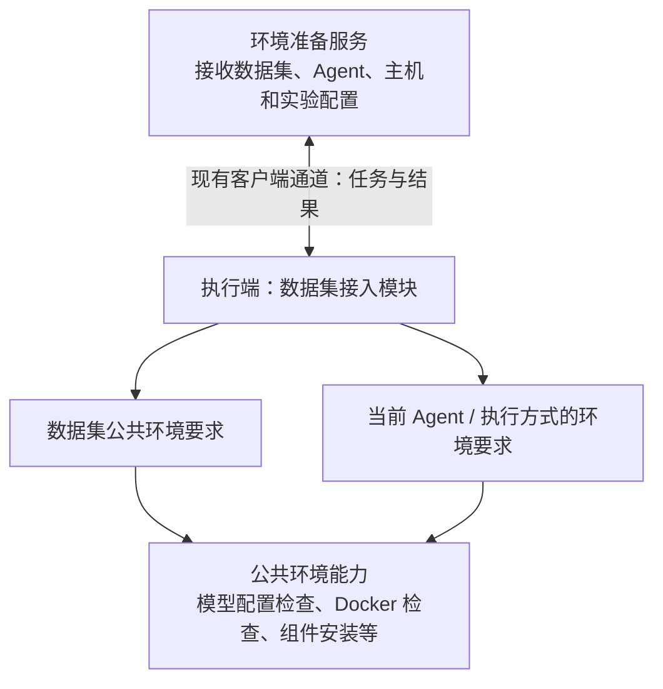

# 实验执行环境准备：需求设计

需求边界见[需求分析](phase1-requirements-analysis.md)，实施拆分见[开发计划](phase3-development-plan.md)。本文为目标设计，新增接口、字段和目录均表示拟议落点；实施状态见[需求清单](../README.md)。

## 1. 前端交互

### 1.1 创建向导检查入口

保留现有四步向导：

```text
① 实验设计 → ② Trace 来源 → ③ 预期答案 → ④ 评估器与执行
```

第二步先完成主机、模型、参数和 Case 选择。点击「下一步」后：

1. 执行现有表单必填与格式校验；不通过时不创建环境任务。
2. 判断本次是否实际执行 Agent。纯已有 Trace 评测直接进入第三步。
3. 固定当前配置快照，锁定第二步字段、步骤导航和上下步按钮，提交环境准备请求。
4. 环境已就绪则进入第三步；可自动准备则留在第二步等待自动准备及复查。
5. 需人工处理或任务失败时展示底部提示，解除锁定；下次点击「下一步」重新检查。

选择默认主机、切换主机、切换模型或返回第二步本身都不启动远程检查。已经通过后返回第二步，再点击下一步仍检查当前组合，复用已安装组件。

### 同配置实验快捷入口

实验列表与 Skill 工作台点击“同配置实验”后，先按原实验冻结的数据集、主机、Agent、模型和运行参数进入同一环境准备服务，通过后才创建并启动新实验。纯已有 Trace 评测跳过；Skill A/B 等实际执行 Agent 的路径仍检查。缺少可确认配置的旧实验提示通过复用向导重新选择。

按钮依次为“环境检查中…”、“环境准备中…”；通过后自动跳转，正常检查不展开额外提示。自动准备或异常信息放在当前实验行的操作按钮下方；只有实际首次耗时编译才提示几分钟。手动配置或失败时显示“重试”，再次点击重新检查。没有常驻卡片、详情入口或弹窗。该入口复用现有准备 POST，提交 `requestId/sourceExperimentId`，由后端恢复上下文，不新增路由或数据表。

### 1.2 提示位置与文本线框图

创建向导的提示仅放在第二步底部操作区、按钮上方，沿用共享设计令牌和现有状态样式。没有独立环境卡片、检查清单、详情/日志抽屉、重新检查按钮或安装确认按钮。

正在检查：

```text
数据集 Case
☑ Case 1
☑ Case 2
……
────────────────────────────────────────────────────
◌ 正在检查运行环境…

[上一步（禁用）]                    [检查中…（禁用）]
```

快速准备：

```text
────────────────────────────────────────────────────
◌ 正在准备运行环境…

[上一步（禁用）]                    [准备中…（禁用）]
```

实际进入首次耗时编译：

```text
────────────────────────────────────────────────────
◌ 正在准备运行环境，首次可能需要几分钟。
  完成后将自动进入下一步。

[上一步（禁用）]                    [准备中…（禁用）]
```

需要人工配置：

```text
────────────────────────────────────────────────────
⚠ 主机 linux-agent-01 上未找到所选模型的 API Key。
  请使用客户端运行账号，在该主机完成所选 Agent 的模型配置，
  然后再次点击“下一步”。
  配置位置/操作：由对应接入实现提供必要的具体说明。

[上一步]                           [下一步：预期答案 →]
```

准备失败：

```text
────────────────────────────────────────────────────
⚠ 运行环境准备失败：下载组件时连接超时。
  请确认执行机网络正常后，再次点击“下一步”重试。

[上一步]                           [下一步：预期答案 →]
```

通过后直接进入第三步，底部提示随步骤退出，不增加成功确认页。文案示例中的主机和原因来自实际检测；多个人工问题可以在同一区域分行列出必要处理事项，不列出已通过项目。

### 1.3 状态与跳转规则

| 状态 | 底部展示 | 表单与导航 | 跳转 |
| --- | --- | --- | --- |
| idle | 无 | 可编辑 | 点击下一步后判断 |
| checking | 正在检查运行环境… | 锁定 | 等待 |
| preparing | 正在准备运行环境…；实际耗时动作可补充耗时说明 | 锁定 | 等待 |
| needs_action | 具体问题、目标主机、必要处理步骤 | 解锁 | 用户修复后再次点击下一步 |
| failed | 实际失败原因和重试说明 | 解锁 | 再次点击下一步 |
| ready | 不保留通过提示 | 结束本次等待 | 自动进入第三步一次 |

耗时文案由当前动作回报的 `durationHint` 决定，不由前端检测组件名称，也不因数据集为 SWE-bench 就固定显示。只在实际首次耗时安装时使用 `first_install_minutes`；已有组件检查用普通文案，耗时修复可使用不含「首次」的 `minutes` 文案。

用户仍可通过浏览器离开或刷新页面。离开不等于取消客户端任务；重新打开后核对同一上下文的任务状态，禁止因页面重新挂载盲目重发安装。状态无法确认时在底部说明，不能自动跳转。任务完成后只有当前仍处于第二步、且请求上下文一致时才跳转。

## 2. 后端功能模块

核心只有三个部分：环境准备服务、数据集接入实现、公共环境能力。现有客户端通道负责传输，不另建通信系统。



| 模块 | 职责 | 边界 |
| --- | --- | --- |
| 环境准备服务 | 校验访问权限、确定数据集接入标识、固定上下文、下发任务并保存状态 | 不判断某个 Benchmark 应安装什么，不执行安装脚本 |
| 执行端数据集接入模块 | 根据数据集与 Agent/执行方式，组合要求并提供检查和准备方法 | 不依赖前端步骤或平台数据库，不复制公共安装实现 |
| 公共环境能力 | 检查本机事实，安装受管理组件，复查结果并回报进度 | 不判断业务数据集名称，不决定页面是否跳转 |

不额外建设多层需求引擎或通用依赖图平台。接入实现可以组合已有函数完成所需顺序；共享执行器仅负责调用统一方法、任务状态及异常处理。

## 3. 数据集与 Agent 的组合

数据集记录关联接入标识，由服务端根据现有数据集元数据、执行方式和受信注册信息解析。客户端只加载已分发、已注册的实现；不接受浏览器提供的模块路径、脚本或下载地址。

多份同源数据集可映射到同一接入实现。普通数据集可使用内置通用实现；可靠性数据集由对应实现组合 FI 条件；这些差异封装在接入实现中。无法识别的专用接入实现必须报不支持或需升级，不能静默降级为无额外要求。

同一 SWE-bench 数据集的示例：

| Agent / 执行方式 | 环境要求示例 |
| --- | --- |
| 原生 Pi + 本地 Docker | 对应模型配置、Docker、兼容 xGovernor、Pi 桥接组件 |
| 原生 xiaoO + 本地 Docker | 对应模型配置、Docker、兼容 xGovernor、xiaoO 凭据桥接 |
| Pi-MCTS | MCTS 仓库与依赖、所配置外部执行服务、对应 Trace/提交物导出能力 |

按实际执行绑定决定要求，不把某个后端写成整个数据集的无条件依赖。仅检查选中的 Agent/Runtime，未选择的 Runtime 缺配置不能阻止当前组合。

## 4. 接入协议与代码归属

### 4.1 两个接入方法

以下为职责草案，实施时使用严格校验的共享协议类型：

```ts
checkEnvironment(context): Promise<EnvironmentCheckResult>
prepareEnvironment(context, reportProgress): Promise<void>
```

`context` 包含：

- 本次实验执行模式及相关配置；新建实验尚无持久化 ID 时使用请求关联标识，不为检查提前创建实验。
- 数据集 ID、接入标识、版本或内容摘要，以及经过服务端校验的公开执行元数据。
- 所选 Case 范围及可能影响准备的公开配置，不发送隐藏测试或 Gold Patch。
- clientId、platform、Agent、模型选择及解析后的执行方式。
- 影响环境要求的运行参数、客户端/接入协议版本；平台传选择，客户端在实际运行账号下解析本机配置与凭据。

`EnvironmentCheckResult` 区分：已满足、可自动准备、需人工处理、不支持、检测异常。未检查或因前置依赖缺失而无法检查的项目必须显式保留，不能当作已满足。

结果提供稳定错误码、用户可读原因及必要处理说明；凭据只回报是否可读取、验证结果与配置位置，不返回密钥或完整敏感配置。缺失凭据、认证拒绝、网络故障、模型不存在分别报告。默认不发送计费模型推理请求；本地配置通过也不能宣称已验证账户余额或全部模型调用能力。

### 4.2 Benchmark 执行端扩展

在现有 Benchmark 接入协议中增加环境准备扩展，职责属于 executor。拟议接入包布局：

```text
benchmarks/<key>/
  benchmark.yaml
  executor/
    environment.cjs       # checkEnvironment / prepareEnvironment
    ...                   # 原有执行端策略
```

拟议 Manifest 声明：

```yaml
executor:
  environmentPreparation:
    protocol: execution-environment/v1
    implementation: ./executor/environment.cjs
```

该声明由构建期 Catalog 校验并分发给执行客户端，实施时同步更新 Manifest 校验、产物摘要、Catalog 和安装 bundle。当前 executor 文件发现依赖 Git 来源策略入口，扩展后不能要求新 Benchmark 必须声明 Git 策略才能分发环境准备代码。

共享契约由执行协议导出，Benchmark 接入协议引用它；非 Benchmark 数据集也采用相同方法合同，不需要接入 Benchmark 数据导入或评测协议。普通和可靠性数据集的实现放在执行端对应数据集接入目录。

SWE-bench 专属的组合决策在自身 `executor/environment.cjs`；现有 `services/executor/src/xgovernor/` 保留公共检查、依赖管理与安装实现，供该接入方法调用，不将整套驱动复制进接入包。

## 5. 检查与自动准备流程

```text
检查可提前判断的条件
  ├─ 需要用户配置 / 环境不支持 → needs_action
  ├─ 检测异常 → failed
  ├─ 所有必需条件已满足 → ready
  └─ 存在可自动准备项
       → 调用 prepareEnvironment
       → 按前置依赖顺序准备
       → 再调用 checkEnvironment
       → 全部满足才返回 ready
```

- 模型配置、系统支持、权限等可以提前检查的问题应先暴露，避免编译几分钟后才提示已知的人工问题。
- 检查方法不安装软件；准备方法只能执行对应实现支持的操作。需要安装后才能验证的条件放在复查中。
- 不做无界的「失败后自动重装」循环；准备失败或复查仍缺条件时返回明确结果，下一步按钮负责用户重试入口。
- 自动安装固定兼容版本，尽量使用受管理独立目录；已有有效组件直接复用，失败保留此前可用版本。
- 系统软件、Docker 权限、内核/cgroup 或交互式认证等超出非交互策略的事项返回人工说明。现有 xGovernor 工具链自动调用系统包管理器的逻辑须按此边界拆分，不能检查时隐式提权安装。
- 不安装所有数据集可能用到的依赖，不下载全部 Case 镜像。单 Case 的镜像拉取、工作区创建等仍归原执行生命周期。

## 6. API、任务状态与上下文一致性

### 6.1 平台 API 草案

| 方法与路径 | 用途 |
| --- | --- |
| `POST /api/experiments/environment-preparations` | 提交当前执行上下文，创建或复用正在处理的任务，返回 `taskId` 与状态 |
| `GET /api/experiments/environment-preparations/:taskId` | 查询当前用户所属任务的状态、上下文摘要和底部提示 |

POST 返回异步任务引用，不保持 HTTP 请求等待编译。前端复用现有轮询习惯读取状态，不增加详情 API 或原始日志返回。参数、用户与数据集/主机归属均由服务端校验；只允许设备回报所属任务。

### 6.2 复用现有控制面

建议增加一个白名单动作 `PREPARE_EXECUTION_ENVIRONMENT`，表示完成「检查、必要时自动准备、复查」整个流程；客户端先 ACK，再执行，接入方法仍保持检查与安装分离。

优先复用 `ReliabilityCommand` 保存 payload、状态和结构化 `resultJson`，`commandId` 作为准备任务标识，设计不要求新建 Prisma 表。任务语义由环境准备服务封装，前端不直接解释控制指令状态。

`checking/preparing` 对应指令运行中；`ready/needs_action` 是已完成的一次检查流程的不同业务结果；检测/准备异常对应失败。查询接口根据结果统一映射为前端状态，不能把指令 `SUCCEEDED` 直接当成环境就绪。

送达 ACK 期限与准备运行期限分别管理。当前普通指令默认 30 秒并会过期，准备动作必须设置独立、有限的任务期限并传给客户端，不全局延长其他动作。客户端在期限到达后中止本次子进程并核对状态，不能平台已标过期而后台继续无界安装。

编译在子进程中执行，不阻塞心跳、状态查询与其他控制消息。客户端保存任务最小状态和安装锁，重启或断连后核对真实进程与安装结果；网络断开不直接推断安装失败或成功，禁止未核对就重复编译。

终态经 HTTP 回执确认后才标记已回报，未确认结果保留并定期补报。恢复已完成任务前，按持久化上下文只读复查当前环境，不触发自动安装或全量扫描；上下文丢失、过期或环境变化时提示重新点击下一步。安装锁确认 PID 已退出后才清理，存活进程占用的锁继续等待。

### 6.3 去重与结果有效性

- 每次点击生成请求幂等标识，网络重试复用同一标识；人工修复后的再次点击生成新检查请求。
- 相同用户、客户端和上下文摘要的进行中任务复用；实现时使用原子竞争与客户端任务记录保证幂等，不能依赖服务端进程内 Map。
- 上下文摘要覆盖数据集内容、Agent、模型、执行方式、相关参数及选择范围；结果同时关联检查时客户端配置指纹和实现版本。密钥值不写入摘要或上报。
- 共享依赖另按安装根目录、组件和目标版本互斥。同一安装完成后，各等待任务分别复查自己的上下文，不共享一个全局 ready 标志。
- 检查结果仅增量上报当前平台与相关 Profile，不触发或等待全量能力扫描；可靠性数据集只检查所选 Agent 的 FI 适配与所需故障定义。
- 安装造成 Profile 或制品版本变化时，先同步相关能力及最终身份，再进入后续实验冻结流程；不能沿用安装前的占位摘要，未检查 Runtime 也不能沿用旧身份下的就绪状态。
- 前端只消费当前请求和上下文的结果。修改相关选择使此前通过记录失效，下一次点击重新检查。

创建/启动及客户端受理执行时继续保留现有权限、能力、Profile 和必要条件校验，防止绕过第二步或检查后漂移。这里不再自动启动长时间安装；需要准备时提示回到第二步重新检查。

## 7. 候选主机与安装迁移

现有目标列表将「支持执行路径」与「此刻已就绪」部分混合。需要拆开：拥有所选 Agent、支持准备协议及目标执行方式但缺组件的主机仍可选择，后续由第二步检查处理。离线、协议过旧、不支持所选组合的目标给出准确原因；不能先按 ready 过滤，再要求用户进入准备流程。

从客户端安装器移除因选择 Pi/xiaoO 而触发的 xGovernor 编译安装。链路采集器及常驻通信需要的基础运行时仍必须正常安装。现有 xGovernor 版本、手动配置和 CLI 管理入口保留，准备方法优先验证并复用。

可靠性数据集通过自己的接入方法检查 FI 组件、Agent 适配和所需权限，支持的受管理缺失项按需准备。梳理 FI 与采集 Hook 共用的基础运行时依赖，不能为了延迟实验准备而破坏链路采集；只有实验专用的可选准备动作迁入此流程。

当前选框架安装时保存的用户 HOME、配置查找路径等上下文，也需与「编译是否发生」解耦，确保后台客户端按实际执行账号找到 Pi/xiaoO 配置。

旧客户端未声明新准备协议时提示升级，不尝试下发未知动作。已完成实验与历史结果不迁移，不根据新环境重写历史执行身份。
