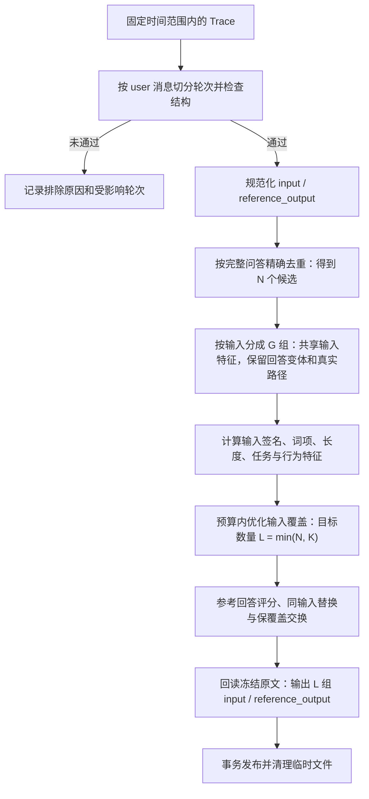
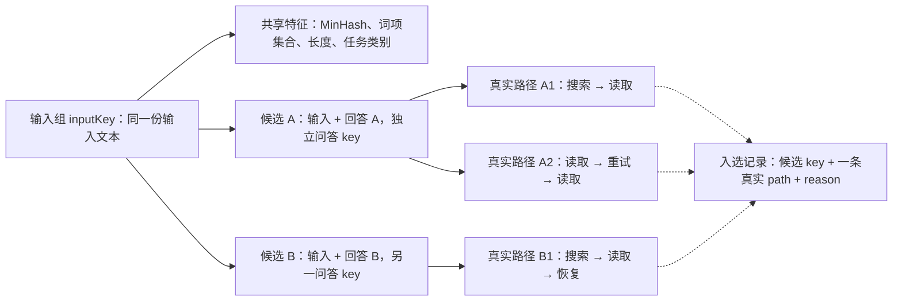
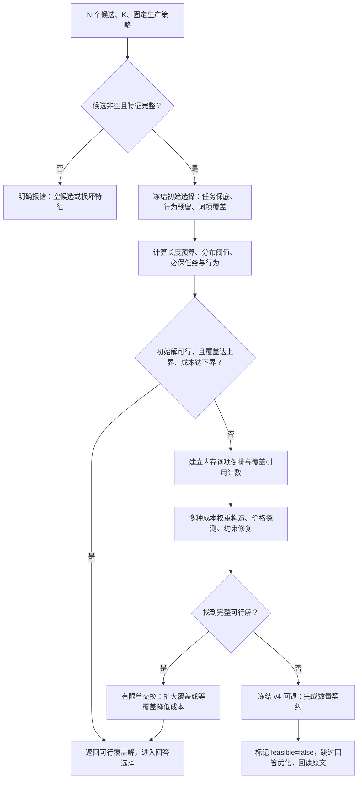
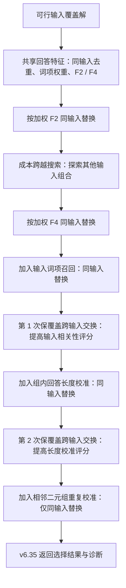
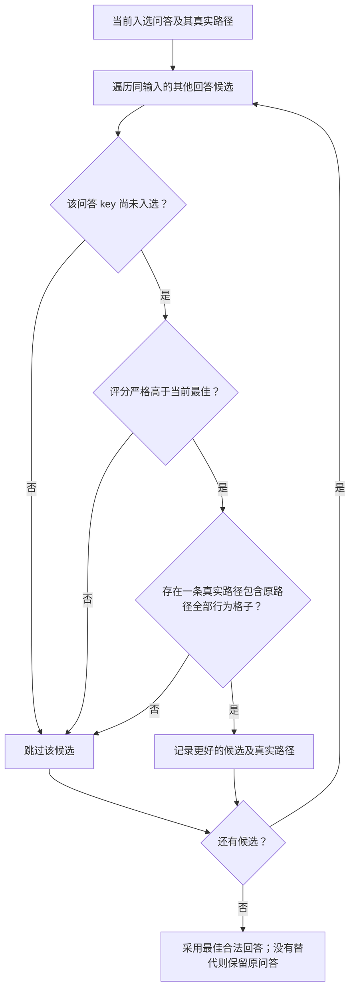

# 基于 Trace 自动生成理想输出评测集：需求设计

更新：2026-10-13。本文以当前生产源码为准，与[需求分析](phase1-requirements-analysis.md)、[开发计划](phase3-development-plan.md)共同构成现行基线。本特性的生产采样能力称为**智能采样**，当前策略版本为 `trace-coverage-v6.35`；这是 Agent Insight 的产品名称，不代表与其他产品采用相同算法。已冻结 v4/v5 任务仍可恢复。运行时 DTO 见 [contracts.ts](../../../src/lib/trace-datasets/contracts.ts)，交互原型和演练 Schema 不作为运行时真源。

效果验收覆盖微软八源公开实验及五个独立新来源；目标与阈值以需求分析 §4 为准。生产默认切换、产品正确性和效果目标分别判定。本文不保留历轮研究方案。

## 1. 架构与处理流程

| 模块 | 当前职责 |
| --- | --- |
| [AgentDatasetCenter](../../../src/components/AgentDatasetCenter.tsx)、[TraceDatasetFlow](../../../src/components/TraceDatasetFlow.tsx) | 创建、状态、进度、失败回填、关闭明细 |
| [DatasetItemsPage](../../../src/components/DatasetItemsPage.tsx) | 已发布数据项查看、编辑、添加、删除和双字段导入 |
| [catalog.ts](../../../src/server/trace-datasets/catalog.ts) | 平台别名、稳定 Agent 身份、时间范围计数及来源条件 |
| [manager.ts](../../../src/server/trace-datasets/manager.ts) | 持久队列、线程池、幂等、租约、恢复、删除与明细中转 |
| [worker.ts](../../../src/server/trace-datasets/worker.ts) | 来源捕获、候选去重、采样、进度及原子发布 |
| [source-reader.ts](../../../src/server/trace-datasets/source-reader.ts) | 只读来源、完整摘要、消息字段投影、临时冻结 |
| [trace-analysis.ts](../../../src/server/trace-datasets/trace-analysis.ts)、[normalizer.ts](../../../src/server/trace-datasets/normalizer.ts) | 多轮切分、结构检查、最终回答及任务/行为特征 |
| [content-processor.ts](../../../src/server/trace-datasets/content-processor.ts) | 内容处理边界，当前 `identity-v1` 透传 |
| [sampling/production.ts](../../../src/lib/trace-datasets/sampling/production.ts)、[budgeted-evidence.ts](../../../src/lib/trace-datasets/sampling/budgeted-evidence.ts) | 智能采样的 v6.35 生产分派、输入覆盖优化与回答选择，兼容旧策略 |
| [sampling/index.ts](../../../src/lib/trace-datasets/sampling/index.ts) | 共用哈希、输入词项、MinHash 与冻结 v4/v5 算法，不依赖 HTTP/Prisma |
| [agent_datasets_storage.ts](../../../src/server/agent_datasets_storage.ts) | 数据集读写、状态保护与既有评测投影兼容 |

不引入外部模型、Redis、向量数据库或独立常驻服务。生成阶段不调用旧回流的模型观点提取，不复用其按 taskId 去重的规则。

## 2. 界面与交互

### 2.1 配置

在新建菜单添加带星光图标的“基于 Trace 生成”。配置包括名称、描述、Agent 平台、Agent、**时间范围**和生成条数上限；名称 1–50 字符，描述最多 200，范围为 24 小时/7 天/30 天（默认 7 天），上限 1–500（默认 20）。类型固定 `ideal_output`，业务字段固定 `input/reference_output`，均为必填非空文本。

必填星号为红色；有效 Agent 未选中、列表加载中或配置无效时禁用开始按钮。平台/时间范围变化清空 Agent，按请求作用域和取消请求处理过期异步响应；同一有效列表内切换 Agent 不应错误禁用按钮。

配置和进度分别使用最大宽度 920px、620px，复用共享设计令牌并适配窄屏、深色模式。原型的演示开关不是产品配置；不展示用途、模型预算、来源预览或人工发布入口。

### 2.2 进度与状态操作

六阶段为：读取 Trace、筛选与去重、任务与行为归类、多样性采样、生成数据项、保存数据集。`stageIndex/totalStages` 表示完成的阶段数；排队为等待，成功为 6/6，不表示扫描完成百分比。结构提取在来源捕获时完成，签名与特征准备部分在去重循环中完成，阶段名是用户流程分组，不承诺对应独立性能计时区间。

| 状态 | 进度按钮 | 列表点击/编辑 | 评测 |
| --- | --- | --- | --- |
| 生成中 | 取消可用，完成禁用，无返回 | 点击打开进度；编辑禁用 | 禁用 |
| 异常 | 取消、返回可用，完成禁用 | 点击打开错误；编辑回填配置 | 禁用 |
| 已发布 | 完成可用，取消禁用，无返回 | 点击进入数据项；编辑名称/描述 | 有数据项时可用 |

正常生成按秒轮询；读取失败提示后重试，不能将网络失败写成作业失败。点击遮罩、卸载或刷新不取消任务；完成按钮只关闭已经发布的结果。

失败进度“返回”先清理，再回填配置。失败卡片“编辑信息”先回填，取消保留旧记录，提交时清理旧记录后以新 requestId 创建。重新提交按原范围时长计算新的绝对时间并刷新 Agent。清理失败保留原状态，不提前导航。

### 2.3 发布后的操作与本次明细

已发布数据集继续使用现有详情和评测入口。元信息编辑不改案例；数据项允许双字段新增、编辑、删除和导入，不允许新增列或切换类型。删空仍为已发布，但不能评测。原始 Trace 及实验冻结案例不随数据集删除。

列表无“生成详情”按钮。生成窗口内的筛选明细仅供本次查看；关闭释放，不留历史回看入口。重开生成中/失败卡片可查进度与错误，但不恢复已释放的明细；成功卡片直接进入数据项。明细生命周期见 §5.4。

## 3. 来源目录与冻结

### 3.1 平台、Agent 与时间范围

平台目录合并安装配置中的 `FRAMEWORK_OPTIONS` 与已注册适配器 `listFrameworks()`，通过 `resolveFrameworkId` 归一别名，再与当前 owner 的历史 Execution 平台取交集。平台存在性看全部历史，Agent 计数看 `[from,to)` 范围；最近没有执行不隐藏历史平台。

Agent 优先使用 Execution 的 `agentId`，键为 `registered:<agentId>`；缺失时使用 `legacy:<hash([canonicalPlatform,agentName,clientId])>`。不查询 RegisteredAgent 表；缺少 ID 和名称的记录不列为选项。同名键在显示时用后缀区分，不合并不同身份。计数由范围内执行记录分组累计，包括之后可能因结构检查排除的记录。提交时重新校验选择及身份，来源不可用返回 422。

服务端校验 UTC 时间格式、范围长度为 1/7/30 天、结束时间不超过当前时间五分钟。UI 提交最近范围的绝对时间，任务恢复不滚动时间窗。

### 3.2 已存储 Trace 的读取

只读当前 owner 的 Execution 和通过 taskId 关联的 Session，不读取原始 OTEL spool，不依赖 `requestMessages` 或 `traceDatasetBoundary`，不新增采集字段。映射版本为 `stored-interactions-v4`。

执行投影含输入摘要、最终结果、框架、身份及已知失败信息；会话投影含结束状态与原始 interactions。消息从 SQLite JSON 投影必要字段，按数组顺序每页 128 条读取：角色、文本/文本块、channel、工具名、时间、trace/span 标识、完成原因及失败、重试、委派、截断等标记。工具结果正文不整体加载到 JavaScript，但完整 interactions 参与来源摘要。

### 3.3 临时冻结与恢复边界

目录为 `<dataDir>/trace-datasets/<ownerHash>/jobs/<jobId>/`：

| 文件 | 用途 |
| --- | --- |
| `members.jsonl` | 固定执行 ID 与来源摘要；临时文件完成后重命名 |
| `sources/<hash(executionId)>.json` | 提取的 `units[]`、排除原因、来源版本及校验和 |
| `sealed.json` | 成员清单摘要及捕获完成标记 |
| `result.json` | 发布前规范化案例临时结果 |

成员清单在一次读取事务中按 timestamp 降序、ID 升序分页生成；该读取事务包含清单文件写入，不是所有文件 I/O 均在事务外。摘要覆盖执行投影、Session ID/结束时间及完整 interactions，长正文以 SQLite substr 分段扫描，每段 65536 字符。

逐来源捕获在读取前后校验摘要，最多重试三次；与固定成员摘要不一致记 `SOURCE_CHANGED`，执行/会话缺失记 `SOURCE_UNAVAILABLE`，排除该来源。可恢复的已封存结果按校验和重用，源文件损坏则失败；不会扩大原范围重新挑来源补位。

冻结文件目前通过整体 JSON 序列化写入，单来源的必要消息仍在内存中。没有 `manifest.json`、磁盘采样索引或计算 checkpoint 文件；进程恢复复用封存来源重新计算，不是从采样中断点续算。旧版已封存 `unit/units[]` 保持结果兼容，未封存旧摘要不匹配时按来源变化处理，重新生成才能采用新规则。

## 4. 提取、去重与智能采样详细设计

智能采样将已有 Trace 中的问答整理成一个数量受控、尽量覆盖不同输入及真实执行行为的评测集。当前生产策略固定为 v6.35：先构建有效候选，再在预算与分布约束内扩大输入覆盖，最后结合已有回答的词项证据选择参考回答。全部步骤在生成时计算，不调用 LLM，不新增 Trace 采集字段，不读取公开数据集名称或人工评分作为选样依据。

图 1 给出数据经过各层后的变化。**选样单位是问答候选，覆盖统计单位是独立输入**；一条 Trace 可以贡献多轮问答，同一输入也可以保留不同回答，因此生成数量不一定等于 Trace 数。

下文依次说明结构提取（§4.1）、候选与特征（§4.2–4.3）、覆盖优化（§4.4）、回答选择（§4.5）以及统计和资源边界（§4.6）。预算未找到可行解时的分支见图 3；发布生命周期见 §5。

### 4.1 执行级与逐轮结构提取

1. 检查 Session 已结束，并且没有已知的执行失败类型（如 `opencode-session-error`、`goal_plus_pi_session_failed`、`agent-process-exit`）；否则记 `EXECUTION_NOT_SUCCESSFUL`。
2. 子 Agent 执行或没有 user 消息，记 `INPUT_UNATTRIBUTED`。其余按已存储数组顺序，每条 user 到下一条 user 之前为一轮。
3. 单轮中若助手有多个不同的非空 traceId、与已知 user traceId 冲突，或出现子 Agent 记录，记 `INPUT_UNATTRIBUTED`。没有 traceId 本身不是排除条件。
4. 若该轮后续事件开始时间不早于下一条 user，或完成时间晚于下一条 user，记 `ANSWER_UNATTRIBUTED`。仅在相关时间可解析时检查，不用语义猜测轮次。
5. 输入必须是单个非空用户文本且不含不可保留的非文本内容；出现截断/延迟内容标记时记 `TRUNCATED`。首轮与非空 Execution.query 核对，其他轮使用本轮输入。
6. 取该轮最后一条非空、无工具调用且 channel 不为 analysis/reasoning/thinking/commentary 的助手文本。末轮还与非空 Execution.finalResult 核对；不能把整条执行的最终输出套给每一轮。
7. 回答缺失、末轮输出不一致、finishReason 表示仍需工具调用，或答案后还有工具/失败事件，记 `ANSWER_UNATTRIBUTED`。回答明确失败/取消/内容过滤则记执行未成功；length/max_tokens 记截断。

中间工具失败后恢复并给出有效最终回答，可以保留。没有独立正确性评分或语义上下文检查，含“再乘以 2”等依赖历史的文本原样保留，也不将所有多轮记录整体过滤。

`CONTEXT_UNCONFIRMED/HISTORY/INPUT_LOSS` 仅用于旧冻结结果/旧原因展示兼容；当前结构提取不产生这些原因。`MULTI_TURN` 是单轮归一器的兼容防卫分支，当前流程先分轮，不靠它过滤多轮。

### 4.2 文本规范化、精确去重和特征

文本统一 NFC，CRLF/CR 转 LF；只用 trim 检查是否为空，不删除正文有意义的首尾空格。双字段键为 `SHA256(JSON.stringify([input,reference_output]))`，输入组键为 `SHA256(JSON.stringify([input]))`。命中相同问答键还会核对正文，冲突报错。相同输入不同回答保留候选；重复问答保留各次真实行为路径供选样时择代表，不合成不存在的路径。

任务分类只对输入依次使用正则规则：`coding`、`data_processing`、`workflow_action`、`content_generation`、`information_lookup`，未命中为 `unknown`。没有元数据 taskType 优先级，也没有额外 `other` 类。该分类是规则近似，不是语义识别。

行为特征来自已观测工具名（带平台前缀）、相邻工具转换，以及记录过的恢复、重试、委派。工具顺序按时间、spanId、原消息/工具序号稳定排序。缺少记录不当作明确 false；`knownDimensions` 仅计已有观测维度。不使用工具参数、完整路径哈希或时延作为采样特征。当前策略在生成时计算输入词项集合及 token 数，用于覆盖增量和长度分层，不写入 Trace 或新增数据库字段；尚未提供时延/token 用户统计报表。

#### 4.2.1 候选、输入组与真实路径

图 2 展示同一输入的两种回答。候选 A 来自两次重复问答，去重后仍保留两条实际观测路径；采样时从中选一条。不能把不同执行中的工具拼成一条“覆盖更多行为”的虚构路径。

虚线表示可选路径。选中两个不同回答时会产生两条案例，消耗两份输入长度预算，但相同输入的词项覆盖只计一次。

| 数据 | 计算或存放方式 | 在算法中的作用 |
| --- | --- | --- |
| 问答 `key` / 输入 `inputKey` | 分别对规范化双字段 / 输入计算哈希 | 区分精确重复与同输入回答变体 |
| `lexical.terms` | 小写化后按汉字单字或连续字母、组合标记、数字提取，再去重 | 计算输入词项并集及新增覆盖 |
| `lexical.tokenCount` | 使用相同词法规则，累计所有出现次数 | 预算成本和长度分档；不是模型 tokenizer 的 token 数 |
| `signature` | 输入的 128 维字符 MinHash | 初始选择的距离比较、确定性消歧及旧策略回退 |
| `task` | 输入正则分类，未命中为 `unknown` | 任务保底与任务分布约束 |
| `paths[].cells` | 每次实际执行观测到的工具、转换、恢复等行为格子 | 行为预留、替换时保护已保留行为 |
| `answers`、回答词项和评分 | 以候选键关联的临时内存数据 | 从已有回答中选择参考输出 |

词法规范化只用于特征计算；发布正文仍读取冻结的规范化原文，不用小写词项反拼文本。以上采样特征在 Worker 内存中使用，成功生成不增加长期特征存储。

### 4.3 输入签名与距离

智能采样当前默认策略版本为 `trace-coverage-v6.35`，生产入口为 `sampling/production.ts`，复用冻结的 `budgeted-evidence.ts` v6.35 实现。Worker 同时兼容旧 v4/v5 任务；其他版本拒绝执行。签名协议：`mh-affine32-v1`；seed=42；行为预留比例 rho=0.2。同输入组只计算一份 128 维 MinHash。

- 按 Unicode code point 生成字符 5-gram；非空且不足 5 个字符时以全文为一个 gram。
- 基础哈希取 SHA-256(`JSON.stringify(['mh-base-v1',gram])`) 前 32 位大端，再做 fmix32 混合。
- 第 j 维系数来自 SHA-256(`JSON.stringify(['mh-affine32-v1',seed,j])`)；a 为首 32 位设为奇数，b 为随后 32 位。
- 每维保留 `(Math.imul(a,h)+b) >>> 0` 的最小值。相似度为相同分量数/128，距离为 `1−相似度`。

参考回答不参与签名。固定候选、策略及种子下确定性选择；各阶段使用冻结的版本命名空间、seed、阶段名和键进行哈希排序，再按 key 消歧；内部复用阶段保留自身命名空间，不能全部替换成 v6.35。它是近似文本距离，不承诺等价语义识别。

字符 5-gram 与词项承担不同职责：前者保留大小写，描述输入文本距离；后者转为小写，计算词汇覆盖和成本。当前覆盖优化的主目标是输入词项并集大小，MinHash 服务于底层初始选择和回退路径，不代表使用向量语义模型。

### 4.4 分阶段预算与选择

生成 API 固定保存智能采样的 `PRODUCTION_POLICY`（v6.35），不接受客户端策略版本。`sampling/index.ts` 的 `POLICY` 仅为冻结的 v4 底层/研究默认，Manager 和 Worker 使用 `sampling/production.ts`。

设候选问答数 N、上限 K，目标数量 L=min(N,K)。同输入共享 MinHash、词项集合和长度；覆盖只计算输入，回答文本以候选键暂存在 Worker 内存，供回答选择使用，不写回 Trace。

1. 使用冻结 v6.35 的价格构造、单交换与成本跨越搜索，最大化独立输入词项覆盖。预算为 floor(1.10×L×独立输入平均词法 token 数)，保留任务与真实行为路径；长度分布 TV≤max(0.10,2/Q)，任务分布 TV≤max(0.20,2/Q)，Q 为入选独立输入数。
2. 对同输入的不同回答计算词项共识，使用输入词项召回与长度校准，进行保覆盖的有限交换；最终以重复片段比例校准，只替换同输入的参考回答。固定权重，不读取人工标签，不调用 LLM，不判断答案正确性。
3. 没有找到可行预算解时，沿用冻结算法的 v4 回退以完成数量契约；保留算法内部回退诊断，不把回退算作预算优化成功。N=0 明确失败，不发布空集。
4. 选中的输入和回答从校验后的冻结来源读取原文，保持原有双字段输出、原子发布、取消、幂等与临时文件清理。

旧任务按保存的版本分派：v4 保留原 farthest-first 流程，v5 保留原分档词项覆盖流程。v6.35 缺少词项/回答特征、未知版本或签名协议时明确报错，不静默换用其他研究候选。研究消融开关不接入生产配置。

#### 4.4.1 目标函数与约束

令 `S` 为入选问答集合，`I(S)` 为其中不重复的输入组，`T(g)` 为输入组 g 的去重词项集合，`c(g)` 为其词法 token 数。池中共有 G 个输入组，入选独立输入数为 Q。

| 项目 | 定义 | 设计目的 |
| --- | --- | --- |
| 数量 | `L = min(N, K)`，`1 ≤ K ≤ 500`；每个问答 key 最多选一次 | 遵守生成条数上限；候选不足时保留现有数量 |
| 覆盖目标 | 最大化 `V(S) = size(union(T(g), g in I(S)))` | 在有限案例中覆盖更多不同输入词项 |
| 长度预算 | `B = floor(1.10 × L × sum(c(g))/G)` | 约束为扩大词汇而过度偏向长输入的倾向 |
| 实际成本 | `C(S) = sum(c(input(s)), s in S) ≤ B` | 按实际案例累计，相同输入的不同回答分别计费 |
| 长度分布 | 长度档为 `≤32 / 33–128 / 129–512 / >512`；`TV ≤ max(0.10, 2/Q)` | 控制选样后的长短输入结构偏差 |
| 任务分布 | 各任务类别含 `unknown`；`TV ≤ max(0.20, 2/Q)` | 控制规则任务类别的结构偏差 |
| 任务与行为保留 | 保留初始保底任务与所需真实路径格子；后续阶段继续保护各自入口的任务/行为集合 | 避免纯词汇目标挤掉已经保留的任务或执行行为 |

两种分布都以**独立输入组**计数：候选池分母是 G，入选集合分母是 Q，不按回答变体重复计数。`TV(P,R) = 0.5 × sum(abs(P_i − R_i))`，表示两组类别占比的总变差距离。例如 Q=100 时，长度和任务阈值分别为 0.10、0.20；小样本时 `2/Q` 放宽约束，避免离散计数导致无解。预算中的 1.10 是算法内部长度约束，不是与其他版本比较的性能验收目标。

#### 4.4.2 初始保底、价格构造与覆盖交换

图 3 为输入覆盖核心的决策过程。这里复用的 v5 是冻结的初始选样函数，v4 是异常回退函数，均属于当前生产调用链，不是让用户选择的策略，也不构成效果验收比较目标。

1. **生成初始代表集。** 当 N>K 时，已知任务类别先各选代表，最多占满 L；任务太多时按确定性次序选择。存在行为记录时，行为预留最多为 `min(floor(0.2×L), L−任务保底数)`，优先增加尚未覆盖的真实行为格子。没有新增行为收益时不强占名额，余量继续选择输入；可用独立输入耗尽后，用未选回答变体补足数量。N≤K 时初始集包含全部问答。
2. **提取保留条件。** 核心从初始结果的 `task_floor`、`behavior` 记录提取必保任务和路径格子。保留的是这些观测特征，不强制永久保留原候选 ID；满足同样条件的真实候选可以替换。K 很小时不承诺覆盖池中全部任务、工具或行为。
3. **尝试多个构造起点。** 为输入组计算新增词项数 `gain`，以 `gain / max(1,cost)^p − λ×cost` 作为构造评分。先尝试 `p=0、0.5、1`；价格探测使用 p=0，通过 λ 平衡覆盖与成本。普通构造为剩余名额预留最低成本；价格探测可以生成待修复状态，统一通过最终可行性检查后才纳入结果。
4. **有限探测与修复。** 价格从零开始；需要压低成本时最多 4 次扩大价格寻找区间，找到后最多 6 次二分。每个完整起点最多执行 `min(L,32)` 次约束修复。比较可行起点时优先覆盖数，其次长度与任务 TV 之和，再其次成本。
5. **单交换改善。** 使用词项倒排、引用计数和增益缓存评估“移出一个候选、移入一个候选”，避免每次重算全部词项。最多 `min(64,L)` 轮，在数量、预算、分布和保留条件满足时接受覆盖增加，或等覆盖且成本降低的交换；没有可接受交换或达到停止条件时结束。

覆盖上界取三个易计算界的最小值：池中总词汇量、最多 L 个输入组词汇量之和、共享词汇量加最多 L 个组的私有词汇量之和。成本下界取最便宜 L 个问答候选的输入成本之和。初始解同时达到两者且满足约束时，可跳过倒排构建和覆盖搜索；普通停止并不证明全局最优。

未找到可行起点表示**本次有限搜索未找到**，不等于数学上已证明无解。回退记录 `fallbackReason=NO_FEASIBLE_CONSTRUCTION` 和实际生效策略；回退结果不承诺满足本节预算/分布优化约束，也不能计为预算优化成功。

#### 4.4.3 一个覆盖选择示例

以下是便于手算的示例，不是某次生产运行的结果。假定任务类别、长度档和行为保留条件一致，输入词项与候选如下：

| 候选 | 输入组 | 输入词项 | 输入成本 | 回答 |
| --- | --- | --- | --- | --- |
| A1 | A | alpha、beta、gamma | 3 | 回答 A1 |
| A2 | A | alpha、beta、gamma | 3 | 回答 A2 |
| B1 | B | alpha、beta、delta | 3 | 回答 B1 |
| C1 | C | delta、epsilon、zeta | 3 | 回答 C1 |

N=4、G=3、K=2 时，L=2，B=`floor(1.10×2×3)=6`。选择 A1+B1 覆盖 4 个不同词项；A1+C1 覆盖 6 个；A1+A2 只覆盖 3 个，三种方案成本均为 6。因此在这些条件下，A 组与 C 组组合提供更大的覆盖；A 组具体保留 A1 还是 A2，再由回答评分和真实路径约束决定。若 K≥4，则数量契约要求保留全部 4 个问答，不会把两个不同回答误删为一条。

### 4.5 参考回答选择与生产一致性

实现链路为 `productionSampleSteps` → `evidenceSampleSteps` 的 V635 分支 → `memoBasePreparedSteps`。它是单一固定策略，不按公开数据集名称挑选算法。

- 输入覆盖优化使用 `pricedCoreSampleSteps` 与 `prunedCrossingSteps`，保留任务、真实路径、数量和最终预算/分布约束；内部成本跨越可探索超预算状态，但最终只接受满足原预算的结果。
- 回答特征按输入分组，规范化相同回答不重复充当支持，最多使用 32 个其他回答。共识采用有方向的加权词项召回；同输入只换严格提高评分且保留原路径格子的真实候选，不能重复选中同一问答。
- 输入相关性分数固定为 `0.75×回答加权 F4 共识＋0.25×输入词项加权召回`。长度校准为 `0.90×该分数＋0.10×exp(−abs(log((回答 token 数+1)/(组内长度中位数+1))))`；随后执行保持输入覆盖、预算与真实路径的有限交换。
- 最终重复片段校准为 `0.90×长度校准分数＋0.10×不同相邻二元组数/二元组出现次数`；少于两个 token 时该比例为 0，单回答或全组没有二元组证据时保留原分数。V635 在这一轮同输入替换后返回，不执行其他候选分支的后续交换。

覆盖仅读取输入，参考回答原文用于回答选择但不被改写。词项共识、长度及重复比例都是启发式信号，不验证事实或上下文独立性。Worker 使用同一冻结实现及完整临时特征；通过与离线结果逐 ID、路径、诊断对照保证接入一致，不另实现简化版采样器。

#### 4.5.1 生产执行顺序

图 4 展开可行覆盖解之后的真实调用顺序。**同输入替换**只换参考回答；**跨输入交换**可能改变入选输入，因而需要重新检查覆盖、预算和分布。两种操作不能混为一谈。

成本跨越搜索用两个不同价格起点，各最多执行 `min(32,L)` 步，允许中间状态成本达到 `floor(1.25×B)`，也允许暂时降低覆盖，以探索单步贪心不易到达的组合；返回的最佳状态必须满足原预算 B，覆盖不低于入口。通过短期禁止刚移出的输入组回流，减少来回交换；产生更好可行覆盖时允许突破该限制。入口已经同时达到覆盖上界和成本下界时跳过这一步。

两次保覆盖跨输入交换各最多执行 `min(16,L)` 轮，只接受回答评分严格提升、数量和独立输入数不变、预算和分布合规、入口任务/行为仍被覆盖的替换。每次调用固定自己的入口词汇覆盖为下限；中间可以从高于下限的位置回落到下限，因此“保覆盖”不表示每一步覆盖都严格上升。

最后的重复校准只执行同输入替换，v6.35 随即返回，没有第三次跨输入评分搜索。覆盖核心若走回退分支，则整段回答优化跳过。

#### 4.5.2 回答评分的含义与公式

对同一输入，规范化后相同的回答只作为一种变体参与共识。变体按候选 key 排序产生稳定顺序，每个回答最多与 32 个其他变体比较；不会因为同一回答被记录很多次就增加支持票数。共享回答词项和成对交集，减少重复计算。

令 A 为待评分回答的词项集合、R 为同输入的另一个回答，`w(t)=1+ln((G+1)/(df(t)+1))`；此处 df 是包含该词项的**输入组回答并集**数量。令 `mass(A)=sum(w(t),t in A)`、`overlap(A,R)=sum(w(t),t in A∩R)`。稀有词项权重较高，词项出现次数不重复增加共识权重。

| 信号 | 公式及边界 | 作用 |
| --- | --- | --- |
| 加权 F2 共识 | 对其他回答求 `5×overlap(A,R)/(4×mass(R)+mass(A))` 的均值 | 初次选择能覆盖同组其他回答词项的参考回答 |
| 加权 F4 共识 | 对其他回答求 `17×overlap(A,R)/(16×mass(R)+mass(A))` 的均值 | 更强调对其他回答词项的召回 |
| 输入词项召回 r | 回答包含的输入词项权重之和 / 全部输入词项权重之和 | 增加回答与输入的词面关联；这里 df 单独按输入词项计算 |
| 输入相关性 q | `q = 0.75×F4 + 0.25×r` | 平衡回答共识与输入关联 |
| 长度校准 h | `h = 0.90×q + 0.10×exp(−abs(log((a+1)/(m+1))))`；a 为回答词法长度，m 为组内不同回答长度中位数 | 轻度偏好与组内典型长度接近的回答 |
| 重复校准 z | `z = 0.90×h + 0.10×d`；d 为不同相邻词法二元组数 / 二元组出现总次数 | 降低反复重复同一短片段的回答优势 |

共识分母为零或没有其他回答时，共识记 0；输入词项权重总和为零时 r=0。单回答组的长度和重复校准沿用上一阶段分数。多回答组若全部没有二元组证据，重复校准也沿用上一阶段；否则少于两个词法 token 的回答取 d=0。

例如词法序列 `a b a b` 的二元组依次为 `a b`、`b a`、`a b`，d=2/3；`a b c d` 的 d=1。在其他评分相同且路径条件满足时，后者的重复校准分数更高。这只描述重复度，不意味着后者的事实一定正确。

这些固定权重是当前策略的组成部分。采样不使用人工质量标签；人工评分只在独立验证中衡量实际效果。词项一致、输入召回和长度接近都可能与质量不一致，不能解释为自动判定参考答案正确。

#### 4.5.3 同输入回答替换的决策边界

图 5 中每个阶段使用该阶段的评分。算法遍历同输入候选，记录当前找到的最高分合法替代；相同分数保持原选择，不因遍历产生无意义换答。

例如原入选回答携带“搜索→读取”路径，即使另一回答分数更高，只要它所有真实路径都缺少需要保留的“搜索”或该工具转换，就不能替换。算法不会把原回答的路径移植到新回答，也不会合并多条路径伪造满足条件的执行。

同输入替换保持输入覆盖、输入成本、任务和长度分布不变；跨输入交换则重新检查这些指标。两者均只选择已有问答，最终输出没有回答改写、补全文本或 LLM 生成。

#### 4.5.4 设计与源码对应

| 设计环节 | 当前实现入口 |
| --- | --- |
| 生产策略与特征完整性校验 | [production.ts](../../../src/lib/trace-datasets/sampling/production.ts) |
| 特征、MinHash、初始选择与冻结回退 | [index.ts](../../../src/lib/trace-datasets/sampling/index.ts) |
| 预算构造、约束修复、覆盖交换 | [budgeted-priced-core.ts](../../../src/lib/trace-datasets/sampling/budgeted-priced-core.ts) |
| F2、跨越、F4、输入相关性阶段编排 | [budgeted-memo-base.ts](../../../src/lib/trace-datasets/sampling/budgeted-memo-base.ts) |
| 回答共享词项与加权 F2/F4 | [answer-memo-paired.ts](../../../src/lib/trace-datasets/sampling/answer-memo-paired.ts) |
| 成本跨越与保覆盖评分交换 | [budgeted-pruned-crossing.ts](../../../src/lib/trace-datasets/sampling/budgeted-pruned-crossing.ts)、[budgeted-proxy.ts](../../../src/lib/trace-datasets/sampling/budgeted-proxy.ts) |
| 输入相关性、长度、重复校准 | [answer-sparse-grounded.ts](../../../src/lib/trace-datasets/sampling/answer-sparse-grounded.ts)、[answer-calibrated.ts](../../../src/lib/trace-datasets/sampling/answer-calibrated.ts)、[answer-phrase.ts](../../../src/lib/trace-datasets/sampling/answer-phrase.ts) |
| 同输入合法回答替换 | [answer-consensus.ts](../../../src/lib/trace-datasets/sampling/answer-consensus.ts) |
| v6.35 最终阶段及返回边界 | [budgeted-evidence.ts](../../../src/lib/trace-datasets/sampling/budgeted-evidence.ts) 的 V635 分支 |

### 4.6 统计口径与资源限制

`sourceTraces` 为固定来源数；`retainedTraces` 为至少提取一个单元的来源数；`candidateCount` 为去重前单元数；`duplicateCount` 为重复问答数；`sampledOutCount` 为去重后候选数减入选数，未完成选样时为 null。

排除原因同一 Trace 同一 code 只计一次 traceCount，turnCount 累加受影响轮次；不同原因的 Trace 数可重叠。文案由固定原因字典和这些数值组成，不调用模型。

签名每扫描 1024 个 code point、词项提取/倒排更新每 1024 步、距离更新和候选/行为扫描每 256 步让出计算；Worker 在让出后按时间检查取消与租约。排序、单来源物化及最终 JSON 序列化并非全部可抢占，不能据此承诺每 100ms 必定响应取消。

候选 Map、候选回答文本与特征、输入签名、词项集合、词项倒排、路径、距离及最终案例当前在内存中。磁盘索引、严格背压和全流程有界内存尚未实现；性能证据是指定规模实测，不是任意规模保证。

## 5. 持久化、任务与清理

### 5.1 数据归属

结构见 [Prisma schema](../../../prisma/schema.prisma)和[增量 SQL](../../../prisma/trace-dataset-generation.sql)。

| 对象 | 保存内容与生命周期 |
| --- | --- |
| `AgentEvalDataset` | 来源/状态、名称/描述、全部 casesJson、referenceCasesJson、caseCount、projectionReady；成功后长期作为用户数据集存在 |
| `TraceDatasetGenerationJob` | owner/datasetId、配置、阶段、错误、租约、捕获状态及清理标记；未完成/失败保留，成功且文件清理完后删除 |
| `TraceDatasetOperationReceipt` | create/delete 操作键、配置哈希、关联 ID、结果和到期时间；不含输入输出或完整配置；clock 行保存永久时间水位 |
| 任务目录 | 本次来源、中间结果；终态自动清理或随取消/删除清理 |
| 本次明细 | Manager 临时中转和当前组件状态；不写数据库、配置或额外结果文件 |

旧 nullable `summaryJson` 不再是当前模型；停服迁移脚本 [remove-legacy-summary.cjs](../../../scripts/trace-datasets/remove-legacy-summary.cjs)精确移除旧列并保留其他任务数据。正常生成不新增统计存储。

### 5.2 调度、发布与恢复

Manager 为进程单例，任务根目录锁包含进程身份，限制同一目录的多个调度器。4 个长期复用 Worker 各持独立 Prisma 客户端，每线程一次一个作业；最多 20 个 queued/running/deleting 作业，按创建时间、ID FIFO 领取。第 5 个可排队，同 owner 不另设三个任务上限。

tick 每秒执行，租约长度 30 秒、按 tick 续租；Worker 每 5 秒发心跳。启动时 running 回 queued 并推进 epoch，处理孤儿目录后恢复；线程就绪有 30 秒期限，失联线程终止后重建对应槽位。恢复重试两次，间隔 1 秒/5 秒，耗尽后失败。消息匹配 jobId/epoch/incarnationId，旧线程消息不改变新任务。

Worker 在保存事务中校验运行状态、取消标记和 epoch，一次写入完整案例、引用投影、数量、发布状态及 succeeded/cleanupPending，外部不看到半成品。失败事务保存错误、failed 状态和清理标记。发布不是人工按钮触发。

成功清理顺序：幂等删除任务目录 → 事务写入/更新 succeeded 创建回执并删除成功 Job。失败清理删除目录并清除标记，保留 Job 的配置/错误。文件删除失败或任务退役事务回滚都保留记录供重试；旧版已清理、标记为 false 的 succeeded 任务也会被扫描退役。

### 5.3 幂等、取消与无任务记录的数据集

首次创建使用 UUIDv7 requestId；允许的首次接受窗口为请求时间起 24 小时，未来时间最多 5 分钟。配置哈希使用规范化配置且不含 requestId。持久 clock 高水位用于防时钟回拨后重新接受过期请求。

重复请求先检查现存任务，再检查操作回执，不因来源后来消失而重复创建。同键同配置返回原 ID；不同配置 409；正在删除或已删除/过期请求返回 410。成功回执有效且数据集仍发布时返回原 ID；回执到期清除后，旧 UUID 仍不能作为首次请求重新接受。用户显式重新生成必须用新请求 ID。

回执到期为 `max(终态时间+24h,请求时间+24h+5min)`，进行中任务关联回执不提前清除；永久 clock 行仅保存时间元数据。

取消/删除先增加 epoch 并置 deleting，通知对应 Worker；5 秒未停止则终止该线程，确认退出后重建槽位。发布晚于取消时无法通过事务条件；发布先完成时取消返回 409，可走列表删除。

仍有任务时，清理目录后事务删除任务、数据集并写回执。成功任务已退役时，直接在事务中核对 owner/trace/published，删除数据集并同步创建/删除回执，不重新建任务。重复删除在回执有效时返回已完成；跨 owner 返回 404。清理失败保留 deleting，恢复继续清理。

成功任务删除后，GET 进度由已发布数据集返回 complete/6/6，数量读取当前 caseCount；jobId 从有效回执或尚存本次明细取得，均无则 null。**已发布保存条件允许关联任务不存在，或仍为 succeeded；拒绝生成中和 deleting。** 案例修改同时更新评测投影，不依赖成功 Job 长期存在。

### 5.4 筛选明细只属于本次窗口

仅新建任务时登记 Manager 中转项，GET 轮询将有效期续至 60 秒。Worker 将统计通过 IPC 发送，Manager 校验身份/epoch 后只更新尚存项并确认接收；项已释放或过期也确认接收但不重建。

完成/遮罩关闭调用 `DELETE /api/agent-datasets/:id/generation` 释放；卸载和 pagehide 尽力发送，异常离开由 60 秒过期兜底。服务重启不恢复明细，重复创建请求和后续 GET 也不重建明细。

React 组件保留已收到统计到本次关闭，后续 null 不抹掉当前已展示值。StrictMode 的模拟卸载不会提前释放真正仍打开的窗口。成功任务退役不主动清除本次明细，因此可以在任务已删后继续查看，直到关闭/过期。

## 6. API 与权限

身份来自验证后的 `x-witty-api-key`，所有读写和回执查询校验归属，不信任 query.user。运行时错误结构为 `{error:{code,message,details?}}`。

| 路径（前缀 `/api/agent-datasets`） | 契约 |
| --- | --- |
| `GET /generation-options` | 可选 platform/from/to；默认最近 7 天，返回平台和对应范围的 Agent/traceCount |
| `POST /trace-generation` | name/description/platform/agentKey/from/to/limit/requestId；202 返回 datasetId/jobId；同请求重试返回原 ID |
| `GET /:id/generation` | 状态、阶段、计数、summary、error、按钮能力；失败附 generationConfig；成功退役后 jobId 可为 null |
| `DELETE /:id/generation` | 204，仅释放本次明细；不取消任务或删除数据集 |
| `POST /:id/generation/cancel` | 取消生成中/失败任务；202 清理中或 204 已清理；成功生成返回 409 |
| `DELETE /:id` | Trace 数据集走统一删除；202 携带 deleting/deleted 状态，重复已完成可 204；旧来源沿用原逻辑 |
| `GET /deletions/:deletionId` | 返回 deleting/deleted/cleanup_failed，按 owner 隔离 |
| 现有列表/详情/编辑/导入/评测 | 服务端拒绝未就绪数据项操作/评测，生成中拒绝编辑；已发布保持双字段约束 |

典型错误：401 UNAUTHENTICATED；404 NOT_FOUND；400 INVALID_CONFIG（数据项校验可 422）；422 SOURCE_NOT_AVAILABLE；409 IDEMPOTENCY_CONFLICT / DATASET_NOT_READY / ALREADY_COMPLETED；410 REQUEST_EXPIRED；429 QUEUE_LIMIT；503 FEATURE_UNAVAILABLE。删除中用 409 DATASET_DELETING 并附 details.deletionId。

任务内无有效问答记 NO_VALID_SAMPLES，冻结结果损坏记 SOURCE_CORRUPT，读取/保存等异常映射 RESOURCE_UNAVAILABLE；线程恢复耗尽有 WORKER_RECOVERY_EXHAUSTED。清理状态单独处理，不把网络断连写成生成失败。

## 7. 兼容、构建与部署

新字段对旧数据集可空，只有 generationSource=trace 使用本契约。保存生成数据项时维护 values、input/expectedOutput 别名和 referenceCasesJson；本来源不调用模型观点提取，其他来源保持原逻辑。实验创建或已有 Trace 评测配对冻结所选案例，避免后续删集改变历史输入。

Worker 由 [build-trace-dataset-worker.cjs](../../../scripts/build-trace-dataset-worker.cjs)生成，Next 配置接入构建及 standalone 文件追踪，[instrumentation-node.ts](../../../src/instrumentation-node.ts)启动调度器。部署需 SQLite、可写数据目录及常驻 Node Worker；JSON 后端不支持此功能。

重启恢复依赖持久任务、租约和来源封存，不承诺采样计算检查点恢复。多目录实例必须隔离数据库/数据目录；仅改变监听端口不能绕过同一任务目录的锁。

## 8. 效果验证协议

### 8.1 验证矩阵与判定

[需求分析 §4](phase1-requirements-analysis.md#4-r10效果目标与验证范围)是目标真源。测试矩阵包括八个开发数据源以及五个独立来源快照；其中四个新来源来自已有数据集的不同范围，SummEval 是第九个数据集名称，不将两组相加称为十三种独立数据集。

| 矩阵 | 规模与种子 | 必报内容 |
| --- | --- | --- |
| 八源开发回归 | 固定候选池，按来源可用量设置 1k/5k/10k 上限；主试验 K=100、种子 42/100/101/102/103；补 K=20/500 | 六项微软覆盖参照、OASST2 人工质量、摘要三个分层 overall 和保留的防退步轴 |
| 五源独立确认 | HelpSteer2 validation、No Robots test、OASST2 validation、SummEval 新文章、WildChat 新页；完整池 K=100、种子 200–219，seed=200 补 K=20/500 | 同池随机与 v6.35 的覆盖、人工评分及差值；5 项覆盖和 OASST2/SummEval 的 5 项质量目标；预算可行性、缺标注分母与来源隔离 |
| 真实业务 Trace | 支持平台、多轮、工具、恢复、重试、委派及不同规模 | 提取正确性、真实行为保留、全链路耗时/峰值内存、4 Worker 并发与取消清理 |

八源开发池的六项覆盖目标继续采用微软公开增幅加 5 个百分点，质量采用需求分析 §4.1 的规定。五个新来源统一只与同池均匀随机比较，固定候选、样本数及验证协议；覆盖增幅须 >0%，OASST2 quality 和 SummEval 指定质量轴按随机防退步验收，容忍范围见 §8.3。微软公开数值及 v4/v5 不参与五源验收。

状态分为“均值目标通过”“未通过”“证据不足/不可比较”。即使均值通过，来源隔离、统计支持、成本约束及产品验证不足时，仍不能标为整体通过。不得直接引用旧实验 JSON 中的 gates/coveragePassed/releasePassed 或随机/v4/v5 防退步结论作为现行结论，须按当前目标从原指标重新判断。严格超过采用未舍入原值计算，等于阈值不通过。

### 8.2 指标定义与同成本比较

输入词项使用生产 `lexicalSteps`：NFC、小写化、汉字逐码点，其他字母/组合标记/数字连续成词。独立输入只贡献一次覆盖；词汇增幅为 `100×(方法平均覆盖/同池随机平均覆盖−1)`。同时报告独立输入数、原始输入词法 token 数、语言/长度分布、原生类别和人工评分。

人工均分只统计入选且有对应原始评分的样本，缺失值不补零；每项给出有效分母。质量相对增幅使用该池随机基线；若随机均值为零，改报差值并标明相对增幅不可计算，不强造百分比。不同量表和不同标注池不直接比较绝对分数。

同 token 对照按冻结 QA ID 散列顺序和共同最小输入预算计量，不按词项收益重新排列。原始覆盖与同 token 覆盖同时展示；增加 token 不能替代算法硬预算通过。研究预算敏感性使用 1.00/1.10/1.20 三档，正式策略仍为 1.10，不能用放宽预算后的结果替代主试验。

微软数值是公开实验参照，不是本地同池的微软实测。输入映射、来源快照、分词和筛选差异必须说明；仅取得同池对照后才能作严格算法胜负判断。SummEval 的 consistency/fluency/relevance/coherence 不与微软未披露的指标拼接比较。

### 8.3 新来源隔离、标签隔离与统计证据

准备阶段排除旧八源整份映射原始数据中的关联来源 ID、NFC 输入、词法归一输入及 token 集 Jaccard≥0.8 的近重复。命中时排除关联来源组；新集内部相同/近重复输入并入同一来源组件，组件不可跨面板。该规则不能识别所有语义改写。

正文和评分分文件保存，冻结来源 revision/响应摘要、映射协议、代码 SHA 和种子。选样进程仅读取文本，完成所有入选 ID 后审计才读取人工评分；算法不接收数据集名称、微软目标或评分。研究缓存存放在实验临时目录，不写入产品 Trace 或生产特征库。

完整池 20 个种子的区间只表示同池选样波动。另按来源组件分为最多 5 个不重叠面板，每个面板使用 200–203 四个种子，面板均值再做 bootstrap。少于 100 条候选的面板标为不足。小面板改变池大小与采样比例，其区间不是完整池均值差的置信区间；不能掩盖完整池质量下降。

新来源质量判定仅包含 OASST2 quality 与 SummEval 四项评分。除摘要 coherence 外，指定轴对同池随机的均值不得下降，并检查量表跨度 1% 的非劣界；摘要 coherence 对随机的容许量为量表跨度 0.6%，SummEval 为 0.024。微软和 v4/v5 结果可描述，不参与五源验收。显著性宣称需匹配来源层级、足够独立样本及多重比较处理；统计证据不足单列，不能由多跑随机种子补足。

五个来源已用于一次确认，再据其结果改算法时必须将其转为开发回归来源，并另外建立未参与优化的确认集。

### 8.4 验证入口与交付

- 生产正确性：[采样测试](../../../test/trace-datasets-sampling.test.ts)、[生产分派测试](../../../test/trace-datasets-production.test.ts)、[SQLite/Worker 集成测试](../../../test/trace-datasets-integration.test.ts)。
- 产品自动化与此前浏览器验证范围见[开发计划 §3](phase3-development-plan.md#3-产品正确性验证)；截图及原始浏览器记录不纳入本次提交。
- 新来源流水线：[准备](../../../scripts/trace-datasets/prepare-v635-confirmation.py) → [冻结选样](../../../scripts/trace-datasets/run-v635-confirmation.ts) → [指标审计](../../../scripts/trace-datasets/audit-v635-confirmation.ts)，另运行[来源隔离检查](../../../scripts/trace-datasets/verify-v635-source-isolation.py)。
- 效果证据：[对比报告](eight-datasets-comparison-report.md)、[开发池指标](examples/evidence-six-rounds-v632-v637/summary.json)、[新来源指标](examples/v635-independent-20261013/summary.json)。这些材料中的历史默认版本和验收结论不覆盖本三份文档的现行要求。

Web UI 使用真实应用、认证、API、SQLite 和 Worker 验证正常及异常流程，不能由原型或纯函数测试代替。性能记录硬件、N、K、长文本规模及并发数，保留绝对耗时/峰值内存和失败；没有相对 v5 的工程门槛，也不承诺尚未验证的任意规模资源上限。
