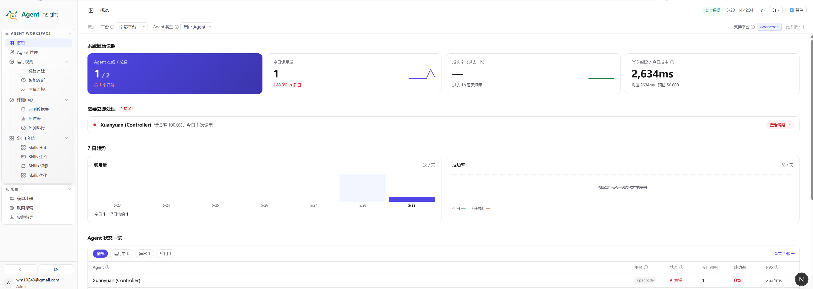
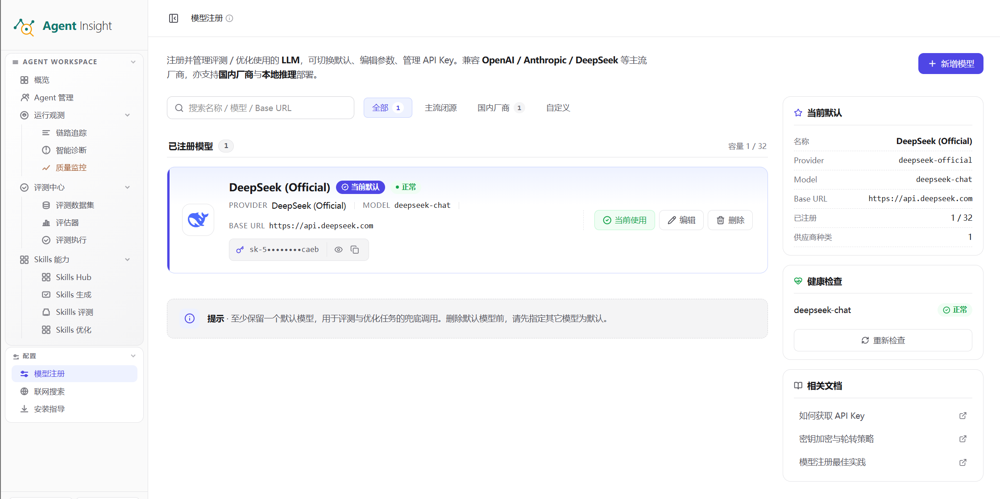
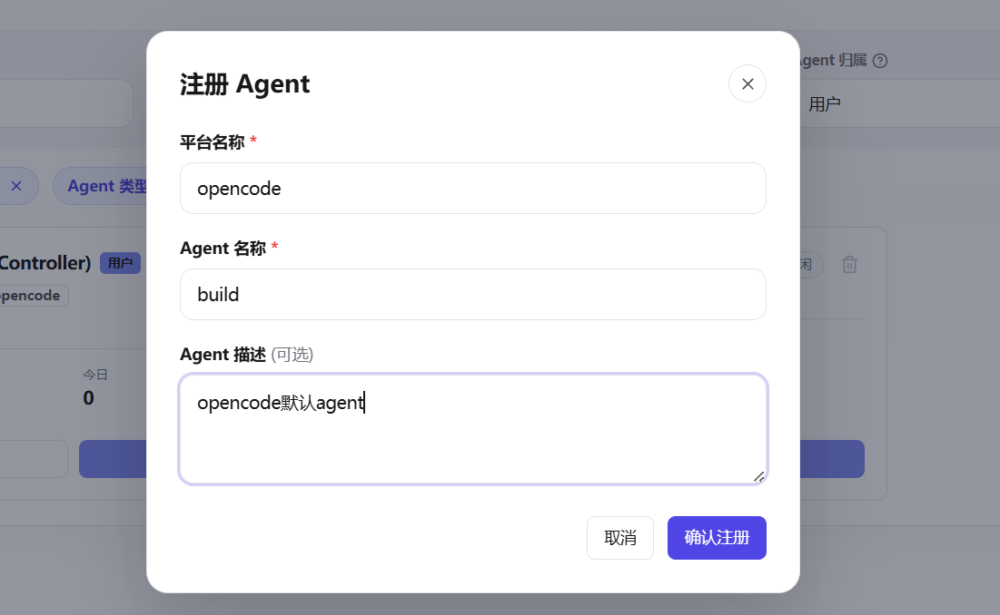
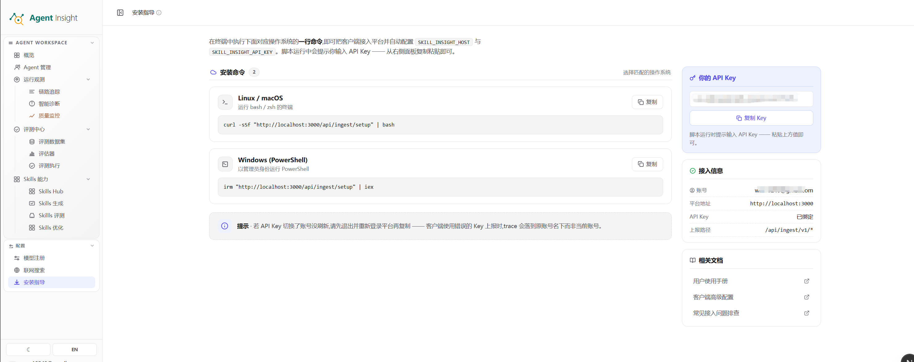
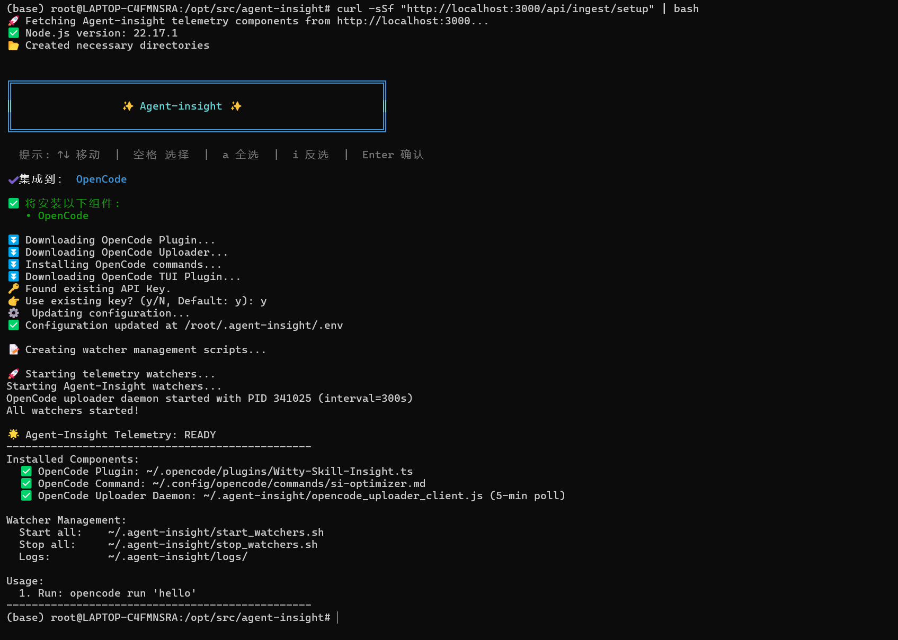
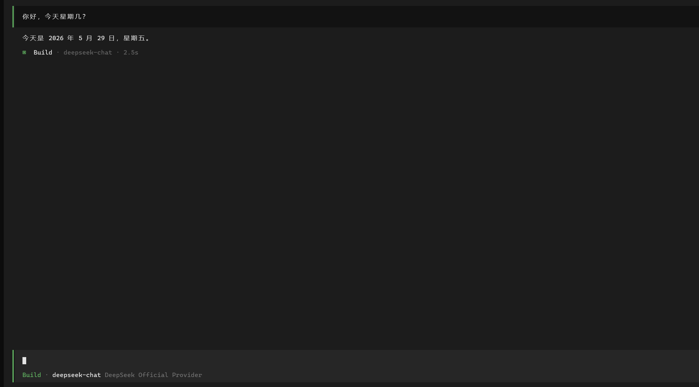
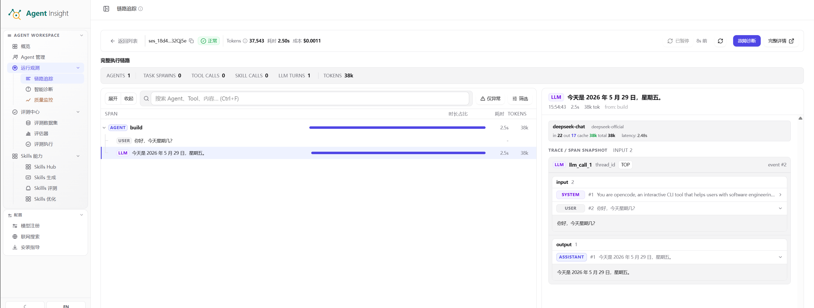

This tutorial completes the first Agent Insight workflow: configure a model, connect an Agent, and inspect its real execution. The sidebar **Quick start (快速开始)** groups available entry points into onboarding, observability, evaluation, diagnosis, and optimization. The steps below cover onboarding.

You will finish with a registered Agent, a usable model configuration, and a real uploaded Trace. UI labels are shown with their Chinese names where useful.

## Prerequisites

- Access to the deployed dashboard, for example `http://localhost:3000` or your self-hosted address.
- A usable model API Key, such as OpenAI, DeepSeek, or another supported provider.
- An Agent environment to connect, with runtimes prepared according to that framework's installation guide.

If the dashboard is not deployed, follow [Docker deployment, Chinese](../../../zh/how-to/platform/deploy-docker.md) first. If a service already exists, use the administrator's address.

## Recommended path

1. Sign in and confirm the Workspace.
2. Configure a model under **Model registration (模型注册)**.
3. Register an Agent under **Observability → Agents (运行观测 → Agent 概览)**.
4. Complete **Settings → Client installation (配置 → 客户端安装)**.
5. Trigger a real execution and locate its Trace.

For a custom code integration, first check [Trace HTTP ingestion](../../reference/observability/trace-ingestion.md) and the framework guide for protocol and identity requirements.

Agent RAS on Linux, WSL, or macOS needs Python 3.10+, pip, and shared libpython. OpenCode 1.x installation enables RAS by default; `AGENT_INSIGHT_RAS=0` skips it. Native Windows does not enable in-process RAS; use WSL for OpenCode and the installation command. See [framework compatibility, Chinese](../../../zh/reference/observability/client-compatibility.md) for version-specific behavior.

## Step 1: Sign in and confirm the Workspace

Open the dashboard and sign in using the configured deployment mode:

- Default `LOGIN_MODE=standalone`: enter your email on the login page.
- `LOGIN_MODE=idaas_oauth`: choose unified identity login and authenticate through IDaaS. Its unique UUID becomes the local account and data owner. The sidebar prefers an account alias when provided, otherwise the UUID. Signing out and back in returns to unified authorization.
- Legacy `ORGANIZATION_MODE=true`: keep using the existing organization gateway and Cookie flow; this is different from IDaaS OAuth.

With `scripts/develop_start.sh`, IDaaS mode checks status for readiness without creating an `admin` Key. Existing client Keys remain intact; obtain a missing Key from installation guidance after first login.

The OpenCode upload Key must belong to the account currently viewing data, for both ordinary and reliability Traces. If local keyless development explicitly uses `AGENT_INSIGHT_DEFAULT_INGEST_USER`, match the actual `User.username`: email in standalone mode or UUID in IDaaS mode, not an unrelated `admin` alias.

Confirm that the sidebar includes Quick start, Observability, Agents, Evaluation, Diagnosis, Optimization, and Settings. Use distinct Agents for development, staging, and production when maintaining several environments.

## Step 2: Register a model

Open **Settings → Model registration (配置 → 模型注册)**:

1. Choose register/add model.
2. Select the provider.
3. Enter the API Key and required endpoint.
4. Choose **Test connection and save (测试连接并保存)**.

This supplies the model dependency for generation, diagnosis, and evaluation. If connection testing fails, resolve it before proceeding; many analysis and Skill workflows require a working model. See the [model test API](../../reference/platform/model-connection-test.md) for deadline and error semantics.

## Step 3: Register an Agent

Open **Observability → Agents (运行观测 → Agent 概览)**, register an Agent, enter its name and requested details, then save and open its detail page.

Use the name of the Agent actually used by the client so execution data can be shown correctly. OpenCode's default Agent names include `plan` and `build`.

## Step 4: Install the client

Open **Settings → Client installation (配置 → 客户端安装)**:

1. Select the Agent framework.
2. Copy the generated Linux curl command.

3. Run it in Bash/Zsh on the Linux host where that Agent runs.
4. Check the configuration result. The command includes the current account Key, so it need not be entered again.

The installation command writes the platform address and Key. Shared collector updates, framework differences, and OpenCode 1.x/2.x migration are covered in [client compatibility, Chinese](../../../zh/reference/observability/client-compatibility.md). Use that reference and the framework guide when capabilities are missing or Trace ingestion times out.

## Step 5: Verify a Trace

Send a real, simple request through the Agent, for example OpenCode:

Return to **Observability → Traces (运行观测 → 链路追踪)** and locate the new record.

Confirm a new Trace appears, basic status/duration/Token information is available, and its detail page can expand the Trace tree and Spans. Tools and child Agents should appear when the execution used them. Start by proving that data arrives and the main steps are readable; complete field coverage is a later check.

If nothing appears after about 30 seconds, check the collector log (`~/.agent-insight/logs/opencode_uploader.log` for OpenCode), client-to-server connectivity, selected Workspace, and whether the client Key belongs to the viewing account. Continue with the [FAQ, Chinese](../../../zh/how-to/platform/faq.md) if needed.

## Continue

- [Run your first evaluation](../evaluation/01-first-experiment.md).
- [Platform overview, Chinese](../../../zh/explanation/platform/product-overview.md) and [core concepts, Chinese](../../../zh/explanation/platform/core-concepts.md).
- [Model registration, Chinese](../../../zh/how-to/platform/settings/model-registry.md) and [client installation, Chinese](../../../zh/how-to/platform/settings/access-control.md).
- [Observability, Chinese](../../../zh/explanation/observability/overview.md), [evaluation, Chinese](../../../zh/explanation/evaluation/overview.md), and [Skill workbench, Chinese](../../../zh/explanation/optimization/skills/workbench-overview.md).

[中文权威版本](../../../zh/tutorial/platform/01-quick-start.md)
