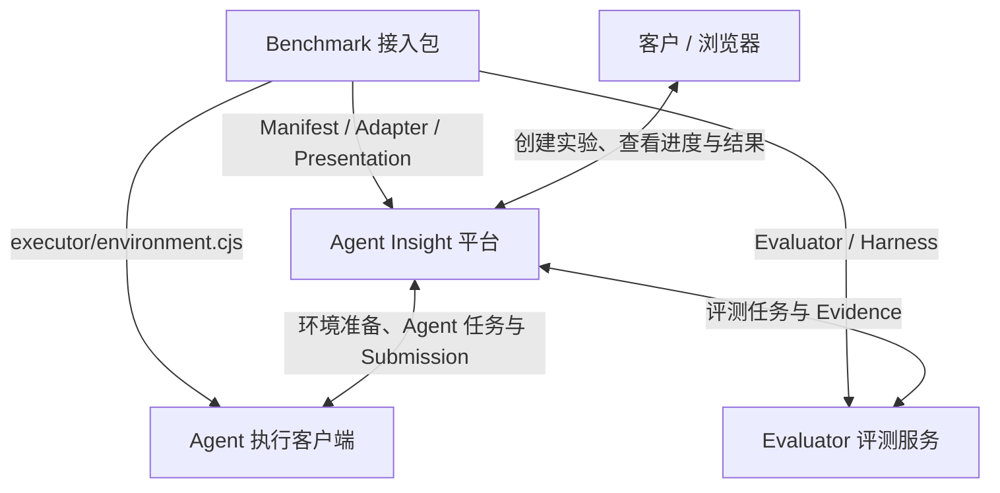

这是 Benchmark 接入开发与部署的文档入口。自定义接入从需求确认开始；部署已有接入包时先安装公共服务，再选择同级的 SWE-bench 或 ZSoft 部署指南。

## 文档关系

| 文档 | 用途 |
|---|---|
| [《自定义 Benchmark 接入指南》](../../../how-to/evaluation/benchmarks/onboard-custom-benchmark.md) | 帮助客户用自然语言描述需求，并与 AI 确认评测目标、数据边界和成功标准 |
| [《Benchmark 接入开发规范》](../../../how-to/evaluation/benchmarks/develop-benchmark.md) | 指导 AI 或开发者实现 Manifest、Adapter、执行环境准备、Evaluator、Presentation 和测试 |
| [《Benchmark 通用服务部署指南》](../../../how-to/evaluation/benchmarks/deploy-services.md) | 安装平台、执行客户端和 Evaluator，配置通信、共享镜像池、并发与公共运维 |
| [《SWE-bench 部署指南》](../../../how-to/evaluation/benchmarks/deploy-swe-bench.md) | 安装 SWE-bench 数据集，配置 Case 源码与评测镜像，完成验收 |
| [《ZSoft 部署指南》](../../../how-to/evaluation/benchmarks/deploy-zsoft.md) | 安装 ZSoft 数据集，配置原生任务目录、固定评测资产与内核加速，完成验收 |
| [《ZSoft 评测资产发布指南》](../../../how-to/evaluation/benchmarks/release-zsoft-assets.md) | 维护者构建、冻结、发布 userspace 和内核资产，供部署者消费固定版本 |
| 本文档 | 说明需求确认、接入开发和服务部署的完整流程 |

```text
客户描述自然语言需求并提供已有材料
                  │
                  ▼
《自定义 Benchmark 接入指南》
AI 阅读材料、提出方案，并通过少量问答生成接入确认单
                  │
             客户确认业务含义
                  │
                  ▼
《Benchmark 接入开发规范》
AI 开发 benchmarks/<key> 接入包并完成测试
                  │
                  ▼
《Benchmark 通用服务部署指南》
部署平台、执行客户端和 Evaluator
                  │
          ┌───────┴───────┐
          ▼               ▼
《SWE-bench 部署指南》 《ZSoft 部署指南》
安装各自数据、执行环境与评测资产
          └───────┬───────┘
                  ▼
客户验收所选 Benchmark 的成功、失败和异常场景
```

SWE-bench 与 ZSoft 是并列的 Benchmark；MCTS、OpenCode 等是 Agent Runtime。Runtime 接入见对应指南，不改变 Benchmark 文档层级。构建发布与日常部署分开，具体机器地址、账号、发布目录和实测记录由部署方在项目文档之外管理。

## 服务关系

一个 Benchmark 接入包会被平台、Agent 执行客户端和 Evaluator 分别使用，它本身不是独立服务。三个运行角色可以分机部署，也可以部署在同一台机器；实际地址和端口由部署配置决定。

| 角色 | 主要功能 |
|---|---|
| Agent Insight 平台 | 安装数据集、加载 Manifest/Adapter、创建实验、调度任务、保存 Artifact、归一化结果并展示 |
| Agent 执行客户端 | 按数据集和所选 Agent 检查、准备运行环境，再准备工作区、执行公开 Case 并上传 Submission |
| Evaluator 评测服务 | 获取 Submission 和私有评测契约，运行 Benchmark Harness，上传进度、报告输出、Evidence 和原生结果 |
| Benchmark 接入包 | 提供 Manifest、Schema、Adapter、执行端环境模块、Evaluator、Presentation 和测试，不单独维护一套平台流程 |
| 浏览器 | 创建实验和查看公开 Case、状态、指标及受控 Artifact，不接收私有 Case 数据 |

接入包与运行服务的组成关系：



图中保留英文名称，是为了与代码、配置字段和日志保持一致；对应含义如下：

| 英文词汇 | 中文含义 | 在接入中的作用 |
|---|---|---|
| Benchmark | 评测基准 | 一组有统一任务定义和判分规则的评测 Case |
| Case | 评测样例 | 一次独立执行和判分的数据单元 |
| Manifest | 接入清单 | 声明 Benchmark 标识、能力、提交物、Evaluator、资源和展示配置 |
| Schema | 数据结构约束 | 校验原始 Case 和 Evaluator 原生结果的字段与类型 |
| Adapter | 适配器 | 把 Benchmark 业务数据转换为平台任务，并将评测结果归一化 |
| Presentation | 展示配置 | 定义页面列名、顺序、主指标文案和文件友好名称 |
| Evaluator | 评测器 | 接收提交物并执行具体判分逻辑 |
| Tests | 自动化测试 | 验证接入包契约、正常流程和异常边界 |
| Dataset | 数据集 | 保存已安装的 Case 和冻结后的公开展示字段 |
| Catalog | 接入目录 | 构建时自动发现并注册 Manifest、Adapter、执行端环境模块和 Evaluator |
| Controller | 评测控制器 | 接收评测任务，选择 Evaluator，并管理进度、超时和回传 |
| Entrypoint | 执行入口 | Evaluator 对外提供的统一命令行入口 |
| Harness | 评测程序 | 实际运行测试、比对答案或计算指标的业务程序 |
| Artifact | 文件产物 | 平台统一管理的 Submission 或 Evidence 文件 |
| Evidence | 评测证据 | Evaluator 产生的报告输出、测试输出和运行日志等文件 |
| Cleanup | 资源清理 | 记录进程、容器和临时资源是否清理完成 |
| UI | 用户界面 | 创建实验并展示状态、结果、文件和趋势 |
| Workspace | 工作区 | Agent 执行任务和修改文件的隔离目录 |
| Policy | 执行策略 | 控制工作区写入、网络和隐藏数据访问边界 |
| Runtime | 运行环境 | 启动并管理具体 Agent 的执行实现 |
| Collector | 产物采集器 | 从 Agent 执行结果中生成规定的 Submission |

创建实验前，用户在第二步 Trace 来源点击“下一步”，平台通过现有客户端通道触发执行环境检查；可自动准备的组件由客户端安装并复查，需要 API 配置或权限时在向导底部提示。已满足的环境直接放行，不增加向导步骤。执行环境准备模块及接口见[接入开发规范第 5.5 节](../../../how-to/evaluation/benchmarks/develop-benchmark.md#55-执行环境准备协议)。

环境就绪并创建实验后，一次 Case 的数据与任务流转关系：

```text
客户 / 浏览器
    │ ① 创建实验、选择数据集、Agent 和模型
    ▼
Agent Insight 平台
    │ ② Agent Task：公开任务数据 + Workspace + Submission 契约
    ▼
Agent 执行客户端
    │ ③ 回传进度、Trace、Submission 和执行终态
    ▼
Agent Insight 平台
    │ ④ Adapter 校验 Submission，生成冻结的 EvaluationJob
    ▼
Evaluator 评测服务
    │ ⑤ 拉取 Submission，使用私有评测契约运行 Harness
    │ ⑥ 回传进度、报告输出、Evidence、Raw Result 和 Cleanup
    ▼
Agent Insight 平台
    │ ⑦ Adapter 归一化，平台存储并聚合结果
    ▼
客户 / 浏览器：查看结论、指标、评分点、文件和趋势
```

数据流中的主要对象：

| 英文词汇 | 中文含义 |
|---|---|
| Agent Task | Agent 执行任务，包含公开任务数据、工作区、执行策略和提交契约 |
| Submission | Agent 的提交物，例如代码 Patch 或接入包声明的其他文件 |
| EvaluationJob | 评测任务，包含冻结上下文、Submission 描述、私有评测数据和资源限制 |
| Trace | Agent 执行轨迹，用于查看模型输出、工具调用和执行过程 |
| Raw Result | Evaluator 返回的 Benchmark 原生结果，之后由 Adapter 归一化 |
| Gold | 标准答案或权威参考数据，只供评测使用，不发送给 Agent |

完整运行过程如下：

1. 平台安装数据集，Adapter 将原始 Case 拆成 Agent 可见的公开数据和只供评测使用的私有数据。
2. 用户选择数据集、主机、Agent 等配置；第二步点击“下一步”时检查、准备执行环境，满足后继续并创建实验。
3. 平台向 Agent 执行客户端下发 Agent Task；客户端准备 Workspace，并通过选定的 Agent Runtime 执行任务。
4. Collector 从执行结果中生成 Submission，客户端将 Submission、Trace、进度和终态回传平台。
5. 平台校验 Submission，并由 Adapter 使用冻结的 Case、Artifact 和资源配置生成 EvaluationJob。
6. Evaluator 拉取 Submission，结合私有评测契约运行 Harness，再回传报告输出、全部 Evidence 和原生结果。
7. Adapter 将原生结果归一化为结论、分数、主指标和评分点；平台负责存储、趋势聚合和统一页面展示。

数据边界是固定的：Agent 和浏览器不能获得隐藏测试、Gold 答案或私有评测配置；Evaluator 只获得完成本次判定所需的数据和 Submission。

## 客户如何启动开发

第一步，把业务需求和已有材料发给 AI：

```text
我想把下面的评测场景接入 Agent Insight：
<用自然语言描述想评测什么，以及怎样大致算成功>

已有材料：
<数据、仓库、测试、脚本、文档或样例的位置>

请先阅读《自定义 Benchmark 接入指南》和《Benchmark 接入开发规范》，
检查已有材料并和我逐步确认需求。先生成 Benchmark 接入确认单，不要立即编码。
```

第二步，确认 AI 给出的接入确认单后开始开发：

```text
我确认这份 Benchmark 接入确认单，请按照《Benchmark 接入开发规范》实施并验证。

如果需求超出 agent-task/v1 或现有执行能力，请先说明需要扩展的公共能力，
不要添加 Benchmark 专属的公共前后端分支。
```

客户不需要预先决定执行输出、Evaluator、运行环境或页面字段。AI 应根据已有材料提出方案；客户主要确认成功标准、敏感数据范围和业务限制。
