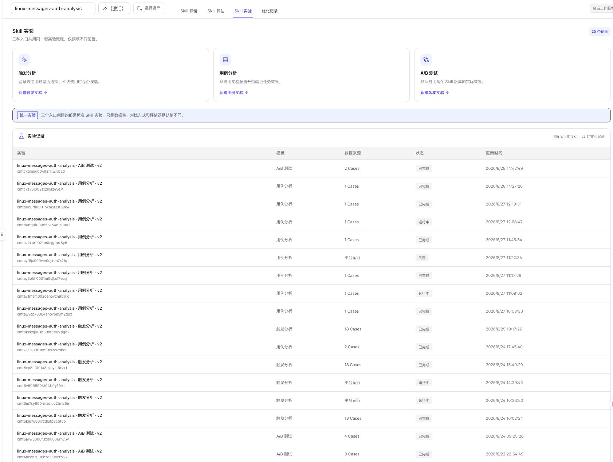

# Skill 评估与实验

Skill 工作台把质量验证分成两个页签：

- **Skill 评估**：检查当前快照或正式版本的内容质量，承担发布前静态质量门禁。
- **Skill 实验**：使用真实 Case、Trace 和评估器验证触发、任务效果以及版本差异。

两者都继承顶部选择的 Skill 和精确版本。切换版本后，结果和实验记录也随之切换。

## Skill 评估与 Skill 实验的区别

| 维度 | Skill 评估 | Skill 实验 |
| --- | --- | --- |
| 评测对象 | Skill 文件快照 | Skill 在 Agent 中的真实执行 |
| 是否需要数据集或 Trace | 不需要 | 需要数据集或已有 Trace |
| 主要结果 | 五个质量维度、问题清单、质量门禁 | 分数、触发率、误选/漏选、A/B 胜负和 Case 明细 |
| 典型用途 | 发布前检查、发现结构和安全问题 | 回归测试、效果验证、版本对比 |
| 可否用于未发布快照 | 可以 | 当前仅对正式版本开放 |

静态评估通过不代表真实效果一定提升；实验得分高也不能替代内容安全和工程健壮性检查。

## Skill 实验入口

打开目标正式版本的 **Skill 实验**页签，可以看到三种实验入口和当前版本的实验记录。

  

### 触发分析

验证当前 Skill 在应该使用时是否被选中、在不应该使用时是否被误选。入口会预置触发分析数据集和专用评估器。

### 用例分析

验证一批任务的最终结果与执行轨迹。可以选择已有 Trace，也可以从数据集 Case 重新生成 Trace，并按需选择结果或轨迹评估器。

### A/B 测试

在相同 Case 和评估器下比较两个 Skill 版本，或比较当前版本与无 Skill 基线。系统对 A、B 两侧自动配对后再统计分数与胜负。

## 统一四步向导

三个入口创建的都是标准 Skill 实验，只是默认配置不同。向导复用全局实验的四步流程：

1. **实验设计**
   - 自动带入当前 Skill 名称、版本和实验模板。
   - 选择待执行 Agent、数据集和实验类型。
   - A/B 测试还需要确定 A、B 两侧版本。
2. **Trace 来源**
   - 选择已有 Trace，或选择运行主机、模型与数据集 Case 生成新 Trace。
   - 触发分析和 A/B 测试默认生成新 Trace；用例分析默认选择已有 Trace。
3. **预期答案**
   - 已有 Trace 可以从数据集匹配参考答案和 Tool/Skill 目录。
   - 生成 Trace 时检查冻结的数据集快照。
4. **评估器与执行**
   - 查看冻结配置并选择可用评估器。
   - 触发分析固定使用 `skill-trigger-analyzer`；其他实验按模板预置常用评估器。

完整的 Trace 选择、数据集匹配和评估器门控说明见 [实验](../../../how-to/evaluation/experiments.md)。

## 实验记录

实验记录只展示顶部当前 Skill 和精确版本的数据，包括：

- 实验名称与 ID。
- 使用的模板。
- 数据来源或 Case 数。
- 运行状态。
- 创建时间（记录按创建时间倒序排列，实验运行或状态更新不会改变顺序）。

点击一条记录进入统一实验结果页。运行中、已完成和失败记录都会保留。

三种入口新建实验及“同配置实验”的默认名称均为“Skill 名称 · 模板 · 版本 · 当前日期时间”，日期时间与普通实验使用相同的 `YYYY-MM-DD HH:mm` 格式；手动输入的名称不追加时间。

触发分析、用例分析和 A/B 测试记录的操作列提供 **同配置实验**与**复用同配置**。前者沿用原实验选定的数据集、未删除的 Case、Skill 版本、评估器及客户端运行配置，先检查和准备该组合的运行环境，通过后创建新实验并自动运行；后者将配置带入四步向导，供检查和调整后再运行。原记录和结果不会被覆盖。旧记录缺少冻结的客户端或 Skill 文件时，需使用复用入口重新确认配置。

实验创建后，可在记录名称旁或结果页标题旁点击铅笔图标重命名。名称须为 1～120 个字符；修改名称不会改变 Skill 版本、实验配置或评测结果。

三类 Skill 实验使用执行客户端本机的 OpenCode 连接配置。OpenCode 1.19.3 的诊断输出会把 Key 和请求头脱敏为 `***`；新版客户端从本机原始 JSON/JSONC 配置恢复这些字段，支持 `{env:变量名}` 和 `{file:文件路径}`，不会把 `***` 当成真实 Key。文件引用相对于声明它的配置文件解析，环境变量必须在启动客户端的进程中可见。未显式配置 Key 时继续使用 OpenCode 自身的登录或环境变量认证。

如果提示“OpenCode 客户端连接配置不可用”，请检查执行客户端用户、配置文件、环境变量和引用文件。无法确定原始值、配置读取不完整或配置来源暂不支持时，实验会在请求模型前失败，不会改用其他凭据或模型。脱敏恢复主要验证版本为 1.19.3，兼容配置规则相同的 1.18.35；其他版本以及远程组织配置、MDM 托管配置暂不支持此恢复路径。修复需要同步更新并重启执行客户端，仅升级 OpenCode 或平台不足以生效。触发分析的连接配置在工作区租约期间保持不变；模型不可用后该工作区会被清理，修正配置后重新执行即可重新读取。

## 推荐验证顺序

1. 在 **Skill 评估**运行静态质量检查。
2. 使用 **触发分析**确认路由边界。
3. 使用 **用例分析**验证结果和轨迹。
4. 使用 **A/B 测试**确认新版本是否优于基线。
5. 把确认的问题交给 **Skill 优化**生成候选版本。
6. 发布新版本后，使用相同数据集和评估器复测。

用例详情显示“执行已结束，等待 Trace 完成上报”时，Agent 进程已经退出，但服务器尚未收到完整轨迹的结束标记，因此还不能开始评测。客户端会在 OpenCode 退出后定向补报本次 Trace；上传器也会重检尚未完成上报的会话，不依赖日志继续增长。此修复需要同时更新常驻客户端与 OpenCode 上传器。若最终回答提示输入文件不存在，应在所选执行主机上准备对应文件；执行进程正常退出不代表任务已经成功完成。

环境预检兼容 OpenCode 配置 JSON 前的插件日志，并通过本机临时文件完整读取较大的配置输出，不会仅因这些日志或 stdout 管道截断提示“模型配置无法读取”。若配置输出被截断、出现多个配置对象或带有无法确认的尾部内容，仍会阻止运行；请检查执行账号下的 OpenCode 与插件输出后重试。

## 下一步

- 查看静态质量与发布门禁：[Skill 评估](../../../how-to/evaluation/skills/static-compliance.md)
- 验证触发边界：[触发分析](../../../how-to/evaluation/skills/trigger-analysis.md)
- 验证任务效果：[用例分析](../../../how-to/evaluation/skills/use-case-analysis.md)
- 比较不同版本：[A/B 测试](../../../how-to/evaluation/skills/ab-test.md)
- 根据证据改进 Skill：[Skill 优化](../../../how-to/optimization/skills/optimize.md)

“同配置实验”的按钮在处理期间显示“环境检查中…”或“环境准备中…”，准备进度及配置问题显示在当前实验行的操作按钮下方。忙状态按实验行独立记录，不禁用其他行的操作。需手动配置时按提示在执行机完成配置，再点击“重试”。A/B 实验即使来源为已有 Trace，只要会执行 Agent 仍需检查。
