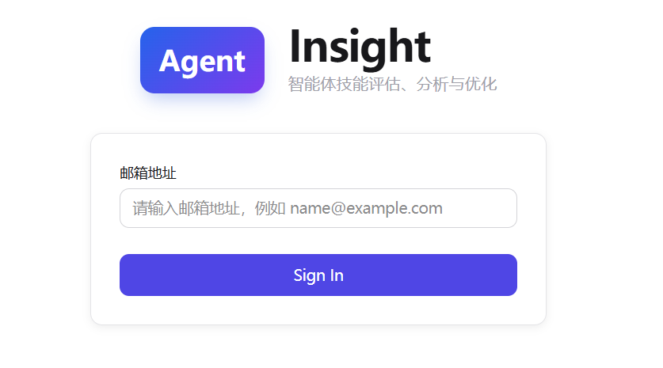
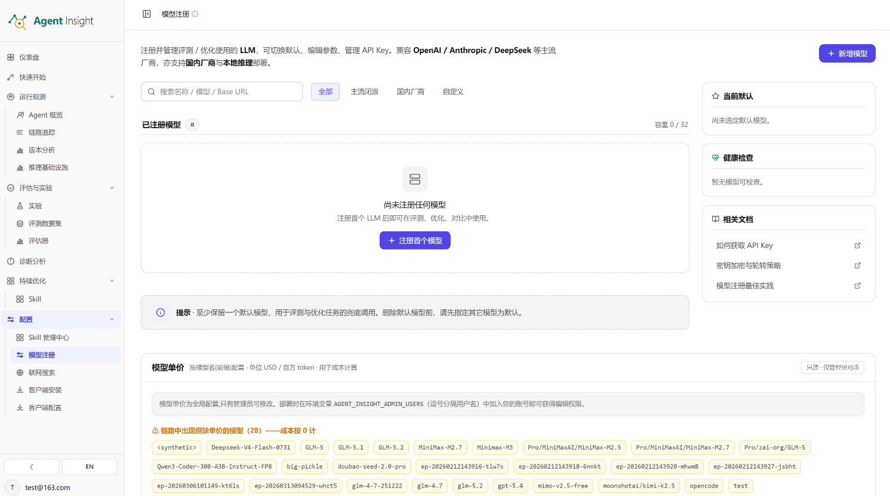
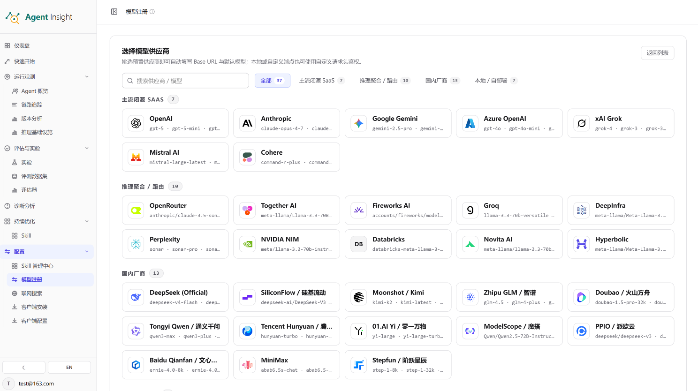
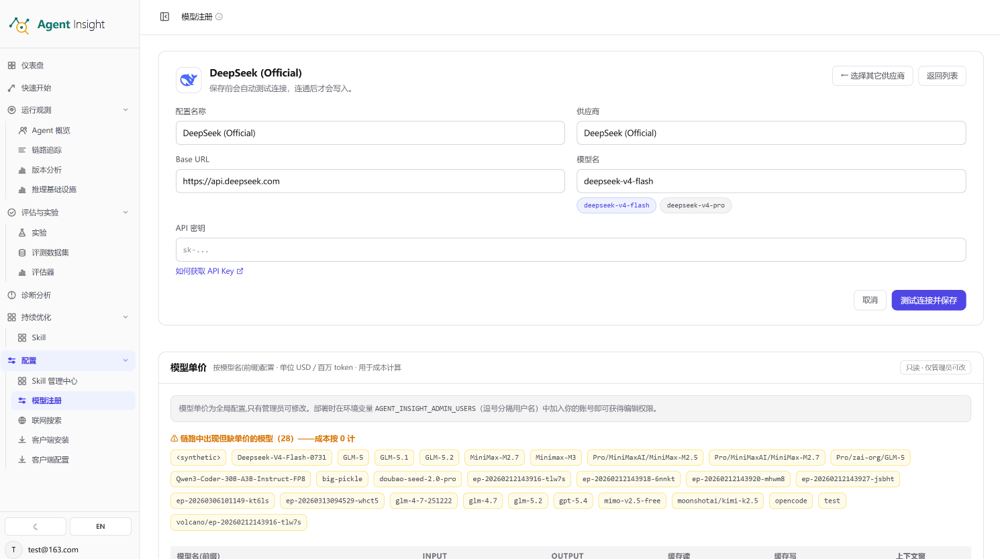
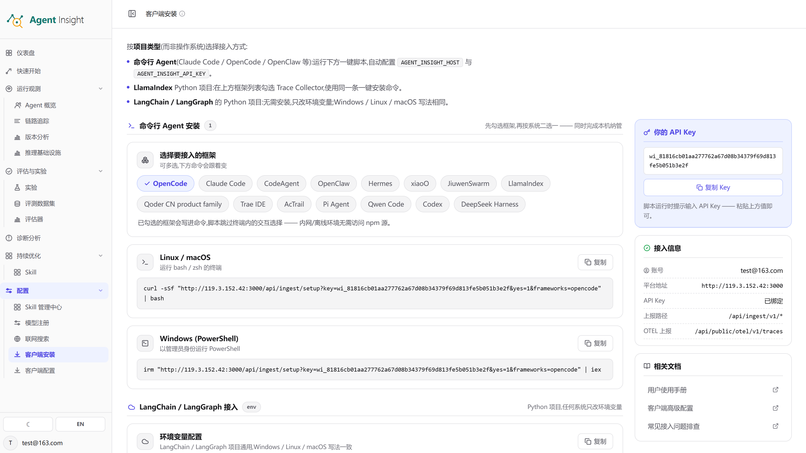
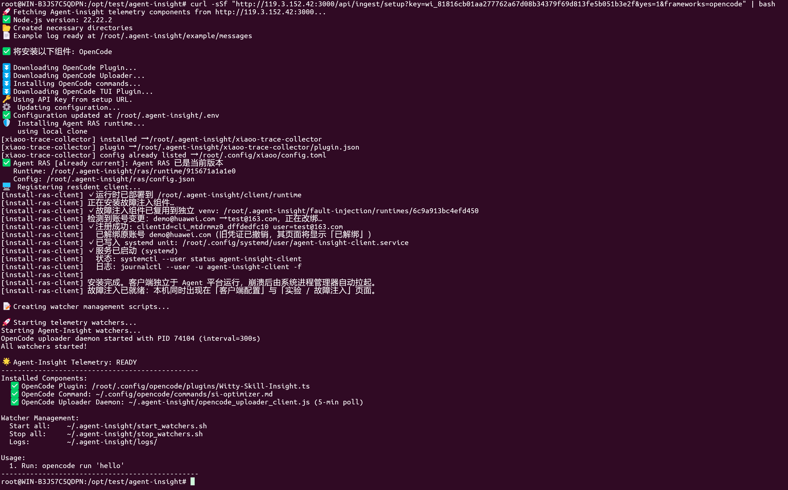
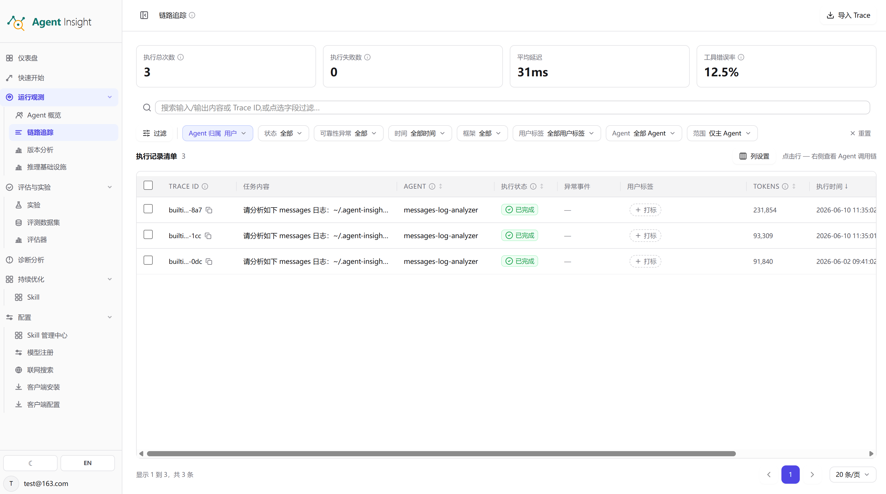
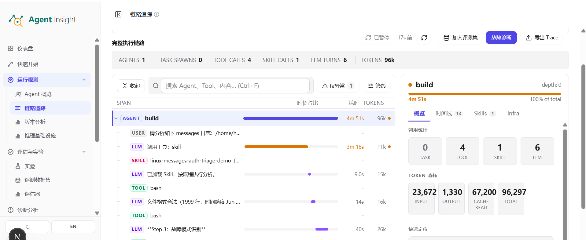

# 安装部署实战：从零搭建 Agent Insight 环境

Agent Insight 是开源 AgentOps 平台（观测 · 评测 · 诊断 · 优化 · 可靠性一体化），支持本地自主部署、运行数据自主可控。本篇从零走完最短完整路径：**基础环境 → 服务端安装 → 模型注册 → OpenCode 接入 → 第一条 Trace**。

**学习目标**：一个可访问的服务端（`http://localhost:3000`）、一个已设为默认的平台模型、一个完成接入的 OpenCode——链路追踪里出现自己的第一条 Trace。

---

## 前置：Windows 用户安装 WSL 2 与 Ubuntu

OpenCode 插件与 Agent RAS 组件在 Linux / WSL 环境最顺畅，Windows 用户先装好 WSL 2 再开始；Mac 用户直接进入操作步骤。

在管理员 PowerShell 执行：

```
wsl --install -d Ubuntu-24.04
```

按提示完成安装并重启，打开 Ubuntu 设置 Linux 用户名和密码，再用 `wsl --list --verbose` 确认 Ubuntu 行 **VERSION** 为 **2**（为 1 时执行 `wsl --set-version Ubuntu-24.04 2` 转换）。之后命令全部在 Ubuntu 终端执行；安装异常参考[微软 WSL 安装指南](https://learn.microsoft.com/zh-cn/windows/wsl/install)。

---

## 一、操作步骤

### 步骤 1：安装基础工具【Ubuntu 终端 / Mac 终端】

**Ubuntu**：

```
sudo apt update
sudo apt install -y curl ca-certificates git build-essential unzip lsof sqlite3 python3 python3-pip python3-venv python3-dev
```

检查 `git --version`、`python3 --version`（应为 3.10+，后续客户端组件也要用）。练习目录等放 `~/` 下，别放 `/mnt/c`。

**Mac**：

```
xcode-select --install        # 已装可跳过
brew install git python@3.12  # 无 brew 先按 brew.sh 安装
```

让终端优先使用刚装的 Python（zsh 用户把这行追加到 `~/.zshrc`）：

```
export PATH="$(brew --prefix python@3.12)/libexec/bin:$PATH"
```

检查 `git --version`、`python3 --version`（应为 3.12.x）。

### 步骤 2：安装 Node.js 22【Ubuntu 终端 / Mac 终端】

平台要求 Node.js ≥ 20.9.0，本篇通过 nvm 安装 22.x（Mac zsh 先执行 `touch "$HOME/.zshrc"`）：

```
curl -fsSL https://raw.githubusercontent.com/nvm-sh/nvm/v0.40.8/install.sh | bash
```

**重开终端**（Windows 重开 Ubuntu）后执行：

```
nvm install 22
nvm alias default 22
node --version
```

检查点：Node 显示 `v22.x.x`。Windows 用户另确认 `command -v node` 指向 `/home/用户名/.nvm/`，而不是 Windows 侧的 `.exe` 或 `/mnt/c/`。

### 步骤 3：安装并启动服务端【Ubuntu 终端 / Mac 终端】

**方式一：npm 快速部署（推荐，本篇主线）**

```
npx agent-insight install
```

一键安装会启动平台并执行 Agent 接入流程；选择 OpenCode 时会同时安装 Agent RAS inproc 插件（保存在 `~/.agent-insight/ras/runtime/`，重复安装复用当前版本）。OpenCode 与平台不在同一机器时，先启动平台，再到 OpenCode 机器执行看板"安装指导"生成的命令。

常用服务管理命令：

| 命令 | 说明 |
|---|---|
| `npx agent-insight start / stop / restart` | 启动（默认 3000 端口）/ 停止 / 重启 |
| `npx agent-insight start --port <端口>` | 指定端口启动 |
| `npx agent-insight status / logs` | 查看运行状态 / 日志 |
| `npx agent-insight install-ras` | 安装或更新 Agent RAS |

**方式二：Docker 镜像**

适合服务器部署、容器与数据目录分离（多架构镜像自动匹配 x86_64 / arm64）：

```bash
docker pull karaggagent/agent-insight:latest

mkdir -p ~/.agent-insight/data
chmod -R 777 ~/.agent-insight

docker run -d \
  --name agent-insight \
  --restart unless-stopped \
  -p 3000:3000 \
  -v ~/.agent-insight:/data/agent-insight \
  karaggagent/agent-insight:latest
```

版本锁定、离线导入等见 [Docker 部署指南](../../how-to/platform/deploy-docker.md)。容器只运行服务端，OpenCode 接入仍按步骤 6 执行；升级保留 `~/.agent-insight` 挂载目录即可复用数据。

**访问看板**：服务就绪后浏览器打开 `http://localhost:3000`（Windows 用 Windows 浏览器访问，服务运行在 Ubuntu 中），个人邮箱登录、登录即注册：



数据默认本地存储：SQLite 位于 `~/.agent-insight/data/witty_insight.db`；自定义路径在 `~/.agent-insight/.env` 设置 `DATABASE_URL`。

检查点：能进入看板并打开**链路追踪**等页面。

### 步骤 4：注册平台模型【平台看板】

进入 **模型注册**，单击 **注册首个模型**：



选择模型供应商：



填写模型名称、模型标识、服务地址及 API Key，单击 **测试连接并保存**，确认测试通过：



最后将常用模型设为 **默认**。

> **Warning**
> 平台模型用于评测、智能诊断和 Skill 优化；OpenCode 的模型配置需单独完成，两者不共用。不要把真实 API Key 放进代码仓库或公开的文档、截图。

### 步骤 5：安装并验证 OpenCode V2【Ubuntu 终端 / Mac 终端 + OpenCode】

```
npm install -g @opencode/cli
opencode --version
```

检查点：版本号为 2.x.x（旧版命令 `npm install -g opencode-ai` 不是 V2）。装过 V1 的先 `type -a opencode` 排查旧安装遮蔽，处理后重开终端。

创建练习目录并启动：

```
mkdir -p "$HOME/work/opencode-practice"
cd "$HOME/work/opencode-practice"
opencode
```

在 OpenCode 界面中依次输入：

> 这里的模型配置与步骤 4 的平台注册**用途不同、互不共用**：平台注册的模型供服务端的评测、智能诊断、Skill 优化调用；此处配置的模型供 OpenCode 对话与执行任务调用。可以是同一供应商的同一模型，但 Key 分别保存。

1. `/connect` —— 选择供应商，按提示完成认证；
2. `/models` —— 选择实际可调用的模型；
3. `hi` —— 等待正常回复。

检查点：能启动、能选模型、`hi` 有回复（自定义模型服务需按 V2 配置设置 Base URL，不能只填 API Key）。

### 步骤 6：接入 Agent 并验证第一条 Trace【平台看板 + 终端】

1. 在看板 **配置 → 客户端安装** 页面选择 OpenCode，复制生成的安装命令：



2. 在 OpenCode 所在机器的终端执行该命令，按提示完成插件安装：



3. 触发一次测试任务：

```
opencode run 'hello'
```

4. 回到看板 **运行观测 → 链路追踪**，确认出现新记录：



点击该 Trace 查看详情——调用树、各 Span 与消息内容：



检查点：有新 Trace、能展开、能看懂主要步骤。30 秒后仍无数据时，见文末常见问题。

### 完成检查

- [ ] Ubuntu 已安装且 VERSION 为 2（Windows 用户）
- [ ] 终端内 Git、Node.js 22.x、npm、Python 可用
- [ ] `http://localhost:3000` 能登录，**链路追踪**等页面可打开
- [ ] 平台模型测试通过并设为默认
- [ ] `opencode --version` 为 2.x.x，`hi` 有回复
- [ ] 接入完成，链路追踪能看到 `hello` 的 Trace

### 重新打开环境

```
npx agent-insight status   # 未运行时：npx agent-insight start
```

另开一个终端：

```
cd "$HOME/work/opencode-practice"
opencode
```

使用期间保持设备唤醒、网络连接与 WSL 运行，不要在采集与实验执行过程中关闭 WSL 或重启电脑。

### 常见问题

| 现象 | 处理 |
|---|---|
| node 路径指向 `.exe` 或 `/mnt/c/` | 用到了 Windows 侧的 Node.js；重开 Ubuntu 终端确认 nvm 生效，路径应位于 `/home/用户名/.nvm/` |
| 服务页面打不开 | `npx agent-insight status` 看状态、`npx agent-insight logs` 查日志；`curl -I http://localhost:3000` 验证端口；Windows 检查 WSL localhost 转发 |
| 3000 端口被占用 | `lsof -iTCP:3000 -sTCP:LISTEN` 查看并停掉占用程序；或用 `npx agent-insight start --port <端口>` 换端口 |
| `opencode --version` 不是 2.x.x | `type -a opencode` 查实际调用位置，处理 V1 遮蔽后重开终端 |
| `/connect` 认证失败或模型不存在 | 检查模型配置（含 Base URL 与模型标识）和网络；自定义服务不能只填 API Key |
| 接入后链路追踪没有数据 | 依次检查：客户端日志 `~/.agent-insight/logs/opencode_uploader.log` → 客户端到服务端网络 → Workspace 选择 → API Key 归属 |

---

## 二、延伸阅读

- [Docker 部署](../../how-to/platform/deploy-docker.md)——服务器与容器化部署完整说明
- [模型注册](../../how-to/platform/settings/model-registry.md)——供应商、协议与测试连接的完整说明
- [客户端兼容性参考](../../reference/observability/client-compatibility.md)——OpenCode 1.x / 2.x 迁移与各框架采集器差异
