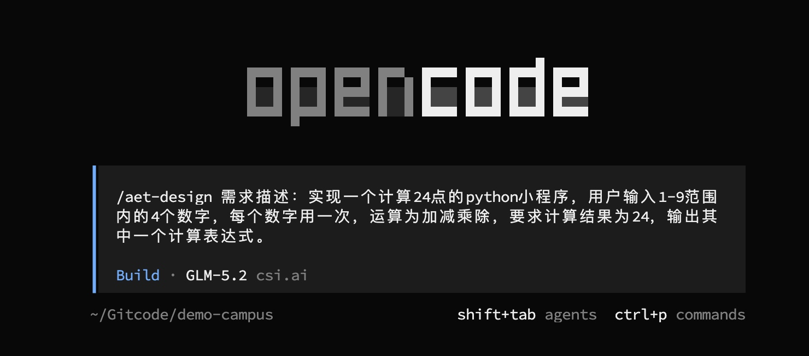
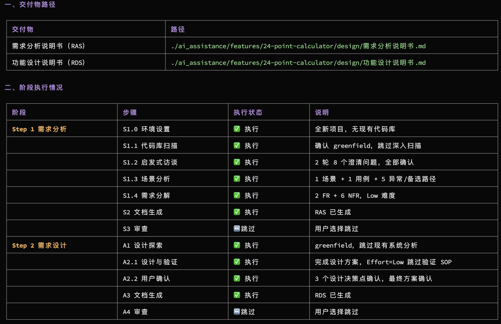
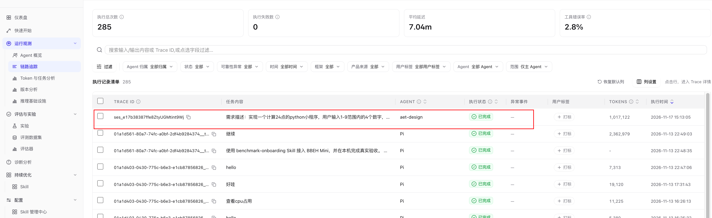
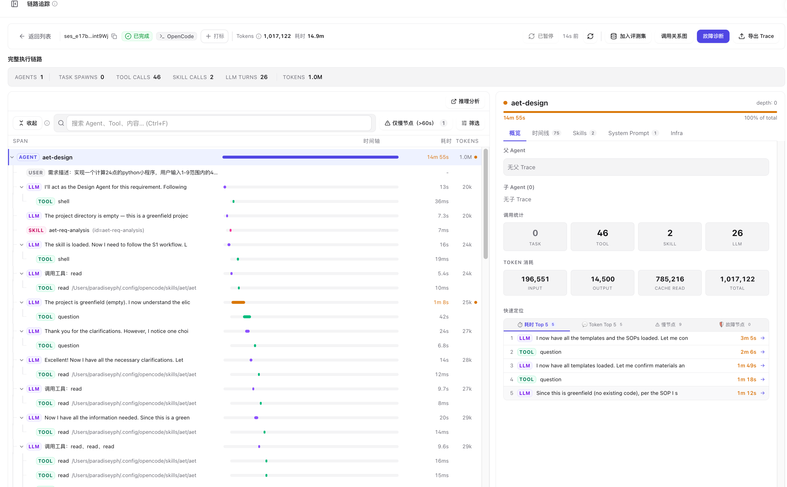

# 链路追踪实战：看懂一条真实 Trace

前置：已完成安装部署；全程约 20–30 分钟。

**链路追踪**用一条 Trace 记录 Agent 从收到任务到给出回复的执行过程。本篇在 OpenCode 里运行一次 AET 需求设计生成真实 Trace，再从三个角度读懂这次运行：

- **执行过程**：链路树按顺序展示用户输入、模型调用、Skill 和工具操作；点开节点查看这一环节记录的交互内容，例如执行了什么命令、工具返回了什么；
- **Token 用量**：看整次运行用了多少 Token，在概览里查看输入、输出和缓存读取等统计，或用 **Token Top 5** 找到用量较高的节点；
- **耗时和状态**：先看整次运行的状态和总耗时，再从时间轴或 **耗时 Top 5** 找到较慢的步骤，结合节点详情了解当时正在做什么。

**学习目标**：生成一条自己的 Trace → 在列表里定位它 → 在详情页读出 Token、耗时和一次关键交互，并保存 Trace ID 供后续诊断与评测使用。

---

## 一、操作步骤

以"24 点计算器"需求为例走一遍完整流程，共三步：运行任务、定位 Trace、查看详情。

### 步骤 1：运行一次 AET 需求设计【OpenCode 会话】

启动服务端与 OpenCode 后，在 OpenCode 输入 AET 命令：

```
/aet-design 需求描述：实现一个计算24点的python小程序，用户输入1-9范围内的4个数字，每个数字用一次，运算为加减乘除，要求计算结果为24，输出其中一个计算表达式。
```



运行过程中会有交互澄清，根据个人对需求的理解进行选择。执行完成后，生成《需求分析说明书》和《功能设计说明书》：



### 步骤 2：找到自己的 Trace【平台看板】

进入 **运行观测 → 链路追踪**：

1. 按任务关键词（如"24点"）或 Trace ID 搜索，也可以按时间和 Agent 筛选；
2. 点击对应的记录行，核对任务内容；
3. 打开详情后，保存页面链接或复制顶部的 **Trace ID**——后续的诊断与评测都使用它。



列表顶部指标卡、筛选区与表格字段的完整说明，见[链路追踪操作指南](../../how-to/observability/view-traces.md#列表页总览)。

### 步骤 3：查看用量、耗时和交互【平台看板】

在详情顶部查看 **Tokens** 和 **耗时**；左侧链路树按执行顺序展示模型、Skill 和工具节点；点开任意一个相关节点，在右侧查看详情，例如工具的输入和返回结果。



三个核对动作：

1. **Token**：记录总 Token；需要细分时在概览查看输入、输出和缓存读取统计，用 **Token Top 5** 找到用量较高的节点；
2. **耗时**：先看整次运行的状态和总耗时，再从时间轴或 **耗时 Top 5** 找到较慢的步骤，点开节点了解当时正在做什么；
3. **交互**：选一个工具节点，核对它的输入参数与返回结果是否与任务预期一致。

### 完成检查

- [ ] 已保存 Trace 链接或 Trace ID
- [ ] 记录了总 Token 和总耗时
- [ ] 选定一个节点，用一句话说明它做了什么

### 常见问题

| 现象 | 处理 |
|---|---|
| 列表里找不到自己的 Trace | 依次检查：客户端日志 `~/.agent-insight/logs/opencode_uploader.log` → 客户端到服务端网络 → Workspace 选择 → API Key 归属 |
| Trace 状态一直是"执行中" | 所有框架统一十分钟无上报兜底显示超时；确认 OpenCode 会话是否仍在运行，等待上报或重新执行任务 |

---

## 二、延伸阅读

- [链路追踪操作指南](../../how-to/observability/view-traces.md)——列表筛选、详情页与时间轴的完整说明

