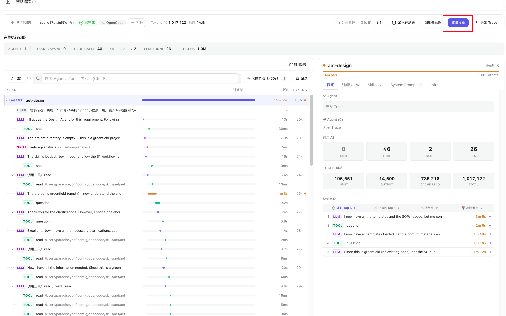
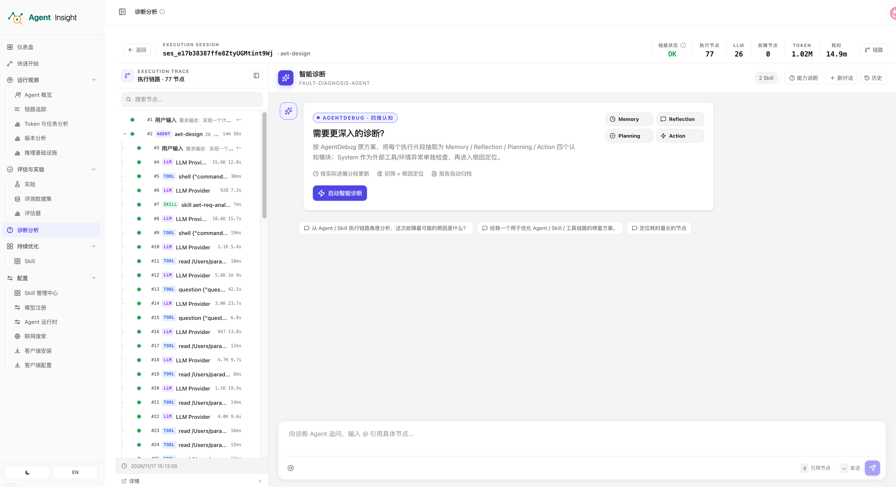
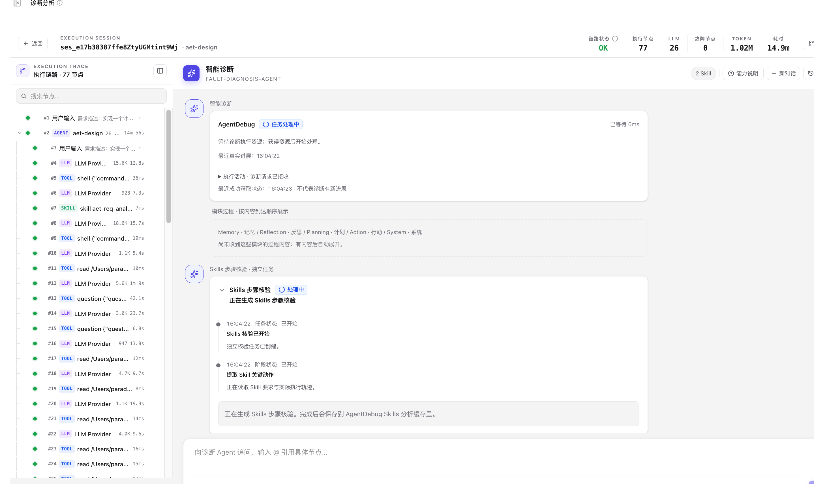
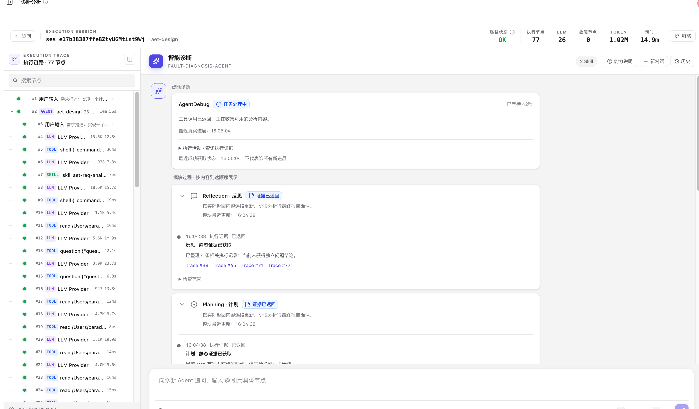
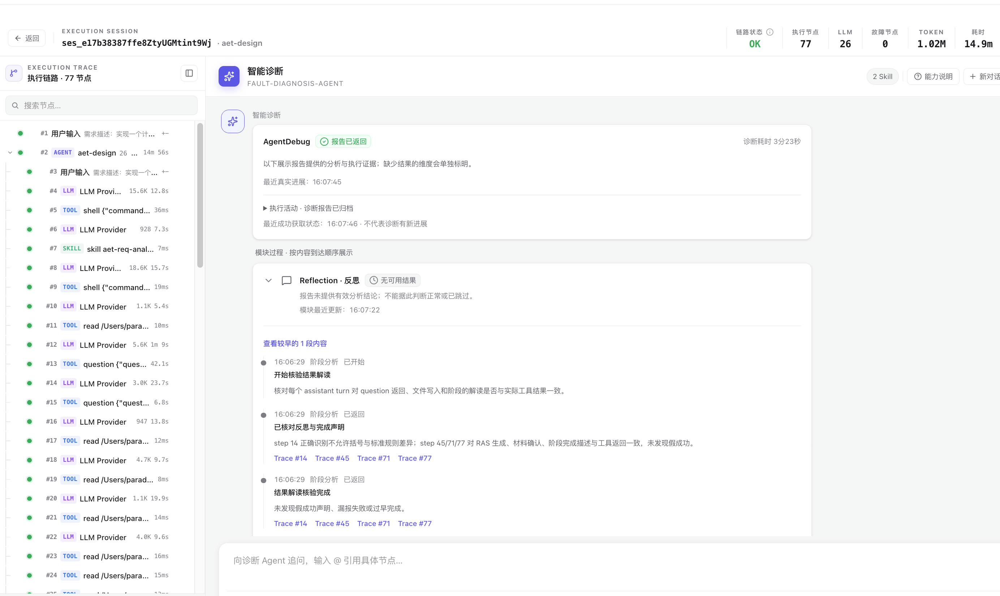
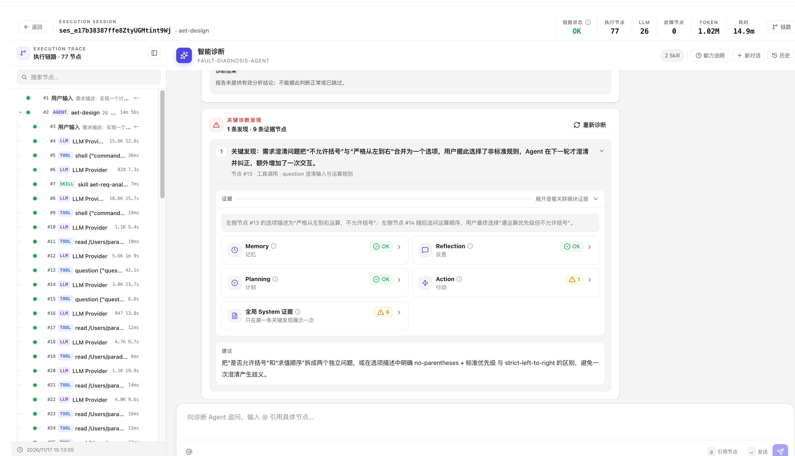
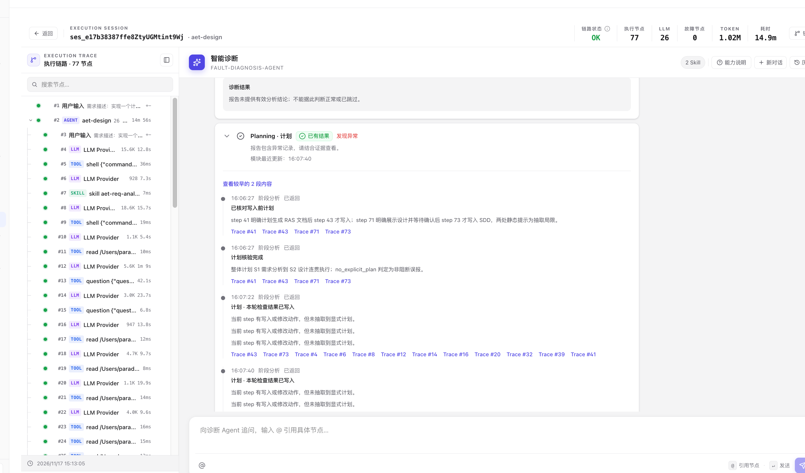

# 智能诊断实战：从 Trace 到五维归因

前置：链路追踪中已有一条执行记录；全程约 15–30 分钟，取决于诊断模型速度。

**智能诊断**从 Trace 读取执行记录，分析可疑行为或异常。报告给出**发现、关联证据和改进建议**，帮助你定位值得回查的步骤——它回答三个问题：问题发生在哪一层、证据来自哪里、建议如何继续处理。

本篇沿用链路追踪实战生成的那条 Trace：AET 为"24 点计算器"执行需求设计的完整链路——多轮澄清、两份文档生成、大量模型与工具调用，正适合看五维归因能从中查出什么。换成你自己的任何一条 Trace，流程完全相同。

主诊断从 **5 个维度**检查这次执行，包括 Agent 的 **4 个认知模块**和独立的 **System**（系统）检查：

| 维度 | 检查什么 | 常见问题举例 |
| --- | --- | --- |
| Memory（记忆） | 是否正确获取并沿用上下文 | 后续步骤漏掉了用户已明确的限制 |
| Reflection（反思） | 是否检查执行结果并在发现问题后纠正 | 测试失败后仍报告验证通过 |
| Planning（计划） | 任务拆解、步骤顺序和依赖是否合理 | 还没明确需求，就开始执行依赖该需求的步骤 |
| Action（行动） | 工具选择、调用参数和实际操作是否合适 | 选对了工具，但传入了错误的文件路径 |
| System（系统） | 外部工具和运行环境是否有异常 | 依赖缺失、权限不足或网络超时 |

这 5 个维度是检查范围。报告根据实际证据给出发现，部分维度可能没有明确结论。若页面提供 **Skills 步骤核验**，还可以查看实际执行是否覆盖了相应 Skill 的关键步骤。

**学习目标**：从一条 Trace 发起智能诊断 → 等待报告返回 → 展开一条关键发现 → 回到执行链路核对证据节点。

---

## 一、操作步骤

### 步骤 1：打开故障诊断【平台看板】

在 **运行观测 → 链路追踪** 打开链路追踪实战保存的 Trace 详情（AET 生成 24 点计算器设计文档的那条），点击右上角的 **故障诊断**。

### 步骤 2：启动智能诊断【平台看板】

在 **诊断分析** 页点击 **启动智能诊断**，等待 **AgentDebug** 显示 **报告已返回**。已有报告时可以直接查看。

启动后主诊断与 Skills 步骤核验并行运行：页面约每 3 秒查询一次进度，工具调用、静态证据与模块阶段摘要分段出现，无需等待整份报告完成。过程中会陆续看到三种状态：

**诊断任务处理中**——各认知模块进入"检查中"：

**模块证据已返回**——模块卡片显示"证据已返回 / 已收到阶段内容"，结论待最终报告确认：

**报告已返回**——最终报告到达，模块卡片转入"已有结果"：

### 步骤 3：阅读报告并核对证据【平台看板】

在 **关键诊断发现** 中展开一条发现，查看证据和建议，再回到左侧执行链路核对对应节点。遇到 `Trace #编号` 链接时，可以点击跳转到相应节点。

以 Planning（计划）模块为例，展开模块卡片可以看到该维度收到的证据段与节点引用：

### 完成检查

- [ ] 记录这条 Trace 的一条诊断发现、对应节点和一项改进或验证建议
- [ ] 报告没有给出明确发现时，记下报告状态，再选一个节点说明你核对了什么

### 常见问题

| 现象 | 处理 |
|---|---|
| 报告读取、解析或校验失败 | 页面会显示失败原因，可直接重新诊断；本地服务进程在分析中途重启时任务不会续跑，需重新分析 |
| 显示"未形成关键发现" | 不代表执行没有问题——5 个维度是检查范围，报告只对有证据的问题下结论 |
| 诊断长时间无进展 | 若模型服务较长时间只有心跳而无真实诊断进展，后台会主动中止该次运行并显示失败；确认平台评测模型可用后重新分析 |
| Skills 步骤核验显示"已跳过" | Trace 未关联 Skill，或当前账号在 Skill 管理中心找不到关联 Skill；注册后可回 Trace 点"重新核验" |

---

## 二、延伸阅读

- [智能诊断操作指南](../../how-to/diagnosis/agent-debug/diagnosis.md)——六个区块、故障模式与 Skills 步骤核验的完整说明
- [将诊断发现用于 Skill 优化](../../how-to/diagnosis/agent-debug/diagnosis.md#将诊断发现用于-skill-优化)——诊断结论转向优化计划的衔接

