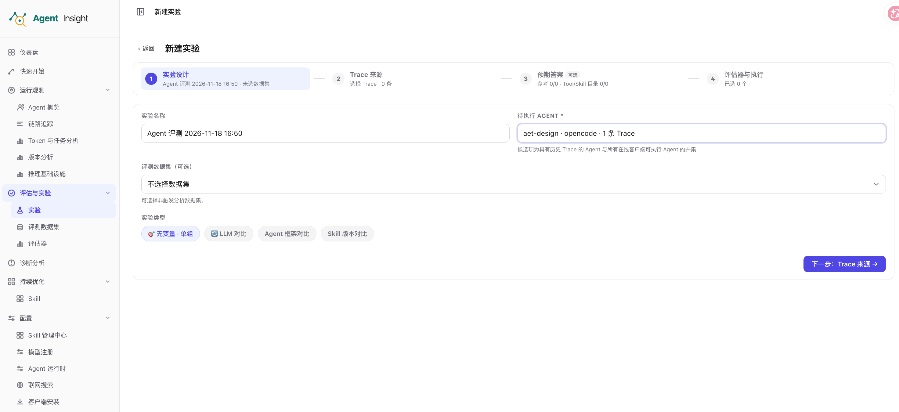
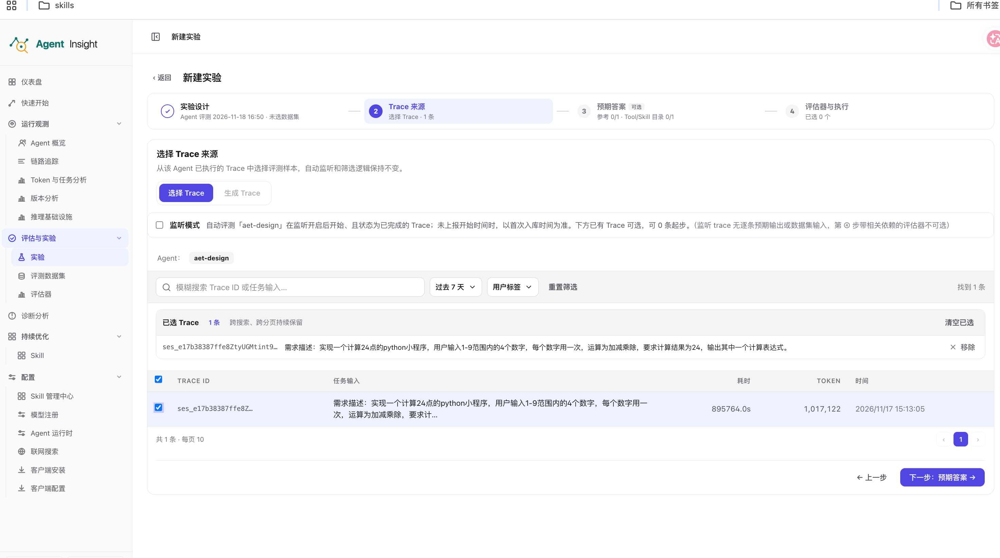
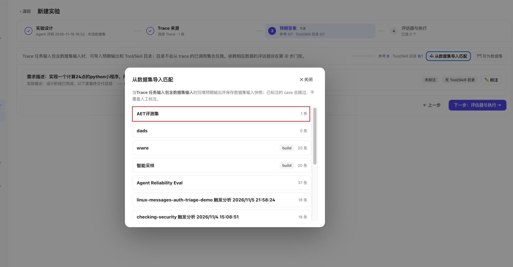
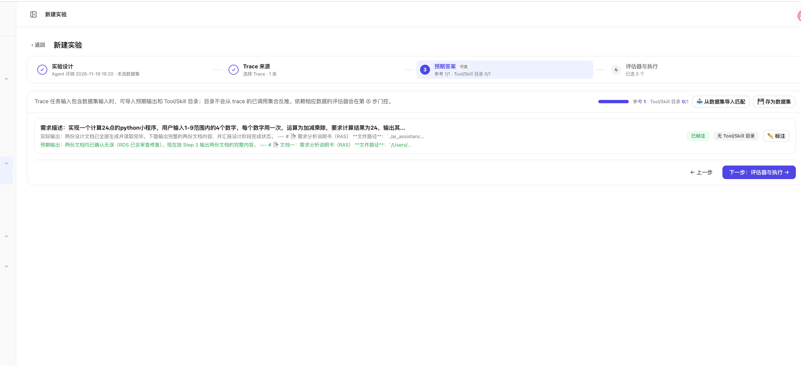
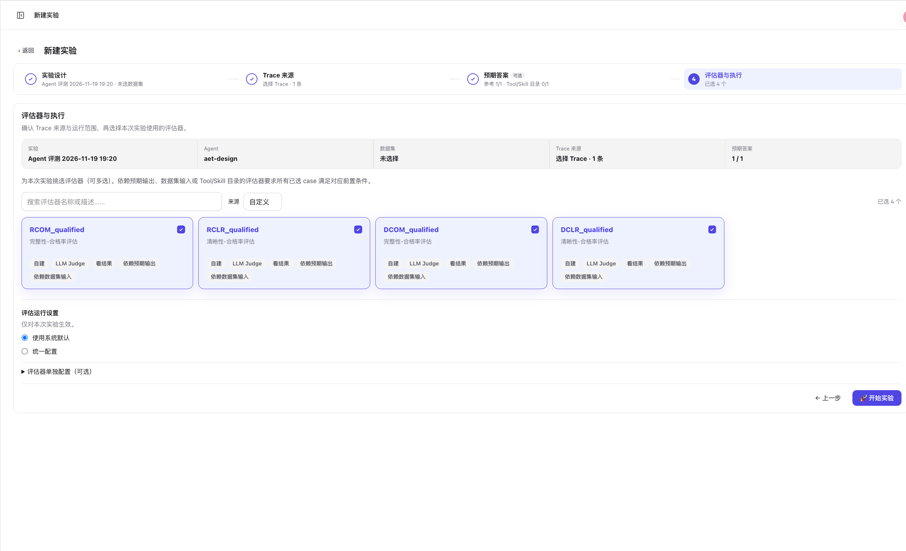
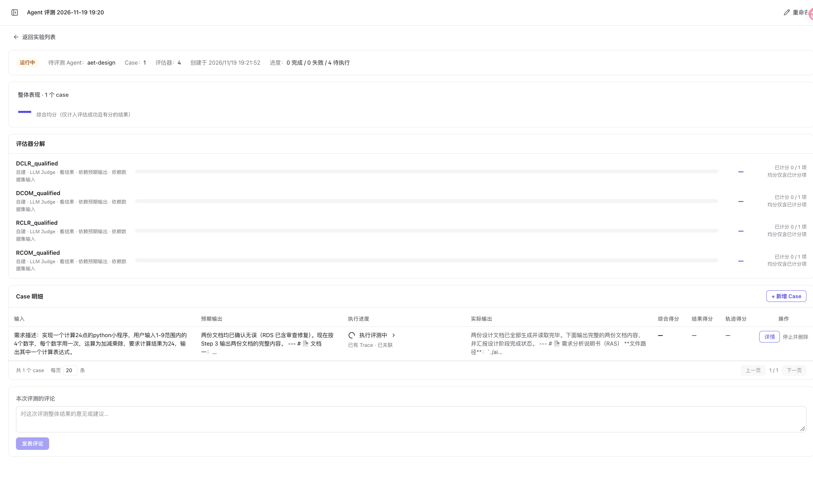
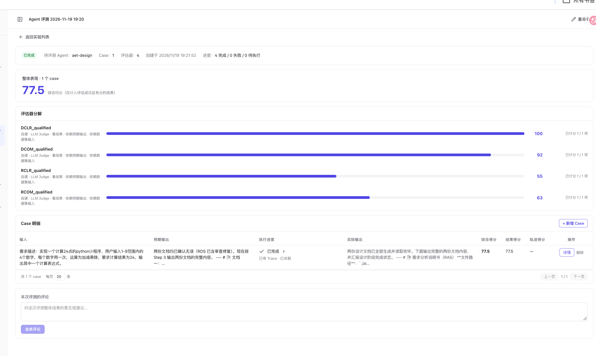
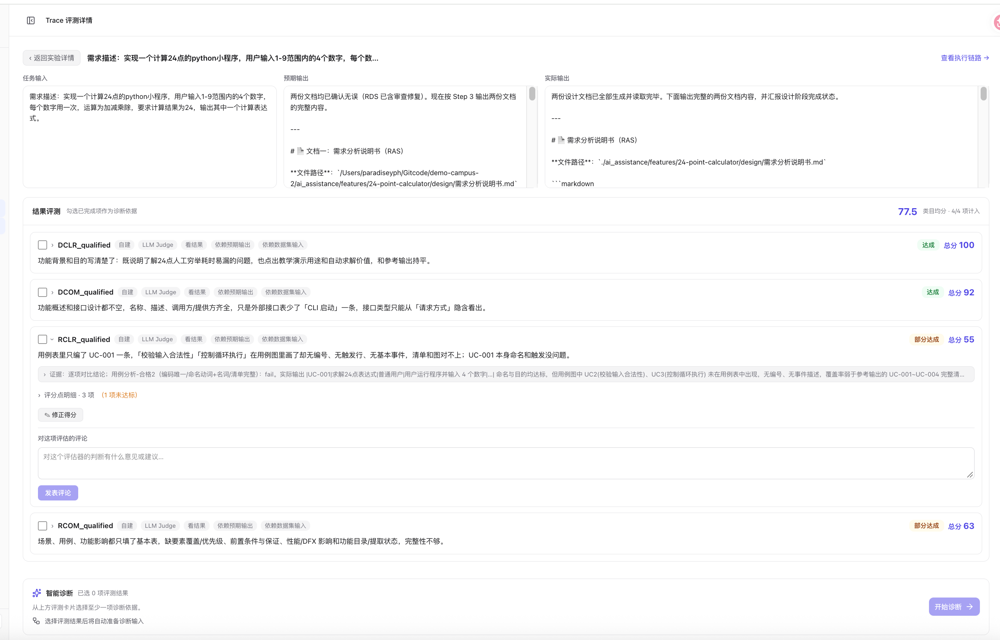

# 设计评估实战：给 AET 设计文档打分

前置：链路追踪中已有一条执行记录，且平台已设默认评测模型；全程约 40–60 分钟。

用四个**自建评估器**检查链路追踪实战中 AET 生成的《功能设计说明书》和《需求分析说明书》。每个评估器按自己负责的标准，逐项比对**实际输出**（Trace 最终回复里的说明书正文）和**参考输出**（评测集里的参考说明书），给出通过情况与判分证据：

| 评估器 | 检查内容 | 检查项数 |
| --- | --- | --- |
| 功能设计清晰度（DCLR） | 功能背景、目的或使用场景是否说清楚 | 1 |
| 功能设计完整度（DCOM） | 功能概述和接口设计是否齐全 | 3 |
| 需求分析清晰度（RCLR） | 用例编号、命名、目的和触发条件是否清楚 | 2 |
| 需求分析完整度（RCOM） | 场景、用例和功能影响等内容是否齐全 | 16 |

**学习目标**：创建评测集并导入数据 → 配置四个自建评估器 → 新建实验关联已有 Trace 与参考输出 → 读出四项得分并核对判分依据。

---

## 一、操作步骤

### 步骤 1：准备这条 Trace 和评测集【平台看板】

打开链路追踪实战中的 Trace，确认最终回复包含两份说明书正文。如果回复只有摘要或文件路径，在原 OpenCode 会话请 AET 将两份正文合在一条回复里输出，再到链路追踪确认回复已更新。

进入 **评估与实验 → 评测数据集**，点击 **新建评测集**：选择 **理想输出评测集**，**名称** 填 **AET评测集**，点击 **保存评测集**。在数据项页面点击 **批量导入**，上传 [AET 评测集](./assets/aet-evalset.json)。导入后打开数据项，确认有任务输入和两份参考说明书。

评估器运行时用到三类内容：

| 评估器用到的内容 | 从哪里来 |
| --- | --- |
| 数据集输入 | 评测集中的任务输入，用于匹配 Trace 的原始用户需求 |
| 实际输出 | Trace 最终回复里的两份说明书正文 |
| 参考输出 | 评测集同一数据项的预期输出，含两份参考说明书正文 |

### 步骤 2：配置四个自建评估器【平台看板】

进入 **评估与实验 → 评估器 → 自建评估器**。对下面四组配置各做一次：

1. 点击 **新建自定义评估器**，按对应小节填写 **名称** 和 **描述**，**类目** 选 **看结果**；
2. 把该小节代码框中的整段文字粘贴到 **评估提示词**——三个双花括号变量原样保留，由平台在运行时替换；额外评分点保持默认；
3. 保存评估器。四个都建好后，核对列表里的名称，再进入下一步。实验使用已设为默认的平台评测模型。

#### 功能设计清晰度_评估

**名称**  `DCLR_qualified`
**描述**  清晰性-合格率评估

~~~text
你是一位资深软件功能设计评审专家，正在评审「功能设计说明书」中清晰性（DCLR）维度的合格率。

【清晰性维度定义】
清晰性（DCLR）：职责、交互与依赖明确

【本评估器覆盖的合格标准评估项】（共 1 条）
1. 功能概述-合格标准2：描述该功能背景和目的，内容可能包括功能相关需求的需求背景、解决什么问题、使用场景、方案特点和价值或符合什么标准或协议
   归类依据：背景、目的与使用场景表述

【结构化检查清单】
请按以下检查项逐条对比「实际输出」与「参考输出」，每项给出 pass 或 fail，并引用实际输出和参考输出中的具体内容作为证据：

1. 功能概述-合格2：描述该功能背景和目的，内容可能包括功能相关需求的需求背景、解决什么问题、使用场景、方案特点和价值或符合什么标准或协议 —— 判定标准：对比实际输出与参考输出，实际输出满足该评估标准且达到或优于参考输出则 pass，未满足或明显弱于参考输出则 fail

【评分规则】
合格率 = 通过的合格项数 ÷ 合格项总数 × 100%
合格项总数 = 1
请先逐项判定 pass/fail，再统计通过数，最后按公式计算合格率。

数据集输入：
{{dataset_input}}
实际输出：
{{output}}

参考输出（作为对比基准）：
{{reference_output}}

**重要提示**：
注意：你只需要评估清晰性维度的合格标准评估项，不要评价优秀标准评估项或其他维度。
对每个检查项，必须先在实际输出和参考输出中分别定位到对应内容，再对比判断 pass/fail，不要凭整体印象评分。
你应当扮演一位公正无私（IMPARTIAL）的评委，尽可能保持客观（OBJECTIVE）。
避免任何位置偏差（POSITION BIASES），确保回答的呈现顺序不会影响你的判断。
~~~

#### 功能设计完整度_评估

**名称**  `DCOM_qualified`
**描述**  完整性-合格率评估

~~~text
你是一位资深软件功能设计评审专家，正在评审「功能设计说明书」中完整性（DCOM）维度的合格率。

【完整性维度定义】
完整性（DCOM）：需求、流程与异常有设计

【本评估器覆盖的合格标准评估项】（共 3 条）
1. 功能概述-合格标准1：内容不为空
   归类依据：功能概述存在性
2. 实现接口设计-合格标准1：接口设计内容不为空
   归类依据：接口设计存在性
3. 实现接口设计-合格标准2：内容完备，接口名称、接口描述、接口类型、所属系统元素内容全面
   归类依据：接口名称、描述、类型及所属元素信息覆盖

【结构化检查清单】
请按以下检查项逐条对比「实际输出」与「参考输出」，每项给出 pass 或 fail，并引用实际输出和参考输出中的具体内容作为证据：

1. 功能概述-合格1：内容不为空 —— 判定标准：对比实际输出与参考输出，实际输出满足该评估标准且达到或优于参考输出则 pass，未满足或明显弱于参考输出则 fail
2. 实现接口设计-合格1：接口设计内容不为空 —— 判定标准：对比实际输出与参考输出，实际输出满足该评估标准且达到或优于参考输出则 pass，未满足或明显弱于参考输出则 fail
3. 实现接口设计-合格2：内容完备，接口名称、接口描述、接口类型、所属系统元素内容全面 —— 判定标准：对比实际输出与参考输出，实际输出满足该评估标准且达到或优于参考输出则 pass，未满足或明显弱于参考输出则 fail

【评分规则】
合格率 = 通过的合格项数 ÷ 合格项总数 × 100%
合格项总数 = 3
请先逐项判定 pass/fail，再统计通过数，最后按公式计算合格率。

数据集输入：
{{dataset_input}}
实际输出：
{{output}}

参考输出（作为对比基准）：
{{reference_output}}

**重要提示**：
注意：你只需要评估完整性维度的合格标准评估项，不要评价优秀标准评估项或其他维度。
对每个检查项，必须先在实际输出和参考输出中分别定位到对应内容，再对比判断 pass/fail，不要凭整体印象评分。
你应当扮演一位公正无私（IMPARTIAL）的评委，尽可能保持客观（OBJECTIVE）。
避免任何位置偏差（POSITION BIASES），确保回答的呈现顺序不会影响你的判断。
~~~

#### 需求分析清晰度_评估

**名称**  `RCLR_qualified`
**描述**  清晰性-合格率评估

~~~text
你是一位资深软件需求分析评审专家，正在评审「需求分析说明书」中清晰性（RCLR）维度的合格率。

【清晰性维度定义】
清晰性（RCLR）：规则与条件无歧义

【本评估器覆盖的合格标准评估项】（共 2 条）
1. 用例分析-合格标准2：所有用例的编码唯一、目的明确、用例清单完整，用例命名规范：动词+名词，清晰表达主执行者目标
   归类依据：命名规范、目的明确
2. 用例分析-合格标准5：所有用例的触发事件描述不能为空，且必须有效
   归类依据：触发清楚

【结构化检查清单】
请按以下检查项逐条对比「实际输出」与「参考输出」，每项给出 pass 或 fail，并引用实际输出和参考输出中的具体内容作为证据：

1. 用例分析-合格2：所有用例的编码唯一、目的明确、用例清单完整，用例命名规范：动词+名词，清晰表达主执行者目标 —— 判定标准：对比实际输出与参考输出，实际输出满足该评估标准且达到或优于参考输出则 pass，未满足或明显弱于参考输出则 fail
2. 用例分析-合格5：所有用例的触发事件描述不能为空，且必须有效 —— 判定标准：对比实际输出与参考输出，实际输出满足该评估标准且达到或优于参考输出则 pass，未满足或明显弱于参考输出则 fail

【评分规则】
合格率 = 通过的合格项数 ÷ 合格项总数 × 100%
合格项总数 = 2

请先逐项判定 pass/fail，再统计通过数，最后按公式计算合格率。

数据集输入：
{{dataset_input}}
实际输出：
{{output}}

参考输出（作为对比基准）：
{{reference_output}}

**重要提示**：
注意：你只需要评估清晰性维度的合格标准评估项，不要评价优秀标准评估项或其他维度。
对每个检查项，必须先在实际输出和参考输出中分别定位到对应内容，再对比判断 pass/fail，不要凭整体印象评分。
你应当扮演一位公正无私（IMPARTIAL）的评委，尽可能保持客观（OBJECTIVE）。
避免任何位置偏差（POSITION BIASES），确保回答的呈现顺序不会影响你的判断。
~~~

#### 需求分析完整度_评估

**名称**  `RCOM_qualified`
**描述**  完整性-合格率评估

~~~text
你是一位资深软件需求分析评审专家，正在评审「需求分析说明书」中完整性（RCOM）维度的合格率。

【完整性维度定义】
完整性（RCOM）：能力、约束与范围齐全

【本评估器覆盖的合格标准评估项】（共 16 条）
1. 场景分析-合格标准1：场景清单内容不为空
   归类依据：场景要素覆盖
2. 场景分析-合格标准2：场景清单应汇总本需求涉及的所有场景，标识变更类型、场景编号、名称、要素覆盖和优先级
   归类依据：全量场景覆盖与要素标识
3. 场景分析-合格标准3：每个场景包含场景名称、场景描述、参与者(Actor)、影响因素、生命周期、活动
   归类依据：场景要素完整性
4. 用例分析-合格标准1：对每个IR进行用例分析（UseCase），用例分析内容不能为空，至少包含一个受影响的用例
   归类依据：全IR覆盖
5. 用例分析-合格标准3：用例结构完整：Actor、用例简述、前置条件、触发事件、成功保证、最小保证、主成功场景、扩展场景等内容完整
   归类依据：用例结构完整性
6. 用例分析-合格标准4：所有用例的主成功场景不能缺失，且有步骤编号
   归类依据：主场景覆盖完整性
7. 功能影响分析-合格标准1：功能影响列表不能为空，列表信息完整
   归类依据：影响列表覆盖
8. 功能影响分析-合格标准2：包含功能（含功能、性能、DFX等）增加、修改的列表
   归类依据：变更范围覆盖
9. 功能影响分析-合格标准3：功能清单完整：序号、功能编号、功能目录、功能项、变更点
   归类依据：清单要素完整
10. 功能影响分析-合格标准4：包含受影响功能的功能影响描述、提取状态为是
    归类依据：影响描述完整

【结构化检查清单】
请按以下检查项逐条对比「实际输出」与「参考输出」，每项给出 pass 或 fail，并引用实际输出和参考输出中的具体内容作为证据：

1. 场景分析-合格1：场景清单内容不为空 —— 判定标准：对比实际输出与参考输出，实际输出满足该评估标准且达到或优于参考输出则 pass，未满足或明显弱于参考输出则 fail
2. 场景分析-合格2：场景清单应汇总本需求涉及的所有场景，标识变更类型、场景编号、名称、要素覆盖和优先级 —— 判定标准：对比实际输出与参考输出，实际输出满足该评估标准且达到或优于参考输出则 pass，未满足或明显弱于参考输出则 fail
3. 场景分析-合格3：每个场景包含场景名称、场景描述、参与者(Actor)、影响因素、生命周期、活动 —— 判定标准：对比实际输出与参考输出，实际输出满足该评估标准且达到或优于参考输出则 pass，未满足或明显弱于参考输出则 fail
4. 用例分析-合格1：对每个IR进行用例分析（UseCase），用例分析内容不能为空，至少包含一个受影响的用例 —— 判定标准：对比实际输出与参考输出，实际输出满足该评估标准且达到或优于参考输出则 pass，未满足或明显弱于参考输出则 fail
5. 用例分析-合格3：用例结构完整：Actor、用例简述、前置条件、触发事件、成功保证、最小保证、主成功场景、扩展场景等内容完整 —— 判定标准：对比实际输出与参考输出，实际输出满足该评估标准且达到或优于参考输出则 pass，未满足或明显弱于参考输出则 fail
6. 用例分析-合格4：所有用例的主成功场景不能缺失，且有步骤编号 —— 判定标准：对比实际输出与参考输出，实际输出满足该评估标准且达到或优于参考输出则 pass，未满足或明显弱于参考输出则 fail
7. 功能影响分析-合格1：功能影响列表不能为空，列表信息完整 —— 判定标准：对比实际输出与参考输出，实际输出满足该评估标准且达到或优于参考输出则 pass，未满足或明显弱于参考输出则 fail
8. 功能影响分析-合格2：包含功能（含功能、性能、DFX等）增加、修改的列表 —— 判定标准：对比实际输出与参考输出，实际输出满足该评估标准且达到或优于参考输出则 pass，未满足或明显弱于参考输出则 fail
9. 功能影响分析-合格3：功能清单完整：序号、功能编号、功能目录、功能项、变更点 —— 判定标准：对比实际输出与参考输出，实际输出满足该评估标准且达到或优于参考输出则 pass，未满足或明显弱于参考输出则 fail

【评分规则】
合格率 = 通过的合格项数 ÷ 合格项总数 × 100%
合格项总数 = 16

请先逐项判定 pass/fail，再统计通过数，最后按公式计算合格率。

数据集输入：
{{dataset_input}}
实际输出：
{{output}}

参考输出（作为对比基准）：
{{reference_output}}

**重要提示**：
注意：你只需要评估完整性维度的合格标准评估项，不要评价优秀标准评估项或其他维度。
对每个检查项，必须先在实际输出和参考输出中分别定位到对应内容，再对比判断 pass/fail，不要凭整体印象评分。
你应当扮演一位公正无私（IMPARTIAL）的评委，尽可能保持客观（OBJECTIVE）。
避免任何位置偏差（POSITION BIASES），确保回答的呈现顺序不会影响你的判断。
~~~

### 步骤 3：新建实验，选择已有 Trace【平台看板】

1. 在 **评估与实验 → 实验** 点击 **新建实验**。填写实验名称，在 **待执行 Agent** 选择该 Trace 所属的 Agent，实验类型选 **无变量 · 单组**，评测数据集保持 **不选择数据集**——参考输出在后面的「预期答案」页再关联。

   

2. 在 **Trace 来源** 选 **选择 Trace**。用保存的 Trace ID 搜索并勾选对应记录，确认已选 1 条，再进入 **预期答案**。

   

3. 在 **预期答案** 点 **从数据集导入匹配**，选第 1 步创建的 **AET评测集**。

   

   确认页面显示 **参考 1/1**，并且该条记录的 **预期输出** 包含同一任务的两份参考说明书。若未匹配，回到 Trace 核对实际输入，并按第 1 步检查导入的数据项。

   

4. 进入 **评估器与执行**，选中第 2 步配置的四个评估器。确认 **已选 4 个**，点击 **开始实验**。

   

### 步骤 4：读四个得分【平台看板】

实验启动后，可以在实验详情页查看进度。

页面显示 **已完成** 后，确认进度为 **4 完成 / 0 失败 / 0 待执行**，在 **Case 明细** 点 **详情**。

在 **Trace 评测详情** 核对任务输入、参考说明书和 AET 输出的两份正文，再在 **结果评测** 里记录四个评估器各自的分数和理由（下图为演示结果，请记录实际跑出的结果）。

展开任意一项评估结果，在 **评分点明细** 查看逐项判断和证据。提示词要求用 **通过项数 ÷ 检查项总数 × 100** 算出得分——例如需求分析清晰度（RCLR）有 2 项，通过 1 项时合格率为 50%。

### 完成检查

- [ ] 实验详情中同一条 Trace 的四项得分均为有效得分
- [ ] 选一个评估器，指出一条通过或未通过的检查项，并用说明书里的具体内容解释判断依据

### 常见问题

| 现象 | 处理 |
|---|---|
| "预期答案"页未显示"参考 1/1" | 数据集输入与 Trace 实际输入不匹配；回到 Trace 核对原始用户需求，再按步骤 1 检查导入的数据项 |
| 页面总分与按明细复算不一致 | 分别记录页面总分和复算结果，核对逐项判定；可在 Case 详情填写理由并保存人工修正（评论只用于协作记录，不改变分数） |
| 某个评估器显示失败或没有分数 | 先查看错误信息，再对这一项点 **重评**（复用已有输出和 Trace，无需重新执行 Agent）；页面明确显示 **0** 时按 0 分记录 |
| 评估器提示未配置平台评测模型 | 点击 **去模型注册**，添加模型、测试连接并设为默认，返回后对失败项重评 |

---

## 二、延伸阅读

- [实验](../../how-to/evaluation/experiments.md)——实验向导各步骤的完整说明
- [评测数据集](../../how-to/evaluation/datasets.md) / [评估器](../../how-to/evaluation/evaluators.md)

