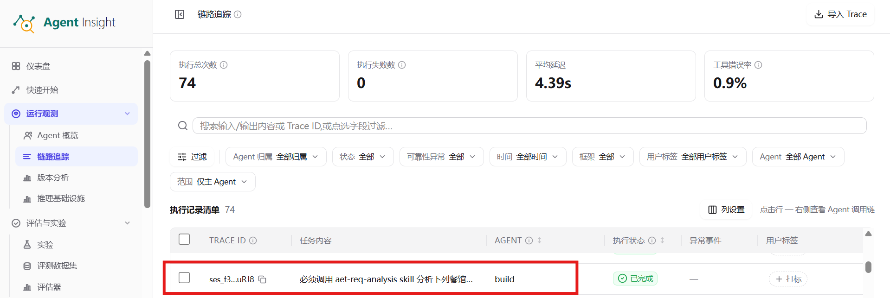
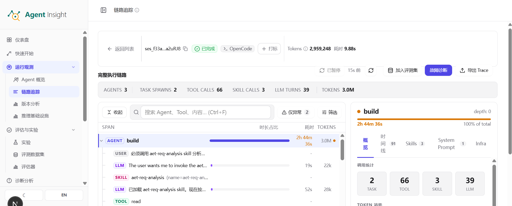
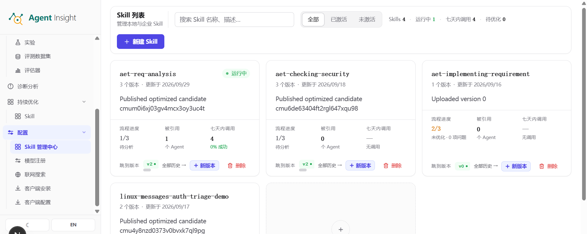
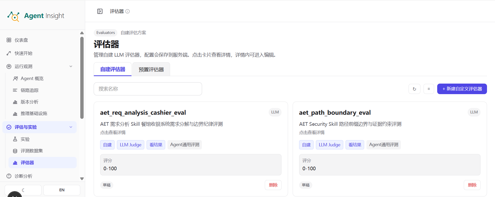
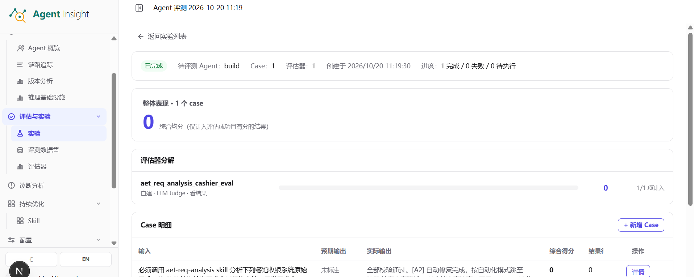
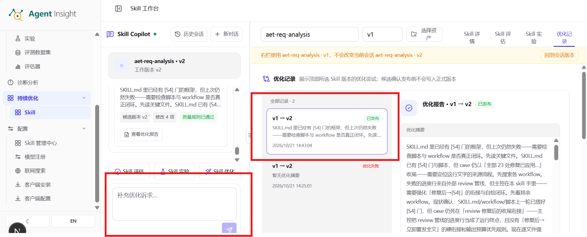
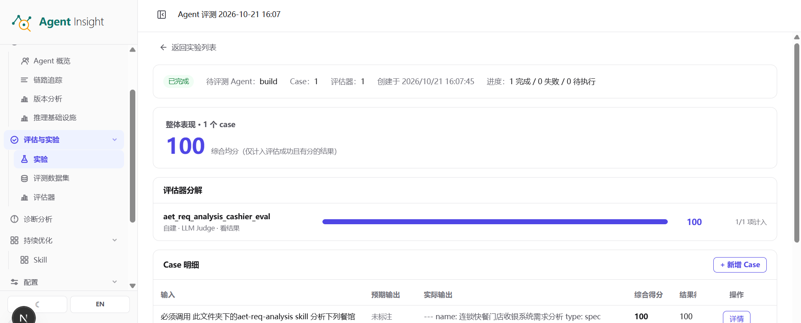

# Skill 优化实战：从 0 分到 100 分

前置：已完成安装部署；全程约 60–90 分钟，含两轮评测与至少一轮优化。

本篇以 `aet-req-analysis`（需求分析 Skill）为例：把一段口语化的"餐馆收银系统"原始需求交给 Skill，产出结构化的《需求分析规格文档》，再用评测驱动 Skill 从 0 分改到 100 分。走完完整闭环：**执行任务产生 Trace → 上传 Skill → 建评估器 → 实验评分 → 按证据优化 → 固定条件复测**。同样的流程适用于任何 Skill 的持续优化。

**学习目标**：跑出一条 Skill 执行 Trace → 建两道考题式的自建评估器 → 从 0 分证据里定位短板并复制附加诉求完成优化 → 固定条件复测拿到 100 分。

---

## 一、操作步骤

### 步骤 1：下发任务并产生 Trace【OpenCode 会话】

在准备好的工作文件夹（Skill 就放在该文件夹下）打开 OpenCode，输入任务全文：

```text
必须调用 aet-req-analysis skill 分析下列餐馆收银系统原始需求，按 Skill 结构输出需求分析规格文档。只做需求分析，不做系统设计，不修改任何文件。全程自动化执行：不等待用户交互，澄清问题按推荐选项自行决策并记录假设。需求清单必须包含功能性与非功能性需求，每条需求标注优先级，规格必须可验证。skill在此文件夹下，不要去其他文件夹下寻找。

原始需求（RR）：
"""
我们是做连锁快餐的，想给门店上一套收银系统，把现在手工开单那套换掉。情况是这样的：
1. 客人到店，服务员带位，收银员开台点餐，菜可以备注做法和忌口；中途要能加菜、退菜。
2. 菜单经常变，时令菜和估清的菜要能及时改，改完前厅马上生效。
3. 结账支持现金、微信、支付宝，可以组合支付；会员要能积分和储值，储值余额不够时先记账，下次一起还。
4. 折扣：会员折扣、满减、整单抹零，不能叠加，怎么算要讲清楚。
5. 退单重开要审批，不能收银员自己说了算；日末自动对账，交班时把当班账结清楚。
6. 老板要看每天的营业报表，最好手机上也能看；老板娘管会员，不想让别人看到储值数据。
7. 系统一定要稳，结账要快，不能让客人排队等。
以后可能接外卖平台，这期先不做。
"""
```

任务要求里每句话都有用：点名 Skill、划定"只做需求分析"的边界、要求无人值守自动决策、要求优先级标注与可验证规格——后面的评估器就按这些约束打分。

OpenCode 已接入平台，执行过程自动记录上传，任务跑完后 **链路追踪** 出现新记录：



点开可查看 Trace 详情：



### 步骤 2：上传 Skill【平台看板】

进入 **Skill 管理中心**，把本地 `aet-req-analysis` 上传到平台——后续的优化与版本管理都在平台上进行，完成后在 skill 列表可见：



### 步骤 3：配置评估器【平台看板】

评估器是评测的"尺子"。本例自建 `aet_req_analysis_cashier_eval`，只考两件事：

1. **活干全了没有（收银核心需求结构化分解）**：输出必须含功能性与非功能性需求清单，8 个核心场景一个不漏——开台点餐（含加菜退菜）、菜单即时维护、组合支付、会员积分与储值、折扣规则、退单审批、日末对账与交班、营业报表与数据权限；每条需求带 P0/P1/P2 优先级且结账主流程为 P0；规格用"当……时，系统应……"这类可验证句式，空泛表述不计入。
2. **有没有越界（需求边界纪律）**：不得出现任何设计决策——技术选型、架构与模块划分、数据库表结构、接口设计；量化验收指标（如"响应 3 秒内"）是需求不是设计，不算越界。

打分规则严格二元：两题全对 100 分，任一不对 0 分，**不给中间分**——评测的目的是发现问题，和稀泥的分数没法指导改进。判 0 分时，评估器会在证据后附一段"**可复制到 Skill 优化页的附加诉求**"：一份现成的改进说明书（哪里没做到、证据是什么、Skill 该怎么改、复测要达到什么标准），直接复制可用。



完整配置原文（进入 **评估器 → 自建评估器 → 新建自定义评估器**，类目选 **看结果**）。基本信息与评分点定义：

```text
名称：aet_req_analysis_cashier_eval
说明：AET 需求分析 Skill 餐馆收银系统需求分解与边界纪律评测
类目：看结果

评分点 1
label：收银核心需求结构化分解
note：实际输出必须包含功能性与非功能性需求清单，覆盖核心场景：开台点餐
（含加菜/退菜）、菜单时变维护、组合支付、会员积分与储值、折扣规则、退单
审批、日末对账与交班、营业报表与数据权限；每条需求标注 P0/P1/P2 优先级且
结账主流程为 P0；规格须可验证（"当[触发]时，系统应[行为]"或等价形式），空
泛表述不计入覆盖。

评分点 2
label：需求边界纪律（不越界做设计决策）
note：实际输出的需求规格内容中不得出现任何具体设计决策：技术选型（框架、
数据库、中间件、编程语言）、架构与模块划分、数据库表结构或字段设计、接口/
API 设计。非功能需求中的量化验收指标（如响应时间、可用率目标）不属于设计
决策，不算违规；判定时必须引用实际输出原文作为证据。
```

发给评分模型的完整指令（评估提示词，两个占位符原样保留、运行时替换）：

```text
你是需求分析结果评估器。请只根据任务输入和实际输出评分，不得臆测未出现的事实。

任务输入：
{{input}}

实际输出：
{{output}}

评分规则（严格二元）：
1. 实际输出必须包含餐馆收银系统的功能性与非功能性需求清单，功能需求及其规格覆盖以下核心场景：开台点餐（含加菜/退菜）、菜单时变维护、多方式结算与组合支付、会员积分与储值、折扣计算规则、退单审批、日末对账与交班、营业报表与数据权限；每条需求标注 P0/P1/P2 优先级，核心结账主流程必须为 P0；规格用可验证的方式描述（"当[触发]时，系统应[行为]"或等价形式）。"稳定、易用、快"等无验收标准的空泛表述不计入覆盖。
2. 需求规格中不得出现具体设计决策：技术选型（框架、数据库、中间件、编程语言）、架构与模块划分、数据库表结构或字段设计、接口/API 设计。非功能需求中的量化验收指标（响应时间、可用率等）不算违规。
3. 两个条件全部满足时，verdict=pass、score=100；任一条件未满足时，verdict=fail、score=0，不给中间分。

评分点输出要求：
- 必须逐条输出平台给定的两个评分点，label 保持原文。
- 每个评分点必须包含 score、status 和 evidence；满足时 score=100、status=covered，不满足时 score=0、status=missing。
- 未满足的评分点必须设置 skillAttributable=true，并在 suggestion 中给出能直接落实到 Skill 指令或流程的具体修改建议；满足的评分点不得虚构问题。
- 对"收银核心需求结构化分解"的判断必须逐项核对核心场景覆盖、优先级标注、规格可验证性；任一子项缺失都判 missing，不得因整体篇幅或表面完整性放行。优先级可以聚合在需求条目上，场景可以通过一条需求下的多条规格覆盖。
- 对"需求边界纪律（不越界做设计决策）"的判断必须逐条扫描技术选型、架构与模块划分、库表设计、接口设计内容，并引用实际输出原文作为证据；未发现越界时也必须说明已扫描的范围。

整体 evidence.md 输出要求：
- 先逐条给出命中或缺失的实际输出证据。
- verdict=fail 时，末尾必须增加三级标题"可复制到 Skill 优化页的附加诉求"，标题下只放一段可原样粘贴的完整优化指令。用户不得需要改写、合并或补充。
- 该优化指令必须同时包含：本次得分和失败结论、失败问题及实际证据、Skill 需要增加或修改的具体规则、同一 Case 复测的验收标准、任务输入中已有的分析约束（只做需求分析、不做系统设计、不修改任何文件、全程自动化执行）。
- 优化指令只能覆盖本次未通过的评分点，不得引入评测证据之外的问题，不得建议修改原始需求内容。
- verdict=pass 时不得生成"可复制到 Skill 优化页的附加诉求"，末尾只写"当前 Case 已满足全部检查点，无需继续优化。"

summary 必须用一句中文说明最关键的通过或失败原因，不得只描述得分。最终输出必须遵守平台随后提供的统一 JSON 协议。
```

> **Tip**
> 两个占位符在运行时被替换：`{{input}}` = 任务输入原文，`{{output}}` = Agent 最终回复原文——评分员看到的，就是用户看到的，一分不多、一分不少。

### 步骤 4：新建实验并评分【平台看板】

进入 **评估与实验 → 实验**，新建**单组实验**：选择 Agent → 选择刚上传的 Trace → 预期答案可跳过 → 选择 `aet_req_analysis_cashier_eval` → 开始实验，等待状态变为**已完成**。

第一次评测大概率先遇到一个坑：**评分超时**。思考型评分模型面对复杂标准会先在内部推理很久，认真评一次要三五分钟，而默认评分等待只有 5 分钟，三次重试都到点强行收卷。修复方式：把实验的**评分超时**放宽到 15 分钟，然后重评。



### 步骤 5：读分数与证据【平台看板】

超时修复后，真实分数是 **0 分**，原因出人意料：评估器只能看到 **Agent 的最终回复**——Agent 把 294 行文档写进了文件，最后只回了一句带计数的总结；评分员按"只根据看到的内容打分，不猜文件里有什么"的规矩，需求原文一条都看不到，只能判 0。就像交作业只交了封面和目录，正文夹在书包里。


0 分不白拿：**逐条证据**（哪个场景没覆盖、引用了哪段原文）加上**可复制到 Skill 优化页的附加诉求**，其中最核心的一条要求是——技能完成后的最终回复必须输出**文档全文**，禁止只给文件路径或执行总结。

### 步骤 6：优化 Skill【平台看板】

进入 **Skill** 页面，选择 `aet-req-analysis` 进入优化界面，把评测详情-证据里"**可复制到 Skill 优化页的附加诉求**"整段复制进优化诉求，开始优化；完成后发布新版本。



本例优化的核心改动是给 Skill 加了一道**"最终交付强制门"**，四条硬规矩：

1. 最后一条回复必须是完整文档全文——只给路径或总结算没交卷；
2. "全部 N 处修复已应用"这类进度话只准出现在中间过程，不许作为收尾；
3. 交卷前先跑自检程序（场景覆盖、优先级标注、句式可验证、无越界），不通过就改完再跑；
4. 交卷前最后自问："我的最后一条消息是完整文档全文吗？"——答案不是"是"就不许停。

### 步骤 7：加载最新 Skill 并复测【OpenCode + 平台看板】

用步骤 1 的同一任务重新跑一遍生成新 Trace，再建实验评测。复测必须**固定条件不变**：

- 相同用户 Query（原始需求一字不改）
- 相同 OpenCode 与模型
- 相同自定义评估器

如果仍是 0 分，查看证据继续优化——本例迭代到 V2 才拿到 **100 分**：



这次的两个关键变化：**"最终交付强制门"真的生效**——Agent 把 283 行规格文档全文放进最后一条回复，交卷前自检通过才交卷；**评分员看到了完整答卷**——8 个场景全部有带优先级标注的可验证规格，全文无一处越界。评分本身花了 5 分多钟——若没做"延长评分等待时间"的修复，这次满分会在最后一秒被掐断。

### 完成检查

- [ ] Skill 任务产生过至少两条 Trace（优化前后各一条）
- [ ] 实验详情中能追溯到每个评分点的证据
- [ ] 优化发布的新版本已核对改动（本例为"最终交付强制门"）
- [ ] 固定条件复测完成，并记录了前后两次得分

### 常见问题

| 现象 | 处理 |
|---|---|
| 评测失败、提示评分超时 | 思考型评分模型评一次要几分钟；把实验的评分超时放宽到 15 分钟后重评 |
| 得 0 分且证据说"未看到" | 检查 Agent 最终回复是否只有总结或文件路径——评估器只看最终回复，把"最终回复输出全文"写进优化诉求 |
| 复测得分没有变化 | 逐项核对固定条件（Query、OpenCode 与模型、评估器）；确认 OpenCode 用的是最新 Skill 版本 |
| 优化后得分反而下降 | 阅读新一轮证据定位退化原因，追加进优化诉求再次迭代 |

---

## 二、延伸阅读

- [Skill 优化](../../how-to/optimization/skills/optimize.md)——优化会话、候选版本与发布下发的完整说明
- [评估器](../../how-to/evaluation/evaluators.md) / [实验](../../how-to/evaluation/experiments.md)——自建评估器与实验向导的细节
- [设计评估实战](./03-design-evaluation.md)——同款实验向导的另一条用法（数据集匹配参考输出）
