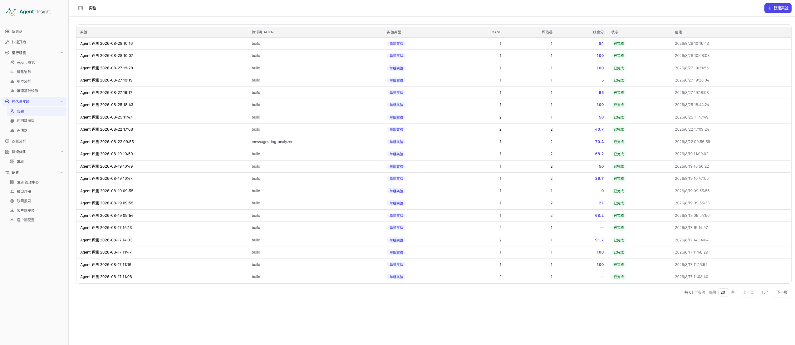
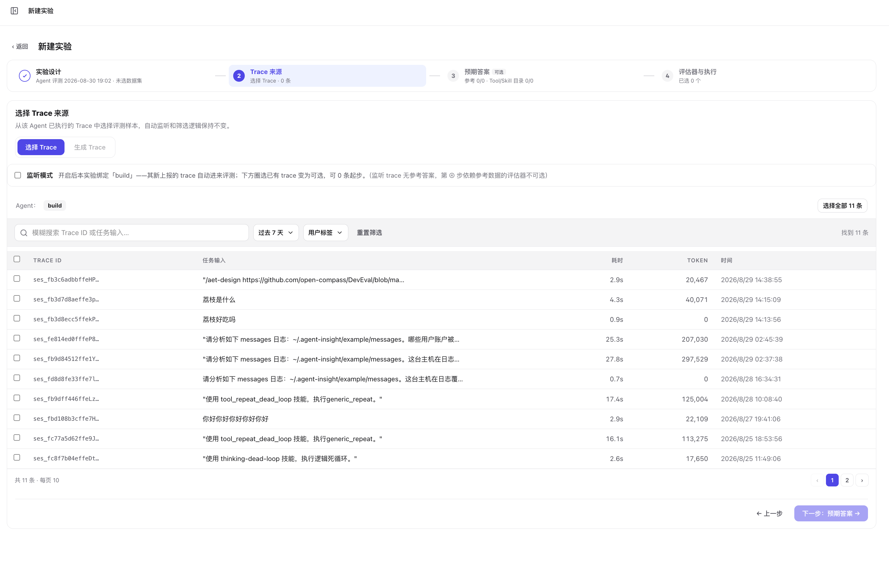
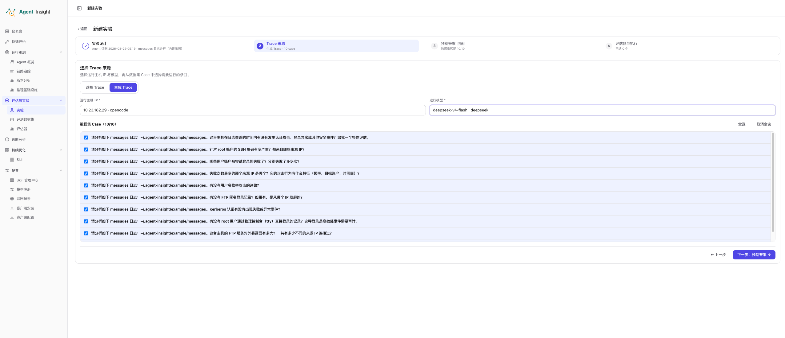
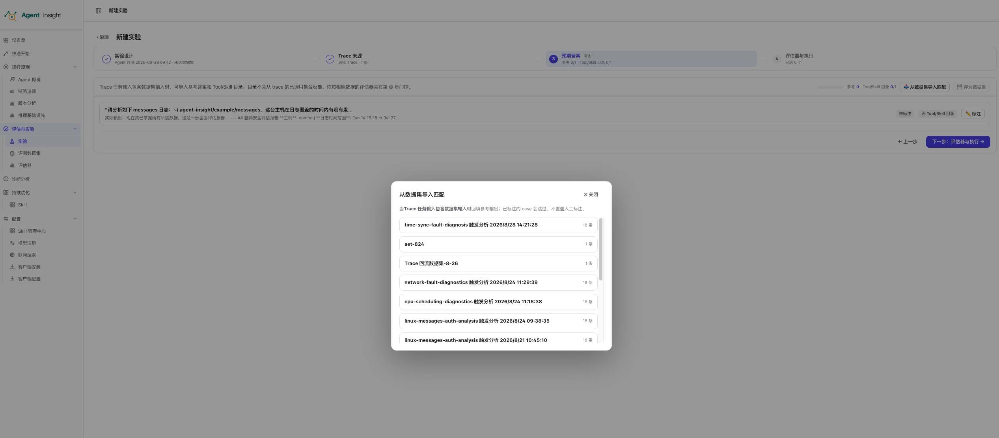
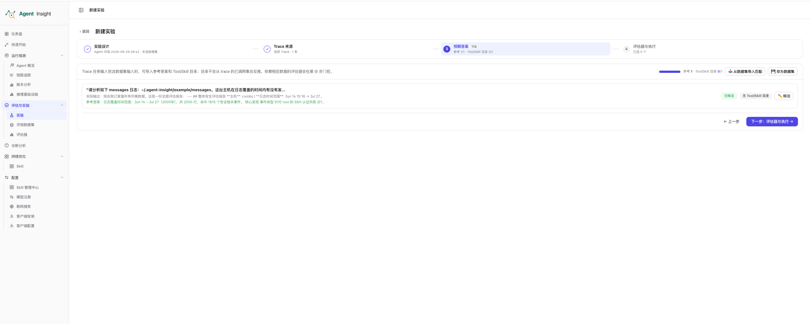
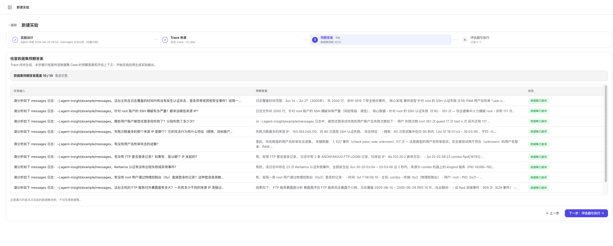
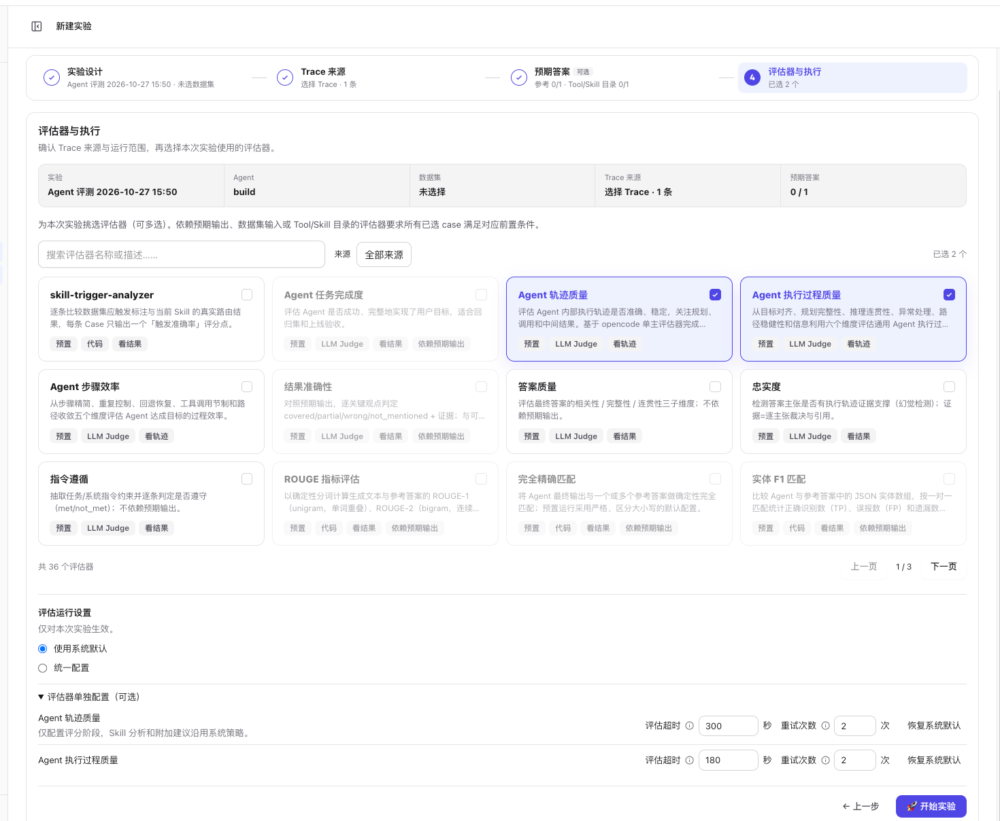
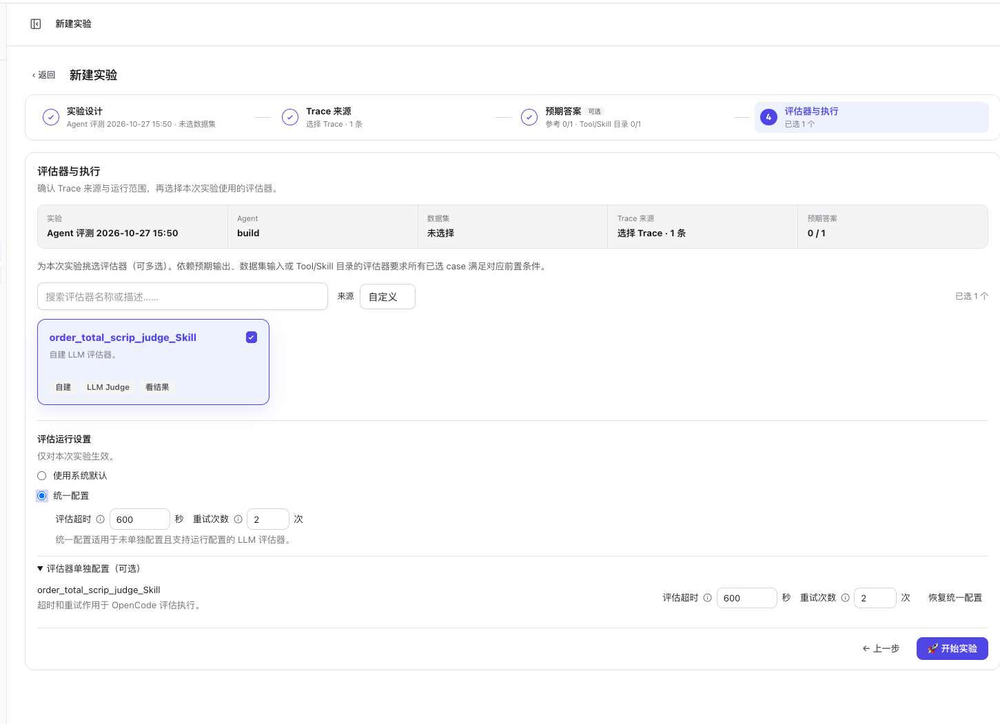
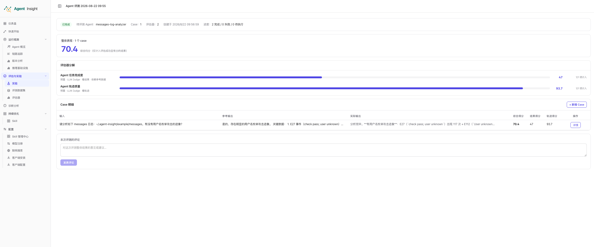
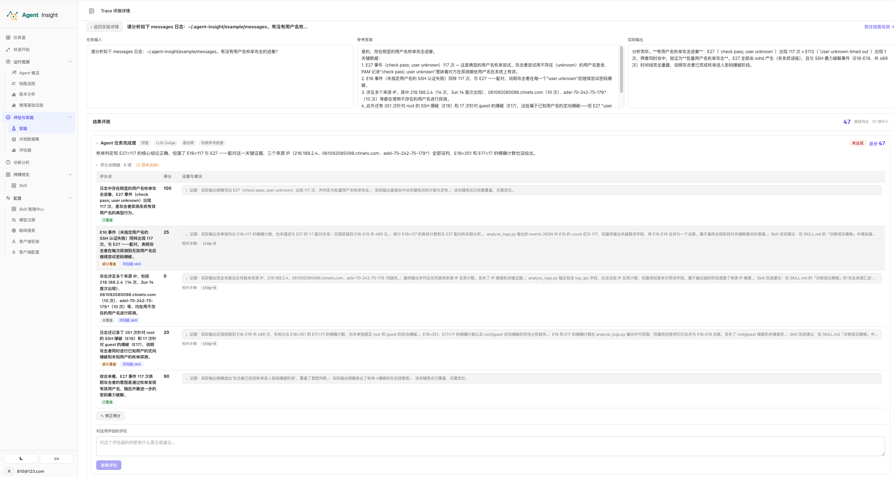

# 实验

实验用于把待评测 Agent、Case 和评估器组织成一次可追踪的质量验证。实验创建后立即开始执行，结果按实验汇总，并可继续下钻到单条 Case 的评估证据。

## 实验列表

进入 **评估与实验 → 实验**，可以查看当前账号下的实验记录。

<p align="center">
  
</p>

列表字段说明：

| 字段 | 含义 |
| --- | --- |
| **实验** | 实验名称；点击所在行进入实验详情 |
| **待评测 Agent** | 本次实验绑定的 Agent |
| **实验类型** | 当前为单组实验或 LLM 对比实验 |
| **Case** | 纳入实验的 Case 数量 |
| **评估器** | 本次实验使用的评估器数量 |
| **综合分** | 实验全部评测结束后，显示全部有效评估结果的平均分；运行中或没有有效分数时显示 `—` |
| **状态** | 运行中、已完成、部分完成或失败；至少一项成功且至少一项失败时显示“部分完成”，监听实验还会显示监听状态 |
| **创建** | 实验创建时间 |

列表支持每页 20、50 或 100 条，并可使用上一页、下一页翻页。点击右上角 **新建实验** 进入四步向导。

实验列表按当前页的实际记录数自然展开，内容超过窗口高度时可在页面内容区向下滚动，查看剩余记录及底部的分页栏，无需缩小浏览器。窄屏下可在表格内横向滚动查看右侧列，分页栏自动换行。

列表中的 **同配置实验** 会先按原实验的冻结配置检查本次数据集、主机和 Agent 所需的运行环境，通过后自动创建并运行新实验；**复用评测配置** 会把配置带入新实验向导，供你核对和调整。两个入口的新实验名称都默认使用“Agent 评测 + 当前日期时间”，不会把复用方式追加到名称中。历史默认格式的实验名称若带有“同配置”或“复用评测配置”后缀，列表和详情标题会按该实验的创建时间展示标准名称；原始记录不改动。配置可在实验详情中查看。

点击 **同配置实验** 后，按钮显示“环境检查中…”，检查通过直接启动。需要自动安装时显示“环境准备中…”，提示放在该实验行的操作按钮下方；只有实际进入首次耗时编译时，才提示“首次可能需要几分钟”。需要手动配置或准备失败时，该位置显示原因及执行机信息，按钮恢复为“重试”；在执行机完成配置后点击即可重新检查。检查和准备只锁定当前实验行的操作，其他行仍可操作。准备未通过不会创建新实验。纯已有 Trace 评测跳过执行环境准备；旧实验缺少可确认的数据集 Case 或执行目标时，使用“复用评测配置”重新确认。

创建 Benchmark 实验时，如果自建评估器配置无效或绑定的 Skill 快照缺失，会提示具体原因；请检查评估器及其 Skills 配置后重新创建。

创建后可在列表名称旁或实验详情右上角点击铅笔图标修改名称。名称须为 1～120 个字符，运行中和已完成的实验都可以修改；保存后列表、详情及趋势中的名称会更新，不改变实验配置和评测结果。带历史复用后缀的实验也可直接保存当前显示名称，或改成自定义名称。

## 四步创建实验

新建实验按照 **实验设计 → Trace 来源 → 预期答案 → 评估器与执行** 四步推进。步骤条会保存当前填写摘要，返回上一步不会清空已经完成的配置。

### 第一步：实验设计

在实验设计中配置：

- **实验名称**：本次验证的业务名称。
- **待执行 Agent**：候选项来自已有历史 Trace 的 Agent 与在线客户端可执行 Agent 的并集。
- **评测数据集**：可选；生成 Trace 时必须选择。
- **实验类型**：全局入口支持 **无变量 · 单组** 和 **LLM 对比**。

评测数据集列表与选择框左侧对齐，靠近窗口边缘时自动调整展开方向；列表较长时可在列表内滚动，较长的名称会换行完整显示。

单组实验适合基线评测、问题复盘和回归验证。LLM 对比会按相同任务输入，从目标 Agent 已有 Trace 中自动配对 A、B 两个模型取值；只有两侧都有有效分数的 Case 才进入可比统计。

### 第二步：选择 Trace 来源

单组实验支持两种来源。

第 1 步选择或更换数据集后，第 2 步默认展示 **生成 Trace**；清空数据集后默认展示 **选择 Trace**。普通数据集仍可手动切换到已有 Trace，返回步骤时保留手动选择。**复用评测配置**保留原实验的 Trace 来源；LLM 对比仍使用已有 Trace 配对，切回单组时按是否选择数据集设置默认来源。

#### 选择已有 Trace

**选择 Trace** 直接评估目标 Agent 已经产生的执行记录，不会重新运行 Agent。

<p align="center">
  
</p>

可用操作包括：

- 按 Trace ID 或任务输入模糊搜索。
- 按时间范围和用户标签筛选。
- 查看 Trace ID、任务输入、耗时、Token 和执行时间；执行过程异常请在诊断分析中查看。
- 分页浏览并跨页选择 Trace。
- 使用 **选择全部** 批量圈选当前筛选范围。
- 开启 **监听模式**，让该 Agent 后续新上报的 Trace 自动加入本实验评测。

监听模式允许不选择历史 Trace 直接创建实验。服务端约每 5 秒扫描数据库，不需要保持实验页面打开。自动加入的 Trace 必须属于当前用户、匹配所选主 Agent、状态为已完成，并且开始时间晚于监听开启时间；没有上报开始时间时使用首次入库时间。执行中、超时、失败、其他 Agent 和子 Agent Trace 不会加入，延迟上传或稍后才完成的 Trace 会在后续扫描中被发现。

监听只代替手动选择已有 Trace，不会重新运行 Agent 或修改原始 Trace。后续读取输入、输出、轨迹，调用评估器、正常重试及保存结果均复用手动评测流程。同一 Trace 在同一实验只加入一次，已有结果和人工评分不会被监听扫描覆盖。停止监听后不再加入新 Trace，已经开始的评测继续完成。

由于未来 Trace 没有逐条预期输出、数据集输入快照和 Tool/Skill 目录，依赖这些上下文的评估器在第 4 步不可选择。

#### 生成新 Trace

**生成 Trace** 使用数据集 Case 重新运行 Agent，再对新产生的 Trace 执行评估。

OpenCode 1.x 和 2.x 均支持普通数据集生成 Trace，客户端按本机版本选择执行方式。1.x 保留原有命令和插件接口；2.x 通过独立服务创建本次 Case 的新会话，使用原生插件事件回传会话 ID。两版均等待对应 Trace 上传并校验账号、客户端和模型后绑定 Case，进程结束本身不表示 Trace 已入库。2.x 输入以原文传入，不转换为 1.x 的 `--command`。更新后的常驻客户端也支持两版的 Skill 冻结快照与只读触发分析，详见 [Skill 执行兼容性](../../explanation/evaluation/skills/overview.md#opencode-执行兼容性)。

服务端更新后，在运行 OpenCode 的 Linux/macOS 用户下重新执行当前平台账号的一键接入命令，更新采集器与常驻客户端。操作系统用户名可以与平台账号不同，绑定以安装命令中的平台账号凭证为准。确认「客户端配置」中本机在线且 Agent 列表非空后再选择执行目标。

没有可选主机时，向导会区分未绑定客户端、客户端离线、尚未上报探测结果、Agent 列表为空和运行时不支持，并展示对应主机及原因。在线但探测失败不等同于离线，也不一定是客户端版本过旧。OpenCode v2 的 Agent 发现使用原生 API，不再调用已移除的 `opencode agent list`。模型列表来自本机配置与发现结果，能力检查不会验证模型密钥、余额或推理权限。

第二步点击“下一步”时，只检查本次数据集、主机和所选 Agent 需要的运行环境；无需等待客户端全量能力刷新。已满足时直接继续，可自动准备的组件完成安装并复查后自动继续；其他 Agent 的未就绪状态不会阻止本次实验。

浏览器整页刷新会重建向导，从第一步开始；重新确认相同配置并点击第二步“下一步”时，会查询保存的未完成任务，已经结束的旧检查会重新核对当前环境。若任务失效、主机或数据集发生变化，底部会提示重新点击“下一步”，不会自动换一台主机继续。断连后的结果由客户端恢复补报，不会仅因刷新页面重新编译安装。

预检不发送计费模型推理请求。普通 xiaoO 的原生默认凭据引用和加密库可读性检查目前仍不完整，预检通过不能视为这些凭据已验证可用。

普通 OpenCode 实验的模型预检按版本执行：1.x 检查原有配置及认证来源；2.x 使用客户端运行账号启动独立服务，读取原生可用模型目录。2.x 提示“无法读取原生模型目录”时，检查该账号执行 `opencode api --standalone model.list` 是否成功；提示“可用模型目录中没有所选模型”时，检查 provider 认证、模型启用状态和模型 ID。预检通过只表示本机能解析并提供该模型，不保证远端密钥有效、余额或推理权限。服务端修复预检后，需重新执行一键接入命令更新常驻客户端，再点击“下一步”。

OpenCode 1.x 的普通实验、Skill 实验和原生 OpenCode Benchmark 共用模型配置预检：依次使用显式选择、所选 Agent 默认模型、全局默认模型，检查 Agent 是否可作为主 Agent 执行、Provider 是否启用、模型是否在生效配置的 `provider.<供应商>.models` 中明确声明，或出现在 OpenCode 自身目录中，以及自定义连接地址、API Key、认证请求头和凭据引用是否完整。只检查本次所选模型连接，支持原生 OAuth、环境变量和本地免密连接。客户端正式执行前会按实际工作目录及环境再次检查，Skill 隔离或复用工作区也使用其实际生效配置；失败时不会启动 Case，也不会换用其他模型。

1.x 的 CLI 模型目录可能遗漏已配置的自定义模型。页面候选合并配置与原生目录，预检也接受生效配置中明确声明、连接与认证检查通过且未被禁用的模型，不再仅因 CLI 目录缺失而拒绝；未显式声明的模型仍必须存在于原生目录。Provider 的模型黑名单、白名单继续生效。2.x 使用原生 `model.list/model.default` 的启用状态，不使用 1.x 配置声明绕过原生禁用或缺失检查。

模型目录读取不强制刷新远程目录，不调用模型推理；预检通过不代表 Key 有效、余额充足、拥有模型权限或模型服务可访问。配置及模型目录读取的单条命令最多等待 60 秒，执行前异步检查整体最多等待 120 秒，可取消。此能力需更新并重启执行客户端后生效。

上述向导检查与开始实验后的 Case 环境准备不同：xiaoO 使用 xGovernor 执行时，创建会话仍会发送一次真实模型探测请求，等待上限为 60 秒；超时会在“准备执行环境”阶段报告，页面配置的 Agent 执行时限继续独立生效。使用旧版 10 秒时限的受管理 xGovernor 安装，更新客户端后还需重建 xGovernor：在新建实验向导第二步重新准备环境即可触发检查和重建。重装客户端只刷新运行时代码并保存安装上下文，不会自动编译 xGovernor；直接重试旧实验也不会执行该安装步骤。

也可在执行机手动重建当前兼容版本：

```bash
node "${AGENT_INSIGHT_HOME:-$HOME/.agent-insight}/client/runtime/xgovernor.cjs" update --version d08e67e366b89e622af9383383e251c4f40eb728
```

重建完成后等待客户端能力上报，并在新建实验向导重新确认执行环境；既有实验冻结的旧制品摘要不会自动迁移。

选择 Benchmark Case 时，列表上方会集中展示已选项；该区域默认最多显示 3 条，更多已选项可在区域内滚动查看，也可逐条取消选择或整体收起。

普通实验和 Benchmark 实验生成新 Trace 时，可设置“执行并发”（正整数，默认 1），表示本实验最多同时执行多少个 Case。配置在创建时冻结，复制实验会带入该值。并发大于 1 需要升级并重启执行客户端；同一客户端上的多个实验分别使用各自的并发配置，机器资源由用户判断。普通实验每次尝试使用独立临时目录，结束后清理；全局模型凭据和 Collector 配置继续复用，Agent 不应修改全局配置。Skill 实验与故障注入实验保留原有策略。

普通实验会等待本批 Trace 生成和重试完成，再评估成功的 Case；普通评估器继续使用共享的 4 条结果行并发。Benchmark 的执行与评测分别调度，执行结束即可释放执行名额，后续 Case 可继续运行；评测容量由管理员设置。评测服务默认会在 Agent 执行期间提前准备镜像，空间不足时仍可能等待镜像或镜像空间；镜像仓库连接临时中断时会等待重试。页面会区分等待配额、等待镜像、等待镜像空间与评测中。执行中或尚未完成评测的 Benchmark Case 数达到平台上限时，暂停启动新的 Case；已有任务继续运行，腾出名额后恢复。

Benchmark 官方评测并发独立于 Agent 执行并发，默认是 1。管理员可沿用原启动命令中的 `--evaluator-env EVALUATOR_MAX_CONCURRENCY=4` 将本次启动容量设为 4，无需修改命令格式或创建 YAML；启动日志与 `/health` 会显示生效值。已有 YAML 配置会被该显式参数覆盖，但文件本身不改写。镜像池和预取开关也可通过显式启动参数设置，详见[评测服务部署](./benchmarks/deploy-services.md#5-安装-evaluator)。

评测服务启动成功后会自动清理已登记、不再被当前版本需要的旧 Runtime 镜像，启动输出只显示检查和清理摘要，异常会显示原因；管理员也可在评测机项目目录执行 `bash scripts/evaluator.sh images purge`，在线清理空闲 Case 镜像和旧 Runtime，不停止正在运行的任务。加 `--dry-run` 可先预览，手动命令保留完整结果；当前版本需要、被容器引用或归属不明确的镜像会保留，详见[镜像清理](./benchmarks/deploy-services.md#11-立即停止与镜像清理)。

每个 Case 的 Agent 执行上限默认是 10 分钟，可在实验向导中配置为 30～3600 秒；达到上限仍未结束时，本次 Trace 生成按超时失败处理。该上限只约束 Agent 运行，不改变后续评估器各自的超时与重试规则。

<p align="center">
  
</p>

生成前需要满足：

- 第 1 步已经选择包含 Case 的数据集。
- 目标 Agent 存在在线、可执行且支持回传 Trace ID 的客户端。
- 已选择运行主机 IP 和该主机上报的可用模型。
- 至少勾选一个数据集 Case。

完成第二步后点击 **下一步**，系统按当前数据集、主机、Agent、模型和运行配置检查执行环境。已满足要求时直接进入第三步；缺少可自动安装的运行组件时会自动准备，复查通过后自动进入第三步。检查、自动准备及完成后的执行目标刷新期间，本步配置、上下步、步骤切换及页头“返回”暂时锁定；确认通过后只进入第三步，不自动返回实验列表。

状态只显示在第二步底部、上下步按钮上方，不增加准备卡片或详情入口。一般检查显示“正在检查运行环境”，快速准备显示“正在准备运行环境”；只有实际首次编译等耗时安装才提示“首次可能需要几分钟”。已安装的组件会复用，不会每次重新编译。

若缺少模型 API Key、系统权限或其他需要人工处理的条件，底部会说明原因。请使用客户端运行账号在提示的执行机完成配置，然后再次点击 **下一步** 重新检查；自动准备失败也通过同一个按钮重试。选择或切换主机本身不会安装依赖。纯已有 Trace 评测跳过环境准备；已有 Trace 仅作为输入、仍需重新执行 Agent 的 Skill A/B 实验仍会检查。

OpenCode 执行会实时识别运行时错误：鉴权或模型配置错误立即失败；连接故障进入重试时最多允许一次重试，收到第二次重试信号或首次错误后 10 秒内没有恢复有效输出/工具调用，就终止并展示原因。恢复输出后清除本轮错误计时，执行中途再次断连仍会检测。没有明确错误信号时，保留默认 90 秒首响应超时兜底，不把正常慢响应直接当失败。失败后不进入评测，也不自动更换模型。此机制由普通实验、Benchmark 和 Skill 客户端实验共享，升级并重启执行客户端后生效。

错误来自本次执行临时启用的事件插件，而非仅依赖 CLI 打印信息。插件通过独立通道传递当前根 Session 的原始重试/错误事件，不修改全局 OpenCode 配置，不影响手动使用。客户端给 OpenCode 最多 120 秒准备监测通道并创建根会话；若本次执行上限更短，仍以所配置的执行上限为准。首个模型响应的 90 秒兜底从会话创建后计时。初始化超时或进程结束仍无通道时，会显示实际失败原因，不把慢启动当成模型首响应超时。

Pi Agent 的普通生成 Trace 实验使用原生 CLI。以下 Pi CLI、模型发现和 Collector 说明适用于普通实验；SWE-bench Benchmark 的执行环境见下方“Benchmark 实验”。先按[Pi 接入说明](../platform/settings/access-control.md#流程四接入-pi-agent)安装并注册现有 Trace Collector，更新并重启 Reliability Client，再选择平台 `pi-agent`、根 Agent `pi-agent` 和运行主机。仅安装 `pi` CLI 不会开放实验能力；客户端还会检查 CLI 版本与参数、Collector 注册、启用状态、上传配置和 spool 可写性。Pi 实验能力独立于故障注入，不需要 Pi FI 组件，也不将 SubAgent profile 作为可启动目标。

Pi 模型配置仍读取运行用户的 `~/.pi/agent/settings.json`（默认 provider/model）、`models.json`（自定义模型）、`auth.json`（模型凭据）以及 provider 环境变量；设置 `PI_CODING_AGENT_DIR` 时使用该目录。模型列表由 `pi --no-approve --list-models` 发现，完整展示 Pi 在实验运行环境下列出的候选模型，标识为完整 `provider/model`；不增加白名单、不验证模型密钥有效性、余额或模型权限，也不逐个发起模型调用。发现失败时仍可选“平台默认”。

模型发现和实际执行共用同一启动方式：launchd/systemd 托管时按用户配置的 shell 加载登录交互环境，兼容 macOS/Linux 的 bash、zsh 等受支持 shell，不固定读取 `.zshrc`，不另外保存模型密钥。bash 由登录配置决定是否加载 `.bashrc`，zsh 按自身规则读取启动文件。仅在某个终端临时 export 的变量不会自动进入后台服务。CLI/模型探测按文件指纹缓存，Pi 配置修改触发下次能力刷新；修改 shell 环境或安装客户端后请重启客户端并刷新页面。

各平台共用的“运行模型”选择器支持按供应商、模型名称和完整 ID 搜索，采用大小写不敏感的字面包含匹配：输入内容必须连续出现在名称或 ID 中，例如 `deep` 会命中 DeepSeek，但不会命中字母分散在不同位置的模型。每个模型在列表中只显示一行友好名称，完整 ID 仍参与搜索、作为悬停提示并原样提交；相同 ID 会自动去重。搜索只筛选候选项，不改变已选模型；清空搜索恢复完整列表，方向键切换、Enter 选择、Esc 关闭，无匹配时显示提示。模型列表为空时仍保留“平台默认”；列表中的候选模型不代表平台保证调用成功，实际模型错误在实验执行时报告。

Pi 模型目录在后台异步发现，最多等待 20 秒，期间客户端继续发送心跳。成功列表缓存 5 分钟；探测失败会保留同一配置下上次成功的列表，并在 30 秒后的能力刷新中重试。初次启动尚未发现模型时可能暂时只有“平台默认”，能力上报后刷新页面即可。如果持续只有默认项，检查客户端日志中的 `Pi model catalog`：`ok models=0` 表示 Pi 自身列出的目录为空，`failed=TIMEOUT` 则表示探测超时，不能据此判断没有模型。

Pi 每次执行使用全新 Session，通过 stdin 接收 Case 文本；临时模型错误允许 Pi 自行重试，最终错误、无输出、超时或缺失完成事件会明确失败。实验绑定的是 Collector 的 `<session>__task0`，不是 Pi 原始 Session ID 或 OTLP span 哈希。进程退出不代表 Trace 已入库，平台仍等待既有 Collector 上传；本地 self-check 不验证远端网络和平台密钥有效性。Collector 未就绪时修复安装/配置后再运行，Trace 入库超时时检查上传端点、密钥及 spool。

实验使用 `--no-approve`，忽略 Case 仓库中的 `.pi` 项目资源与项目 Skill，保留全局 Collector/Skill。需要评测的 Skill 请安装到受控的全局位置；不要依赖 Case 中的 `.pi/extensions` 或项目模型覆盖。此选项只是项目信任策略，不是工具执行沙箱。

xiaoo 的普通生成 Trace 实验使用原生 CLI。以下 xiaoo CLI、密钥和 Collector 说明适用于普通实验；SWE-bench Benchmark 使用下方介绍的 xGovernor 后端。先使用现有 curl 安装流程完成客户端与 xiaoo Trace Collector 安装；更新客户端后重启服务，在 Agent 列表选择 `xiaoo · xiaoo · 可执行 N 台`，再选择对应运行主机。界面将 Collector 上报的 `xiaoo` Trace 身份与 CLI 原生 `defaultagent` 执行 ID 合并展示，实际执行仍使用 `defaultagent`。历史 Trace 中的 `xiaoo` 名称本身不表示该机器已具备实验执行能力。平台与运行主机可以分开部署，继续使用客户端安装时配置的平台地址。

客户端要求 xiaoo CLI 支持 JSON 输出、Agent 和标题参数；模型 `provider/model` 会拆为 xiaoo 的 provider 和 model 参数。执行错误、模型鉴权失败、无输出和超时会回写为明确失败，原有 Trace Collector 继续负责上传轨迹。若 CLI 返回 HTTP 401，请修复运行主机上的模型鉴权配置后重跑 Case。

xiaoo 执行过工具但最后没有文字回复时，不应被判为“无输出”。客户端会在正常退出后结合本次会话的 Collector 活动记录判断；真正无活动、明确执行错误、超时或 Benchmark 必需 Patch 为空仍然失败。升级此修复需同时更新客户端与 xiaoo Collector，并重启客户端服务；此前误判失败的 Case 需重新运行，不会自动恢复。

xiaoo 实验复用运行主机上同一系统用户已有的配置和密钥。由 launchd/systemd 托管时，客户端通过用户的登录交互 shell（如 zsh/bash）启动 xiaoo，读取已配置在 shell 启动文件中的环境变量；xiaoo 继续自行读取原生密钥存储及 provider 默认变量。无需再次录入 API Key，也无需额外创建模型环境文件。请确保终端 TUI 与客户端使用同一用户；只在某个未保存的终端会话内设置的变量无法由新 shell 恢复。配置中的 TOML 行尾注释可以保留。升级后需重新安装/更新客户端及 FI 组件，再重新创建实验，旧实验冻结的错误模型标识不会自动更新。

模型按完整的 `provider/model` 标识执行；页面在模型名旁展示 provider，避免同名模型混淆。开始实验后，系统等待新 Trace 完整入库，再运行评估器。

xiaoo 实验成功但没有链路跟踪时，需区分模型鉴权和 Trace 上传鉴权：Collector 使用的是平台安装密钥，不是模型 API Key。Collector 优先读取当前安装的 `ras/config.json` 上传配置，只有该文件不存在时才兼容旧 FI 配置；显式环境覆盖必须同时提供平台密钥与地址，不能拼接不同来源的配置。可先执行 `node scripts/install-ras.js --check`，检查会校验 xiaoo Collector 运行文件、Hook 插件与 `config.toml` 挂载。更新后可在源码目录执行 `node scripts/xiaoo-trace-collector/install.js` 仅更新 xiaoo Collector，再退出并重新打开 xiaoo，让新的 Hook 命令生效。无需重配模型或修改其他 Agent。

实验 CLI 与 TUI 的无会话 ID 事件按 xiaoo 进程隔离；同一进程同时有多个活动会话时，缺失会话 ID 的事件会跳过并记录提示，不会猜测归属。旧版全局会话缓存不再使用，已串线的历史缓冲不会自动重放或修复，验证请新建实验。

正常退出 xiaoo 后，Collector 会随最终上传携带明确的 Trace 完成标记，平台据此写入会话结束时间并显示“已完成”。若旧版本上传的 Trace 已有完整回复却长期显示“执行中”，更新 Collector 后的新 Trace 会恢复；旧记录需按实际退出时间一次性校正，不会自动猜测。

#### Benchmark 实验

原生 Pi/xiaoO 的新建 SWE-bench 实验使用 **xGovernor 本地 Docker**：每个 Case 在独立工具容器中修改仓库，模型请求仍由宿主机控制器发出。工具容器断网，资源限额约束工具容器。普通实验、OpenCode 与 MCTS 保留原有执行方式。

Case 镜像已包含源码和安装环境，Pi/xiaoO 直接在镜像的 `/testbed` 中工作，不重新拉取源码，也不要求仓库保留 origin。执行端保留镜像构建时的安装提交，以镜像初始 HEAD 为基线生成 `model.patch`；数据集的 `base_commit` 仍用于确认镜像包含正确的任务基线。Agent 创建的 commit、尚未提交的修改、新增与删除文件都会纳入最终 Patch，镜像原有安装修改和 `model.patch` 文件自身不作为提交物。初始工作树不干净或不包含任务基线时会明确失败，不自动删除镜像中的文件。

已有 `model.patch` 但评测提示 `Evaluator Entrypoint` 找不到模块（如 `runtime-image.cjs`），说明评测运行镜像缺少依赖，不能据此判断 Agent 修复失败。管理员更新评测服务及 Runtime 后，点击“Benchmark 重评”即可复用已有 Patch，无需重跑 Agent。该问题不需要开放执行容器网络或调整权限。

沙箱命令失败时，Case 页面会显示失败阶段、操作、退出码和可识别的安全原因，例如 Git 仓库缺失、权限不足、磁盘已满或镜像基线不匹配。本地对应 `xgovernor-runs/<runId>/diagnostic.json` 保存同样的脱敏诊断，沿用 Case 日志保留期限；原始命令参数、stderr 中的路径、URL 和凭据不会显示或写入该诊断。历史失败记录不会自动补齐，更新后需要重跑 Case。

在客户端安装页选择 Pi/xiaoO，执行原有的一条 curl 命令即可。客户端注册后自动准备编译依赖、拉取平台固定版本的 xGovernor 源码并编译；重复安装会复用已通过校验的同版本组件。缺失的系统编译依赖在支持的发行版上通过包管理器安装，需要 root 或可用的非交互 sudo；Node/Rust 必要时安装到客户端独立目录。执行机仍需可访问的 Docker Linux daemon 和 cgroup v2，不自动修改内核启动参数或重启。安装失败会明确显示 Benchmark 未就绪，处理后重跑同一命令。用户无需手工启动 xGovernor、配置 YAML 或修改 systemd，平台和 Evaluator 无需安装它。

旧客户端若出现“Pi 在返回模型探测结果前退出”，可能是旧安装编译后移动目录造成扩展路径失效。先升级平台，再重新执行客户端安装页生成的 Pi/xiaoO curl 命令；安装器会自动识别并重建旧制品，无需手工删除安装目录。重建后环境摘要会变化，请新建或复用实验并重新确认执行环境，再运行 Case。更新平台和执行端客户端后，新失败记录会在 Case 顶部、实验内 Case 列表摘要及评测结果显示明确原因，例如“模型预检查超时”“模型认证失败”“所选模型不存在或不可用”“无法连接模型服务”“模型服务请求受限”“模型服务响应格式异常”，并给出处理提示。无法识别的响应显示“执行环境请求失败（HTTP 状态码）”；历史记录若只保存了 HTTP 400，不能据此补推具体原因。模型预检查超时表示会话创建前的检查未及时完成，与 Case 的 Agent 执行超时不同；当前 xiaoO 预检查仍为 10 秒。

需要调整 CPU、内存、准备超时或镜像来源时，curl 安装版统一编辑 `~/.agent-insight/config/executor.local.yaml`；自定义 `AGENT_INSIGHT_HOME` 时使用 `$AGENT_INSIGHT_HOME/config/executor.local.yaml`。安装器会创建目录并提示路径，文件可按需创建，客户端升级不会覆盖它。旧的 `client/runtime/config/` 下的用户配置不再读取，也不会自动迁移；需要保留的设置请写入新路径，其中相对路径按新目录解析。源码运行仍使用项目内的 `config/benchmark/executor.local.yaml`。

Benchmark 的本地日志和运行记录默认保留 **7 天**，从 Case 进入终态开始计时。客户端启动时及之后每小时检查一次；只有任务已结束、资源清理成功、Artifact 与 Trace 没有待上传内容，并已成功回调平台（或已取消）时才删除。正在执行、待上传、待清理或状态无法确认的记录继续保留，平台上已入库的结果和 Trace 不受影响。在上述用户配置文件中可设置：

```yaml
retention:
  days: 14
```

`days` 必须为正整数，修改后在下一轮清理检查生效。清理只涉及客户端的 `benchmark-runs/` 和对应 `xgovernor-runs/` 本地目录，不清理 Docker 镜像。xGovernor 安装版本在客户端执行空闲时清理：当前版本、上一版本和仍被未完成清理的 Case 引用的版本始终保留，其他版本超过同一保留期限后删除。旧记录缺少终态时间或上传确认时也会保留。

模型沿用实验中的选择。Pi 从原有 `models.json`、`auth.json` 和登录环境解析；xiaoO 从原有 `config.toml` 的 `[llm]` / 启用的模型 Profile 解析，凭据沿用同目录加密库 `llm_secrets.json`（原生 `api_keys`、`tokens` 优先级）和环境变量；未显式指定 `api_key_env` 时使用原生 provider 的默认引用。不要求把已保存在 xiaoo 中的 Key 再导出到 shell。选择默认模型时使用 Agent 原有默认配置。新机器仍须完成一次原有 Agent 的模型配置；无需再配置 xGovernor 的模型 Key。Pi 内置模型的兼容参数正常沿用，模型的推理能力、输入类型、上下文和输出 Token 上限同步传入执行会话；只有与同版本内置目录不同、当前桥接无法保留的自定义 headers/兼容参数才报出具体字段。Pi OAuth/订阅认证仍不支持。xiaoO 沿用 `[llm].max_tokens`，并将 `reasoning_effort` 传给每轮请求；当前支持 `off/high/max` 及原生别名（例如 `xhigh` 对应 `max`），未配置时使用 Runtime 默认值。`kvcache_enabled` 和 `kvcache_debug_enabled` 未配置或为 `false` 可执行，显式设为 `true` 会提示当前 xGovernor 契约不支持，不会忽略配置后继续运行。Trace 上传复用 curl 安装保存的采集认证。

凭据解析失败时，Case 详情和实验列表会分别提示“未取得模型凭据”“原生凭据库读取失败”或“模型凭据适配未就绪”，显示具体原因及处理方式。此时尚未向模型发请求，不代表 Key 无效或模型服务不可用。旧客户端缺少原生凭据桥接时，更新平台并重跑安装页生成的 curl 命令即可自动构建；无需手工配置 xGovernor Key。构建会更新执行环境摘要，请新建实验选择更新后的环境。原生免 Key 模型若受当前 xGovernor 桥接限制，会明确提示不支持该认证方式。

MCTS 的 xGovernor 保持独立：不接管其进程、源码、配置或版本；原生执行端每个 Case 使用自己的动态端口、状态目录和 Docker 标签。两者共享机器资源，需合理控制并发。

创建 Benchmark 实验时，若没有可用执行主机，“生成 Trace”步骤会逐台显示已发现客户端的未就绪原因，例如“Docker 或 cgroup v2 未就绪”、客户端离线或缺少执行能力。未就绪客户端不可选；该步骤每 10 秒及页面重新获得焦点时刷新状态，修复环境并恢复客户端后可重新选择主机。没有任何候选客户端时显示通用连接提示。

创建确认页与详情显示冻结的版本提交。受管理安装自动记录实际版本并刷新环境摘要，无需手动维护 `sourceRevision`；客户端正常联网时约在下一轮能力上报生效。已运行 Case 继续使用原版本，旧实验尚未运行的任务若与当前环境摘要不一致，需要重新创建并确认。原生模型配置和凭据在每次任务准备时重新读取；轮换 Key 不改变执行环境摘要。

平台和执行客户端需同步升级。执行环境就绪与模型凭据检查分开：环境未就绪不会回退宿主机，所选模型在任务准备阶段校验。模型候选默认沿用该 Agent 的模型目录；高级手动 Profile 的显式模型映射仍可覆盖。执行与评测分别维护镜像拉取实现，当前默认顺序相同：先查本地缓存，再依次尝试 SWR、配置代理和官方仓库；SWR Verified 镜像适用于官方 x86_64，ARM64 跳过这些仓库。两端分别读取各自的 `benchmarks.swe-bench.images` 配置，不自动同步配置。执行与评测仍使用独立容器，不强制两端 digest、image ID 或架构相同；评测保留原有预热流程。因此不保证两端基础镜像内容完全相同。

确认页展示所选执行环境、工具网络和资源；实验创建后冻结 Profile。配置摘要变化时需重新创建并确认。详情保留冻结环境，执行完成后还可查看实际镜像、隔离边界与清理状态。Trace ID 为 `xgovernor:<runId>`；上传与评测继续沿用现有流程。旧版 Pi/xiaoO 的 SWE-bench 待执行任务应重新创建，不自动迁移。

Benchmark 全部 Case 及评测结果进入终态后，实验会结束：全部成功显示“已完成”，成功与失败并存显示“部分完成”，全部失败显示“失败”。Agent 执行失败时，Case 中会标明原因。只有仍有排队、执行或评测任务时才保持“运行中”；重试 Case 后重新进入“运行中”。“已完成”表示评测流程结束，SWE-bench 的 Resolved 结果仍可能为否。

在线且已就绪的 Benchmark 专用执行器会直接出现在“待执行 Agent”列表，不需要先产生历史 Trace。MCTS 展示为 `mcts-coordinator`，其 `pi-mcts` 执行器不支持普通生成 Trace；选择它执行新任务时需搭配 SWE-bench Benchmark 数据集。

选择受控导入的 Benchmark 数据集后仍使用同一套四步向导，但必须生成新 Trace，不能选择已有 Trace 或开启监听。系统会按接入包声明自动绑定对应 Evaluator，并显示其名称、判分用途、运行方式和主指标；还可追加不依赖参考答案的普通评估器。

SWE-bench 可以选择 `mcts-coordinator` Agent，与链路追踪中的根执行 Agent 同名；对应的执行平台为 `pi-mcts`，客户端内部仍使用 `pi-mcts` 调度。模型选择“平台默认”；MCTS 使用部署时配置的 xGovernor 模型。每个 Case 使用独立运行 ID 和输出目录，页面关联 MCTS 的根 Trace，并将最终选中的 Patch 作为 `model.patch` 提交。首次使用需由管理员在执行机配置 MCTS、Trace 代理及客户端，在 xGovernor 主机准备 Pi 和 E2B；两者可以分机部署，步骤见 [MCTS 接入指南](../observability/mcts-xgovernor.md#用于平台-benchmark-实验)。采集通过 MCTS xGovernor 透明代理完成。平台创建页直接显示并保存 MCTS 搜索参数，README 的快速验证参数只用于联调。MCTS 会执行自己的最终节点官测，平台收到 Patch 后仍按 Benchmark 配置执行平台评测；请按实际运行时间提高 Agent 超时。Agent 超时覆盖 MCTS 命令从启动到退出的全部时间；链路从首次 xGovernor 调用开始记录，前面的数据集加载等准备耗时可能未展示。有 Trace 或某个分支给出 Patch，不代表最终 `model.patch` 已提交。中断后的根 Trace 显示执行失败，Case 保留具体超时原因。

选择执行主机后，支持通用配置的目标会显示 **Agent 运行参数**。参数区默认展开，可通过标题右侧的 **收起 / 展开** 按钮切换；收起保留当前参数和编辑状态，参数错误仍会显示。有默认配置时复制到本次草稿，没有默认配置时从 `{}` 开始；编辑草稿不会修改客户端默认配置。所有目标统一提供 String、Number、Boolean、Object、Array、Null。点击 **添加对象**，或将字段类型改为 **Object**，即可点击该行的 **添加子字段**；Array 可添加、删除和排序元素。MCTS 默认值虽然平铺，也可手动添加嵌套字段。平台不自动分组、拆分或重命名，`/`、`.` 等字符保持完整 Key；字符串不会被自动解析成对象。切换到 **JSON 编辑** 可编辑同一份完整草稿。

**导入 JSON** 支持粘贴和上传文件，先展示差异，点击 **应用导入配置** 后整体替换本次草稿；取消不影响当前值。根节点为对象，限制为 256 KiB、32 层，重复 Key、非法 JSON 等通用错误阻止应用，原草稿保留。导入可包含任意合法嵌套结构，默认配置的形状不限制它。**导出** 下载完整草稿；**查看最终配置** 展示将保存和下发的完整对象。个人模板保存为不可变修订，应用只修改本次草稿。**恢复默认** 显式重新复制执行机当前上报的默认值；自动更新默认值不会覆盖正在编辑的内容。切换主机保留各目标的独立草稿。

MCTS 默认模板包含七个平铺 CLI 参数，Key 省略 `--`：`max-iters / branching / max-turns-init / max-turns-step / max-turns-author / max-turns-author-step / token-fuse-limit`，默认值为 `5、3、160、80、160、80、30000000`。联调配置可通过 JSON 导入并保存为普通参数模板，参数模板仍按同一 Runtime 筛选。这些只决定初始展示，不限制通用编辑器新增字段、嵌套对象或数组。平台允许保存和下发完整配置；客户端在启动前按 MCTS 实际接口检查，当前 CLI 不支持的嵌套值、非法参数或调度 flag 会明确报错，不会自动改写。执行端已支持的新 CLI 业务参数填写同名 key/value 即可，不改平台代码。

参数随实验保存完整快照，删除字段和显式空对象不会重新补默认值。已有实验及客户端默认配置不因编辑本次草稿而改变。复用时保持原 Key、层级和类型；客户端契约变化时先确认完整原配置用于新草稿，平台不推断别名转换。业务参数是否可执行由客户端判断。

平台和执行客户端首次启用本能力需同步升级；旧逐字段协议仅作兼容。OpenCode 暂不显示运行参数编辑、模板入口、执行摘要和详情页配置快照，原生配置接入完善后再开放。已有实验的参数数据保留。

Benchmark 的 Case 字段、主指标和评估器文案来自接入包 Presentation。实验详情的 Case 明细表使用独立的“执行进度”列替代“参考契约”列；点击进度可查看等待调度、准备执行环境、Agent 执行、整理提交物、准备评测、执行评测和汇总结果。当前步骤转圈、完成步骤打勾，失败或取消后停止转圈，后续步骤显示“未执行”；导入提交物时执行阶段显示“无需执行”。Agent 执行不进一步拆分。该步骤提供“查看主 Agent 链路”入口，在新标签页打开本次 Case 已关联的主链路；尚无关联时显示“主 Agent 链路尚未关联”，导入提交物时不显示此入口。提交物列只展示产出文件，无文件时显示“尚未生成”。单个 Case 详情页保持原有布局与参考契约展示。

Case 详情完整展示本次运行的所有提交物与评测证据：配置命中的文件使用友好名称和顺序，未命中的新文件仍按原名显示；文本、JSON、Diff、图片和 PDF 可直接查看，其余格式可下载。

进度弹窗显示总耗时和当前流程最近上报时间；只有存在可靠的阶段开始时间才显示阶段耗时。执行中连续 5 分钟没有新上报时提示“进度更新延迟”，尚未首次上报时从该流程启动时间计时，正常排队不触发此提示。阶段上报不等于心跳，延迟不代表任务失败，最终失败或超时以服务端状态为准。页面轮询失败时显示“状态刷新失败”，保留上次状态并继续尝试刷新。

归一化评分点直接按 `label/value/total/format` 展示，不从证据内容推断业务指标。重试 Case 会重新执行完整 Agent 与评测链路；单独重评 Benchmark Evaluator 时复用该 Case 最新有效提交物。Agent 执行和 Evaluator 使用各自冻结的超时。需要部署独立 Evaluator Controller 时，参见 [Benchmark 服务安装指南](./benchmarks/deploy-services.md)。

ZSoft 已生成 PoC，但评测镜像安装 Python 依赖失败时，请管理员按 [ZSoft 部署指南](./benchmarks/deploy-zsoft.md) 检查包源并更新评测服务。修复后点击“Benchmark 重评”即可复用现有 PoC。

若提示“ZSoft 提交物描述与当前任务不匹配”，请管理员检查平台与评测服务的版本及提交物交接配置；若提示提交物大小或 SHA-256 不一致，则检查文件下载和存储完整性。修复后可用“Benchmark 重评”复用原 PoC，这类错误不代表 PoC 已被正式判定无效。

Benchmark 实验的 Case 列表按实际执行阶段显示进度：尚未轮到的 Case 显示“等待开始”，下发和 Agent 执行分别显示对应状态；执行器准备 Git 工作区时显示“正在准备 Git 工作区…”，其他工作区类型使用通用的“正在准备执行环境…”。这些状态不表示所有 Case 同时运行，也不代表 Git 拉取百分比。

### 第三步：预期答案

第 3 步用于确认每条 Case 的预期输出、数据集输入快照和评估上下文。

#### 选择已有 Trace：从数据集导入匹配

选择已有 Trace 时，点击 **从数据集导入匹配**，可以从已有数据集中选择匹配来源。

<p align="center">
  
</p>

系统使用 Trace 的任务输入与数据集 Case 的 `input` 进行匹配：只要任务输入确定性包含数据集 `input`，就会导入对应的预期输出、数据集输入快照和 Tool/Skill 目录；多条输入同时命中时，优先选择更长、更具体的一条。已经手工标注的 Case 会被跳过，不会被导入操作覆盖。

导入后，页面顶部会统计预期输出、数据集输入快照和 Tool/Skill 目录的覆盖数量；Case 中会显示导入的预期输出及 **已标注** 状态。

<p align="center">
  
</p>

这一条路径还可以：

- 手工填写预期输出。
- 将已经整理的预期输出和能力目录存为新数据集。

#### 生成 Trace：检查已有数据集

若 Agent 在创建 Session 前启动失败，Case 展示 plugin_start_failed 等实际平台错误；这类任务不会进入评分，原始启动日志保存在执行机的运行 artifacts 中。 OpenCode 插件启动默认等待 120 秒；若仍在运行、插件已安装且没有业务 Session、激活或标准输出证据，会先停止旧进程，再随机退避后重试一次。已有有效本地模型目录时，重试优先使用缓存，不改模型或 provider 配置；已有执行证据或明确退出的错误不自动重放。启动、退避和执行共用本次超时预算，重试用尽后明确失败。

OpenCode v1 会在退出前保存结束事件并触发 Trace 上传，不必等待下一次启动补传。

FI 任务全部结束后，无有效 Trace 的 Case 会标记生成失败；有效 Case 的评估仍会完成，实验显示部分完成。RAS 内部判定轨迹归属系统，Trace 列表选择用户时不展示，选择全部或系统时展示；它不参与业务 Trace 选择，已完成的判定轨迹仍按账号设置进行二次分析。

生成 Trace 时，数据集已经在前面的步骤选定。第 3 步不再执行输入匹配，而是展示创建实验时冻结的数据集快照，供你检查每条 Case 的任务输入、预期答案和覆盖情况。

<p align="center">
  
</p>

这里显示的是本次实验的数据快照，不是可回写的原数据集；在实验中调整预期输出，不会修改评测数据集页面中的原始内容。

两条路径的区别是：

| Trace 来源 | 数据集的作用 | 第 3 步操作 |
| --- | --- | --- |
| 选择已有 Trace | 数据集可选，用于给已选 Trace 补充预期输出、数据集输入快照和 Tool/Skill 目录 | 选择数据集并按任务输入匹配，也可手工标注或存为数据集 |
| 生成 Trace | 数据集必选，用于提供待运行的 Case | 检查已选数据集的冻结快照和预期答案覆盖情况 |

> **Note**
> 预期输出和数据集输入都不是所有评估器的必需项。缺少相应上下文的 Case 仍可执行，但依赖它们的评估器会被禁用或不记分。

### 第四步：评估器与执行

最后一步展示本次实验的冻结摘要，并选择评估器。全局实验可以选择预置评估器和自建评估器。

<p align="center">
  
</p>

图中选择了 **使用系统默认**：Agent 轨迹质量显示 300 秒、2 次，Agent 执行过程质量显示 180 秒、2 次。展开 **评估器单独配置（可选）** 后仍可直接修改各行，点击 **恢复系统默认** 可恢复对应评估器的默认值。

摘要区用于最终核对实验名称、Agent、数据集、Trace 来源、预期答案覆盖率以及运行主机和模型。下方每张评估器卡片会标明评估方式、评估对象和数据依赖；勾选框可用时可以多选，条件不满足的评估器不可选择。

评估器会按自身要求检查全部已选 Case：

- 引用 `{{reference_output}}` 时，全部 Case 都需要预期输出。
- 引用 `{{dataset_input}}` 时，全部 Case 都需要匹配到数据集输入快照。
- 工具类评估器需要完整的 `available_tools` / `available_skills` 目录。
- 可靠性专用评估器只适用于可靠性数据集。
- 监听模式下，依赖逐条上下文的评估器不可用。

卡片上方可按名称或描述搜索，并按内置、自定义或当前可用的 Benchmark 来源筛选；每页最多展示 12 个。翻页或筛选不会取消已选项，右侧“已选”统计所有页面。

卡片下方的 **评估运行设置** 仅对本次实验生效：

- **使用系统默认**：使用各评估器自己的超时和重试数值，默认值可能不同。
- **统一配置**：对支持配置且未单独设置的 LLM 评估器应用同一组数值。首次展开为 600 秒、2 次，可修改。
- **评估器单独配置（可选）**：两种模式下都可展开，在已选评估器对应行直接修改。未修改行显示系统默认或统一配置；修改任一字段后，该行两项数值一起成为单独配置。
- 每行的 **恢复统一配置** 或 **恢复系统默认** 始终可点击，清除该行单独配置并恢复两项数值。切换模式保留已有单独配置，取消勾选评估器会清除它的单独配置。

**评估超时** 为每条 Case、每个评估器的单次尝试上限，具体作用范围见评估器行内说明，允许 30～3600 秒整数；**重试次数** 为失败后额外尝试次数，允许 0～3 次整数。600 秒、2 次表示最多尝试 3 次，每次重新获得 600 秒。成功评分（包括低分）不会重试；取消、鉴权及不可恢复配置错误也不会自动重试。输入无效时会提示并阻止开始实验。手工重评继续累计实际执行次数，重置为待执行状态本身不增加次数；联网核实的单次搜索失败可降级，但整轮评估超时或取消仍会终止该次尝试。

单独配置区域包含全部预置 LLM 和自定义 LLM 评估器，包括带 Skills 的自定义项。任务完成度、轨迹质量和 RAS 的配置只作用于评分阶段；带 Skills 自定义项只限制 OpenCode 评估执行时间，不含排队、准备和服务启动。代码和 Benchmark 官方评估器显示不支持配置的原因，混选时仍保留提示，详见[评估器运行配置范围](./evaluators.md#实验中的超时与重试)。Agent 执行上限与这里的评估超时分别配置。

<p align="center">
  
</p>

图中按 **自定义** 来源筛选，选择带 Skills 的评估器，并使用统一配置的 600 秒、2 次。下方对应行当前使用同一组数值；直接修改该行即可形成单独配置，点击 **恢复统一配置** 则重新使用上方数值。这里的 600 秒约束一次 OpenCode 评估执行中的模型和工具调用；2 次表示失败后最多额外重试两次，正常评分（包括 0 分）不会触发重试。

修改随 **开始实验** 一起提交，没有单独的确认修改弹窗或区域保存按钮。至少选择一个可用评估器后，点击 **开始实验**。服务端确认已进入执行流程后才会跳转详情；如果启动尚未被接受，临时记录会回滚并保留向导内容，便于修正后重试。已创建实验的评估策略会冻结，手动重新评估沿用保存的策略；不包含新配置的历史实验保持原行为。

## 查看实验详情

实验详情用于查看整个实验的运行状态和聚合结果。

普通单组实验的 Case 明细表提供“执行进度”入口，保留输入、预期输出、实际输出和得分。点击后查看等待调度、Agent 执行、等待 Trace 入库、执行评测、结果就绪；已有 Trace 的实验跳过执行阶段。评测步骤可以展开各评估器状态，Agent 执行不进一步拆分，单个 Case 详情页布局不变。

链路可以在 Agent 执行中提前关联。已有链路不表示执行成功：模型错误、超时等执行失败仍显示在 **Agent 执行**，后续步骤显示未执行；执行成功后等待上传失败才显示在 **等待 Trace 入库**。此判断同样适用于 Skill 触发、用例与 A/B 实验。旧页面已显示错误阶段时，刷新页面可重新读取修正后的阶段。

普通实验与 Benchmark 都会在执行中关联本次主 Agent 链路。尚未收到根链路时显示“等待本次主 Agent 链路关联”，收到后尚未入库时显示“主 Agent 链路上传中”，唯一主记录入库后即可打开，无需等待 Agent 执行结束。MCTS 入口固定指向本次 coordinator 根链路，搜索过程中子节点增加不会改变入口；原生 Pi/xiaoO 沙箱持续上传运行中快照，结束后补齐最终轨迹。更新平台后也需重新安装更新客户端，使提前上报与沙箱快照代码生效。

生成 Trace 的实验显示“第 N 次执行”。点击重试先显示“正在提交重试”，服务端受理后切换新轮次；排队期间撤下旧链路，新主执行记录入库后显示“查看本次主 Agent 链路”，在新标签页精确打开该记录。仅重试评估器会保留 Agent 链路。客户端返回了历史轮次的 Trace ID 时，会明确报错，不关联旧链路。

运行期间每 2 秒串行刷新，打开进度弹窗、页面恢复焦点和重试受理后立即请求刷新。展示以客户端现有状态和入库结果为准：任务已下发但尚未收到执行上报时显示“等待客户端开始执行”，收到 `RUNNING` 后进入 Agent 执行。不根据时间推测执行阶段。旧轮次或过期响应不能覆盖当前进度、链路和 Case 结果；状态刷新失败时保留最后可信结果并继续尝试刷新。自动重试等待时显示“等待重试”，重新执行后使用新的轮次。

点击实验详情内容区域左上方的 **返回实验列表**，可以回到实验记录列表。

<p align="center">
  
</p>

页面主要区域包括：

### 状态与进度

顶部显示实验状态、待评测 Agent、Case 数、评估器数、创建时间和完成/失败/待执行数量。已保存执行上限的实验还会显示“Agent 单次执行上限”，单位为秒，取本次实验冻结的配置。生成新 Trace 的实验还会显示所选运行模型（未指定时显示“平台默认”）及 Trace 已生成、生成中和失败数量；复用已有 Trace 的实验可能包含不同模型，不显示单一运行模型。

运行中的实验会自动刷新，不需要手工刷新页面。

### 整体表现

**综合均分**在全部 Case 的已选评估器都结束、实验状态变为已完成或部分完成后才显示。全部评估成功时为“已完成”，成功与失败并存时为“部分完成”，全部失败时为“失败”。最终分数只统计状态成功且有数值分数的结果：

- 评估失败不按 0 分计算，但会使实验进入“部分完成”或“失败”状态。
- 无分结果不进入分母。
- 保存人工修正后，聚合分使用人工分，机器原分仍保留展示。

### 评估器分解

每个评估器分别展示均分和计入数量。由此可以判断综合分下降来自哪个评分维度，而不是只查看一个总分。

### 同评测基线趋势

已完成、非监听的普通单组实验和 Benchmark 实验会展示最多 50 次同基线趋势。普通实验使用综合得分，Benchmark 使用接入包声明的主指标及聚合名称。

普通实验只比较数据集、Case 集与 Case 契约、Trace 来源和评估器配置都相同的记录；Benchmark 只比较 Benchmark、数据集内容版本、Case 集、Evaluator 和协议都相同的记录。Agent、模型和执行客户端可以不同。横轴按实验时间从旧到新排列，默认窗口展示最近 10 次；历史超过 10 次时可从下拉框选择最多显示最近 10、20 或 50 次，再通过底部时间窗口缩放或平移。悬停、聚焦或点击节点时，底部摘要会跟随显示该点的日期、指标、Agent、模型及相较前一次的变化；节点浮层中的“查看实验详情”和底部历史实验入口都会进入该点对应的实验。仅有当前一次时显示空状态。A/B 实验暂不展示该趋势。

### Case 明细

Case 表格并排展示输入、参考输出、实际输出、综合分、结果得分和轨迹得分。单个 Case 的结果得分会等待全部已选结果评估器结束，轨迹得分会等待全部已选轨迹评估器结束，综合分则等待该 Case 的全部已选评估器结束；未选择的结果或轨迹评估项不需要等待，对应列显示 `—`。评估失败或无分结果在全部评估结束后不进入相应分数的分母。点击 **详情** 进入单条 Trace 评测详情。

Case 明细按当前页的实际行数自然展开，纵向滚动由整页统一承载；每页条数增加时，表格随之增高，最后一页不足设定条数时自动缩短。总数、每页条数选择和翻页控件始终显示。页面地址保存当前页码与每页条数，刷新页面或浏览器后退时恢复。

从明细行进入 Case 详情后，点击 **返回实验详情** 会保留每页条数，按该 Case 当前所在位置返回对应分页，滚动到该行并短暂高亮。直接打开 Case 链接时也会定位；若期间有 Case 被删除，则重新计算位置，目标已删除时回到有效分页并提示。Case 详情顶部不再重复提供删除入口；请在实验 Case 明细表的操作列使用 **删除／停止并删除**。

Benchmark Case 的失败提示会区分存储错误和模型错误：`ENOSPC` 显示“执行端存储空间不足”，需检查执行客户端对应挂载点的空间和 inode；`EDQUOT` 显示“执行端存储配额不足”，需检查存储配额。两者都属于无分的执行失败，不代表模型调用失败或补丁未解决题目。修复对应客户端的资源条件后，再手动重跑失败 Case。

旧记录若被归为 `MODEL_ERROR` 等通用执行错误，但错误详情明确包含 ENOSPC 或配额不足，页面会显示存储错误类别，并标注“原始码”以便追溯。数据库中的原始错误和已有评分不变；历史提示的修正随平台更新生效，新任务的准确上报还需要更新并重启执行客户端。

Case 行的 **重试** 由 Trace 来源决定：

- 选择已有 Trace 的实验保留当前 Trace，只重试失败评估。
- 生成 Trace 的实验会重新执行 Agent、绑定新 Trace，再运行该 Case 的全部评估器。

点击 **新增 Case** 可以从当前实验绑定 Agent 的 Trace 中追加样本，并立即使用实验既定评估器运行。若评估器依赖预期输出，可在追加时补充标注；若依赖数据集输入，新增 Case 也需要完成数据集匹配。

### 实验级评论

评论用于记录本次实验整体结论和协作意见，不影响评分。

## 查看单条 Case 详情

Trace 评测详情把输入、输出和评分依据放在同一页，适合核查一次具体判断。

普通实验执行失败时，Case 详情顶部直接展示失败原因；Benchmark 详情按当前执行和评测状态展示失败原因，即使已经生成提交物或关联 Trace 也会显示。失败信息同时保留在执行进度弹窗中；重试或重评开始后不再展示上一轮的失败提示。

<p align="center">
  
</p>

### 输入与输出

页面顶部并排展示：

- **任务输入**：Agent 接收到的真实输入。
- **参考答案**：数据集导入或人工填写的期望结果。
- **实际输出**：本次 Trace 的最终输出。

点击 **前往链路观测** 可以查看完整执行 Trace。

### 结果评测与轨迹评测

评估器按 **结果评测** 和 **轨迹评测** 分类展示。类目标题显示类目均分与实际计入的评估器数量。

每张评估器卡片首先展示一句话结论和总分；展开后可以查看：

- 评分点名称和单项得分。
- 证据、相关步骤与改进建议。
- 未达标评分点数量。
- 单个评估器结果的重评入口。
- 人工修正和修正理由。
- 该评估结果的评论。

评估失败时显示错误原因并提供重评，不会把失败结果按 0 分纳入均分。

### 人工修正与评论

人工修正必须填写理由。保存后，实验、类目、评估器和 Case 的聚合分都会使用人工分重新计算。

评论分为三种范围：

- 实验级评论：记录整次实验的意见。
- Case 级评论：记录当前样本的整体意见。
- 评估结果级评论：针对某一个评估器判断提出意见。

评论不会改变分数。

## 典型使用方式

### 复盘线上问题

选择已有 Trace，复用真实输入、输出和执行轨迹。按需导入预期输出与数据集上下文后运行评估，适合确认问题究竟来自结果还是过程。

### 固定题库回归

选择数据集并使用生成 Trace。保持 Agent、数据集和评估器不变，在版本调整后重新创建实验，用于比较回归结果。

### 持续监听

在选择 Trace 模式中开启监听，只使用不依赖逐条参考上下文的评估器。后续新 Trace 会自动进入同一实验，适合持续观察稳定性。

## 停止并删除

实验列表和 Case 列表中，已结束的实验或 Case 显示“删除”，进行中的显示“停止并删除”。确认后，条目从默认列表移除；进行中的任务会请求终止正在执行的 Agent 和评测，排队、重试和自动追加不再启动。删除一个 Case 不会停止其他 Case。

远端主机离线或执行退出尚未确认时，页面显示“停止待确认”，平台会继续重试。若提示客户端不支持停止指令，需要在执行机更新并重启客户端；平台会在重启后重试确认。列表隐藏不等于执行器已经退出，也不会回滚 Agent 已产生的外部操作。

更新后的执行客户端会持久保存普通实验 Trace 生成任务的进程状态；客户端重启后核查遗留进程并继续确认停止。若旧客户端运行时没有留下进程记录，页面会明确提示“旧客户端未保存执行进程状态”，这类历史任务不能仅凭重启自动标记为已停止，需要先核查执行机进程。

这是逻辑删除：源数据集、Skill 版本、共享 Trace、日志和缓存镜像保留。被删除的 Case 不计入本实验成绩；删除最后一个 Case 后，实验也会自动删除，页面返回实验列表。只评测已有 Trace 时，不会终止产生该 Trace 的原业务进程。

长期不用 Benchmark 评测服务时，可在评测机停止服务并清理受管镜像，见[部署指南](./benchmarks/deploy-services.md#11-立即停止与镜像清理)。这与删除平台实验是两个独立操作。

## 后续阅读

- 准备和维护 Case：[评测数据集](./datasets.md)
- 查看评估器前置条件：[评估器](./evaluators.md)
- 返回总览：[评估与实验](../../explanation/evaluation/overview.md)

普通数据集及 Skill 生成 Trace 的入库等待独立限制为 60 秒。`TRACE_INGEST_TIMEOUT` 保留本次 Trace ID，停止自动执行重试；修复采集或上传后再选择恢复或手动重新执行，避免因上传延迟反复调用 Agent。Skill 结果页将此阶段显示为“等待 Trace 入库”。
