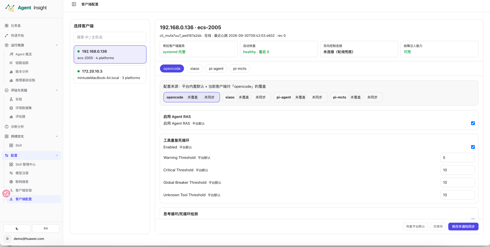
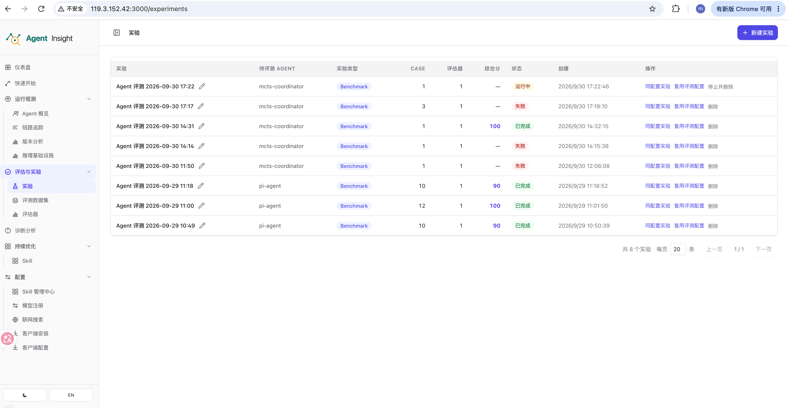
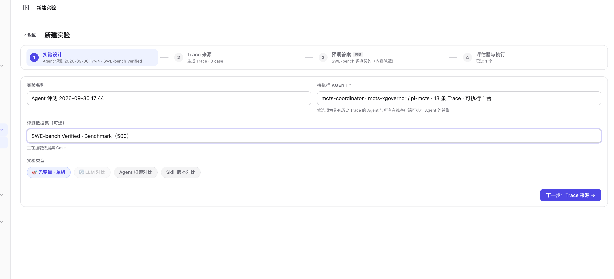
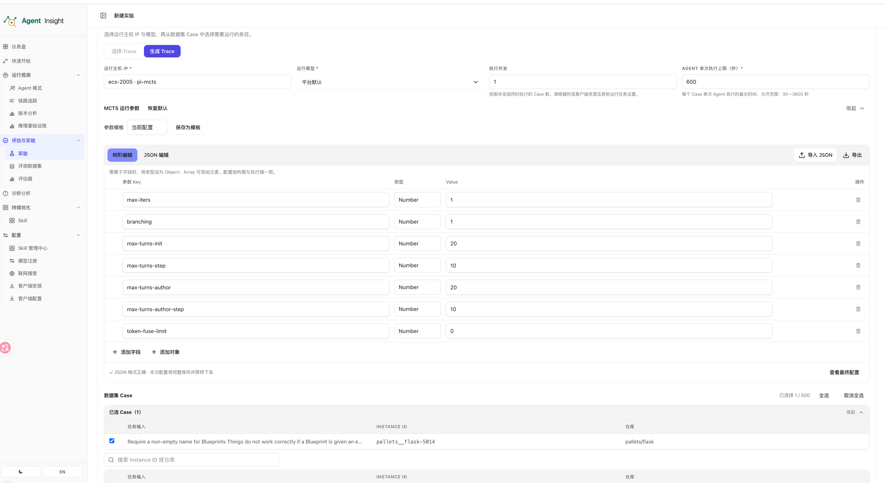
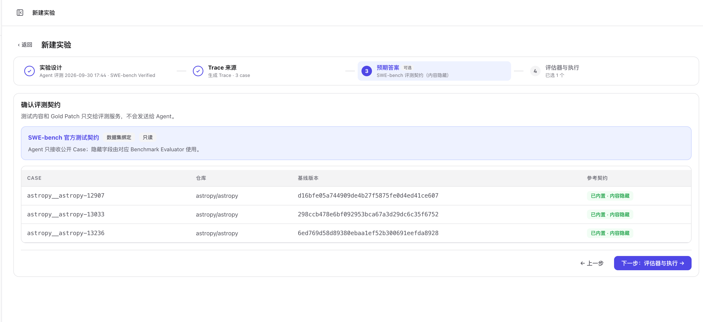
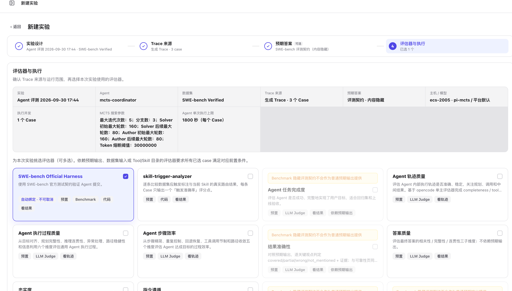
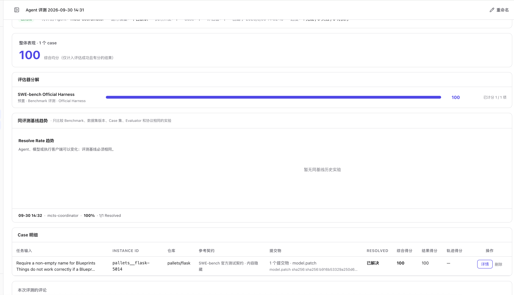
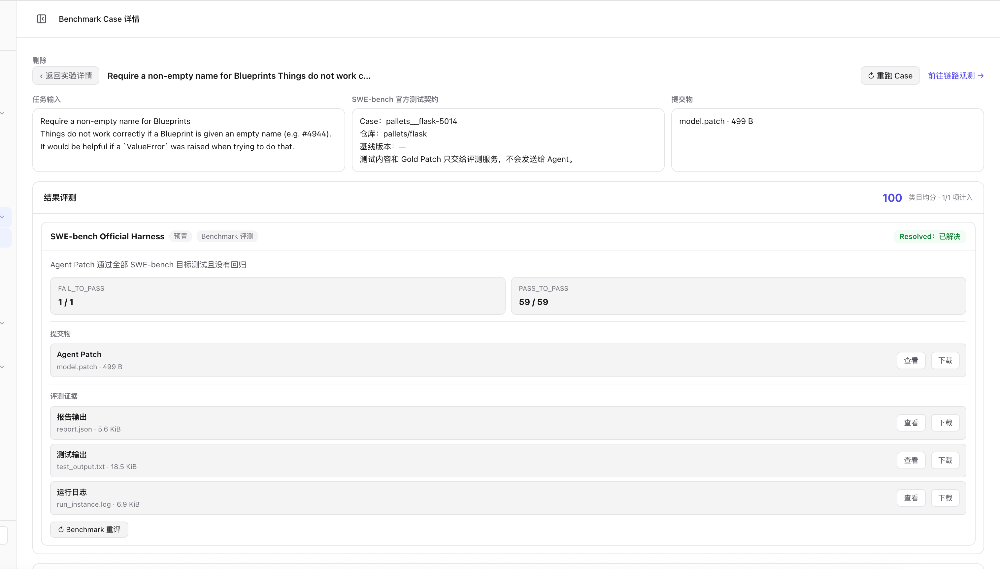
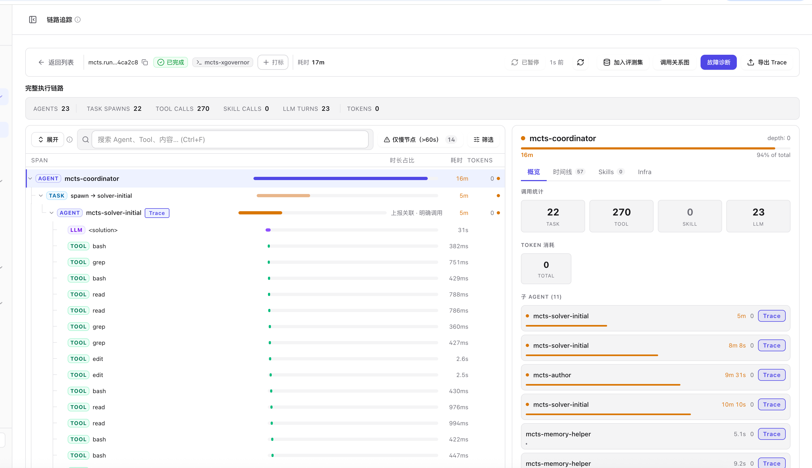

<a id="mcts-实验用户使用说明书"></a>
适用于已部署 MCTS 和 xGovernor 的使用者。**所有终端命令在 MCTS 执行机上执行**；文中及截图中的地址、目录和主机均为示例，请使用自己的配置。

## 1. 接入前准备

- MCTS 原始命令能够正常运行，支持输出目录隔离和中断清理。
- 执行机已安装 Git、Node.js 22.19.0+，MCTS 使用 Python 3.11+。SWE-bench 还要求该环境安装 `datasets` 并提供 `run_union.sh`；ZSoft 不依赖这两项。
- 平台已导入所需 Benchmark 数据集，Benchmark 评测服务可用。

确认 MCTS 的 `testcases_union/config.env` 已配置可访问的 xGovernor，安装器会沿用这份配置。模型和 E2B 凭据由 xGovernor 部署者配置，详见 [MCTS 接入指南](../observability/mcts-xgovernor.md#用于平台-benchmark-实验)。

## 2. 一次命令完成接入

1. 进入 **配置 → 客户端安装**，勾选 **MCTS (xGovernor)**；只接入 MCTS 时取消其他框架。
2. 填写执行机上的 **MCTS 仓库绝对路径**，例如 `/opt/MCTS`，复制 Linux 命令。
3. 在 MCTS 执行机上，以运行客户端的系统账户执行完整命令。

```bash
curl -sSf "https://insight.example.com/api/ingest/setup?key=<当前账号的APIKey>&yes=1&frameworks=mcts-xgovernor" | AGENT_INSIGHT_MCTS_REPO_DIR='/opt/MCTS' bash
```

以页面生成的命令为准。安装器检查仓库、Python 版本和 xGovernor 连接；客户端再分别探测 SWE-bench 与 ZSoft 能力，安装采集器，将路径保存到 `~/.agent-insight/.env`，最后注册并启动客户端。**无需再编辑配置或手动重启**；检查失败时先处理提示，再重新执行同一命令。

安装器复用 MCTS 的连接和凭据配置，不改动 MCTS 仓库。默认使用 `<仓库>/.venv/bin/python`；仓库外的解释器可由部署者预设 `AGENT_INSIGHT_MCTS_PYTHON`。正常安装不需要设置 `mctsTraceLauncher`。

## 3. 确认客户端在线

进入 **配置 → 客户端配置**，确认执行机在线、服务健康，并显示 `pi-mcts`。



*图 2：客户端在线。截图当前打开的是 `opencode` 页签，检查 MCTS 时点击 `pi-mcts`。*

## 4. 创建并执行实验

进入 **评估与实验 → 实验**，点击 **新建实验**。



*图 3：新建实验入口。*

### 4.1 实验设计

填写实验名称，选择 **`mcts-coordinator`**、所需的 **Benchmark 数据集（SWE-bench 或 ZSoft）**和 **无变量 · 单组**，点击 **下一步**。

以下截图以 SWE-bench 为例；运行 ZSoft 时选择 ZSoft 数据集，后续操作相同。



*图 4：实验设计。*

### 4.2 Trace 来源与执行参数

1. 选择 **生成 Trace**，运行主机选择配置好的 **`pi-mcts`** 执行机，模型使用 **平台默认**。
2. 按需设置执行并发、单次执行上限和 MCTS 参数；可选择同 Runtime 的参数模板，也可通过 **导入 JSON** 填入配置、**保存为模板** 供后续复用。
3. 勾选要执行的 Case，点击 **下一步**。首次运行建议选择一个 Case，并发设为 `1`。

点击下一步后，平台会在所选执行机检查当前数据集与 Agent 对应的环境。MCTS 使用自己的接入检查，不会因为选择 SWE-bench 就安装原生 Pi/xiaoO 的本地 xGovernor。需人工处理的问题显示在本步底部，完成执行机配置后再次点击下一步；通过后自动进入第三步。



*图 5：设置运行参数并选择 Case。*

### 4.3 预期答案

确认选中的 Case 和只读测试契约，点击 **下一步：评估器与执行**。无需填写 Gold Patch；隐藏测试与 Gold Patch 不会发送给 Agent。



*图 6：确认评测契约。*

### 4.4 评估器与执行

核对配置摘要，确认所选数据集对应的 **Benchmark 评估器** 已自动绑定（图中为 SWE-bench Official Harness）。首次联调可只保留该评估器，向下滚动后点击 **开始实验**。



*图 7：核对配置并开始实验，按钮位于页面底部。*

## 5. 查看结果与链路

### 5.1 实验结果

打开实验详情查看进度和 Case 结果。**已完成**表示评测流程完成，是否解决任务以 **Resolved** 为准；执行失败时点击 Case 的 **详情**查看错误。



*图 8：单条 Case 通过评测的结果示例。*

### 5.2 最终 Patch 与评测证据

在 Case 明细点击 **详情**，查看或下载 **`model.patch`**、评测报告和日志。MCTS 从多个分支中选择最终 Patch，客户端自动上传，无需手工提交。

ZSoft 的提交物为 **`poc`**。“评测证据”保留官方原始 `evaluation.json`、`record.json`、评测及清理日志，以及 `judge-evidence/`、`public-feedback/` 内的全部输出文件。文件夹可点击展开，文件可查看、下载；点击 **完整官方输出** 下载保留目录结构的 ZIP。空日志也保留，失败时仍可查看已经生成的输出。旧实验不会自动补齐完整报告，需点击 **Benchmark 重评**。



*图 9：提交物、评测证据与右上角链路入口。*

### 5.3 链路追踪

点击 Case 详情顶部的 **前往链路观测**。根 Agent 为 **`mcts-coordinator`**，展开 TASK 和子角色可查看模型、工具调用及耗时。



*图 10：MCTS 执行链路。*

有 Trace 不代表已完成提交；确认实验成功时还需检查最终 `model.patch` 和平台评测结果。

## 6. 失败处理与重新执行

| 操作或问题 | 处理方式 |
| --- | --- |
| 找不到 MCTS 执行主机 | 检查客户端在线状态、`.env` 仓库路径和重启结果 |
| `Missing datasets package` | 在 MCTS 实际使用的 Python 环境中安装 `datasets` |
| 没有 MCTS 搜索参数 | 确认选中 SWE-bench 数据集和 MCTS 主机，并更新客户端 |
| `AGENT_TIMEOUT` | 通过 **复用评测配置**增加执行上限，或减小搜索参数后创建新实验 |
| `MCTS_LLM_INSUFFICIENT_BALANCE` | 模型服务明确返回余额或付费额度不足，检查所用账户或渠道后重跑 Case |
| `MCTS_LLM_OUTPUT_TRUNCATED` | 输出达到 token 上限，写文件工具可能未执行；缩短单次输出或分段写入，并核对有效输出限额 |
| 环境修复后重新执行 | 点击 **重试 / 重跑 Case**，沿用原实验参数 |
| 已有 Patch，评测阶段失败 | 点击 **Benchmark 重评**，使用已有提交物重新评测 |
| 需要中止执行 | 使用平台停止入口；中断时尚未生成 Patch 的 Case 可能没有提交物 |

不同 Case 可以同时提交 **Benchmark 重评**，复用已有提交物，不重新执行 MCTS。首次评测和重评共用评测服务的并发容量；例如服务配置 `EVALUATOR_MAX_CONCURRENCY=4` 时，合计最多同时执行 4 个评测，其余自动排队。若管理员配置了单用户并发配额，还需遵守该配额。同一 Case 在重评完成前不能重复提交。重评会自动触发镜像准备，镜像尚未就绪时显示等待并自动重试。

**Trace 耗时与执行上限的计时范围不同。** Trace 可能未包含首次 xGovernor 请求前的准备时间；Case 总耗时还包含工作区准备和中断清理。判断是否超时，以 Case 的错误说明和配置上限为准。

客户端会优先显示已观察到的模型余额不足、输出截断等错误，不再只保留最后的文件缺失或 404；多个原因可以同时展示，并保留根 Trace 关联。这里不增加任务重试或更改模型配置。需更新客户端和 MCTS 采集器（重新执行页面生成的安装命令）；已有失败记录不会自动改写。若外部 xGovernor 将底层模型错误吞掉并报成空的成功轮次，平台只能展示实际收到的证据，不能由 404 推断余额不足，也不会读取外部 Pi 原始会话或修改 MCTS/xGovernor。

## 相关指南

- [实验功能说明](./experiments.md)
- [MCTS xGovernor Trace 接入指南](../observability/mcts-xgovernor.md)
- [Benchmark 服务安装指南](./benchmarks/deploy-services.md)
