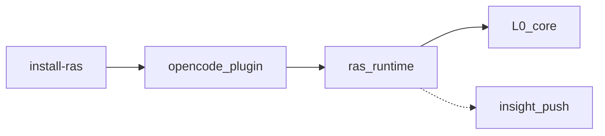

<a id="opencode-接入"></a>
同进程：`ras_runtime` + bun:ffi；能力为 partial（非 jiuwen 同级 chunk abort）。

**inproc 如何加载 libpython、模块如何互相调用**：见 [architecture.md §4](../../../explanation/reliability/agent-ras/architecture.md)。

## 架构



## 安装

在 Agent Insight 仓库根：

```bash
npx agent-insight install-ras
# 开发：node scripts/install-ras.js
# 检查：node scripts/install-ras.js --check
```

安装器写入 `~/.agent-insight/ras/`，合并 `ras-judge` 等到 OpenCode 配置。详细步骤见源码旁 [`platform_adapter/opencode/INSTALL.md`](https://gitcode.com/openeuler/agent-insight/blob/master/agent_ras/platform_adapter/opencode/INSTALL.md)。\
看板 curl / `npm pack` / 本机目录树与数据源见 [local-install-process.md](./local-install-process.md)。

判定 Agent 的模型由 OpenCode 的 agent.ras-judge.model 独立指定，当前模板使用 zhipuai-coding-plan/GLM-5.2。该模型需在本机 provider 中可用；业务默认模型变化不会自动覆盖已有判定模型配置。修改后新建会话生效。

## 启动与能力配置同步

插件先读取本地能力配置并返回 OpenCode Hook，再在后台向平台同步配置。平台暂时不可达时沿用本地配置，不等待远程同步完成才打开 Agent；同步成功后更新本地快照，尚未初始化的后续会话使用新快照，已经 hello 的会话不在中途重建。

配置请求的总等待上限为 3 秒，包含读取响应正文。超时会中止请求；访问本机平台仍绕过 HTTP 代理，并使用异步 curl，避免占用 OpenCode 的事件循环。同步失败会保留原配置。

这项修复仅处理 Agent RAS 插件自身的平台配置同步。OpenCode 启动时若因 npm 包仓不可达而等待插件依赖下载，仍需按宿主版本和缓存状态排查；不会自动关闭更新或修改 npm 配置。

## 注意

- 仅 inproc；不启本地 RAS 端口或守护进程
- 语义 Judge 默认开；可在配置中关闭
- 旁路事件 fail-open；UI 契约见 developer-guide

配置见 [01-getting-started.md](../../../tutorial/reliability/agent-ras/01-getting-started.md)。
